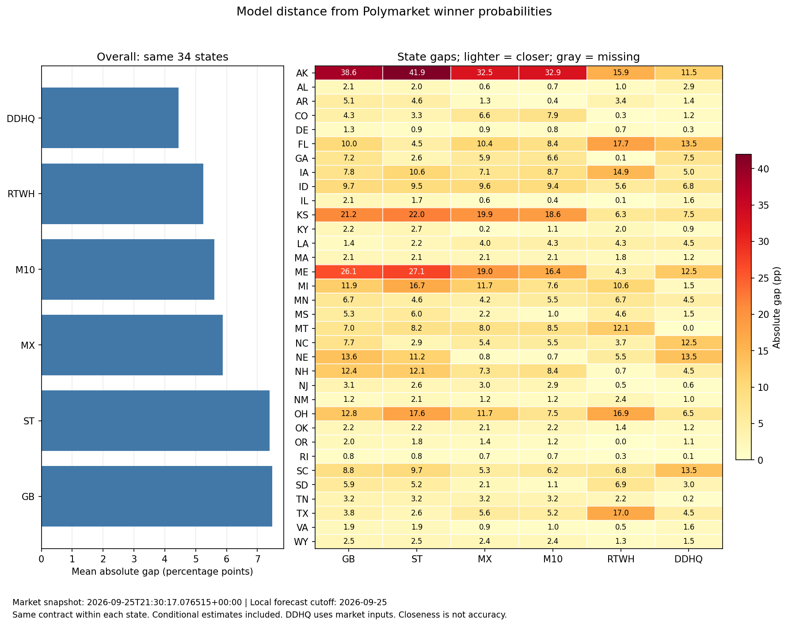

# Model alignment to Polymarket winner probabilities

Winner contracts only; no margin, seat-total or control markets. Market probability is the Yes best-bid/ask midpoint, before fees; it is not an executable purchase price or ground truth. All mapped winner contracts are considered, not just profitable trades. Each state uses one shared contract: maximize model coverage, then reported liquidity, then narrower spread, then contract ID. This avoids counting Yes/No and alternative winner contracts as independent observations. The headline ranking uses only states covered by every selected model, with equal weight per state. Mean absolute gap is the average absolute probability difference in percentage points; lower means closer. The available-coverage table is descriptive and uses different state sets. State rankings show ties and exclude missing models. Conditional settlement estimates remain included and flagged; unavailable probabilities are not imputed. DDHQ includes market inputs, so closeness is not independent validation or evidence of better forecasting.

Snapshot: 2026-09-25T21:30:17.076515+00:00. Our forecast cutoff: 2026-09-25.

## Overall: identical state coverage

| Model   |   States |   Mean gap (pp) |   Signed gap (pp) |   Conditional |
|:--------|---------:|----------------:|------------------:|--------------:|
| DDHQ    |       34 |            4.44 |              1.15 |             0 |
| RTWH    |       34 |            5.25 |              1.75 |             0 |
| M10     |       34 |            5.60 |             -1.07 |            13 |
| MX      |       34 |            5.88 |             -0.97 |            13 |
| ST      |       34 |            7.40 |             -2.14 |            13 |
| GB      |       34 |            7.48 |             -1.92 |            13 |

## All available coverage (different state sets)

| Model   |   States |   Mean gap (pp) |   Signed gap (pp) |   Conditional |
|:--------|---------:|----------------:|------------------:|--------------:|
| DDHQ    |       34 |            4.44 |              1.15 |             0 |
| RTWH    |       34 |            5.25 |              1.75 |             0 |
| M10     |       34 |            5.60 |             -1.07 |            13 |
| MX      |       34 |            5.88 |             -0.97 |            13 |
| ST      |       34 |            7.40 |             -2.14 |            13 |
| GB      |       34 |            7.48 |             -1.92 |            13 |

## Per-state ranking

† Some models are missing; they are excluded from that state ranking. * marks a conditional estimate.

| State   | Closest   |   Gap (pp) | Farthest   |   Far gap (pp) |
|:--------|:----------|-----------:|:-----------|---------------:|
| AK      | DDHQ      |      11.50 | ST*        |          41.94 |
| AL      | MX        |       0.61 | DDHQ       |           2.85 |
| AR      | M10       |       0.43 | GB         |           5.11 |
| CO      | RTWH      |       0.25 | M10*       |           7.88 |
| DE      | DDHQ      |       0.30 | GB*        |           1.25 |
| FL      | ST        |       4.53 | RTWH       |          17.70 |
| GA      | RTWH      |       0.10 | DDHQ       |           7.50 |
| IA      | DDHQ      |       5.00 | RTWH       |          14.90 |
| ID      | RTWH      |       5.60 | GB*        |           9.75 |
| IL      | RTWH      |       0.10 | GB*        |           2.14 |
| KS      | RTWH      |       6.30 | ST         |          22.02 |
| KY      | MX        |       0.20 | ST         |           2.68 |
| LA      | GB        |       1.40 | DDHQ       |           4.50 |
| MA      | DDHQ      |       1.15 | GB         |           2.15 |
| ME      | RTWH      |       4.30 | ST*        |          27.13 |
| MI      | DDHQ      |       1.50 | ST         |          16.67 |
| MN      | MX        |       4.18 | RTWH       |           6.70 |
| MS      | M10       |       0.97 | ST         |           5.99 |
| MT      | DDHQ      |       0.00 | RTWH       |          12.10 |
| NC      | ST        |       2.86 | DDHQ       |          12.50 |
| NE      | M10*      |       0.72 | GB*        |          13.57 |
| NH      | RTWH      |       0.70 | GB         |          12.43 |
| NJ      | RTWH      |       0.45 | GB*        |           3.13 |
| NM      | DDHQ      |       0.95 | RTWH       |           2.35 |
| OH      | DDHQ      |       6.50 | ST         |          17.56 |
| OK      | DDHQ      |       1.20 | GB         |           2.19 |
| OR      | RTWH      |       0.00 | GB*        |           2.03 |
| RI      | DDHQ      |       0.15 | GB         |           0.84 |
| SC      | MX        |       5.29 | DDHQ       |          13.50 |
| SD      | M10*      |       1.15 | RTWH       |           6.90 |
| TN      | DDHQ      |       0.25 | ST         |           3.23 |
| TX      | ST        |       2.61 | RTWH       |          17.00 |
| VA      | RTWH      |       0.55 | GB         |           1.88 |
| WY      | RTWH      |       1.30 | GB*        |           2.50 |

No eligible comparison in this snapshot: WV. See the saved exclusions.

## AK

[Will Mary Peltola win the Alaska Senate race in 2026?](https://polymarket.com/event/alaska-senate-election-winner/will-mary-peltola-win-the-alaska-senate-race-in-2026) — contract 634976.

| Model   |   Model (%) |   Market (%) |   Gap (pp) |
|:--------|------------:|-------------:|-----------:|
| GB*     |       33.88 |        72.50 |     -38.62 |
| MX*     |       39.96 |        72.50 |     -32.54 |
| ST*     |       30.56 |        72.50 |     -41.94 |
| M10*    |       39.60 |        72.50 |     -32.90 |
| RTWH    |       56.60 |        72.50 |     -15.90 |
| DDHQ    |       61.00 |        72.50 |     -11.50 |

* marks a conditional settlement estimate. Model minus market is signed; closer means a smaller absolute gap.

## AL

[Will the Democrats win the Alabama Senate race in 2026?](https://polymarket.com/event/alabama-senate-election-winner-154/will-the-democrats-win-the-alabama-senate-race-in-2026) — contract 630627.

| Model   |   Model (%) |   Market (%) |   Gap (pp) |
|:--------|------------:|-------------:|-----------:|
| GB      |        0.06 |         2.15 |      -2.09 |
| MX      |        1.54 |         2.15 |      -0.61 |
| ST      |        0.15 |         2.15 |      -2.00 |
| M10     |        1.46 |         2.15 |      -0.69 |
| RTWH    |        1.10 |         2.15 |      -1.05 |
| DDHQ    |        5.00 |         2.15 |       2.85 |

* marks a conditional settlement estimate. Model minus market is signed; closer means a smaller absolute gap.

## AR

[Will the Republicans win the Arkansas Senate race in 2026?](https://polymarket.com/event/arkansas-senate-election-winner/will-the-republicans-win-the-arkansas-senate-race-in-2026) — contract 630654.

| Model   |   Model (%) |   Market (%) |   Gap (pp) |
|:--------|------------:|-------------:|-----------:|
| GB      |       99.76 |        94.65 |       5.11 |
| MX      |       93.36 |        94.65 |      -1.29 |
| ST      |       99.21 |        94.65 |       4.56 |
| M10     |       94.22 |        94.65 |      -0.43 |
| RTWH    |       98.00 |        94.65 |       3.35 |
| DDHQ    |       96.00 |        94.65 |       1.35 |

* marks a conditional settlement estimate. Model minus market is signed; closer means a smaller absolute gap.

## CO

[Will the Republicans win the Colorado Senate race in 2026?](https://polymarket.com/event/colorado-senate-election-winner/will-the-republicans-win-the-colorado-senate-race-in-2026) — contract 630667.

| Model   |   Model (%) |   Market (%) |   Gap (pp) |
|:--------|------------:|-------------:|-----------:|
| GB*     |        6.02 |         1.75 |       4.27 |
| MX*     |        8.30 |         1.75 |       6.55 |
| ST*     |        5.01 |         1.75 |       3.26 |
| M10*    |        9.63 |         1.75 |       7.88 |
| RTWH    |        1.50 |         1.75 |      -0.25 |
| DDHQ    |        3.00 |         1.75 |       1.25 |

* marks a conditional settlement estimate. Model minus market is signed; closer means a smaller absolute gap.

## DE

[Will the Republicans win the Delaware Senate race in 2026?](https://polymarket.com/event/delaware-senate-election-winner/will-the-republicans-win-the-delaware-senate-race-in-2026) — contract 630680.

| Model   |   Model (%) |   Market (%) |   Gap (pp) |
|:--------|------------:|-------------:|-----------:|
| GB*     |        0.05 |         1.30 |      -1.25 |
| MX*     |        0.43 |         1.30 |      -0.87 |
| ST*     |        0.38 |         1.30 |      -0.92 |
| M10*    |        0.54 |         1.30 |      -0.76 |
| RTWH    |        2.00 |         1.30 |       0.70 |
| DDHQ    |        1.00 |         1.30 |      -0.30 |

* marks a conditional settlement estimate. Model minus market is signed; closer means a smaller absolute gap.

## FL

[Will the Democrats win the Florida Senate race in 2026?](https://polymarket.com/event/florida-senate-election-winner/will-the-democrats-win-the-florida-senate-race-in-2026) — contract 631044.

| Model   |   Model (%) |   Market (%) |   Gap (pp) |
|:--------|------------:|-------------:|-----------:|
| GB      |       18.45 |         8.50 |       9.95 |
| MX      |       18.92 |         8.50 |      10.42 |
| ST      |       13.03 |         8.50 |       4.53 |
| M10     |       16.86 |         8.50 |       8.36 |
| RTWH    |       26.20 |         8.50 |      17.70 |
| DDHQ    |       22.00 |         8.50 |      13.50 |

* marks a conditional settlement estimate. Model minus market is signed; closer means a smaller absolute gap.

## GA

[Will the Democrats win the Georgia Senate race in 2026?](https://polymarket.com/event/georgia-senate-election-winner/will-the-democrats-win-the-georgia-senate-race-in-2026) — contract 630692.

| Model   |   Model (%) |   Market (%) |   Gap (pp) |
|:--------|------------:|-------------:|-----------:|
| GB*     |       87.32 |        94.50 |      -7.18 |
| MX*     |       88.57 |        94.50 |      -5.93 |
| ST*     |       91.86 |        94.50 |      -2.64 |
| M10*    |       87.91 |        94.50 |      -6.59 |
| RTWH    |       94.40 |        94.50 |      -0.10 |
| DDHQ    |       87.00 |        94.50 |      -7.50 |

* marks a conditional settlement estimate. Model minus market is signed; closer means a smaller absolute gap.

## IA

[Will the Democrats win the Iowa Senate race in 2026?](https://polymarket.com/event/iowa-senate-election-winner/will-the-democrats-win-the-iowa-senate-race-in-2026) — contract 630733.

| Model   |   Model (%) |   Market (%) |   Gap (pp) |
|:--------|------------:|-------------:|-----------:|
| GB      |       36.18 |        44.00 |      -7.82 |
| MX      |       36.92 |        44.00 |      -7.08 |
| ST      |       33.44 |        44.00 |     -10.56 |
| M10     |       35.32 |        44.00 |      -8.68 |
| RTWH    |       58.90 |        44.00 |      14.90 |
| DDHQ    |       49.00 |        44.00 |       5.00 |

* marks a conditional settlement estimate. Model minus market is signed; closer means a smaller absolute gap.

## ID

[Will the Republicans win the Idaho Senate race in 2026?](https://polymarket.com/event/idaho-senate-election-winner/will-the-republicans-win-the-idaho-senate-race-in-2026) — contract 630706.

| Model   |   Model (%) |   Market (%) |   Gap (pp) |
|:--------|------------:|-------------:|-----------:|
| GB*     |       99.95 |        90.20 |       9.75 |
| MX*     |       99.76 |        90.20 |       9.56 |
| ST*     |       99.68 |        90.20 |       9.48 |
| M10*    |       99.61 |        90.20 |       9.41 |
| RTWH    |       95.80 |        90.20 |       5.60 |
| DDHQ    |       97.00 |        90.20 |       6.80 |

* marks a conditional settlement estimate. Model minus market is signed; closer means a smaller absolute gap.

## IL

[Will the Republicans win the Illinois Senate race in 2026?](https://polymarket.com/event/illinois-senate-election-winner/will-the-republicans-win-the-illinois-senate-race-in-2026) — contract 630721.

| Model   |   Model (%) |   Market (%) |   Gap (pp) |
|:--------|------------:|-------------:|-----------:|
| GB*     |        0.26 |         2.40 |      -2.14 |
| MX*     |        1.82 |         2.40 |      -0.58 |
| ST*     |        0.72 |         2.40 |      -1.68 |
| M10*    |        2.03 |         2.40 |      -0.37 |
| RTWH    |        2.50 |         2.40 |       0.10 |
| DDHQ    |        4.00 |         2.40 |       1.60 |

* marks a conditional settlement estimate. Model minus market is signed; closer means a smaller absolute gap.

## KS

[Will the Democrats win the Kansas Senate race in 2026?](https://polymarket.com/event/kansas-senate-election-winner/will-the-democrats-win-the-kansas-senate-race-in-2026) — contract 630746.

| Model   |   Model (%) |   Market (%) |   Gap (pp) |
|:--------|------------:|-------------:|-----------:|
| GB      |        9.28 |        30.50 |     -21.22 |
| MX      |       10.61 |        30.50 |     -19.89 |
| ST      |        8.48 |        30.50 |     -22.02 |
| M10     |       11.87 |        30.50 |     -18.63 |
| RTWH    |       36.80 |        30.50 |       6.30 |
| DDHQ    |       23.00 |        30.50 |      -7.50 |

* marks a conditional settlement estimate. Model minus market is signed; closer means a smaller absolute gap.

## KY

[Will the Republicans win the Kentucky Senate race in 2026?](https://polymarket.com/event/kentucky-senate-election-winner/will-the-republicans-win-the-kentucky-senate-race-in-2026) — contract 630760.

| Model   |   Model (%) |   Market (%) |   Gap (pp) |
|:--------|------------:|-------------:|-----------:|
| GB      |       98.12 |        95.90 |       2.22 |
| MX      |       96.10 |        95.90 |       0.20 |
| ST      |       98.58 |        95.90 |       2.68 |
| M10     |       97.04 |        95.90 |       1.14 |
| RTWH    |       97.90 |        95.90 |       2.00 |
| DDHQ    |       95.00 |        95.90 |      -0.90 |

* marks a conditional settlement estimate. Model minus market is signed; closer means a smaller absolute gap.

## LA

[Will the Democrats win the Louisiana Senate race in 2026?](https://polymarket.com/event/louisiana-senate-election-winner/will-the-democrats-win-the-louisiana-senate-race-in-2026) — contract 634878.

| Model   |   Model (%) |   Market (%) |   Gap (pp) |
|:--------|------------:|-------------:|-----------:|
| GB      |        5.10 |         6.50 |      -1.40 |
| MX      |       10.53 |         6.50 |       4.03 |
| ST      |        4.26 |         6.50 |      -2.24 |
| M10     |       10.76 |         6.50 |       4.26 |
| RTWH    |       10.80 |         6.50 |       4.30 |
| DDHQ    |       11.00 |         6.50 |       4.50 |

* marks a conditional settlement estimate. Model minus market is signed; closer means a smaller absolute gap.

## MA

[Will the Democrats win the Massachusetts Senate race in 2026?](https://polymarket.com/event/massachusetts-senate-election-winner/will-the-democrats-win-the-massachusetts-senate-race-in-2026) — contract 630790.

| Model   |   Model (%) |   Market (%) |   Gap (pp) |
|:--------|------------:|-------------:|-----------:|
| GB      |      100.00 |        97.85 |       2.15 |
| MX      |       99.99 |        97.85 |       2.14 |
| ST      |      100.00 |        97.85 |       2.15 |
| M10     |       99.99 |        97.85 |       2.14 |
| RTWH    |       99.60 |        97.85 |       1.75 |
| DDHQ    |       99.00 |        97.85 |       1.15 |

* marks a conditional settlement estimate. Model minus market is signed; closer means a smaller absolute gap.

## ME

[Will the Republicans win the Maine Senate race in 2026?](https://polymarket.com/event/maine-senate-election-winner/will-the-republicans-win-the-maine-senate-race-in-2026) — contract 630773.

| Model   |   Model (%) |   Market (%) |   Gap (pp) |
|:--------|------------:|-------------:|-----------:|
| GB*     |        7.45 |        33.50 |     -26.05 |
| MX*     |       14.46 |        33.50 |     -19.04 |
| ST*     |        6.37 |        33.50 |     -27.13 |
| M10*    |       17.06 |        33.50 |     -16.44 |
| RTWH    |       37.80 |        33.50 |       4.30 |
| DDHQ    |       46.00 |        33.50 |      12.50 |

* marks a conditional settlement estimate. Model minus market is signed; closer means a smaller absolute gap.

## MI

[Will the Democrats win the Michigan Senate race in 2026?](https://polymarket.com/event/michigan-senate-election-winner/will-the-democrats-win-the-michigan-senate-race-in-2026) — contract 630805.

| Model   |   Model (%) |   Market (%) |   Gap (pp) |
|:--------|------------:|-------------:|-----------:|
| GB      |       83.45 |        71.50 |      11.95 |
| MX      |       83.17 |        71.50 |      11.67 |
| ST      |       88.17 |        71.50 |      16.67 |
| M10     |       79.07 |        71.50 |       7.57 |
| RTWH    |       82.10 |        71.50 |      10.60 |
| DDHQ    |       70.00 |        71.50 |      -1.50 |

* marks a conditional settlement estimate. Model minus market is signed; closer means a smaller absolute gap.

## MN

[Will the Republicans win the Minnesota Senate race in 2026?](https://polymarket.com/event/minnesota-senate-election-winner/will-the-republicans-win-the-minnesota-senate-race-in-2026) — contract 630819.

| Model   |   Model (%) |   Market (%) |   Gap (pp) |
|:--------|------------:|-------------:|-----------:|
| GB      |       15.20 |         8.50 |       6.70 |
| MX      |       12.68 |         8.50 |       4.18 |
| ST      |       13.13 |         8.50 |       4.63 |
| M10     |       13.97 |         8.50 |       5.47 |
| RTWH    |       15.20 |         8.50 |       6.70 |
| DDHQ    |       13.00 |         8.50 |       4.50 |

* marks a conditional settlement estimate. Model minus market is signed; closer means a smaller absolute gap.

## MS

[Will the Democrats win the Mississippi Senate race in 2026?](https://polymarket.com/event/mississippi-senate-election-winner/will-the-democrats-win-the-mississippi-senate-race-in-2026) — contract 631017.

| Model   |   Model (%) |   Market (%) |   Gap (pp) |
|:--------|------------:|-------------:|-----------:|
| GB      |        3.21 |         8.50 |      -5.29 |
| MX      |        6.30 |         8.50 |      -2.20 |
| ST      |        2.51 |         8.50 |      -5.99 |
| M10     |        7.53 |         8.50 |      -0.97 |
| RTWH    |       13.10 |         8.50 |       4.60 |
| DDHQ    |        7.00 |         8.50 |      -1.50 |

* marks a conditional settlement estimate. Model minus market is signed; closer means a smaller absolute gap.

## MT

[Will the Republicans win the Montana Senate race in 2026?](https://polymarket.com/event/montana-senate-election-winner/will-the-republicans-win-the-montana-senate-race-in-2026) — contract 630832.

| Model   |   Model (%) |   Market (%) |   Gap (pp) |
|:--------|------------:|-------------:|-----------:|
| GB*     |       97.05 |        90.00 |       7.05 |
| MX*     |       97.96 |        90.00 |       7.96 |
| ST*     |       98.18 |        90.00 |       8.18 |
| M10*    |       98.46 |        90.00 |       8.46 |
| RTWH    |       77.90 |        90.00 |     -12.10 |
| DDHQ    |       90.00 |        90.00 |       0.00 |

* marks a conditional settlement estimate. Model minus market is signed; closer means a smaller absolute gap.

## NC

[Will the Republicans win the North Carolina Senate race in 2026?](https://polymarket.com/event/north-carolina-senate-election-winner/will-the-republicans-win-the-north-carolina-senate-race-in-2026) — contract 630884.

| Model   |   Model (%) |   Market (%) |   Gap (pp) |
|:--------|------------:|-------------:|-----------:|
| GB      |       14.23 |         6.50 |       7.73 |
| MX      |       11.89 |         6.50 |       5.39 |
| ST      |        9.36 |         6.50 |       2.86 |
| M10     |       11.97 |         6.50 |       5.47 |
| RTWH    |       10.20 |         6.50 |       3.70 |
| DDHQ    |       19.00 |         6.50 |      12.50 |

* marks a conditional settlement estimate. Model minus market is signed; closer means a smaller absolute gap.

## NE

[Will an independent win the Nebraska Senate race in 2026?](https://polymarket.com/event/nebraska-senate-election-winner/will-an-independent-win-the-nebraska-senate-race-in-2026) — contract 634893.

| Model   |   Model (%) |   Market (%) |   Gap (pp) |
|:--------|------------:|-------------:|-----------:|
| GB*     |       16.93 |        30.50 |     -13.57 |
| MX*     |       29.66 |        30.50 |      -0.84 |
| ST*     |       19.31 |        30.50 |     -11.19 |
| M10*    |       29.78 |        30.50 |      -0.72 |
| RTWH    |       36.00 |        30.50 |       5.50 |
| DDHQ    |       17.00 |        30.50 |     -13.50 |

* marks a conditional settlement estimate. Model minus market is signed; closer means a smaller absolute gap.

## NH

[Will the Republicans win the New Hampshire Senate race in 2026?](https://polymarket.com/event/new-hampshire-senate-election-winner/will-the-republicans-win-the-new-hampshire-senate-race-in-2026) — contract 630845.

| Model   |   Model (%) |   Market (%) |   Gap (pp) |
|:--------|------------:|-------------:|-----------:|
| GB      |        2.07 |        14.50 |     -12.43 |
| MX      |        7.23 |        14.50 |      -7.27 |
| ST      |        2.42 |        14.50 |     -12.08 |
| M10     |        6.12 |        14.50 |      -8.38 |
| RTWH    |       13.80 |        14.50 |      -0.70 |
| DDHQ    |       19.00 |        14.50 |       4.50 |

* marks a conditional settlement estimate. Model minus market is signed; closer means a smaller absolute gap.

## NJ

[Will the Republicans win the New Jersey Senate race in 2026?](https://polymarket.com/event/new-jersey-senate-election-winner/will-the-republicans-win-the-new-jersey-senate-race-in-2026) — contract 630858.

| Model   |   Model (%) |   Market (%) |   Gap (pp) |
|:--------|------------:|-------------:|-----------:|
| GB*     |        0.22 |         3.35 |      -3.13 |
| MX*     |        0.35 |         3.35 |      -3.00 |
| ST*     |        0.76 |         3.35 |      -2.59 |
| M10*    |        0.44 |         3.35 |      -2.91 |
| RTWH    |        2.90 |         3.35 |      -0.45 |
| DDHQ    |        4.00 |         3.35 |       0.65 |

* marks a conditional settlement estimate. Model minus market is signed; closer means a smaller absolute gap.

## NM

[Will the Republicans win the New Mexico Senate race in 2026?](https://polymarket.com/event/new-mexico-senate-election-winner/will-the-republicans-win-the-new-mexico-senate-race-in-2026) — contract 630871.

| Model   |   Model (%) |   Market (%) |   Gap (pp) |
|:--------|------------:|-------------:|-----------:|
| GB      |        1.90 |         3.05 |      -1.15 |
| MX      |        1.81 |         3.05 |      -1.24 |
| ST      |        0.93 |         3.05 |      -2.12 |
| M10     |        1.85 |         3.05 |      -1.20 |
| RTWH    |        0.70 |         3.05 |      -2.35 |
| DDHQ    |        4.00 |         3.05 |       0.95 |

* marks a conditional settlement estimate. Model minus market is signed; closer means a smaller absolute gap.

## OH

[Will the Democrats win the Ohio Senate race in 2026?](https://polymarket.com/event/ohio-senate-election-winner/will-the-democrats-win-the-ohio-senate-race-in-2026) — contract 631057.

| Model   |   Model (%) |   Market (%) |   Gap (pp) |
|:--------|------------:|-------------:|-----------:|
| GB      |       70.34 |        57.50 |      12.84 |
| MX      |       69.18 |        57.50 |      11.68 |
| ST      |       75.06 |        57.50 |      17.56 |
| M10     |       65.03 |        57.50 |       7.53 |
| RTWH    |       74.40 |        57.50 |      16.90 |
| DDHQ    |       51.00 |        57.50 |      -6.50 |

* marks a conditional settlement estimate. Model minus market is signed; closer means a smaller absolute gap.

## OK

[Will the Democrats win the Oklahoma Senate race in 2026?](https://polymarket.com/event/oklahoma-senate-election-winner/will-the-democrats-win-the-oklahoma-senate-race-in-2026) — contract 631030.

| Model   |   Model (%) |   Market (%) |   Gap (pp) |
|:--------|------------:|-------------:|-----------:|
| GB      |        0.01 |         2.20 |      -2.19 |
| MX      |        0.06 |         2.20 |      -2.14 |
| ST      |        0.01 |         2.20 |      -2.19 |
| M10     |        0.04 |         2.20 |      -2.16 |
| RTWH    |        0.80 |         2.20 |      -1.40 |
| DDHQ    |        1.00 |         2.20 |      -1.20 |

* marks a conditional settlement estimate. Model minus market is signed; closer means a smaller absolute gap.

## OR

[Will the Republicans win the Oregon Senate race in 2026?](https://polymarket.com/event/oregon-senate-election-winner/will-the-republicans-win-the-oregon-senate-race-in-2026) — contract 630899.

| Model   |   Model (%) |   Market (%) |   Gap (pp) |
|:--------|------------:|-------------:|-----------:|
| GB*     |        0.07 |         2.10 |      -2.03 |
| MX*     |        0.67 |         2.10 |      -1.43 |
| ST*     |        0.35 |         2.10 |      -1.75 |
| M10*    |        0.92 |         2.10 |      -1.18 |
| RTWH    |        2.10 |         2.10 |       0.00 |
| DDHQ    |        1.00 |         2.10 |      -1.10 |

* marks a conditional settlement estimate. Model minus market is signed; closer means a smaller absolute gap.

## RI

[Will the Republicans win the Rhode Island Senate race in 2026?](https://polymarket.com/event/rhode-island-senate-election-winner/will-the-republicans-win-the-rhode-island-senate-race-in-2026) — contract 630912.

| Model   |   Model (%) |   Market (%) |   Gap (pp) |
|:--------|------------:|-------------:|-----------:|
| GB      |        0.01 |         0.85 |      -0.84 |
| MX      |        0.15 |         0.85 |      -0.70 |
| ST      |        0.01 |         0.85 |      -0.84 |
| M10     |        0.18 |         0.85 |      -0.67 |
| RTWH    |        1.10 |         0.85 |       0.25 |
| DDHQ    |        1.00 |         0.85 |       0.15 |

* marks a conditional settlement estimate. Model minus market is signed; closer means a smaller absolute gap.

## SC

[Will the Democrats win the South Carolina Senate race in 2026?](https://polymarket.com/event/south-carolina-senate-election-winner/will-the-democrats-win-the-south-carolina-senate-race-in-2026) — contract 630924.

| Model   |   Model (%) |   Market (%) |   Gap (pp) |
|:--------|------------:|-------------:|-----------:|
| GB      |        4.70 |        13.50 |      -8.80 |
| MX      |        8.21 |        13.50 |      -5.29 |
| ST      |        3.78 |        13.50 |      -9.72 |
| M10     |        7.31 |        13.50 |      -6.19 |
| RTWH    |       20.30 |        13.50 |       6.80 |
| DDHQ    |       27.00 |        13.50 |      13.50 |

* marks a conditional settlement estimate. Model minus market is signed; closer means a smaller absolute gap.

## SD

[Will the Republicans win the South Dakota Senate race in 2026?](https://polymarket.com/event/south-dakota-senate-election-winner/will-the-republicans-win-the-south-dakota-senate-race-in-2026) — contract 630938.

| Model   |   Model (%) |   Market (%) |   Gap (pp) |
|:--------|------------:|-------------:|-----------:|
| GB*     |       99.94 |        94.00 |       5.94 |
| MX*     |       91.88 |        94.00 |      -2.12 |
| ST*     |       99.18 |        94.00 |       5.18 |
| M10*    |       92.85 |        94.00 |      -1.15 |
| RTWH    |       87.10 |        94.00 |      -6.90 |
| DDHQ    |       97.00 |        94.00 |       3.00 |

* marks a conditional settlement estimate. Model minus market is signed; closer means a smaller absolute gap.

## TN

[Will the Republicans win the Tennessee Senate race in 2026?](https://polymarket.com/event/tennessee-senate-election-winner/will-the-republicans-win-the-tennessee-senate-race-in-2026) — contract 630951.

| Model   |   Model (%) |   Market (%) |   Gap (pp) |
|:--------|------------:|-------------:|-----------:|
| GB      |       99.97 |        96.75 |       3.22 |
| MX      |       99.92 |        96.75 |       3.17 |
| ST      |       99.98 |        96.75 |       3.23 |
| M10     |       99.95 |        96.75 |       3.20 |
| RTWH    |       99.00 |        96.75 |       2.25 |
| DDHQ    |       97.00 |        96.75 |       0.25 |

* marks a conditional settlement estimate. Model minus market is signed; closer means a smaller absolute gap.

## TX

[Will the Republicans win the Texas Senate race in 2026?](https://polymarket.com/event/texas-senate-election-winner/will-the-republicans-win-the-texas-senate-race-in-2026) — contract 630964.

| Model   |   Model (%) |   Market (%) |   Gap (pp) |
|:--------|------------:|-------------:|-----------:|
| GB      |       43.28 |        39.50 |       3.78 |
| MX      |       45.09 |        39.50 |       5.59 |
| ST      |       42.11 |        39.50 |       2.61 |
| M10     |       44.71 |        39.50 |       5.21 |
| RTWH    |       22.50 |        39.50 |     -17.00 |
| DDHQ    |       44.00 |        39.50 |       4.50 |

* marks a conditional settlement estimate. Model minus market is signed; closer means a smaller absolute gap.

## VA

[Will the Democrats win the Virginia Senate race in 2026?](https://polymarket.com/event/virginia-senate-election-winner/will-the-democrats-win-the-virginia-senate-race-in-2026) — contract 630976.

| Model   |   Model (%) |   Market (%) |   Gap (pp) |
|:--------|------------:|-------------:|-----------:|
| GB      |       99.43 |        97.55 |       1.88 |
| MX      |       98.48 |        97.55 |       0.93 |
| ST      |       99.41 |        97.55 |       1.86 |
| M10     |       98.52 |        97.55 |       0.97 |
| RTWH    |       98.10 |        97.55 |       0.55 |
| DDHQ    |       96.00 |        97.55 |      -1.55 |

* marks a conditional settlement estimate. Model minus market is signed; closer means a smaller absolute gap.

## WY

[Will the Democrats win the Wyoming Senate race in 2026?](https://polymarket.com/event/wyoming-senate-election-winner/will-the-democrats-win-the-wyoming-senate-race-in-2026) — contract 631002.

| Model   |   Model (%) |   Market (%) |   Gap (pp) |
|:--------|------------:|-------------:|-----------:|
| GB*     |        0.00 |         2.50 |      -2.50 |
| MX*     |        0.06 |         2.50 |      -2.44 |
| ST*     |        0.03 |         2.50 |      -2.47 |
| M10*    |        0.07 |         2.50 |      -2.43 |
| RTWH    |        1.20 |         2.50 |      -1.30 |
| DDHQ    |        1.00 |         2.50 |      -1.50 |

* marks a conditional settlement estimate. Model minus market is signed; closer means a smaller absolute gap.

[All comparisons](alignment_comparisons.parquet) · [Selected state contracts](alignment_anchors.parquet) · [Exclusions](alignment_exclusions.parquet) · [Settings](alignment_settings.json)
