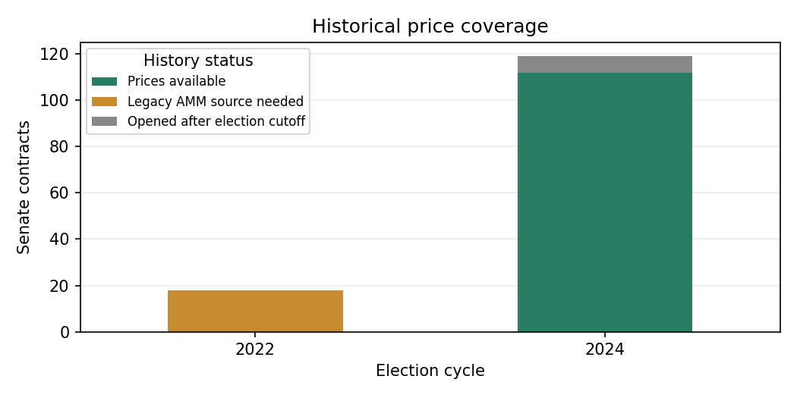

# Historical Senate market research: 2022 and 2024

This is a data and evaluation foundation. No trading strategy has been selected.

## Data coverage

|   cycle | status                      |   contracts |   points |
|--------:|:----------------------------|------------:|---------:|
|    2022 | excluded                    |          30 |        0 |
|    2022 | legacy_amm_history_required |          18 |        0 |
|    2024 | available                   |         112 |    22446 |
|    2024 | excluded                    |         133 |        0 |
|    2024 | opened_after_cutoff         |           7 |        0 |

Legacy AMM markets used liquidity pools and need a separate historical data source; an empty CLOB response does not mean they never traded. Markets opened after the election cutoff have no eligible pre-election window, even when later prices exist. See the methodology and saved history_diagnosis.parquet for the API audit.

## Forecast accuracy at saved cutoffs

Lower Brier and log-loss scores are better. One contract per contest is used, restricted to contests covered by all available models in that cycle and cutoff. Each cutoff is evaluated separately; repeated dates are not independent elections.

|   cycle | scenario     | model   |   races |   model_brier |   market_brier |   model_log_loss |   market_log_loss |   mean_gap_pp |
|--------:|:-------------|:--------|--------:|--------------:|---------------:|-----------------:|------------------:|--------------:|
|    2024 | matched_live | GB      |      26 |        0.0482 |         0.0484 |           0.1676 |            0.1746 |        3.9381 |
|    2024 | matched_live | M10     |      26 |        0.0456 |         0.0484 |           0.1592 |            0.1746 |        3.6590 |
|    2024 | matched_live | MX      |      26 |        0.0468 |         0.0484 |           0.1632 |            0.1746 |        3.7957 |
|    2024 | matched_live | RTWH    |      26 |        0.0610 |         0.0484 |           0.1987 |            0.1746 |        3.3538 |
|    2024 | matched_live | ST      |      26 |        0.0474 |         0.0484 |           0.1684 |            0.1746 |        4.3948 |
|    2024 | oct31        | GB      |      26 |        0.0439 |         0.0386 |           0.1503 |            0.1461 |        3.8089 |
|    2024 | oct31        | M10     |      26 |        0.0405 |         0.0386 |           0.1402 |            0.1461 |        3.7795 |
|    2024 | oct31        | MX      |      26 |        0.0419 |         0.0386 |           0.1455 |            0.1461 |        4.0036 |
|    2024 | oct31        | RTWH    |      26 |        0.0553 |         0.0386 |           0.1773 |            0.1461 |        5.3635 |
|    2024 | oct31        | ST      |      26 |        0.0418 |         0.0386 |           0.1425 |            0.1461 |        4.3260 |

## Publisher availability

| model   |   cycle | status    |   rows | first      | last       |
|:--------|--------:|:----------|-------:|:-----------|:-----------|
| RTWH    |    2024 | available |   2378 | 2023-10-01 | 2024-11-05 |
| 538     |    2022 | available |   4896 | 2022-06-01 | 2022-11-08 |

## Mapping and coverage gaps

|   cycle | reason                                                                       |   contracts |
|--------:|:-----------------------------------------------------------------------------|------------:|
|    2022 | Candidate or other outcome needs an explicit party/candidate adapter.        |           1 |
|    2022 | Combined or non-Senate election contract.                                    |           2 |
|    2022 | History is missing or incomplete; excluded from scoring.                     |          11 |
|    2022 | Independent/party settlement requires candidate-specific historical mapping. |           1 |
|    2022 | Legislative or personnel event, not an election outcome.                     |           9 |
|    2022 | Needs a historical joint/seat/margin distribution adapter.                   |           3 |
|    2022 | No saved historical forecast for this contest.                               |           2 |
|    2022 | Primary nomination contract.                                                 |          14 |
|    2022 | Unrecognized Senate contract; retained for review.                           |           5 |
|    2024 | Candidate or other outcome needs an explicit party/candidate adapter.        |          29 |
|    2024 | Combined or non-Senate election contract.                                    |          12 |
|    2024 | Election cycle is not explicit in the contract or event.                     |          62 |
|    2024 | Election stage or special contest requires explicit review.                  |           3 |
|    2024 | Independent/party settlement requires candidate-specific historical mapping. |           9 |
|    2024 | Legislative or personnel event, not an election outcome.                     |           4 |
|    2024 | Needs a historical joint/seat/margin distribution adapter.                   |          17 |
|    2024 | No saved historical forecast for this contest.                               |           4 |
|    2024 | No unique state in the question.                                             |           3 |
|    2024 | Primary nomination contract.                                                 |          42 |
|    2024 | Unrecognized Senate contract; retained for review.                           |          13 |

## Interpretation

Retrospective reconstruction from saved chronological folds. Model design was developed later; feature publication vintages are not fully reconstructed. This is not a pristine prospective test.

Forecasts become usable the day after their recorded cutoff. The first daily price within 36 hours is matched. General-election prices stop before election day; explicit runoff contracts use their later voting date. API-resolved payouts must agree with the election labels. Missing histories and unreviewed contract mappings remain excluded and visible.

State winners use saved model probabilities directly. Seat counts, chamber control, margins, independents, special elections and runoff-linked contracts remain in the inventory but require additional reviewed adapters. In particular, Senate control can depend on the vice presidency. No normal approximation is substituted for a missing distribution.

## Model, market and final result across dates

All probabilities below mean a Democratic win. The final winner is the observed election result, not a predicted vote share. All available states and both cycles are shown. Each check uses the first market observation after the cutoff day ends, within36hours. The publisher forecast may be up to six days older; its actual date is shown. Local forecasts appear only on their saved September17/October31 cutoffs. No local probabilities are carried forward or interpolated. Missing prices are blank. Market timestamps are UTC.

### Overall accuracy by date

Scores use the same states across models available at each date. States without market prices are not scored. Each date is a separate comparison; these rows reuse election outcomes. This is forecast accuracy across states, not a probability of Senate control.

**2022 — 538**

| Date   |   States |   With prices | Model Brier   | Market Brier   | Gap (pp)   |
|:-------|---------:|--------------:|:--------------|:---------------|:-----------|
| Jun 01 |       11 |             0 |               |                |            |
| Jul 01 |       11 |             0 |               |                |            |
| Aug 01 |       11 |             0 |               |                |            |
| Sep 01 |       11 |             0 |               |                |            |
| Sep 17 |       11 |             0 |               |                |            |
| Oct 01 |       11 |             0 |               |                |            |
| Oct 15 |       11 |             0 |               |                |            |
| Oct 31 |       11 |             0 |               |                |            |
| Nov 03 |       11 |             0 |               |                |            |

**2022 — GB**

| Date   |   States |   With prices | Model Brier   | Market Brier   | Gap (pp)   |
|:-------|---------:|--------------:|:--------------|:---------------|:-----------|
| Sep 17 |       11 |             0 |               |                |            |
| Oct 31 |       11 |             0 |               |                |            |

**2022 — M10**

| Date   |   States |   With prices | Model Brier   | Market Brier   | Gap (pp)   |
|:-------|---------:|--------------:|:--------------|:---------------|:-----------|
| Sep 17 |       11 |             0 |               |                |            |
| Oct 31 |       11 |             0 |               |                |            |

**2022 — MX**

| Date   |   States |   With prices | Model Brier   | Market Brier   | Gap (pp)   |
|:-------|---------:|--------------:|:--------------|:---------------|:-----------|
| Sep 17 |       11 |             0 |               |                |            |
| Oct 31 |       11 |             0 |               |                |            |

**2022 — ST**

| Date   |   States |   With prices | Model Brier   | Market Brier   | Gap (pp)   |
|:-------|---------:|--------------:|:--------------|:---------------|:-----------|
| Sep 17 |       11 |             0 |               |                |            |
| Oct 31 |       11 |             0 |               |                |            |

**2024 — GB**

| Date   |   States |   With prices |   Model Brier |   Market Brier |   Gap (pp) |
|:-------|---------:|--------------:|--------------:|---------------:|-----------:|
| Sep 17 |       26 |            26 |         0.048 |          0.048 |      3.938 |
| Oct 31 |       26 |            26 |         0.044 |          0.039 |      3.809 |

**2024 — M10**

| Date   |   States |   With prices |   Model Brier |   Market Brier |   Gap (pp) |
|:-------|---------:|--------------:|--------------:|---------------:|-----------:|
| Sep 17 |       26 |            26 |         0.046 |          0.048 |      3.659 |
| Oct 31 |       26 |            26 |         0.041 |          0.039 |      3.780 |

**2024 — MX**

| Date   |   States |   With prices |   Model Brier |   Market Brier |   Gap (pp) |
|:-------|---------:|--------------:|--------------:|---------------:|-----------:|
| Sep 17 |       26 |            26 |         0.047 |          0.048 |      3.796 |
| Oct 31 |       26 |            26 |         0.042 |          0.039 |      4.004 |

**2024 — RTWH**

| Date   |   States |   With prices |   Model Brier |   Market Brier |   Gap (pp) |
|:-------|---------:|--------------:|--------------:|---------------:|-----------:|
| Jun 01 |       26 |            26 |         0.070 |          0.061 |      8.142 |
| Jul 01 |       26 |            26 |         0.068 |          0.058 |      7.350 |
| Aug 01 |       26 |            26 |         0.069 |          0.057 |      6.938 |
| Sep 01 |       26 |            26 |         0.067 |          0.053 |      3.592 |
| Sep 17 |       26 |            26 |         0.061 |          0.048 |      3.354 |
| Oct 01 |       26 |            26 |         0.060 |          0.045 |      3.356 |
| Oct 15 |       26 |            26 |         0.056 |          0.041 |      4.079 |
| Oct 31 |       26 |            26 |         0.055 |          0.039 |      5.363 |
| Nov 03 |       26 |            26 |         0.055 |          0.043 |      3.835 |

**2024 — ST**

| Date   |   States |   With prices |   Model Brier |   Market Brier |   Gap (pp) |
|:-------|---------:|--------------:|--------------:|---------------:|-----------:|
| Sep 17 |       26 |            26 |         0.047 |          0.048 |      4.395 |
| Oct 31 |       26 |            26 |         0.042 |          0.039 |      4.326 |

### 2022 — AZ

**538**

| Check date   | Model date   | Market time (UTC)   |   Model (%) | Market (%)   | Final winner   |
|:-------------|:-------------|:--------------------|------------:|:-------------|:---------------|
| Jun 01       | Jun 01       |                     |       60.60 |              | Unavailable    |
| Jul 01       | Jul 01       |                     |       57.79 |              | Unavailable    |
| Aug 01       | Aug 01       |                     |       64.72 |              | Unavailable    |
| Sep 01       | Sep 01       |                     |       75.66 |              | Unavailable    |
| Sep 17       | Sep 17       |                     |       78.56 |              | Unavailable    |
| Oct 01       | Oct 01       |                     |       82.84 |              | Unavailable    |
| Oct 15       | Oct 15       |                     |       80.54 |              | Unavailable    |
| Oct 31       | Oct 31       |                     |       67.64 |              | Unavailable    |
| Nov 03       | Nov 03       |                     |       64.63 |              | Unavailable    |

Coverage: No market price near this date; final election label unavailable.

### 2022 — CO

**538**

| Check date   | Model date   | Market time (UTC)   |   Model (%) | Market (%)   | Final winner   |
|:-------------|:-------------|:--------------------|------------:|:-------------|:---------------|
| Jun 01       | Jun 01       |                     |       88.73 |              | D              |
| Jul 01       | Jul 01       |                     |       85.09 |              | D              |
| Aug 01       | Aug 01       |                     |       88.23 |              | D              |
| Sep 01       | Sep 01       |                     |       89.26 |              | D              |
| Sep 17       | Sep 17       |                     |       91.15 |              | D              |
| Oct 01       | Oct 01       |                     |       91.79 |              | D              |
| Oct 15       | Oct 15       |                     |       90.47 |              | D              |
| Oct 31       | Oct 31       |                     |       90.73 |              | D              |
| Nov 03       | Nov 03       |                     |       90.53 |              | D              |

**GB**

| Check date   | Model date   | Market time (UTC)   |   Model (%) | Market (%)   | Final winner   |
|:-------------|:-------------|:--------------------|------------:|:-------------|:---------------|
| Sep 17       | Sep 17       |                     |       91.82 |              | D              |
| Oct 31       | Oct 31       |                     |       97.49 |              | D              |

**ST**

| Check date   | Model date   | Market time (UTC)   |   Model (%) | Market (%)   | Final winner   |
|:-------------|:-------------|:--------------------|------------:|:-------------|:---------------|
| Sep 17       | Sep 17       |                     |       95.06 |              | D              |
| Oct 31       | Oct 31       |                     |       98.68 |              | D              |

**MX**

| Check date   | Model date   | Market time (UTC)   |   Model (%) | Market (%)   | Final winner   |
|:-------------|:-------------|:--------------------|------------:|:-------------|:---------------|
| Sep 17       | Sep 17       |                     |       91.99 |              | D              |
| Oct 31       | Oct 31       |                     |       97.31 |              | D              |

**M10**

| Check date   | Model date   | Market time (UTC)   |   Model (%) | Market (%)   | Final winner   |
|:-------------|:-------------|:--------------------|------------:|:-------------|:---------------|
| Sep 17       | Sep 17       |                     |       91.48 |              | D              |
| Oct 31       | Oct 31       |                     |       97.34 |              | D              |

Coverage: No market price near this date.

### 2022 — FL

**538**

| Check date   | Model date   | Market time (UTC)   |   Model (%) | Market (%)   | Final winner   |
|:-------------|:-------------|:--------------------|------------:|:-------------|:---------------|
| Jun 01       | Jun 01       |                     |        6.18 |              | R              |
| Jul 01       | Jul 01       |                     |        6.24 |              | R              |
| Aug 01       | Aug 01       |                     |        7.32 |              | R              |
| Sep 01       | Sep 01       |                     |       12.24 |              | R              |
| Sep 17       | Sep 17       |                     |       14.02 |              | R              |
| Oct 01       | Oct 01       |                     |       15.98 |              | R              |
| Oct 15       | Oct 15       |                     |       13.07 |              | R              |
| Oct 31       | Oct 31       |                     |        6.51 |              | R              |
| Nov 03       | Nov 03       |                     |        5.82 |              | R              |

**GB**

| Check date   | Model date   | Market time (UTC)   |   Model (%) | Market (%)   | Final winner   |
|:-------------|:-------------|:--------------------|------------:|:-------------|:---------------|
| Sep 17       | Sep 17       |                     |       25.34 |              | R              |
| Oct 31       | Oct 31       |                     |       10.66 |              | R              |

**ST**

| Check date   | Model date   | Market time (UTC)   |   Model (%) | Market (%)   | Final winner   |
|:-------------|:-------------|:--------------------|------------:|:-------------|:---------------|
| Sep 17       | Sep 17       |                     |       20.02 |              | R              |
| Oct 31       | Oct 31       |                     |        6.70 |              | R              |

**MX**

| Check date   | Model date   | Market time (UTC)   |   Model (%) | Market (%)   | Final winner   |
|:-------------|:-------------|:--------------------|------------:|:-------------|:---------------|
| Sep 17       | Sep 17       |                     |       22.52 |              | R              |
| Oct 31       | Oct 31       |                     |        8.50 |              | R              |

**M10**

| Check date   | Model date   | Market time (UTC)   |   Model (%) | Market (%)   | Final winner   |
|:-------------|:-------------|:--------------------|------------:|:-------------|:---------------|
| Sep 17       | Sep 17       |                     |       22.58 |              | R              |
| Oct 31       | Oct 31       |                     |        8.92 |              | R              |

Coverage: No market price near this date.

### 2022 — GA

**538**

| Check date   | Model date   | Market time (UTC)   |   Model (%) | Market (%)   | Final winner   |
|:-------------|:-------------|:--------------------|------------:|:-------------|:---------------|
| Jun 01       | Jun 01       |                     |       37.60 |              | Unavailable    |
| Jul 01       | Jul 01       |                     |       45.34 |              | Unavailable    |
| Aug 01       | Aug 01       |                     |       49.78 |              | Unavailable    |
| Sep 01       | Sep 01       |                     |       51.12 |              | Unavailable    |
| Sep 17       | Sep 17       |                     |       56.09 |              | Unavailable    |
| Oct 01       | Oct 01       |                     |       54.66 |              | Unavailable    |
| Oct 15       | Oct 15       |                     |       59.55 |              | Unavailable    |
| Oct 31       | Oct 31       |                     |       46.55 |              | Unavailable    |
| Nov 03       | Nov 03       |                     |       41.98 |              | Unavailable    |

Coverage: No market price near this date; final election label unavailable.

### 2022 — IA

**538**

| Check date   | Model date   | Market time (UTC)   |   Model (%) | Market (%)   | Final winner   |
|:-------------|:-------------|:--------------------|------------:|:-------------|:---------------|
| Jun 01       | Jun 01       |                     |        1.52 |              | R              |
| Jul 01       | Jul 01       |                     |        1.59 |              | R              |
| Aug 01       | Aug 01       |                     |        2.31 |              | R              |
| Sep 01       | Sep 01       |                     |        2.60 |              | R              |
| Sep 17       | Sep 17       |                     |        2.19 |              | R              |
| Oct 01       | Oct 01       |                     |        2.17 |              | R              |
| Oct 15       | Oct 15       |                     |        1.21 |              | R              |
| Oct 31       | Oct 31       |                     |        4.47 |              | R              |
| Nov 03       | Nov 03       |                     |        4.42 |              | R              |

**GB**

| Check date   | Model date   | Market time (UTC)   |   Model (%) | Market (%)   | Final winner   |
|:-------------|:-------------|:--------------------|------------:|:-------------|:---------------|
| Sep 17       | Sep 17       |                     |       16.54 |              | R              |
| Oct 31       | Oct 31       |                     |        3.46 |              | R              |

**ST**

| Check date   | Model date   | Market time (UTC)   |   Model (%) | Market (%)   | Final winner   |
|:-------------|:-------------|:--------------------|------------:|:-------------|:---------------|
| Sep 17       | Sep 17       |                     |       11.69 |              | R              |
| Oct 31       | Oct 31       |                     |        1.55 |              | R              |

**MX**

| Check date   | Model date   | Market time (UTC)   |   Model (%) | Market (%)   | Final winner   |
|:-------------|:-------------|:--------------------|------------:|:-------------|:---------------|
| Sep 17       | Sep 17       |                     |       10.91 |              | R              |
| Oct 31       | Oct 31       |                     |        2.35 |              | R              |

**M10**

| Check date   | Model date   | Market time (UTC)   |   Model (%) | Market (%)   | Final winner   |
|:-------------|:-------------|:--------------------|------------:|:-------------|:---------------|
| Sep 17       | Sep 17       |                     |       10.54 |              | R              |
| Oct 31       | Oct 31       |                     |        1.92 |              | R              |

Coverage: No market price near this date.

### 2022 — NC

**538**

| Check date   | Model date   | Market time (UTC)   |   Model (%) | Market (%)   | Final winner   |
|:-------------|:-------------|:--------------------|------------:|:-------------|:---------------|
| Jun 01       | Jun 01       |                     |       18.53 |              | R              |
| Jul 01       | Jul 01       |                     |       23.30 |              | R              |
| Aug 01       | Aug 01       |                     |       31.29 |              | R              |
| Sep 01       | Sep 01       |                     |       36.84 |              | R              |
| Sep 17       | Sep 17       |                     |       37.73 |              | R              |
| Oct 01       | Oct 01       |                     |       33.62 |              | R              |
| Oct 15       | Oct 15       |                     |       28.87 |              | R              |
| Oct 31       | Oct 31       |                     |       21.57 |              | R              |
| Nov 03       | Nov 03       |                     |       19.02 |              | R              |

**GB**

| Check date   | Model date   | Market time (UTC)   |   Model (%) | Market (%)   | Final winner   |
|:-------------|:-------------|:--------------------|------------:|:-------------|:---------------|
| Sep 17       | Sep 17       |                     |       34.25 |              | R              |
| Oct 31       | Oct 31       |                     |       22.42 |              | R              |

**ST**

| Check date   | Model date   | Market time (UTC)   |   Model (%) | Market (%)   | Final winner   |
|:-------------|:-------------|:--------------------|------------:|:-------------|:---------------|
| Sep 17       | Sep 17       |                     |       31.77 |              | R              |
| Oct 31       | Oct 31       |                     |       17.50 |              | R              |

**MX**

| Check date   | Model date   | Market time (UTC)   |   Model (%) | Market (%)   | Final winner   |
|:-------------|:-------------|:--------------------|------------:|:-------------|:---------------|
| Sep 17       | Sep 17       |                     |       23.06 |              | R              |
| Oct 31       | Oct 31       |                     |       14.08 |              | R              |

**M10**

| Check date   | Model date   | Market time (UTC)   |   Model (%) | Market (%)   | Final winner   |
|:-------------|:-------------|:--------------------|------------:|:-------------|:---------------|
| Sep 17       | Sep 17       |                     |       23.41 |              | R              |
| Oct 31       | Oct 31       |                     |       13.30 |              | R              |

Coverage: No market price near this date.

### 2022 — NH

**538**

| Check date   | Model date   | Market time (UTC)   |   Model (%) | Market (%)   | Final winner   |
|:-------------|:-------------|:--------------------|------------:|:-------------|:---------------|
| Jun 01       | Jun 01       |                     |       70.55 |              | D              |
| Jul 01       | Jul 01       |                     |       69.66 |              | D              |
| Aug 01       | Aug 01       |                     |       74.22 |              | D              |
| Sep 01       | Sep 01       |                     |       79.00 |              | D              |
| Sep 17       | Sep 17       |                     |       85.45 |              | D              |
| Oct 01       | Oct 01       |                     |       86.02 |              | D              |
| Oct 15       | Oct 15       |                     |       84.02 |              | D              |
| Oct 31       | Oct 31       |                     |       75.51 |              | D              |
| Nov 03       | Nov 03       |                     |       73.11 |              | D              |

**GB**

| Check date   | Model date   | Market time (UTC)   |   Model (%) | Market (%)   | Final winner   |
|:-------------|:-------------|:--------------------|------------:|:-------------|:---------------|
| Sep 17       | Sep 17       |                     |       87.98 |              | D              |
| Oct 31       | Oct 31       |                     |       80.21 |              | D              |

**ST**

| Check date   | Model date   | Market time (UTC)   |   Model (%) | Market (%)   | Final winner   |
|:-------------|:-------------|:--------------------|------------:|:-------------|:---------------|
| Sep 17       | Sep 17       |                     |       93.20 |              | D              |
| Oct 31       | Oct 31       |                     |       85.29 |              | D              |

**MX**

| Check date   | Model date   | Market time (UTC)   |   Model (%) | Market (%)   | Final winner   |
|:-------------|:-------------|:--------------------|------------:|:-------------|:---------------|
| Sep 17       | Sep 17       |                     |       85.95 |              | D              |
| Oct 31       | Oct 31       |                     |       80.98 |              | D              |

**M10**

| Check date   | Model date   | Market time (UTC)   |   Model (%) | Market (%)   | Final winner   |
|:-------------|:-------------|:--------------------|------------:|:-------------|:---------------|
| Sep 17       | Sep 17       |                     |       85.55 |              | D              |
| Oct 31       | Oct 31       |                     |       82.01 |              | D              |

Coverage: No market price near this date.

### 2022 — NV

**538**

| Check date   | Model date   | Market time (UTC)   |   Model (%) | Market (%)   | Final winner   |
|:-------------|:-------------|:--------------------|------------:|:-------------|:---------------|
| Jun 01       | Jun 01       |                     |       52.89 |              | D              |
| Jul 01       | Jul 01       |                     |       50.68 |              | D              |
| Aug 01       | Aug 01       |                     |       55.16 |              | D              |
| Sep 01       | Sep 01       |                     |       61.27 |              | D              |
| Sep 17       | Sep 17       |                     |       61.06 |              | D              |
| Oct 01       | Oct 01       |                     |       54.29 |              | D              |
| Oct 15       | Oct 15       |                     |       50.70 |              | D              |
| Oct 31       | Oct 31       |                     |       45.58 |              | D              |
| Nov 03       | Nov 03       |                     |       41.20 |              | D              |

**GB**

| Check date   | Model date   | Market time (UTC)   |   Model (%) | Market (%)   | Final winner   |
|:-------------|:-------------|:--------------------|------------:|:-------------|:---------------|
| Sep 17       | Sep 17       |                     |       70.31 |              | D              |
| Oct 31       | Oct 31       |                     |       55.59 |              | D              |

**ST**

| Check date   | Model date   | Market time (UTC)   |   Model (%) | Market (%)   | Final winner   |
|:-------------|:-------------|:--------------------|------------:|:-------------|:---------------|
| Sep 17       | Sep 17       |                     |       75.16 |              | D              |
| Oct 31       | Oct 31       |                     |       57.30 |              | D              |

**MX**

| Check date   | Model date   | Market time (UTC)   |   Model (%) | Market (%)   | Final winner   |
|:-------------|:-------------|:--------------------|------------:|:-------------|:---------------|
| Sep 17       | Sep 17       |                     |       70.28 |              | D              |
| Oct 31       | Oct 31       |                     |       56.18 |              | D              |

**M10**

| Check date   | Model date   | Market time (UTC)   |   Model (%) | Market (%)   | Final winner   |
|:-------------|:-------------|:--------------------|------------:|:-------------|:---------------|
| Sep 17       | Sep 17       |                     |       70.60 |              | D              |
| Oct 31       | Oct 31       |                     |       58.96 |              | D              |

Coverage: No market price near this date.

### 2022 — OH

**538**

| Check date   | Model date   | Market time (UTC)   |   Model (%) | Market (%)   | Final winner   |
|:-------------|:-------------|:--------------------|------------:|:-------------|:---------------|
| Jun 01       | Jun 01       |                     |       10.44 |              | R              |
| Jul 01       | Jul 01       |                     |       10.44 |              | R              |
| Aug 01       | Aug 01       |                     |       21.30 |              | R              |
| Sep 01       | Sep 01       |                     |       26.41 |              | R              |
| Sep 17       | Sep 17       |                     |       29.65 |              | R              |
| Oct 01       | Oct 01       |                     |       29.70 |              | R              |
| Oct 15       | Oct 15       |                     |       29.29 |              | R              |
| Oct 31       | Oct 31       |                     |       21.46 |              | R              |
| Nov 03       | Nov 03       |                     |       19.23 |              | R              |

**GB**

| Check date   | Model date   | Market time (UTC)   |   Model (%) | Market (%)   | Final winner   |
|:-------------|:-------------|:--------------------|------------:|:-------------|:---------------|
| Sep 17       | Sep 17       |                     |       48.71 |              | R              |
| Oct 31       | Oct 31       |                     |       41.50 |              | R              |

**ST**

| Check date   | Model date   | Market time (UTC)   |   Model (%) | Market (%)   | Final winner   |
|:-------------|:-------------|:--------------------|------------:|:-------------|:---------------|
| Sep 17       | Sep 17       |                     |       48.41 |              | R              |
| Oct 31       | Oct 31       |                     |       38.84 |              | R              |

**MX**

| Check date   | Model date   | Market time (UTC)   |   Model (%) | Market (%)   | Final winner   |
|:-------------|:-------------|:--------------------|------------:|:-------------|:---------------|
| Sep 17       | Sep 17       |                     |       45.38 |              | R              |
| Oct 31       | Oct 31       |                     |       38.92 |              | R              |

**M10**

| Check date   | Model date   | Market time (UTC)   |   Model (%) | Market (%)   | Final winner   |
|:-------------|:-------------|:--------------------|------------:|:-------------|:---------------|
| Sep 17       | Sep 17       |                     |       45.82 |              | R              |
| Oct 31       | Oct 31       |                     |       37.73 |              | R              |

Coverage: No market price near this date.

### 2022 — PA

**538**

| Check date   | Model date   | Market time (UTC)   |   Model (%) | Market (%)   | Final winner   |
|:-------------|:-------------|:--------------------|------------:|:-------------|:---------------|
| Jun 01       | Jun 01       |                     |       35.35 |              | D              |
| Jul 01       | Jul 01       |                     |       51.29 |              | D              |
| Aug 01       | Aug 01       |                     |       63.14 |              | D              |
| Sep 01       | Sep 01       |                     |       78.88 |              | D              |
| Sep 17       | Sep 17       |                     |       82.44 |              | D              |
| Oct 01       | Oct 01       |                     |       76.69 |              | D              |
| Oct 15       | Oct 15       |                     |       70.81 |              | D              |
| Oct 31       | Oct 31       |                     |       56.82 |              | D              |
| Nov 03       | Nov 03       |                     |       53.48 |              | D              |

**GB**

| Check date   | Model date   | Market time (UTC)   |   Model (%) | Market (%)   | Final winner   |
|:-------------|:-------------|:--------------------|------------:|:-------------|:---------------|
| Sep 17       | Sep 17       |                     |       95.72 |              | D              |
| Oct 31       | Oct 31       |                     |       76.81 |              | D              |

**ST**

| Check date   | Model date   | Market time (UTC)   |   Model (%) | Market (%)   | Final winner   |
|:-------------|:-------------|:--------------------|------------:|:-------------|:---------------|
| Sep 17       | Sep 17       |                     |       98.13 |              | D              |
| Oct 31       | Oct 31       |                     |       82.46 |              | D              |

**MX**

| Check date   | Model date   | Market time (UTC)   |   Model (%) | Market (%)   | Final winner   |
|:-------------|:-------------|:--------------------|------------:|:-------------|:---------------|
| Sep 17       | Sep 17       |                     |       96.53 |              | D              |
| Oct 31       | Oct 31       |                     |       78.28 |              | D              |

**M10**

| Check date   | Model date   | Market time (UTC)   |   Model (%) | Market (%)   | Final winner   |
|:-------------|:-------------|:--------------------|------------:|:-------------|:---------------|
| Sep 17       | Sep 17       |                     |       96.24 |              | D              |
| Oct 31       | Oct 31       |                     |       77.51 |              | D              |

Coverage: No market price near this date.

### 2022 — VT

**538**

| Check date   | Model date   | Market time (UTC)   |   Model (%) | Market (%)   | Final winner   |
|:-------------|:-------------|:--------------------|------------:|:-------------|:---------------|
| Jun 01       | Jun 01       |                     |       99.57 |              | D              |
| Jul 01       | Jul 01       |                     |       99.61 |              | D              |
| Aug 01       | Aug 01       |                     |       99.74 |              | D              |
| Sep 01       | Sep 01       |                     |       99.73 |              | D              |
| Sep 17       | Sep 17       |                     |       98.64 |              | D              |
| Oct 01       | Oct 01       |                     |       98.60 |              | D              |
| Oct 15       | Oct 15       |                     |       99.78 |              | D              |
| Oct 31       | Oct 31       |                     |       99.72 |              | D              |
| Nov 03       | Nov 03       |                     |       99.96 |              | D              |

**GB**

| Check date   | Model date   | Market time (UTC)   |   Model (%) | Market (%)   | Final winner   |
|:-------------|:-------------|:--------------------|------------:|:-------------|:---------------|
| Sep 17       | Sep 17       |                     |       94.34 |              | D              |
| Oct 31       | Oct 31       |                     |      100.00 |              | D              |

**ST**

| Check date   | Model date   | Market time (UTC)   |   Model (%) | Market (%)   | Final winner   |
|:-------------|:-------------|:--------------------|------------:|:-------------|:---------------|
| Sep 17       | Sep 17       |                     |       95.84 |              | D              |
| Oct 31       | Oct 31       |                     |      100.00 |              | D              |

**MX**

| Check date   | Model date   | Market time (UTC)   |   Model (%) | Market (%)   | Final winner   |
|:-------------|:-------------|:--------------------|------------:|:-------------|:---------------|
| Sep 17       | Sep 17       |                     |       94.41 |              | D              |
| Oct 31       | Oct 31       |                     |      100.00 |              | D              |

**M10**

| Check date   | Model date   | Market time (UTC)   |   Model (%) | Market (%)   | Final winner   |
|:-------------|:-------------|:--------------------|------------:|:-------------|:---------------|
| Sep 17       | Sep 17       |                     |       94.82 |              | D              |
| Oct 31       | Oct 31       |                     |      100.00 |              | D              |

Coverage: No market price near this date.

### 2022 — WA

**538**

| Check date   | Model date   | Market time (UTC)   |   Model (%) | Market (%)   | Final winner   |
|:-------------|:-------------|:--------------------|------------:|:-------------|:---------------|
| Jun 01       | Jun 01       |                     |       91.92 |              | D              |
| Jul 01       | Jul 01       |                     |       90.59 |              | D              |
| Aug 01       | Aug 01       |                     |       96.08 |              | D              |
| Sep 01       | Sep 01       |                     |       98.00 |              | D              |
| Sep 17       | Sep 17       |                     |       96.75 |              | D              |
| Oct 01       | Oct 01       |                     |       97.08 |              | D              |
| Oct 15       | Oct 15       |                     |       96.94 |              | D              |
| Oct 31       | Oct 31       |                     |       91.53 |              | D              |
| Nov 03       | Nov 03       |                     |       90.30 |              | D              |

**GB**

| Check date   | Model date   | Market time (UTC)   |   Model (%) | Market (%)   | Final winner   |
|:-------------|:-------------|:--------------------|------------:|:-------------|:---------------|
| Sep 17       | Sep 17       |                     |       96.85 |              | D              |
| Oct 31       | Oct 31       |                     |       95.95 |              | D              |

**ST**

| Check date   | Model date   | Market time (UTC)   |   Model (%) | Market (%)   | Final winner   |
|:-------------|:-------------|:--------------------|------------:|:-------------|:---------------|
| Sep 17       | Sep 17       |                     |       98.58 |              | D              |
| Oct 31       | Oct 31       |                     |       98.12 |              | D              |

**MX**

| Check date   | Model date   | Market time (UTC)   |   Model (%) | Market (%)   | Final winner   |
|:-------------|:-------------|:--------------------|------------:|:-------------|:---------------|
| Sep 17       | Sep 17       |                     |       98.50 |              | D              |
| Oct 31       | Oct 31       |                     |       97.96 |              | D              |

**M10**

| Check date   | Model date   | Market time (UTC)   |   Model (%) | Market (%)   | Final winner   |
|:-------------|:-------------|:--------------------|------------:|:-------------|:---------------|
| Sep 17       | Sep 17       |                     |       98.46 |              | D              |
| Oct 31       | Oct 31       |                     |       97.81 |              | D              |

Coverage: No market price near this date.

### 2022 — WI

**538**

| Check date   | Model date   | Market time (UTC)   |   Model (%) | Market (%)   | Final winner   |
|:-------------|:-------------|:--------------------|------------:|:-------------|:---------------|
| Jun 01       | Jun 01       |                     |       22.76 |              | R              |
| Jul 01       | Jul 01       |                     |       28.13 |              | R              |
| Aug 01       | Aug 01       |                     |       31.59 |              | R              |
| Sep 01       | Sep 01       |                     |       47.31 |              | R              |
| Sep 17       | Sep 17       |                     |       43.80 |              | R              |
| Oct 01       | Oct 01       |                     |       33.53 |              | R              |
| Oct 15       | Oct 15       |                     |       29.07 |              | R              |
| Oct 31       | Oct 31       |                     |       20.46 |              | R              |
| Nov 03       | Nov 03       |                     |       20.93 |              | R              |

**GB**

| Check date   | Model date   | Market time (UTC)   |   Model (%) | Market (%)   | Final winner   |
|:-------------|:-------------|:--------------------|------------:|:-------------|:---------------|
| Sep 17       | Sep 17       |                     |       52.93 |              | R              |
| Oct 31       | Oct 31       |                     |       31.71 |              | R              |

**ST**

| Check date   | Model date   | Market time (UTC)   |   Model (%) | Market (%)   | Final winner   |
|:-------------|:-------------|:--------------------|------------:|:-------------|:---------------|
| Sep 17       | Sep 17       |                     |       54.59 |              | R              |
| Oct 31       | Oct 31       |                     |       28.58 |              | R              |

**MX**

| Check date   | Model date   | Market time (UTC)   |   Model (%) | Market (%)   | Final winner   |
|:-------------|:-------------|:--------------------|------------:|:-------------|:---------------|
| Sep 17       | Sep 17       |                     |       55.10 |              | R              |
| Oct 31       | Oct 31       |                     |       31.92 |              | R              |

**M10**

| Check date   | Model date   | Market time (UTC)   |   Model (%) | Market (%)   | Final winner   |
|:-------------|:-------------|:--------------------|------------:|:-------------|:---------------|
| Sep 17       | Sep 17       |                     |       55.88 |              | R              |
| Oct 31       | Oct 31       |                     |       30.53 |              | R              |

Coverage: No market price near this date.

### 2024 — AZ

**RTWH**

| Check date   | Model date   | Market time (UTC)   |   Model (%) |   Market (%) | Final winner   |
|:-------------|:-------------|:--------------------|------------:|-------------:|:---------------|
| Jun 01       | May 28       | Jun 02 00:00        |       81.40 |        69.50 | Unavailable    |
| Jul 01       | Jun 27       | Jul 02 00:00        |       80.10 |        68.50 | Unavailable    |
| Aug 01       | Aug 01       | Aug 02 00:00        |       86.30 |        70.50 | Unavailable    |
| Sep 01       | Aug 31       | Sep 02 00:00        |       90.50 |        83.00 | Unavailable    |
| Sep 17       | Sep 15       | Sep 18 00:00        |       89.20 |        83.50 | Unavailable    |
| Oct 01       | Sep 30       | Oct 02 00:00        |       91.00 |        84.50 | Unavailable    |
| Oct 15       | Oct 15       | Oct 16 00:00        |       91.90 |        86.00 | Unavailable    |
| Oct 31       | Oct 30       | Nov 01 00:00        |       91.40 |        73.50 | Unavailable    |
| Nov 03       | Oct 30       | Nov 04 00:00        |       91.40 |        77.00 | Unavailable    |

Coverage: Matched; final election label unavailable.

### 2024 — CA

**RTWH**

| Check date   | Model date   | Market time (UTC)   |   Model (%) |   Market (%) | Final winner   |
|:-------------|:-------------|:--------------------|------------:|-------------:|:---------------|
| Jun 01       | May 28       | Jun 02 00:00        |       99.50 |        90.50 | D              |
| Jul 01       | Jun 27       | Jul 02 00:00        |       99.50 |        90.50 | D              |
| Aug 01       | Aug 01       | Aug 02 00:00        |       99.60 |        95.20 | D              |
| Sep 01       | Aug 31       | Sep 02 00:00        |       99.60 |        97.10 | D              |
| Sep 17       | Sep 15       | Sep 18 00:00        |       99.60 |        97.15 | D              |
| Oct 01       | Sep 30       | Oct 02 00:00        |       99.30 |        97.20 | D              |
| Oct 15       | Oct 15       | Oct 16 00:00        |       99.70 |        97.75 | D              |
| Oct 31       | Oct 30       | Nov 01 00:00        |       99.90 |        97.40 | D              |
| Nov 03       | Oct 30       | Nov 04 00:00        |       99.90 |        97.95 | D              |

**GB**

| Check date   | Model date   | Market time (UTC)   |   Model (%) |   Market (%) | Final winner   |
|:-------------|:-------------|:--------------------|------------:|-------------:|:---------------|
| Sep 17       | Sep 17       | Sep 18 00:00        |      100.00 |        97.15 | D              |
| Oct 31       | Oct 31       | Nov 01 00:00        |      100.00 |        97.40 | D              |

**ST**

| Check date   | Model date   | Market time (UTC)   |   Model (%) |   Market (%) | Final winner   |
|:-------------|:-------------|:--------------------|------------:|-------------:|:---------------|
| Sep 17       | Sep 17       | Sep 18 00:00        |      100.00 |        97.15 | D              |
| Oct 31       | Oct 31       | Nov 01 00:00        |      100.00 |        97.40 | D              |

**MX**

| Check date   | Model date   | Market time (UTC)   |   Model (%) |   Market (%) | Final winner   |
|:-------------|:-------------|:--------------------|------------:|-------------:|:---------------|
| Sep 17       | Sep 17       | Sep 18 00:00        |      100.00 |        97.15 | D              |
| Oct 31       | Oct 31       | Nov 01 00:00        |      100.00 |        97.40 | D              |

**M10**

| Check date   | Model date   | Market time (UTC)   |   Model (%) |   Market (%) | Final winner   |
|:-------------|:-------------|:--------------------|------------:|-------------:|:---------------|
| Sep 17       | Sep 17       | Sep 18 00:00        |      100.00 |        97.15 | D              |
| Oct 31       | Oct 31       | Nov 01 00:00        |      100.00 |        97.40 | D              |

### 2024 — CT

**RTWH**

| Check date   | Model date   | Market time (UTC)   |   Model (%) |   Market (%) | Final winner   |
|:-------------|:-------------|:--------------------|------------:|-------------:|:---------------|
| Jun 01       | May 28       | Jun 02 00:00        |       96.60 |        90.50 | D              |
| Jul 01       | Jun 27       | Jul 02 00:00        |       96.10 |        91.00 | D              |
| Aug 01       | Aug 01       | Aug 02 00:00        |       97.80 |        94.00 | D              |
| Sep 01       | Aug 31       | Sep 02 00:00        |       97.20 |        96.15 | D              |
| Sep 17       | Sep 15       | Sep 18 00:00        |       97.40 |        97.50 | D              |
| Oct 01       | Sep 30       | Oct 02 00:00        |       97.80 |        97.55 | D              |
| Oct 15       | Oct 15       | Oct 16 00:00        |       98.80 |        97.70 | D              |
| Oct 31       | Oct 30       | Nov 01 00:00        |       99.40 |        97.55 | D              |
| Nov 03       | Oct 30       | Nov 04 00:00        |       99.40 |        98.40 | D              |

**GB**

| Check date   | Model date   | Market time (UTC)   |   Model (%) |   Market (%) | Final winner   |
|:-------------|:-------------|:--------------------|------------:|-------------:|:---------------|
| Sep 17       | Sep 17       | Sep 18 00:00        |       97.59 |        97.50 | D              |
| Oct 31       | Oct 31       | Nov 01 00:00        |       99.16 |        97.55 | D              |

**ST**

| Check date   | Model date   | Market time (UTC)   |   Model (%) |   Market (%) | Final winner   |
|:-------------|:-------------|:--------------------|------------:|-------------:|:---------------|
| Sep 17       | Sep 17       | Sep 18 00:00        |       97.65 |        97.50 | D              |
| Oct 31       | Oct 31       | Nov 01 00:00        |       99.65 |        97.55 | D              |

**MX**

| Check date   | Model date   | Market time (UTC)   |   Model (%) |   Market (%) | Final winner   |
|:-------------|:-------------|:--------------------|------------:|-------------:|:---------------|
| Sep 17       | Sep 17       | Sep 18 00:00        |       98.27 |        97.50 | D              |
| Oct 31       | Oct 31       | Nov 01 00:00        |       99.23 |        97.55 | D              |

**M10**

| Check date   | Model date   | Market time (UTC)   |   Model (%) |   Market (%) | Final winner   |
|:-------------|:-------------|:--------------------|------------:|-------------:|:---------------|
| Sep 17       | Sep 17       | Sep 18 00:00        |       98.30 |        97.50 | D              |
| Oct 31       | Oct 31       | Nov 01 00:00        |       99.20 |        97.55 | D              |

### 2024 — DE

**RTWH**

| Check date   | Model date   | Market time (UTC)   |   Model (%) |   Market (%) | Final winner   |
|:-------------|:-------------|:--------------------|------------:|-------------:|:---------------|
| Jun 01       | May 28       | Jun 02 00:00        |       96.80 |        90.50 | D              |
| Jul 01       | Jun 27       | Jul 02 00:00        |       96.60 |        91.00 | D              |
| Aug 01       | Aug 01       | Aug 02 00:00        |       95.30 |        93.00 | D              |
| Sep 01       | Aug 31       | Sep 02 00:00        |       95.70 |        96.25 | D              |
| Sep 17       | Sep 15       | Sep 18 00:00        |       95.90 |        96.70 | D              |
| Oct 01       | Sep 30       | Oct 02 00:00        |       96.50 |        97.95 | D              |
| Oct 15       | Oct 15       | Oct 16 00:00        |       96.80 |        97.80 | D              |
| Oct 31       | Oct 30       | Nov 01 00:00        |       97.00 |        97.30 | D              |
| Nov 03       | Oct 30       | Nov 04 00:00        |       97.00 |        97.55 | D              |

**GB**

| Check date   | Model date   | Market time (UTC)   |   Model (%) |   Market (%) | Final winner   |
|:-------------|:-------------|:--------------------|------------:|-------------:|:---------------|
| Sep 17       | Sep 17       | Sep 18 00:00        |       99.42 |        96.70 | D              |
| Oct 31       | Oct 31       | Nov 01 00:00        |       99.78 |        97.30 | D              |

**ST**

| Check date   | Model date   | Market time (UTC)   |   Model (%) |   Market (%) | Final winner   |
|:-------------|:-------------|:--------------------|------------:|-------------:|:---------------|
| Sep 17       | Sep 17       | Sep 18 00:00        |       98.95 |        96.70 | D              |
| Oct 31       | Oct 31       | Nov 01 00:00        |       99.92 |        97.30 | D              |

**MX**

| Check date   | Model date   | Market time (UTC)   |   Model (%) |   Market (%) | Final winner   |
|:-------------|:-------------|:--------------------|------------:|-------------:|:---------------|
| Sep 17       | Sep 17       | Sep 18 00:00        |       99.24 |        96.70 | D              |
| Oct 31       | Oct 31       | Nov 01 00:00        |       99.88 |        97.30 | D              |

**M10**

| Check date   | Model date   | Market time (UTC)   |   Model (%) |   Market (%) | Final winner   |
|:-------------|:-------------|:--------------------|------------:|-------------:|:---------------|
| Sep 17       | Sep 17       | Sep 18 00:00        |       99.18 |        96.70 | D              |
| Oct 31       | Oct 31       | Nov 01 00:00        |       99.84 |        97.30 | D              |

### 2024 — FL

**RTWH**

| Check date   | Model date   | Market time (UTC)   |   Model (%) |   Market (%) | Final winner   |
|:-------------|:-------------|:--------------------|------------:|-------------:|:---------------|
| Jun 01       | May 28       | Jun 02 00:00        |       11.00 |        12.50 | R              |
| Jul 01       | Jun 27       | Jul 02 00:00        |       15.80 |        11.50 | R              |
| Aug 01       | Aug 01       | Aug 02 00:00        |       24.90 |        14.50 | R              |
| Sep 01       | Aug 31       | Sep 02 00:00        |       25.00 |        17.50 | R              |
| Sep 17       | Sep 15       | Sep 18 00:00        |       28.40 |        18.00 | R              |
| Oct 01       | Sep 30       | Oct 02 00:00        |       28.80 |        18.50 | R              |
| Oct 15       | Oct 15       | Oct 16 00:00        |       22.20 |         9.50 | R              |
| Oct 31       | Oct 30       | Nov 01 00:00        |       19.00 |         9.50 | R              |
| Nov 03       | Oct 30       | Nov 04 00:00        |       19.00 |         9.50 | R              |

**GB**

| Check date   | Model date   | Market time (UTC)   |   Model (%) |   Market (%) | Final winner   |
|:-------------|:-------------|:--------------------|------------:|-------------:|:---------------|
| Sep 17       | Sep 17       | Sep 18 00:00        |       16.01 |        18.00 | R              |
| Oct 31       | Oct 31       | Nov 01 00:00        |       16.68 |         9.50 | R              |

**ST**

| Check date   | Model date   | Market time (UTC)   |   Model (%) |   Market (%) | Final winner   |
|:-------------|:-------------|:--------------------|------------:|-------------:|:---------------|
| Sep 17       | Sep 17       | Sep 18 00:00        |        9.83 |        18.00 | R              |
| Oct 31       | Oct 31       | Nov 01 00:00        |        9.67 |         9.50 | R              |

**MX**

| Check date   | Model date   | Market time (UTC)   |   Model (%) |   Market (%) | Final winner   |
|:-------------|:-------------|:--------------------|------------:|-------------:|:---------------|
| Sep 17       | Sep 17       | Sep 18 00:00        |       14.76 |        18.00 | R              |
| Oct 31       | Oct 31       | Nov 01 00:00        |       14.37 |         9.50 | R              |

**M10**

| Check date   | Model date   | Market time (UTC)   |   Model (%) |   Market (%) | Final winner   |
|:-------------|:-------------|:--------------------|------------:|-------------:|:---------------|
| Sep 17       | Sep 17       | Sep 18 00:00        |       13.00 |        18.00 | R              |
| Oct 31       | Oct 31       | Nov 01 00:00        |       12.96 |         9.50 | R              |

### 2024 — HI

**RTWH**

| Check date   | Model date   | Market time (UTC)   |   Model (%) |   Market (%) | Final winner   |
|:-------------|:-------------|:--------------------|------------:|-------------:|:---------------|
| Jun 01       | May 28       | Jun 02 00:00        |       99.40 |        91.50 | D              |
| Jul 01       | Jun 27       | Jul 02 00:00        |       99.40 |        91.50 | D              |
| Aug 01       | Aug 01       | Aug 02 00:00        |       99.40 |        93.50 | D              |
| Sep 01       | Aug 31       | Sep 02 00:00        |       99.50 |        98.75 | D              |
| Sep 17       | Sep 15       | Sep 18 00:00        |       99.50 |        98.35 | D              |
| Oct 01       | Sep 30       | Oct 02 00:00        |       99.50 |        98.95 | D              |
| Oct 15       | Oct 15       | Oct 16 00:00        |       99.60 |        99.05 | D              |
| Oct 31       | Oct 30       | Nov 01 00:00        |       99.60 |        99.00 | D              |
| Nov 03       | Oct 30       | Nov 04 00:00        |       99.60 |        99.25 | D              |

**GB**

| Check date   | Model date   | Market time (UTC)   |   Model (%) |   Market (%) | Final winner   |
|:-------------|:-------------|:--------------------|------------:|-------------:|:---------------|
| Sep 17       | Sep 17       | Sep 18 00:00        |      100.00 |        98.35 | D              |
| Oct 31       | Oct 31       | Nov 01 00:00        |      100.00 |        99.00 | D              |

**ST**

| Check date   | Model date   | Market time (UTC)   |   Model (%) |   Market (%) | Final winner   |
|:-------------|:-------------|:--------------------|------------:|-------------:|:---------------|
| Sep 17       | Sep 17       | Sep 18 00:00        |       99.95 |        98.35 | D              |
| Oct 31       | Oct 31       | Nov 01 00:00        |       99.88 |        99.00 | D              |

**MX**

| Check date   | Model date   | Market time (UTC)   |   Model (%) |   Market (%) | Final winner   |
|:-------------|:-------------|:--------------------|------------:|-------------:|:---------------|
| Sep 17       | Sep 17       | Sep 18 00:00        |       99.98 |        98.35 | D              |
| Oct 31       | Oct 31       | Nov 01 00:00        |       99.94 |        99.00 | D              |

**M10**

| Check date   | Model date   | Market time (UTC)   |   Model (%) |   Market (%) | Final winner   |
|:-------------|:-------------|:--------------------|------------:|-------------:|:---------------|
| Sep 17       | Sep 17       | Sep 18 00:00        |       99.98 |        98.35 | D              |
| Oct 31       | Oct 31       | Nov 01 00:00        |       99.94 |        99.00 | D              |

### 2024 — IN

**RTWH**

| Check date   | Model date   | Market time (UTC)   |   Model (%) |   Market (%) | Final winner   |
|:-------------|:-------------|:--------------------|------------:|-------------:|:---------------|
| Jun 01       | May 28       | Jun 02 00:00        |        6.70 |         8.50 | R              |
| Jul 01       | Jun 27       | Jul 02 00:00        |        7.10 |         7.50 | R              |
| Aug 01       | Aug 01       | Aug 02 00:00        |        3.30 |         6.50 | R              |
| Sep 01       | Aug 31       | Sep 02 00:00        |        3.40 |         2.45 | R              |
| Sep 17       | Sep 15       | Sep 18 00:00        |        3.20 |         2.45 | R              |
| Oct 01       | Sep 30       | Oct 02 00:00        |        6.60 |         1.50 | R              |
| Oct 15       | Oct 15       | Oct 16 00:00        |        3.80 |         1.10 | R              |
| Oct 31       | Oct 30       | Nov 01 00:00        |        2.80 |         2.15 | R              |
| Nov 03       | Oct 30       | Nov 04 00:00        |        2.80 |         3.05 | R              |

**GB**

| Check date   | Model date   | Market time (UTC)   |   Model (%) |   Market (%) | Final winner   |
|:-------------|:-------------|:--------------------|------------:|-------------:|:---------------|
| Sep 17       | Sep 17       | Sep 18 00:00        |        1.27 |         2.45 | R              |
| Oct 31       | Oct 31       | Nov 01 00:00        |        2.09 |         2.15 | R              |

**ST**

| Check date   | Model date   | Market time (UTC)   |   Model (%) |   Market (%) | Final winner   |
|:-------------|:-------------|:--------------------|------------:|-------------:|:---------------|
| Sep 17       | Sep 17       | Sep 18 00:00        |        0.68 |         2.45 | R              |
| Oct 31       | Oct 31       | Nov 01 00:00        |        0.65 |         2.15 | R              |

**MX**

| Check date   | Model date   | Market time (UTC)   |   Model (%) |   Market (%) | Final winner   |
|:-------------|:-------------|:--------------------|------------:|-------------:|:---------------|
| Sep 17       | Sep 17       | Sep 18 00:00        |        2.90 |         2.45 | R              |
| Oct 31       | Oct 31       | Nov 01 00:00        |        3.32 |         2.15 | R              |

**M10**

| Check date   | Model date   | Market time (UTC)   |   Model (%) |   Market (%) | Final winner   |
|:-------------|:-------------|:--------------------|------------:|-------------:|:---------------|
| Sep 17       | Sep 17       | Sep 18 00:00        |        2.25 |         2.45 | R              |
| Oct 31       | Oct 31       | Nov 01 00:00        |        2.68 |         2.15 | R              |

### 2024 — MA

**RTWH**

| Check date   | Model date   | Market time (UTC)   |   Model (%) |   Market (%) | Final winner   |
|:-------------|:-------------|:--------------------|------------:|-------------:|:---------------|
| Jun 01       | May 28       | Jun 02 00:00        |       99.10 |        91.50 | D              |
| Jul 01       | Jun 27       | Jul 02 00:00        |       99.50 |        91.50 | D              |
| Aug 01       | Aug 01       | Aug 02 00:00        |       99.50 |        94.00 | D              |
| Sep 01       | Aug 31       | Sep 02 00:00        |       99.50 |        98.15 | D              |
| Sep 17       | Sep 15       | Sep 18 00:00        |       99.50 |        97.50 | D              |
| Oct 01       | Sep 30       | Oct 02 00:00        |       99.60 |        97.50 | D              |
| Oct 15       | Oct 15       | Oct 16 00:00        |       99.90 |        96.70 | D              |
| Oct 31       | Oct 30       | Nov 01 00:00        |       99.90 |        97.45 | D              |
| Nov 03       | Oct 30       | Nov 04 00:00        |       99.90 |        97.40 | D              |

**GB**

| Check date   | Model date   | Market time (UTC)   |   Model (%) |   Market (%) | Final winner   |
|:-------------|:-------------|:--------------------|------------:|-------------:|:---------------|
| Sep 17       | Sep 17       | Sep 18 00:00        |      100.00 |        97.50 | D              |
| Oct 31       | Oct 31       | Nov 01 00:00        |      100.00 |        97.45 | D              |

**ST**

| Check date   | Model date   | Market time (UTC)   |   Model (%) |   Market (%) | Final winner   |
|:-------------|:-------------|:--------------------|------------:|-------------:|:---------------|
| Sep 17       | Sep 17       | Sep 18 00:00        |      100.00 |        97.50 | D              |
| Oct 31       | Oct 31       | Nov 01 00:00        |      100.00 |        97.45 | D              |

**MX**

| Check date   | Model date   | Market time (UTC)   |   Model (%) |   Market (%) | Final winner   |
|:-------------|:-------------|:--------------------|------------:|-------------:|:---------------|
| Sep 17       | Sep 17       | Sep 18 00:00        |      100.00 |        97.50 | D              |
| Oct 31       | Oct 31       | Nov 01 00:00        |      100.00 |        97.45 | D              |

**M10**

| Check date   | Model date   | Market time (UTC)   |   Model (%) |   Market (%) | Final winner   |
|:-------------|:-------------|:--------------------|------------:|-------------:|:---------------|
| Sep 17       | Sep 17       | Sep 18 00:00        |      100.00 |        97.50 | D              |
| Oct 31       | Oct 31       | Nov 01 00:00        |      100.00 |        97.45 | D              |

### 2024 — MD

**RTWH**

| Check date   | Model date   | Market time (UTC)   |   Model (%) |   Market (%) | Final winner   |
|:-------------|:-------------|:--------------------|------------:|-------------:|:---------------|
| Jun 01       | May 28       | Jun 02 00:00        |       84.00 |        81.50 | D              |
| Jul 01       | Jun 27       | Jul 02 00:00        |       84.00 |        82.50 | D              |
| Aug 01       | Aug 01       | Aug 02 00:00        |       94.00 |        82.50 | D              |
| Sep 01       | Aug 31       | Sep 02 00:00        |       88.00 |        85.50 | D              |
| Sep 17       | Sep 15       | Sep 18 00:00        |       84.00 |        86.50 | D              |
| Oct 01       | Sep 30       | Oct 02 00:00        |       92.00 |        90.00 | D              |
| Oct 15       | Oct 15       | Oct 16 00:00        |       91.00 |        90.50 | D              |
| Oct 31       | Oct 30       | Nov 01 00:00        |       97.00 |        91.50 | D              |
| Nov 03       | Oct 30       | Nov 04 00:00        |       97.00 |        92.50 | D              |

**GB**

| Check date   | Model date   | Market time (UTC)   |   Model (%) |   Market (%) | Final winner   |
|:-------------|:-------------|:--------------------|------------:|-------------:|:---------------|
| Sep 17       | Sep 17       | Sep 18 00:00        |       99.92 |        86.50 | D              |
| Oct 31       | Oct 31       | Nov 01 00:00        |       99.87 |        91.50 | D              |

**ST**

| Check date   | Model date   | Market time (UTC)   |   Model (%) |   Market (%) | Final winner   |
|:-------------|:-------------|:--------------------|------------:|-------------:|:---------------|
| Sep 17       | Sep 17       | Sep 18 00:00        |       98.65 |        86.50 | D              |
| Oct 31       | Oct 31       | Nov 01 00:00        |       99.92 |        91.50 | D              |

**MX**

| Check date   | Model date   | Market time (UTC)   |   Model (%) |   Market (%) | Final winner   |
|:-------------|:-------------|:--------------------|------------:|-------------:|:---------------|
| Sep 17       | Sep 17       | Sep 18 00:00        |       99.31 |        86.50 | D              |
| Oct 31       | Oct 31       | Nov 01 00:00        |       99.80 |        91.50 | D              |

**M10**

| Check date   | Model date   | Market time (UTC)   |   Model (%) |   Market (%) | Final winner   |
|:-------------|:-------------|:--------------------|------------:|-------------:|:---------------|
| Sep 17       | Sep 17       | Sep 18 00:00        |       98.57 |        86.50 | D              |
| Oct 31       | Oct 31       | Nov 01 00:00        |       99.71 |        91.50 | D              |

### 2024 — MI

**RTWH**

| Check date   | Model date   | Market time (UTC)   |   Model (%) |   Market (%) | Final winner   |
|:-------------|:-------------|:--------------------|------------:|-------------:|:---------------|
| Jun 01       | May 28       | Jun 02 00:00        |       72.10 |        72.50 | D              |
| Jul 01       | Jun 27       | Jul 02 00:00        |       72.60 |        72.50 | D              |
| Aug 01       | Aug 01       | Aug 02 00:00        |       78.90 |        73.50 | D              |
| Sep 01       | Aug 31       | Sep 02 00:00        |       81.70 |        77.50 | D              |
| Sep 17       | Sep 15       | Sep 18 00:00        |       81.90 |        79.50 | D              |
| Oct 01       | Sep 30       | Oct 02 00:00        |       81.40 |        80.00 | D              |
| Oct 15       | Oct 15       | Oct 16 00:00        |       78.90 |        74.00 | D              |
| Oct 31       | Oct 30       | Nov 01 00:00        |       81.00 |        73.00 | D              |
| Nov 03       | Oct 30       | Nov 04 00:00        |       81.00 |        78.00 | D              |

**GB**

| Check date   | Model date   | Market time (UTC)   |   Model (%) |   Market (%) | Final winner   |
|:-------------|:-------------|:--------------------|------------:|-------------:|:---------------|
| Sep 17       | Sep 17       | Sep 18 00:00        |       76.69 |        79.50 | D              |
| Oct 31       | Oct 31       | Nov 01 00:00        |       72.55 |        73.00 | D              |

**ST**

| Check date   | Model date   | Market time (UTC)   |   Model (%) |   Market (%) | Final winner   |
|:-------------|:-------------|:--------------------|------------:|-------------:|:---------------|
| Sep 17       | Sep 17       | Sep 18 00:00        |       84.56 |        79.50 | D              |
| Oct 31       | Oct 31       | Nov 01 00:00        |       80.14 |        73.00 | D              |

**MX**

| Check date   | Model date   | Market time (UTC)   |   Model (%) |   Market (%) | Final winner   |
|:-------------|:-------------|:--------------------|------------:|-------------:|:---------------|
| Sep 17       | Sep 17       | Sep 18 00:00        |       82.83 |        79.50 | D              |
| Oct 31       | Oct 31       | Nov 01 00:00        |       78.10 |        73.00 | D              |

**M10**

| Check date   | Model date   | Market time (UTC)   |   Model (%) |   Market (%) | Final winner   |
|:-------------|:-------------|:--------------------|------------:|-------------:|:---------------|
| Sep 17       | Sep 17       | Sep 18 00:00        |       81.15 |        79.50 | D              |
| Oct 31       | Oct 31       | Nov 01 00:00        |       75.72 |        73.00 | D              |

### 2024 — MN

**RTWH**

| Check date   | Model date   | Market time (UTC)   |   Model (%) |   Market (%) | Final winner   |
|:-------------|:-------------|:--------------------|------------:|-------------:|:---------------|
| Jun 01       | May 28       | Jun 02 00:00        |       98.00 |        88.50 | D              |
| Jul 01       | Jun 27       | Jul 02 00:00        |       97.80 |        88.50 | D              |
| Aug 01       | Aug 01       | Aug 02 00:00        |       99.40 |        90.50 | D              |
| Sep 01       | Aug 31       | Sep 02 00:00        |       99.50 |        96.25 | D              |
| Sep 17       | Sep 15       | Sep 18 00:00        |       99.50 |        96.60 | D              |
| Oct 01       | Sep 30       | Oct 02 00:00        |       98.60 |        97.30 | D              |
| Oct 15       | Oct 15       | Oct 16 00:00        |       93.90 |        97.95 | D              |
| Oct 31       | Oct 30       | Nov 01 00:00        |       96.10 |        96.25 | D              |
| Nov 03       | Oct 30       | Nov 04 00:00        |       96.10 |        98.25 | D              |

**GB**

| Check date   | Model date   | Market time (UTC)   |   Model (%) |   Market (%) | Final winner   |
|:-------------|:-------------|:--------------------|------------:|-------------:|:---------------|
| Sep 17       | Sep 17       | Sep 18 00:00        |       92.43 |        96.60 | D              |
| Oct 31       | Oct 31       | Nov 01 00:00        |       98.14 |        96.25 | D              |

**ST**

| Check date   | Model date   | Market time (UTC)   |   Model (%) |   Market (%) | Final winner   |
|:-------------|:-------------|:--------------------|------------:|-------------:|:---------------|
| Sep 17       | Sep 17       | Sep 18 00:00        |       96.82 |        96.60 | D              |
| Oct 31       | Oct 31       | Nov 01 00:00        |       99.56 |        96.25 | D              |

**MX**

| Check date   | Model date   | Market time (UTC)   |   Model (%) |   Market (%) | Final winner   |
|:-------------|:-------------|:--------------------|------------:|-------------:|:---------------|
| Sep 17       | Sep 17       | Sep 18 00:00        |       94.48 |        96.60 | D              |
| Oct 31       | Oct 31       | Nov 01 00:00        |       98.81 |        96.25 | D              |

**M10**

| Check date   | Model date   | Market time (UTC)   |   Model (%) |   Market (%) | Final winner   |
|:-------------|:-------------|:--------------------|------------:|-------------:|:---------------|
| Sep 17       | Sep 17       | Sep 18 00:00        |       94.17 |        96.60 | D              |
| Oct 31       | Oct 31       | Nov 01 00:00        |       98.72 |        96.25 | D              |

### 2024 — MO

**RTWH**

| Check date   | Model date   | Market time (UTC)   |   Model (%) |   Market (%) | Final winner   |
|:-------------|:-------------|:--------------------|------------:|-------------:|:---------------|
| Jun 01       | May 28       | Jun 02 00:00        |        1.00 |         7.50 | R              |
| Jul 01       | Jun 27       | Jul 02 00:00        |        6.60 |         7.50 | R              |
| Aug 01       | Aug 01       | Aug 02 00:00        |        2.10 |         4.55 | R              |
| Sep 01       | Aug 31       | Sep 02 00:00        |        2.80 |         4.25 | R              |
| Sep 17       | Sep 15       | Sep 18 00:00        |        3.50 |         3.30 | R              |
| Oct 01       | Sep 30       | Oct 02 00:00        |        4.90 |         3.00 | R              |
| Oct 15       | Oct 15       | Oct 16 00:00        |        4.60 |         3.20 | R              |
| Oct 31       | Oct 30       | Nov 01 00:00        |        2.90 |         3.60 | R              |
| Nov 03       | Oct 30       | Nov 04 00:00        |        2.90 |         4.65 | R              |

**GB**

| Check date   | Model date   | Market time (UTC)   |   Model (%) |   Market (%) | Final winner   |
|:-------------|:-------------|:--------------------|------------:|-------------:|:---------------|
| Sep 17       | Sep 17       | Sep 18 00:00        |       18.35 |         3.30 | R              |
| Oct 31       | Oct 31       | Nov 01 00:00        |       12.79 |         3.60 | R              |

**ST**

| Check date   | Model date   | Market time (UTC)   |   Model (%) |   Market (%) | Final winner   |
|:-------------|:-------------|:--------------------|------------:|-------------:|:---------------|
| Sep 17       | Sep 17       | Sep 18 00:00        |       12.20 |         3.30 | R              |
| Oct 31       | Oct 31       | Nov 01 00:00        |        7.46 |         3.60 | R              |

**MX**

| Check date   | Model date   | Market time (UTC)   |   Model (%) |   Market (%) | Final winner   |
|:-------------|:-------------|:--------------------|------------:|-------------:|:---------------|
| Sep 17       | Sep 17       | Sep 18 00:00        |       15.43 |         3.30 | R              |
| Oct 31       | Oct 31       | Nov 01 00:00        |       10.20 |         3.60 | R              |

**M10**

| Check date   | Model date   | Market time (UTC)   |   Model (%) |   Market (%) | Final winner   |
|:-------------|:-------------|:--------------------|------------:|-------------:|:---------------|
| Sep 17       | Sep 17       | Sep 18 00:00        |       12.95 |         3.30 | R              |
| Oct 31       | Oct 31       | Nov 01 00:00        |        8.81 |         3.60 | R              |

### 2024 — MS

**RTWH**

| Check date   | Model date   | Market time (UTC)   |   Model (%) |   Market (%) | Final winner   |
|:-------------|:-------------|:--------------------|------------:|-------------:|:---------------|
| Jun 01       | May 28       | Jun 02 00:00        |        2.00 |         6.50 | R              |
| Jul 01       | Jun 27       | Jul 02 00:00        |        1.20 |         6.50 | R              |
| Aug 01       | Aug 01       | Aug 02 00:00        |        1.20 |         6.50 | R              |
| Sep 01       | Aug 31       | Sep 02 00:00        |        1.50 |         2.80 | R              |
| Sep 17       | Sep 15       | Sep 18 00:00        |        1.40 |         2.15 | R              |
| Oct 01       | Sep 30       | Oct 02 00:00        |        1.20 |         1.80 | R              |
| Oct 15       | Oct 15       | Oct 16 00:00        |        1.90 |         1.30 | R              |
| Oct 31       | Oct 30       | Nov 01 00:00        |        1.20 |         0.25 | R              |
| Nov 03       | Oct 30       | Nov 04 00:00        |        1.20 |         0.40 | R              |

**GB**

| Check date   | Model date   | Market time (UTC)   |   Model (%) |   Market (%) | Final winner   |
|:-------------|:-------------|:--------------------|------------:|-------------:|:---------------|
| Sep 17       | Sep 17       | Sep 18 00:00        |        1.46 |         2.15 | R              |
| Oct 31       | Oct 31       | Nov 01 00:00        |        0.86 |         0.25 | R              |

**ST**

| Check date   | Model date   | Market time (UTC)   |   Model (%) |   Market (%) | Final winner   |
|:-------------|:-------------|:--------------------|------------:|-------------:|:---------------|
| Sep 17       | Sep 17       | Sep 18 00:00        |        1.97 |         2.15 | R              |
| Oct 31       | Oct 31       | Nov 01 00:00        |        0.40 |         0.25 | R              |

**MX**

| Check date   | Model date   | Market time (UTC)   |   Model (%) |   Market (%) | Final winner   |
|:-------------|:-------------|:--------------------|------------:|-------------:|:---------------|
| Sep 17       | Sep 17       | Sep 18 00:00        |        1.35 |         2.15 | R              |
| Oct 31       | Oct 31       | Nov 01 00:00        |        0.60 |         0.25 | R              |

**M10**

| Check date   | Model date   | Market time (UTC)   |   Model (%) |   Market (%) | Final winner   |
|:-------------|:-------------|:--------------------|------------:|-------------:|:---------------|
| Sep 17       | Sep 17       | Sep 18 00:00        |        1.44 |         2.15 | R              |
| Oct 31       | Oct 31       | Nov 01 00:00        |        0.60 |         0.25 | R              |

### 2024 — MT

**RTWH**

| Check date   | Model date   | Market time (UTC)   |   Model (%) |   Market (%) | Final winner   |
|:-------------|:-------------|:--------------------|------------:|-------------:|:---------------|
| Jun 01       | May 28       | Jun 02 00:00        |       59.80 |        44.00 | R              |
| Jul 01       | Jun 27       | Jul 02 00:00        |       57.70 |        38.50 | R              |
| Aug 01       | Aug 01       | Aug 02 00:00        |       55.60 |        40.50 | R              |
| Sep 01       | Aug 31       | Sep 02 00:00        |       46.30 |        34.00 | R              |
| Sep 17       | Sep 15       | Sep 18 00:00        |       41.40 |        26.50 | R              |
| Oct 01       | Sep 30       | Oct 02 00:00        |       36.90 |        21.50 | R              |
| Oct 15       | Oct 15       | Oct 16 00:00        |       31.30 |        19.50 | R              |
| Oct 31       | Oct 30       | Nov 01 00:00        |       35.90 |        16.50 | R              |
| Nov 03       | Oct 30       | Nov 04 00:00        |       35.90 |        18.50 | R              |

**GB**

| Check date   | Model date   | Market time (UTC)   |   Model (%) |   Market (%) | Final winner   |
|:-------------|:-------------|:--------------------|------------:|-------------:|:---------------|
| Sep 17       | Sep 17       | Sep 18 00:00        |       28.90 |        26.50 | R              |
| Oct 31       | Oct 31       | Nov 01 00:00        |       25.13 |        16.50 | R              |

**ST**

| Check date   | Model date   | Market time (UTC)   |   Model (%) |   Market (%) | Final winner   |
|:-------------|:-------------|:--------------------|------------:|-------------:|:---------------|
| Sep 17       | Sep 17       | Sep 18 00:00        |       23.43 |        26.50 | R              |
| Oct 31       | Oct 31       | Nov 01 00:00        |       18.24 |        16.50 | R              |

**MX**

| Check date   | Model date   | Market time (UTC)   |   Model (%) |   Market (%) | Final winner   |
|:-------------|:-------------|:--------------------|------------:|-------------:|:---------------|
| Sep 17       | Sep 17       | Sep 18 00:00        |       28.83 |        26.50 | R              |
| Oct 31       | Oct 31       | Nov 01 00:00        |       23.45 |        16.50 | R              |

**M10**

| Check date   | Model date   | Market time (UTC)   |   Model (%) |   Market (%) | Final winner   |
|:-------------|:-------------|:--------------------|------------:|-------------:|:---------------|
| Sep 17       | Sep 17       | Sep 18 00:00        |       25.78 |        26.50 | R              |
| Oct 31       | Oct 31       | Nov 01 00:00        |       21.72 |        16.50 | R              |

### 2024 — ND

**RTWH**

| Check date   | Model date   | Market time (UTC)   |   Model (%) |   Market (%) | Final winner   |
|:-------------|:-------------|:--------------------|------------:|-------------:|:---------------|
| Jun 01       | May 28       | Jun 02 00:00        |        1.10 |         7.50 | R              |
| Jul 01       | Jun 27       | Jul 02 00:00        |        1.10 |         6.50 | R              |
| Aug 01       | Aug 01       | Aug 02 00:00        |        0.50 |         2.35 | R              |
| Sep 01       | Aug 31       | Sep 02 00:00        |        0.50 |         1.20 | R              |
| Sep 17       | Sep 15       | Sep 18 00:00        |        0.50 |         1.15 | R              |
| Oct 01       | Sep 30       | Oct 02 00:00        |        1.00 |         1.15 | R              |
| Oct 15       | Oct 15       | Oct 16 00:00        |        4.10 |         1.20 | R              |
| Oct 31       | Oct 30       | Nov 01 00:00        |        1.80 |         2.45 | R              |
| Nov 03       | Oct 30       | Nov 04 00:00        |        1.80 |         2.50 | R              |

**GB**

| Check date   | Model date   | Market time (UTC)   |   Model (%) |   Market (%) | Final winner   |
|:-------------|:-------------|:--------------------|------------:|-------------:|:---------------|
| Sep 17       | Sep 17       | Sep 18 00:00        |        0.07 |         1.15 | R              |
| Oct 31       | Oct 31       | Nov 01 00:00        |        0.31 |         2.45 | R              |

**ST**

| Check date   | Model date   | Market time (UTC)   |   Model (%) |   Market (%) | Final winner   |
|:-------------|:-------------|:--------------------|------------:|-------------:|:---------------|
| Sep 17       | Sep 17       | Sep 18 00:00        |        0.05 |         1.15 | R              |
| Oct 31       | Oct 31       | Nov 01 00:00        |        0.08 |         2.45 | R              |

**MX**

| Check date   | Model date   | Market time (UTC)   |   Model (%) |   Market (%) | Final winner   |
|:-------------|:-------------|:--------------------|------------:|-------------:|:---------------|
| Sep 17       | Sep 17       | Sep 18 00:00        |        0.30 |         1.15 | R              |
| Oct 31       | Oct 31       | Nov 01 00:00        |        0.64 |         2.45 | R              |

**M10**

| Check date   | Model date   | Market time (UTC)   |   Model (%) |   Market (%) | Final winner   |
|:-------------|:-------------|:--------------------|------------:|-------------:|:---------------|
| Sep 17       | Sep 17       | Sep 18 00:00        |        0.23 |         1.15 | R              |
| Oct 31       | Oct 31       | Nov 01 00:00        |        0.58 |         2.45 | R              |

### 2024 — NJ

**RTWH**

| Check date   | Model date   | Market time (UTC)   |   Model (%) |   Market (%) | Final winner   |
|:-------------|:-------------|:--------------------|------------:|-------------:|:---------------|
| Jun 01       | May 28       | Jun 02 00:00        |       93.90 |        88.50 | D              |
| Jul 01       | Jun 27       | Jul 02 00:00        |       92.20 |        84.50 | D              |
| Aug 01       | Aug 01       | Aug 02 00:00        |       92.30 |        88.50 | D              |
| Sep 01       | Aug 31       | Sep 02 00:00        |       95.90 |        94.00 | D              |
| Sep 17       | Sep 15       | Sep 18 00:00        |       98.10 |        94.50 | D              |
| Oct 01       | Sep 30       | Oct 02 00:00        |       95.50 |        94.50 | D              |
| Oct 15       | Oct 15       | Oct 16 00:00        |       95.30 |        94.50 | D              |
| Oct 31       | Oct 30       | Nov 01 00:00        |       99.90 |        95.50 | D              |
| Nov 03       | Oct 30       | Nov 04 00:00        |       99.90 |        95.95 | D              |

**GB**

| Check date   | Model date   | Market time (UTC)   |   Model (%) |   Market (%) | Final winner   |
|:-------------|:-------------|:--------------------|------------:|-------------:|:---------------|
| Sep 17       | Sep 17       | Sep 18 00:00        |       97.47 |        94.50 | D              |
| Oct 31       | Oct 31       | Nov 01 00:00        |       99.76 |        95.50 | D              |

**ST**

| Check date   | Model date   | Market time (UTC)   |   Model (%) |   Market (%) | Final winner   |
|:-------------|:-------------|:--------------------|------------:|-------------:|:---------------|
| Sep 17       | Sep 17       | Sep 18 00:00        |       98.56 |        94.50 | D              |
| Oct 31       | Oct 31       | Nov 01 00:00        |       99.97 |        95.50 | D              |

**MX**

| Check date   | Model date   | Market time (UTC)   |   Model (%) |   Market (%) | Final winner   |
|:-------------|:-------------|:--------------------|------------:|-------------:|:---------------|
| Sep 17       | Sep 17       | Sep 18 00:00        |       98.94 |        94.50 | D              |
| Oct 31       | Oct 31       | Nov 01 00:00        |       99.92 |        95.50 | D              |

**M10**

| Check date   | Model date   | Market time (UTC)   |   Model (%) |   Market (%) | Final winner   |
|:-------------|:-------------|:--------------------|------------:|-------------:|:---------------|
| Sep 17       | Sep 17       | Sep 18 00:00        |       98.87 |        94.50 | D              |
| Oct 31       | Oct 31       | Nov 01 00:00        |       99.92 |        95.50 | D              |

### 2024 — NM

**RTWH**

| Check date   | Model date   | Market time (UTC)   |   Model (%) |   Market (%) | Final winner   |
|:-------------|:-------------|:--------------------|------------:|-------------:|:---------------|
| Jun 01       | May 28       | Jun 02 00:00        |       95.70 |        88.50 | D              |
| Jul 01       | Jun 27       | Jul 02 00:00        |       88.70 |        88.50 | D              |
| Aug 01       | Aug 01       | Aug 02 00:00        |       96.90 |        88.00 | D              |
| Sep 01       | Aug 31       | Sep 02 00:00        |       93.60 |        93.50 | D              |
| Sep 17       | Sep 15       | Sep 18 00:00        |       95.80 |        93.50 | D              |
| Oct 01       | Sep 30       | Oct 02 00:00        |       95.20 |        93.50 | D              |
| Oct 15       | Oct 15       | Oct 16 00:00        |       94.80 |        93.50 | D              |
| Oct 31       | Oct 30       | Nov 01 00:00        |       96.60 |        94.00 | D              |
| Nov 03       | Oct 30       | Nov 04 00:00        |       96.60 |        94.50 | D              |

**GB**

| Check date   | Model date   | Market time (UTC)   |   Model (%) |   Market (%) | Final winner   |
|:-------------|:-------------|:--------------------|------------:|-------------:|:---------------|
| Sep 17       | Sep 17       | Sep 18 00:00        |       93.88 |        93.50 | D              |
| Oct 31       | Oct 31       | Nov 01 00:00        |       95.45 |        94.00 | D              |

**ST**

| Check date   | Model date   | Market time (UTC)   |   Model (%) |   Market (%) | Final winner   |
|:-------------|:-------------|:--------------------|------------:|-------------:|:---------------|
| Sep 17       | Sep 17       | Sep 18 00:00        |       97.42 |        93.50 | D              |
| Oct 31       | Oct 31       | Nov 01 00:00        |       98.11 |        94.00 | D              |

**MX**

| Check date   | Model date   | Market time (UTC)   |   Model (%) |   Market (%) | Final winner   |
|:-------------|:-------------|:--------------------|------------:|-------------:|:---------------|
| Sep 17       | Sep 17       | Sep 18 00:00        |       95.45 |        93.50 | D              |
| Oct 31       | Oct 31       | Nov 01 00:00        |       96.56 |        94.00 | D              |

**M10**

| Check date   | Model date   | Market time (UTC)   |   Model (%) |   Market (%) | Final winner   |
|:-------------|:-------------|:--------------------|------------:|-------------:|:---------------|
| Sep 17       | Sep 17       | Sep 18 00:00        |       95.02 |        93.50 | D              |
| Oct 31       | Oct 31       | Nov 01 00:00        |       96.41 |        94.00 | D              |

### 2024 — NV

**RTWH**

| Check date   | Model date   | Market time (UTC)   |   Model (%) |   Market (%) | Final winner   |
|:-------------|:-------------|:--------------------|------------:|-------------:|:---------------|
| Jun 01       | May 28       | Jun 02 00:00        |       85.50 |        53.00 | D              |
| Jul 01       | Jun 27       | Jul 02 00:00        |       85.50 |        58.50 | D              |
| Aug 01       | Aug 01       | Aug 02 00:00        |       83.20 |        71.50 | D              |
| Sep 01       | Aug 31       | Sep 02 00:00        |       91.70 |        79.00 | D              |
| Sep 17       | Sep 15       | Sep 18 00:00        |       92.10 |        81.50 | D              |
| Oct 01       | Sep 30       | Oct 02 00:00        |       92.20 |        87.00 | D              |
| Oct 15       | Oct 15       | Oct 16 00:00        |       93.10 |        87.00 | D              |
| Oct 31       | Oct 30       | Nov 01 00:00        |       94.20 |        78.00 | D              |
| Nov 03       | Oct 30       | Nov 04 00:00        |       94.20 |        80.00 | D              |

**GB**

| Check date   | Model date   | Market time (UTC)   |   Model (%) |   Market (%) | Final winner   |
|:-------------|:-------------|:--------------------|------------:|-------------:|:---------------|
| Sep 17       | Sep 17       | Sep 18 00:00        |       86.46 |        81.50 | D              |
| Oct 31       | Oct 31       | Nov 01 00:00        |       88.78 |        78.00 | D              |

**ST**

| Check date   | Model date   | Market time (UTC)   |   Model (%) |   Market (%) | Final winner   |
|:-------------|:-------------|:--------------------|------------:|-------------:|:---------------|
| Sep 17       | Sep 17       | Sep 18 00:00        |       92.86 |        81.50 | D              |
| Oct 31       | Oct 31       | Nov 01 00:00        |       94.22 |        78.00 | D              |

**MX**

| Check date   | Model date   | Market time (UTC)   |   Model (%) |   Market (%) | Final winner   |
|:-------------|:-------------|:--------------------|------------:|-------------:|:---------------|
| Sep 17       | Sep 17       | Sep 18 00:00        |       89.79 |        81.50 | D              |
| Oct 31       | Oct 31       | Nov 01 00:00        |       91.78 |        78.00 | D              |

**M10**

| Check date   | Model date   | Market time (UTC)   |   Model (%) |   Market (%) | Final winner   |
|:-------------|:-------------|:--------------------|------------:|-------------:|:---------------|
| Sep 17       | Sep 17       | Sep 18 00:00        |       91.65 |        81.50 | D              |
| Oct 31       | Oct 31       | Nov 01 00:00        |       92.19 |        78.00 | D              |

### 2024 — NY

**RTWH**

| Check date   | Model date   | Market time (UTC)   |   Model (%) |   Market (%) | Final winner   |
|:-------------|:-------------|:--------------------|------------:|-------------:|:---------------|
| Jun 01       | May 28       | Jun 02 00:00        |       97.60 |        90.50 | D              |
| Jul 01       | Jun 27       | Jul 02 00:00        |       97.10 |        91.00 | D              |
| Aug 01       | Aug 01       | Aug 02 00:00        |       97.90 |        95.00 | D              |
| Sep 01       | Aug 31       | Sep 02 00:00        |       97.20 |        95.20 | D              |
| Sep 17       | Sep 15       | Sep 18 00:00        |       97.30 |        97.25 | D              |
| Oct 01       | Sep 30       | Oct 02 00:00        |       97.50 |        97.55 | D              |
| Oct 15       | Oct 15       | Oct 16 00:00        |       99.70 |        97.60 | D              |
| Oct 31       | Oct 30       | Nov 01 00:00        |       99.90 |        97.30 | D              |
| Nov 03       | Oct 30       | Nov 04 00:00        |       99.90 |        97.45 | D              |

**GB**

| Check date   | Model date   | Market time (UTC)   |   Model (%) |   Market (%) | Final winner   |
|:-------------|:-------------|:--------------------|------------:|-------------:|:---------------|
| Sep 17       | Sep 17       | Sep 18 00:00        |       99.78 |        97.25 | D              |
| Oct 31       | Oct 31       | Nov 01 00:00        |       99.95 |        97.30 | D              |

**ST**

| Check date   | Model date   | Market time (UTC)   |   Model (%) |   Market (%) | Final winner   |
|:-------------|:-------------|:--------------------|------------:|-------------:|:---------------|
| Sep 17       | Sep 17       | Sep 18 00:00        |       99.96 |        97.25 | D              |
| Oct 31       | Oct 31       | Nov 01 00:00        |       99.99 |        97.30 | D              |

**MX**

| Check date   | Model date   | Market time (UTC)   |   Model (%) |   Market (%) | Final winner   |
|:-------------|:-------------|:--------------------|------------:|-------------:|:---------------|
| Sep 17       | Sep 17       | Sep 18 00:00        |       99.86 |        97.25 | D              |
| Oct 31       | Oct 31       | Nov 01 00:00        |       99.97 |        97.30 | D              |

**M10**

| Check date   | Model date   | Market time (UTC)   |   Model (%) |   Market (%) | Final winner   |
|:-------------|:-------------|:--------------------|------------:|-------------:|:---------------|
| Sep 17       | Sep 17       | Sep 18 00:00        |       99.86 |        97.25 | D              |
| Oct 31       | Oct 31       | Nov 01 00:00        |       99.97 |        97.30 | D              |

### 2024 — OH

**RTWH**

| Check date   | Model date   | Market time (UTC)   |   Model (%) |   Market (%) | Final winner   |
|:-------------|:-------------|:--------------------|------------:|-------------:|:---------------|
| Jun 01       | May 28       | Jun 02 00:00        |       73.40 |        47.50 | R              |
| Jul 01       | Jun 27       | Jul 02 00:00        |       69.20 |        48.00 | R              |
| Aug 01       | Aug 01       | Aug 02 00:00        |       69.60 |        56.00 | R              |
| Sep 01       | Aug 31       | Sep 02 00:00        |       73.40 |        53.50 | R              |
| Sep 17       | Sep 15       | Sep 18 00:00        |       65.60 |        52.50 | R              |
| Oct 01       | Sep 30       | Oct 02 00:00        |       65.10 |        50.50 | R              |
| Oct 15       | Oct 15       | Oct 16 00:00        |       64.80 |        48.50 | R              |
| Oct 31       | Oct 30       | Nov 01 00:00        |       62.90 |        39.50 | R              |
| Nov 03       | Oct 30       | Nov 04 00:00        |       62.90 |        49.50 | R              |

**GB**

| Check date   | Model date   | Market time (UTC)   |   Model (%) |   Market (%) | Final winner   |
|:-------------|:-------------|:--------------------|------------:|-------------:|:---------------|
| Sep 17       | Sep 17       | Sep 18 00:00        |       42.64 |        52.50 | R              |
| Oct 31       | Oct 31       | Nov 01 00:00        |       32.99 |        39.50 | R              |

**ST**

| Check date   | Model date   | Market time (UTC)   |   Model (%) |   Market (%) | Final winner   |
|:-------------|:-------------|:--------------------|------------:|-------------:|:---------------|
| Sep 17       | Sep 17       | Sep 18 00:00        |       45.23 |        52.50 | R              |
| Oct 31       | Oct 31       | Nov 01 00:00        |       29.61 |        39.50 | R              |

**MX**

| Check date   | Model date   | Market time (UTC)   |   Model (%) |   Market (%) | Final winner   |
|:-------------|:-------------|:--------------------|------------:|-------------:|:---------------|
| Sep 17       | Sep 17       | Sep 18 00:00        |       45.18 |        52.50 | R              |
| Oct 31       | Oct 31       | Nov 01 00:00        |       32.23 |        39.50 | R              |

**M10**

| Check date   | Model date   | Market time (UTC)   |   Model (%) |   Market (%) | Final winner   |
|:-------------|:-------------|:--------------------|------------:|-------------:|:---------------|
| Sep 17       | Sep 17       | Sep 18 00:00        |       44.96 |        52.50 | R              |
| Oct 31       | Oct 31       | Nov 01 00:00        |       30.09 |        39.50 | R              |

### 2024 — PA

**RTWH**

| Check date   | Model date   | Market time (UTC)   |   Model (%) |   Market (%) | Final winner   |
|:-------------|:-------------|:--------------------|------------:|-------------:|:---------------|
| Jun 01       | May 28       | Jun 02 00:00        |       83.00 |        75.50 | R              |
| Jul 01       | Jun 27       | Jul 02 00:00        |       83.20 |        76.00 | R              |
| Aug 01       | Aug 01       | Aug 02 00:00        |       86.20 |        80.00 | R              |
| Sep 01       | Aug 31       | Sep 02 00:00        |       87.00 |        85.50 | R              |
| Sep 17       | Sep 15       | Sep 18 00:00        |       85.60 |        84.50 | R              |
| Oct 01       | Sep 30       | Oct 02 00:00        |       84.80 |        83.00 | R              |
| Oct 15       | Oct 15       | Oct 16 00:00        |       83.60 |        76.00 | R              |
| Oct 31       | Oct 30       | Nov 01 00:00        |       84.20 |        71.50 | R              |
| Nov 03       | Oct 30       | Nov 04 00:00        |       84.20 |        77.50 | R              |

**GB**

| Check date   | Model date   | Market time (UTC)   |   Model (%) |   Market (%) | Final winner   |
|:-------------|:-------------|:--------------------|------------:|-------------:|:---------------|
| Sep 17       | Sep 17       | Sep 18 00:00        |       85.37 |        84.50 | R              |
| Oct 31       | Oct 31       | Nov 01 00:00        |       80.20 |        71.50 | R              |

**ST**

| Check date   | Model date   | Market time (UTC)   |   Model (%) |   Market (%) | Final winner   |
|:-------------|:-------------|:--------------------|------------:|-------------:|:---------------|
| Sep 17       | Sep 17       | Sep 18 00:00        |       92.02 |        84.50 | R              |
| Oct 31       | Oct 31       | Nov 01 00:00        |       87.71 |        71.50 | R              |

**MX**

| Check date   | Model date   | Market time (UTC)   |   Model (%) |   Market (%) | Final winner   |
|:-------------|:-------------|:--------------------|------------:|-------------:|:---------------|
| Sep 17       | Sep 17       | Sep 18 00:00        |       87.77 |        84.50 | R              |
| Oct 31       | Oct 31       | Nov 01 00:00        |       83.93 |        71.50 | R              |

**M10**

| Check date   | Model date   | Market time (UTC)   |   Model (%) |   Market (%) | Final winner   |
|:-------------|:-------------|:--------------------|------------:|-------------:|:---------------|
| Sep 17       | Sep 17       | Sep 18 00:00        |       87.24 |        84.50 | R              |
| Oct 31       | Oct 31       | Nov 01 00:00        |       82.42 |        71.50 | R              |

### 2024 — RI

**RTWH**

| Check date   | Model date   | Market time (UTC)   |   Model (%) |   Market (%) | Final winner   |
|:-------------|:-------------|:--------------------|------------:|-------------:|:---------------|
| Jun 01       | May 28       | Jun 02 00:00        |       94.80 |        91.50 | D              |
| Jul 01       | Jun 27       | Jul 02 00:00        |       93.40 |        91.50 | D              |
| Aug 01       | Aug 01       | Aug 02 00:00        |       96.10 |        94.00 | D              |
| Sep 01       | Aug 31       | Sep 02 00:00        |       96.60 |        98.40 | D              |
| Sep 17       | Sep 15       | Sep 18 00:00        |       96.80 |        98.35 | D              |
| Oct 01       | Sep 30       | Oct 02 00:00        |       95.90 |        98.80 | D              |
| Oct 15       | Oct 15       | Oct 16 00:00        |       97.10 |        99.15 | D              |
| Oct 31       | Oct 30       | Nov 01 00:00        |       97.60 |        98.45 | D              |
| Nov 03       | Oct 30       | Nov 04 00:00        |       97.60 |        98.50 | D              |

**GB**

| Check date   | Model date   | Market time (UTC)   |   Model (%) |   Market (%) | Final winner   |
|:-------------|:-------------|:--------------------|------------:|-------------:|:---------------|
| Sep 17       | Sep 17       | Sep 18 00:00        |      100.00 |        98.35 | D              |
| Oct 31       | Oct 31       | Nov 01 00:00        |       99.97 |        98.45 | D              |

**ST**

| Check date   | Model date   | Market time (UTC)   |   Model (%) |   Market (%) | Final winner   |
|:-------------|:-------------|:--------------------|------------:|-------------:|:---------------|
| Sep 17       | Sep 17       | Sep 18 00:00        |      100.00 |        98.35 | D              |
| Oct 31       | Oct 31       | Nov 01 00:00        |       99.99 |        98.45 | D              |

**MX**

| Check date   | Model date   | Market time (UTC)   |   Model (%) |   Market (%) | Final winner   |
|:-------------|:-------------|:--------------------|------------:|-------------:|:---------------|
| Sep 17       | Sep 17       | Sep 18 00:00        |      100.00 |        98.35 | D              |
| Oct 31       | Oct 31       | Nov 01 00:00        |       99.97 |        98.45 | D              |

**M10**

| Check date   | Model date   | Market time (UTC)   |   Model (%) |   Market (%) | Final winner   |
|:-------------|:-------------|:--------------------|------------:|-------------:|:---------------|
| Sep 17       | Sep 17       | Sep 18 00:00        |      100.00 |        98.35 | D              |
| Oct 31       | Oct 31       | Nov 01 00:00        |       99.96 |        98.45 | D              |

### 2024 — TN

**RTWH**

| Check date   | Model date   | Market time (UTC)   |   Model (%) |   Market (%) | Final winner   |
|:-------------|:-------------|:--------------------|------------:|-------------:|:---------------|
| Jun 01       | May 28       | Jun 02 00:00        |        1.10 |         6.50 | R              |
| Jul 01       | Jun 27       | Jul 02 00:00        |        0.70 |         6.50 | R              |
| Aug 01       | Aug 01       | Aug 02 00:00        |        0.60 |         6.00 | R              |
| Sep 01       | Aug 31       | Sep 02 00:00        |        0.60 |         0.65 | R              |
| Sep 17       | Sep 15       | Sep 18 00:00        |        0.60 |         0.45 | R              |
| Oct 01       | Sep 30       | Oct 02 00:00        |        0.70 |         0.25 | R              |
| Oct 15       | Oct 15       | Oct 16 00:00        |        0.30 |         0.70 | R              |
| Oct 31       | Oct 30       | Nov 01 00:00        |        0.20 |         0.70 | R              |
| Nov 03       | Oct 30       | Nov 04 00:00        |        0.20 |         0.65 | R              |

**GB**

| Check date   | Model date   | Market time (UTC)   |   Model (%) |   Market (%) | Final winner   |
|:-------------|:-------------|:--------------------|------------:|-------------:|:---------------|
| Sep 17       | Sep 17       | Sep 18 00:00        |        0.01 |         0.45 | R              |
| Oct 31       | Oct 31       | Nov 01 00:00        |        0.05 |         0.70 | R              |

**ST**

| Check date   | Model date   | Market time (UTC)   |   Model (%) |   Market (%) | Final winner   |
|:-------------|:-------------|:--------------------|------------:|-------------:|:---------------|
| Sep 17       | Sep 17       | Sep 18 00:00        |        0.01 |         0.45 | R              |
| Oct 31       | Oct 31       | Nov 01 00:00        |        0.01 |         0.70 | R              |

**MX**

| Check date   | Model date   | Market time (UTC)   |   Model (%) |   Market (%) | Final winner   |
|:-------------|:-------------|:--------------------|------------:|-------------:|:---------------|
| Sep 17       | Sep 17       | Sep 18 00:00        |        0.04 |         0.45 | R              |
| Oct 31       | Oct 31       | Nov 01 00:00        |        0.04 |         0.70 | R              |

**M10**

| Check date   | Model date   | Market time (UTC)   |   Model (%) |   Market (%) | Final winner   |
|:-------------|:-------------|:--------------------|------------:|-------------:|:---------------|
| Sep 17       | Sep 17       | Sep 18 00:00        |        0.03 |         0.45 | R              |
| Oct 31       | Oct 31       | Nov 01 00:00        |        0.04 |         0.70 | R              |

### 2024 — TX

**RTWH**

| Check date   | Model date   | Market time (UTC)   |   Model (%) |   Market (%) | Final winner   |
|:-------------|:-------------|:--------------------|------------:|-------------:|:---------------|
| Jun 01       | May 28       | Jun 02 00:00        |       20.60 |        13.50 | R              |
| Jul 01       | Jun 27       | Jul 02 00:00        |       22.00 |        13.50 | R              |
| Aug 01       | Aug 01       | Aug 02 00:00        |       27.30 |        12.00 | R              |
| Sep 01       | Aug 31       | Sep 02 00:00        |       27.30 |        18.00 | R              |
| Sep 17       | Sep 15       | Sep 18 00:00        |       25.10 |        15.50 | R              |
| Oct 01       | Sep 30       | Oct 02 00:00        |       30.80 |        18.00 | R              |
| Oct 15       | Oct 15       | Oct 16 00:00        |       27.30 |        17.50 | R              |
| Oct 31       | Oct 30       | Nov 01 00:00        |       25.40 |        19.00 | R              |
| Nov 03       | Oct 30       | Nov 04 00:00        |       25.40 |        22.50 | R              |

**GB**

| Check date   | Model date   | Market time (UTC)   |   Model (%) |   Market (%) | Final winner   |
|:-------------|:-------------|:--------------------|------------:|-------------:|:---------------|
| Sep 17       | Sep 17       | Sep 18 00:00        |        6.08 |        15.50 | R              |
| Oct 31       | Oct 31       | Nov 01 00:00        |       15.27 |        19.00 | R              |

**ST**

| Check date   | Model date   | Market time (UTC)   |   Model (%) |   Market (%) | Final winner   |
|:-------------|:-------------|:--------------------|------------:|-------------:|:---------------|
| Sep 17       | Sep 17       | Sep 18 00:00        |        3.33 |        15.50 | R              |
| Oct 31       | Oct 31       | Nov 01 00:00        |        9.59 |        19.00 | R              |

**MX**

| Check date   | Model date   | Market time (UTC)   |   Model (%) |   Market (%) | Final winner   |
|:-------------|:-------------|:--------------------|------------:|-------------:|:---------------|
| Sep 17       | Sep 17       | Sep 18 00:00        |        4.49 |        15.50 | R              |
| Oct 31       | Oct 31       | Nov 01 00:00        |       13.25 |        19.00 | R              |

**M10**

| Check date   | Model date   | Market time (UTC)   |   Model (%) |   Market (%) | Final winner   |
|:-------------|:-------------|:--------------------|------------:|-------------:|:---------------|
| Sep 17       | Sep 17       | Sep 18 00:00        |        4.80 |        15.50 | R              |
| Oct 31       | Oct 31       | Nov 01 00:00        |       12.77 |        19.00 | R              |

### 2024 — UT

**RTWH**

| Check date   | Model date   | Market time (UTC)   |   Model (%) |   Market (%) | Final winner   |
|:-------------|:-------------|:--------------------|------------:|-------------:|:---------------|
| Jun 01       | May 28       | Jun 02 00:00        |        3.30 |         6.50 | R              |
| Jul 01       | Jun 27       | Jul 02 00:00        |        2.20 |         6.00 | R              |
| Aug 01       | Aug 01       | Aug 02 00:00        |        2.10 |         6.00 | R              |
| Sep 01       | Aug 31       | Sep 02 00:00        |        0.50 |         0.70 | R              |
| Sep 17       | Sep 15       | Sep 18 00:00        |        0.50 |         0.60 | R              |
| Oct 01       | Sep 30       | Oct 02 00:00        |        0.90 |         0.65 | R              |
| Oct 15       | Oct 15       | Oct 16 00:00        |        0.70 |         0.55 | R              |
| Oct 31       | Oct 30       | Nov 01 00:00        |        0.80 |         1.10 | R              |
| Nov 03       | Oct 30       | Nov 04 00:00        |        0.80 |         1.25 | R              |

**GB**

| Check date   | Model date   | Market time (UTC)   |   Model (%) |   Market (%) | Final winner   |
|:-------------|:-------------|:--------------------|------------:|-------------:|:---------------|
| Sep 17       | Sep 17       | Sep 18 00:00        |        0.00 |         0.60 | R              |
| Oct 31       | Oct 31       | Nov 01 00:00        |        0.00 |         1.10 | R              |

**ST**

| Check date   | Model date   | Market time (UTC)   |   Model (%) |   Market (%) | Final winner   |
|:-------------|:-------------|:--------------------|------------:|-------------:|:---------------|
| Sep 17       | Sep 17       | Sep 18 00:00        |        0.00 |         0.60 | R              |
| Oct 31       | Oct 31       | Nov 01 00:00        |        0.00 |         1.10 | R              |

**MX**

| Check date   | Model date   | Market time (UTC)   |   Model (%) |   Market (%) | Final winner   |
|:-------------|:-------------|:--------------------|------------:|-------------:|:---------------|
| Sep 17       | Sep 17       | Sep 18 00:00        |        0.00 |         0.60 | R              |
| Oct 31       | Oct 31       | Nov 01 00:00        |        0.00 |         1.10 | R              |

**M10**

| Check date   | Model date   | Market time (UTC)   |   Model (%) |   Market (%) | Final winner   |
|:-------------|:-------------|:--------------------|------------:|-------------:|:---------------|
| Sep 17       | Sep 17       | Sep 18 00:00        |        0.00 |         0.60 | R              |
| Oct 31       | Oct 31       | Nov 01 00:00        |        0.00 |         1.10 | R              |

### 2024 — VA

**RTWH**

| Check date   | Model date   | Market time (UTC)   |   Model (%) |   Market (%) | Final winner   |
|:-------------|:-------------|:--------------------|------------:|-------------:|:---------------|
| Jun 01       | May 28       | Jun 02 00:00        |       96.50 |        88.50 | D              |
| Jul 01       | Jun 27       | Jul 02 00:00        |       96.30 |        89.00 | D              |
| Aug 01       | Aug 01       | Aug 02 00:00        |       97.80 |        88.50 | D              |
| Sep 01       | Aug 31       | Sep 02 00:00        |       98.20 |        95.00 | D              |
| Sep 17       | Sep 15       | Sep 18 00:00        |       96.30 |        94.50 | D              |
| Oct 01       | Sep 30       | Oct 02 00:00        |       96.60 |        95.50 | D              |
| Oct 15       | Oct 15       | Oct 16 00:00        |       98.90 |        94.00 | D              |
| Oct 31       | Oct 30       | Nov 01 00:00        |       99.20 |        93.50 | D              |
| Nov 03       | Oct 30       | Nov 04 00:00        |       99.20 |        95.50 | D              |

**GB**

| Check date   | Model date   | Market time (UTC)   |   Model (%) |   Market (%) | Final winner   |
|:-------------|:-------------|:--------------------|------------:|-------------:|:---------------|
| Sep 17       | Sep 17       | Sep 18 00:00        |       94.53 |        94.50 | D              |
| Oct 31       | Oct 31       | Nov 01 00:00        |       96.30 |        93.50 | D              |

**ST**

| Check date   | Model date   | Market time (UTC)   |   Model (%) |   Market (%) | Final winner   |
|:-------------|:-------------|:--------------------|------------:|-------------:|:---------------|
| Sep 17       | Sep 17       | Sep 18 00:00        |       97.96 |        94.50 | D              |
| Oct 31       | Oct 31       | Nov 01 00:00        |       98.94 |        93.50 | D              |

**MX**

| Check date   | Model date   | Market time (UTC)   |   Model (%) |   Market (%) | Final winner   |
|:-------------|:-------------|:--------------------|------------:|-------------:|:---------------|
| Sep 17       | Sep 17       | Sep 18 00:00        |       95.28 |        94.50 | D              |
| Oct 31       | Oct 31       | Nov 01 00:00        |       97.23 |        93.50 | D              |

**M10**

| Check date   | Model date   | Market time (UTC)   |   Model (%) |   Market (%) | Final winner   |
|:-------------|:-------------|:--------------------|------------:|-------------:|:---------------|
| Sep 17       | Sep 17       | Sep 18 00:00        |       94.57 |        94.50 | D              |
| Oct 31       | Oct 31       | Nov 01 00:00        |       96.78 |        93.50 | D              |

### 2024 — WA

**RTWH**

| Check date   | Model date   | Market time (UTC)   |   Model (%) |   Market (%) | Final winner   |
|:-------------|:-------------|:--------------------|------------:|-------------:|:---------------|
| Jun 01       | May 28       | Jun 02 00:00        |       93.60 |        91.50 | Unavailable    |
| Jul 01       | Jun 27       | Jul 02 00:00        |       97.50 |        92.00 | Unavailable    |
| Aug 01       | Aug 01       | Aug 02 00:00        |       99.70 |        94.50 | Unavailable    |
| Sep 01       | Aug 31       | Sep 02 00:00        |       99.70 |        96.15 | Unavailable    |
| Sep 17       | Sep 15       | Sep 18 00:00        |       99.70 |        96.85 | Unavailable    |
| Oct 01       | Sep 30       | Oct 02 00:00        |       99.70 |        97.70 | Unavailable    |
| Oct 15       | Oct 15       | Oct 16 00:00        |       99.70 |        97.85 | Unavailable    |
| Oct 31       | Oct 30       | Nov 01 00:00        |       99.60 |        97.55 | Unavailable    |
| Nov 03       | Oct 30       | Nov 04 00:00        |       99.60 |        98.25 | Unavailable    |

Coverage: Matched; final election label unavailable.

### 2024 — WI

**RTWH**

| Check date   | Model date   | Market time (UTC)   |   Model (%) |   Market (%) | Final winner   |
|:-------------|:-------------|:--------------------|------------:|-------------:|:---------------|
| Jun 01       | May 28       | Jun 02 00:00        |       82.80 |        69.50 | D              |
| Jul 01       | Jun 27       | Jul 02 00:00        |       81.40 |        69.00 | D              |
| Aug 01       | Aug 01       | Aug 02 00:00        |       86.30 |        75.00 | D              |
| Sep 01       | Aug 31       | Sep 02 00:00        |       81.90 |        81.50 | D              |
| Sep 17       | Sep 15       | Sep 18 00:00        |       81.70 |        83.00 | D              |
| Oct 01       | Sep 30       | Oct 02 00:00        |       82.30 |        81.50 | D              |
| Oct 15       | Oct 15       | Oct 16 00:00        |       81.70 |        76.50 | D              |
| Oct 31       | Oct 30       | Nov 01 00:00        |       76.10 |        65.50 | D              |
| Nov 03       | Oct 30       | Nov 04 00:00        |       76.10 |        74.00 | D              |

**GB**

| Check date   | Model date   | Market time (UTC)   |   Model (%) |   Market (%) | Final winner   |
|:-------------|:-------------|:--------------------|------------:|-------------:|:---------------|
| Sep 17       | Sep 17       | Sep 18 00:00        |       66.93 |        83.00 | D              |
| Oct 31       | Oct 31       | Nov 01 00:00        |       59.38 |        65.50 | D              |

**ST**

| Check date   | Model date   | Market time (UTC)   |   Model (%) |   Market (%) | Final winner   |
|:-------------|:-------------|:--------------------|------------:|-------------:|:---------------|
| Sep 17       | Sep 17       | Sep 18 00:00        |       73.85 |        83.00 | D              |
| Oct 31       | Oct 31       | Nov 01 00:00        |       64.23 |        65.50 | D              |

**MX**

| Check date   | Model date   | Market time (UTC)   |   Model (%) |   Market (%) | Final winner   |
|:-------------|:-------------|:--------------------|------------:|-------------:|:---------------|
| Sep 17       | Sep 17       | Sep 18 00:00        |       74.99 |        83.00 | D              |
| Oct 31       | Oct 31       | Nov 01 00:00        |       65.33 |        65.50 | D              |

**M10**

| Check date   | Model date   | Market time (UTC)   |   Model (%) |   Market (%) | Final winner   |
|:-------------|:-------------|:--------------------|------------:|-------------:|:---------------|
| Sep 17       | Sep 17       | Sep 18 00:00        |       73.85 |        83.00 | D              |
| Oct 31       | Oct 31       | Nov 01 00:00        |       64.34 |        65.50 | D              |

### 2024 — WY

**GB**

| Check date   | Model date   | Market time (UTC)   |   Model (%) |   Market (%) | Final winner   |
|:-------------|:-------------|:--------------------|------------:|-------------:|:---------------|
| Sep 17       | Sep 17       | Sep 18 00:00        |        0.00 |         0.65 | R              |
| Oct 31       | Oct 31       | Nov 01 00:00        |        0.00 |         0.55 | R              |

**ST**

| Check date   | Model date   | Market time (UTC)   |   Model (%) |   Market (%) | Final winner   |
|:-------------|:-------------|:--------------------|------------:|-------------:|:---------------|
| Sep 17       | Sep 17       | Sep 18 00:00        |        0.08 |         0.65 | R              |
| Oct 31       | Oct 31       | Nov 01 00:00        |        0.00 |         0.55 | R              |

**MX**

| Check date   | Model date   | Market time (UTC)   |   Model (%) |   Market (%) | Final winner   |
|:-------------|:-------------|:--------------------|------------:|-------------:|:---------------|
| Sep 17       | Sep 17       | Sep 18 00:00        |        0.06 |         0.65 | R              |
| Oct 31       | Oct 31       | Nov 01 00:00        |        0.00 |         0.55 | R              |

**M10**

| Check date   | Model date   | Market time (UTC)   |   Model (%) |   Market (%) | Final winner   |
|:-------------|:-------------|:--------------------|------------:|-------------:|:---------------|
| Sep 17       | Sep 17       | Sep 18 00:00        |        0.07 |         0.65 | R              |
| Oct 31       | Oct 31       | Nov 01 00:00        |        0.00 |         0.55 | R              |

## Future trading tests

`evaluate_signals` accepts explicit market/model/side/share positions. It calculates expected profit and realized settlement profit with a chosen friction assumption. Daily historical prices are not executable asks; the second outcome uses the complementary price. Profit estimates do not prove that a historical order could have filled. Strategy selection, capital constraints and portfolio risk evaluation are intentionally deferred.

## Files

See [the research notebook](../../../../../notebooks/12_historical_polymarket_backtest.ipynb) and [methodology](../../../../../docs/POLYMARKET_BACKTEST.md). Portable tables are in `outputs/results/research/polymarket_history`; raw responses stay in ignored `cache/polymarket_history`.
