# Historical Senate prediction comparison: 2022 and 2024

This analysis compares win probabilities with election outcomes and measures distance from the market. It also includes an exploratory long-shot exit-price proxy test, which does not establish executable profits.

## Method and limitations

Retrospective reconstruction from saved chronological folds. Model design was developed later; feature publication vintages are not fully reconstructed. This is not a pristine prospective test.

Our four models are rerun at each cutoff, with the same frozen September 17 calibration and fits trained only on earlier cycles. Polls after each cutoff and known later releases are excluded. Unknown release dates use field-end dates. Features use latest-vintage reference periods, so this is not a publication-vintage replay. Calibration at much earlier or later dates is not separately validated. M10 shifts the mixture mean 10% toward the polling estimate; it does not add ten probability points.

2022 prices are reconstructed marginal probabilities from the original liquidity-pool trades and funding events. All 42 final pool balances match the archive. 2024 uses original archived daily prices where available, then public CLOB history, then last-trade proxies. These are prediction proxies, not executable quotes. Latest observations must precede cutoff-day end and be no more than seven days old. Publisher snapshots must be on or before the check date and no more than six days old.

## Price sources

|   cycle | price_source                                                                |   contracts |   points |
|--------:|:----------------------------------------------------------------------------|------------:|---------:|
|    2022 | Reconstructed FPMM marginal probability, before fees                        |          36 |     2654 |
|    2024 | Last on-chain execution probability proxy; outcome 1 complemented when used |           5 |       47 |
|    2024 | Original archived CLOB price-history observation; not an executable quote   |         164 |    24000 |

GB: Gaussian Bayesian; ST: matched Student-t; OG: older Gaussian; OS: older Student-t (OG/OS are standalone strategy comparisons and mixture components); MX: four-model mixture; M10: mixture with 10% polling mean shift; 538: FiveThirtyEight Deluxe (2022); RTWH: Race to the WH (2024).

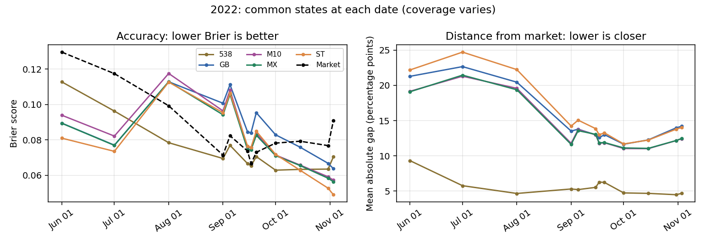

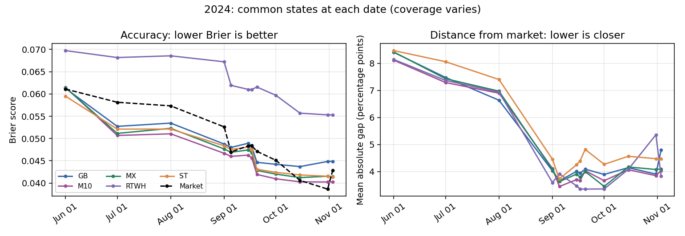

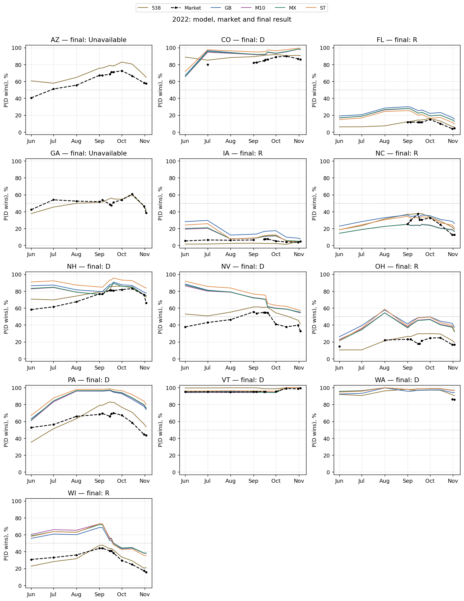

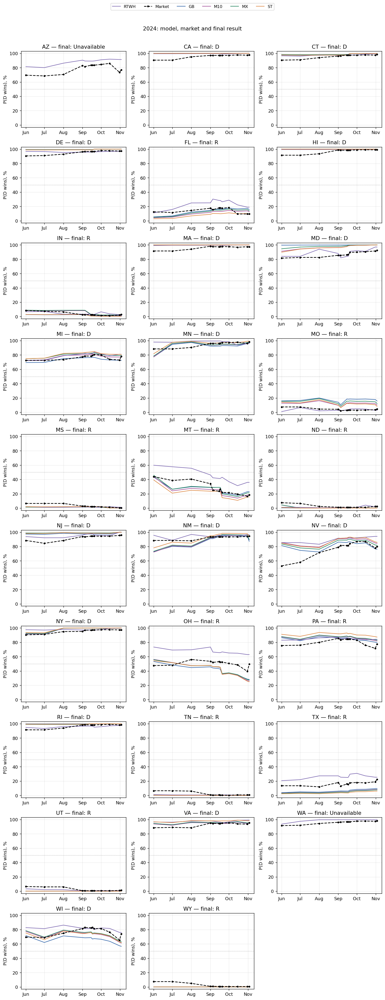

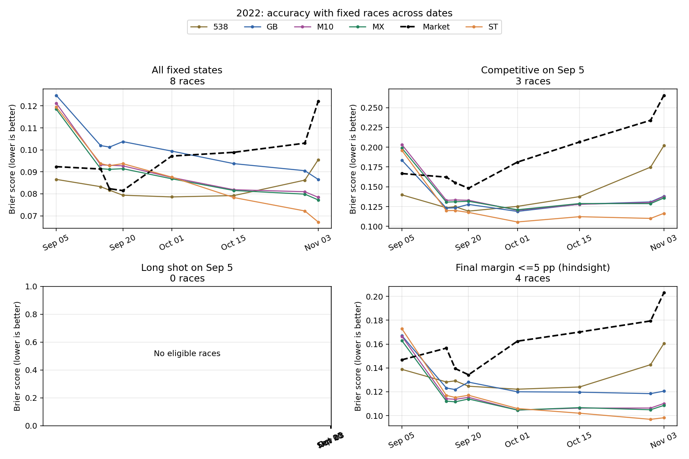

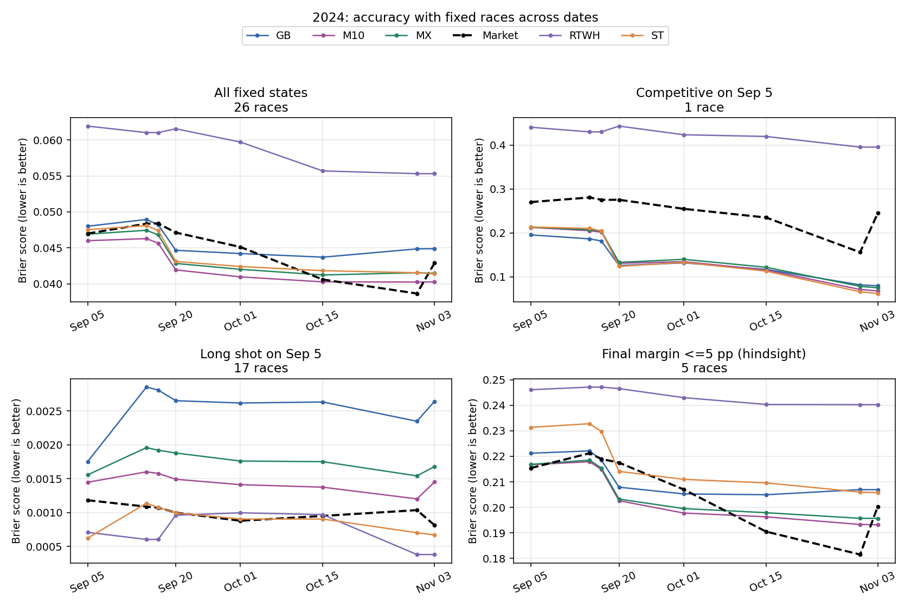

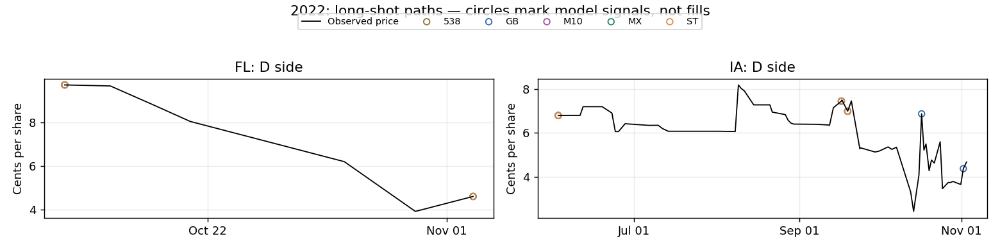

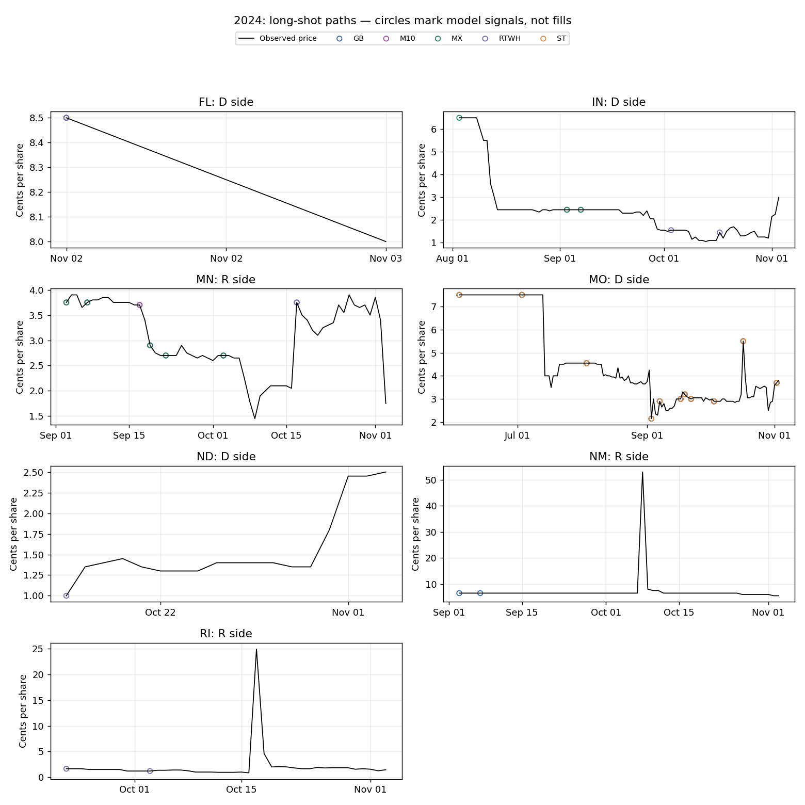

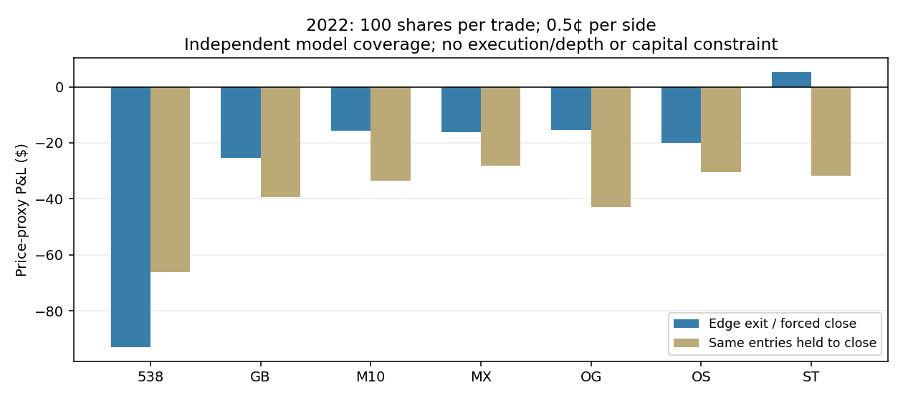

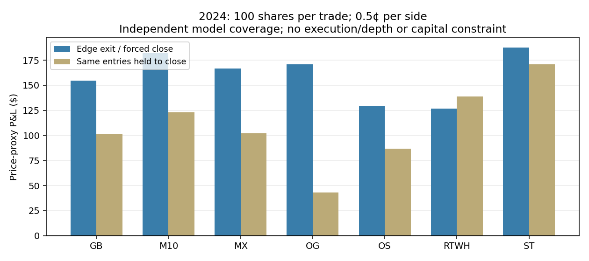

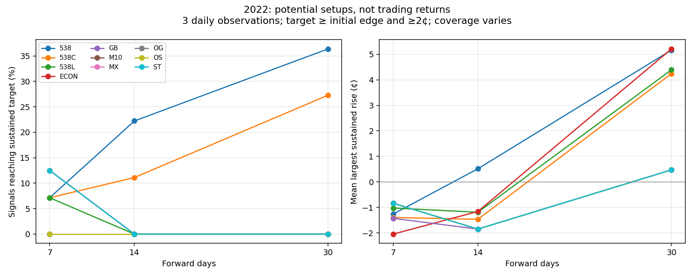

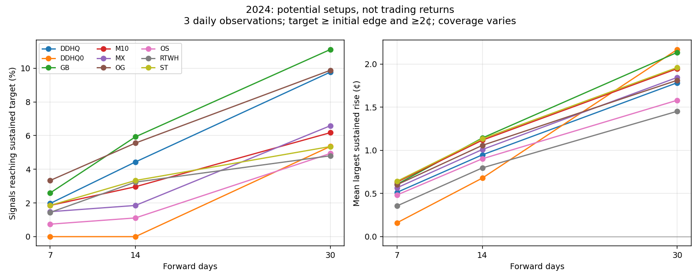

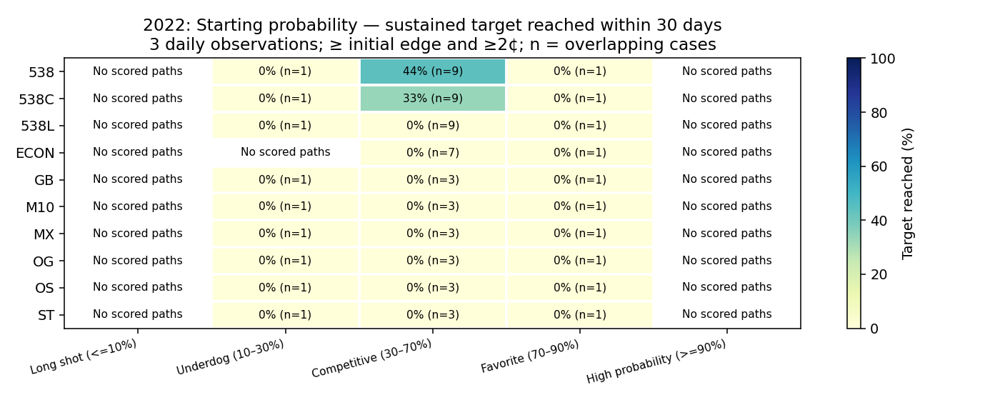

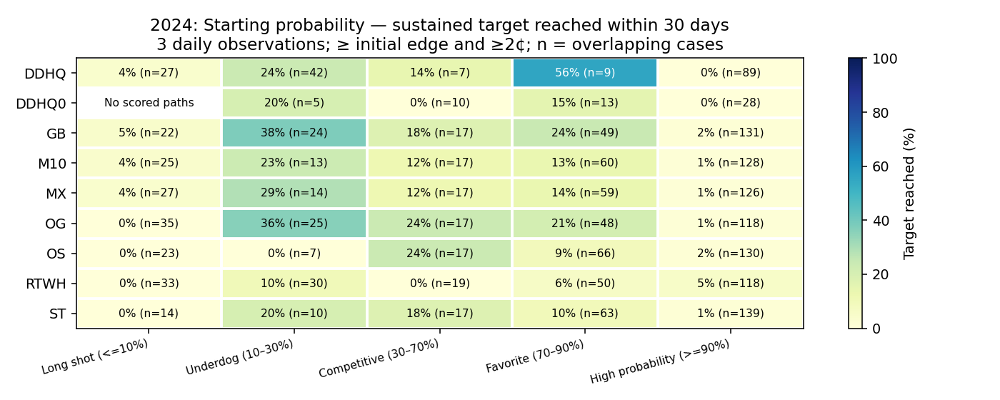

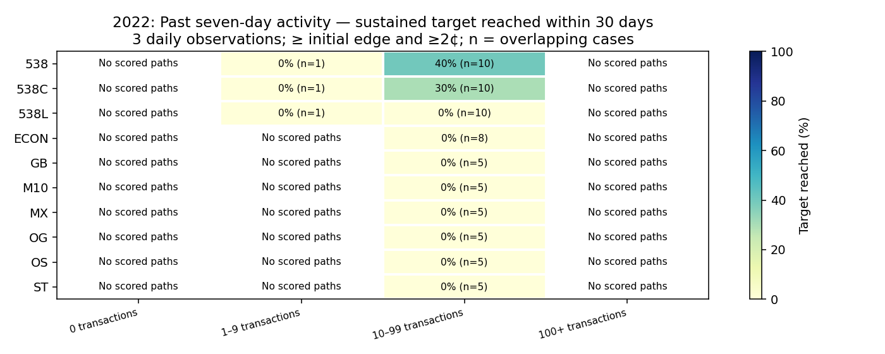

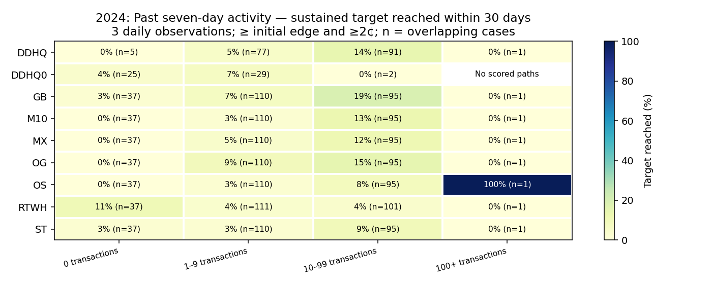

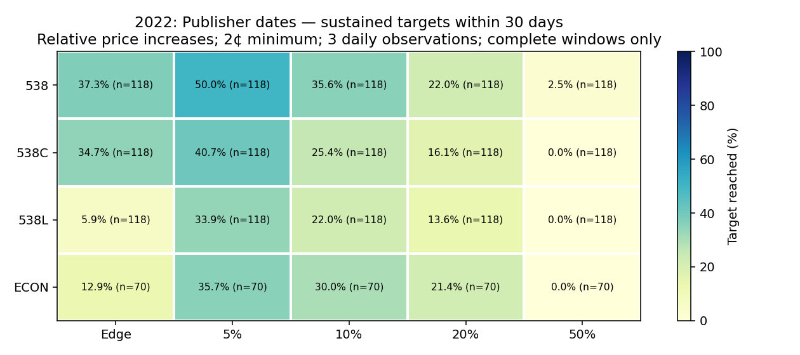

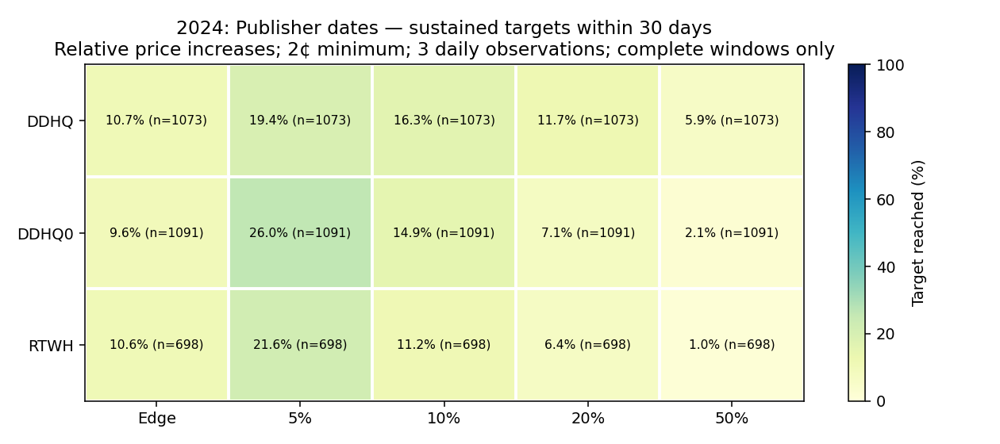

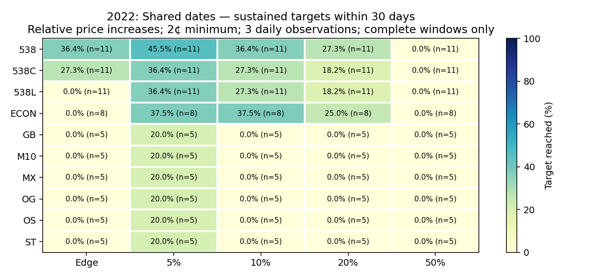

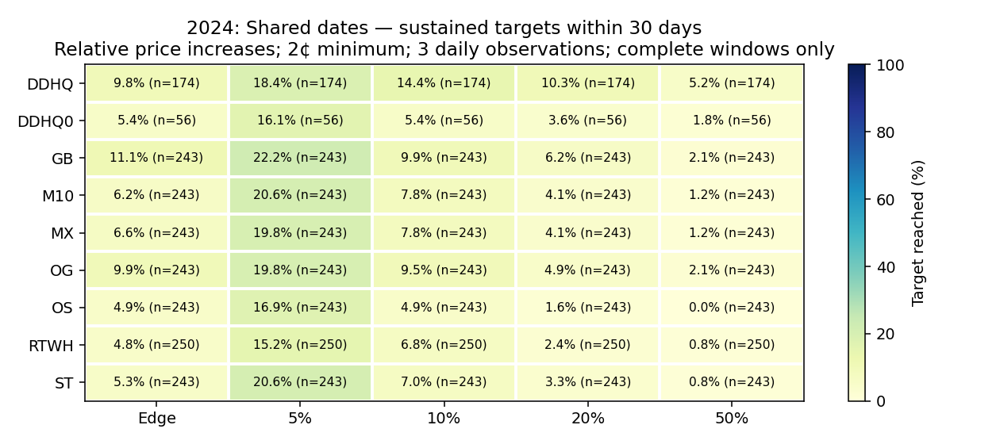

## Sustained price moves after model signals

Each model is evaluated separately at the same twelve historical check dates. Local forecasts must match the check date. Publisher forecasts must be dated on or before it and at most six days old; superseded versions are excluded. A forecast is usable after its dated day ends (UTC). The reference price is the first valid daily observation within the following 36 hours. No final result or future model update selects a signal. Both sides are retained as controls; a positive edge is initial model probability minus initial side price, without fees or an assumed trade.

We follow prices for 7, 14 and 30 days, strictly before the election. A sustained level is the lowest of three consecutive daily observations, spanning at least 36 hours, with no gap above 36 hours and no invalid observation between them. The largest such level is a hindsight path diagnostic, not a chosen exit. A qualifying move exceeds the larger of the initial positive edge and a 2-cent noise floor. Sensitivities use 1/2/3 cents and 2/3/5 consecutive observations. Days after the election are never substituted for a missing horizon. Primary hit rates use only full windows with at least 80% of expected daily observations and a valid endpoint within 36 hours. Incomplete windows remain visible and are not scored as failures.

Tables show case-weighted results and equal-market averages; dates within a race overlap and are not independent evidence. Hit rates alone do not rank calibration: large edges set harder targets. Compare sustained rises, endpoint changes, and edge bands as well. The paired-model table holds market and check date fixed, allowing each model its own signal side. A matched descriptive baseline uses other markets with nonpositive edge for the same model, cycle, horizon, check-date month and 5-percentage-point starting-price bin. Each control is tested against the signal's exact target; at least three control observations from two other markets are required. Missing matches stay missing. This comparison is descriptive, not a causal or held-out test.

Activity bands use distinct on-chain transaction hashes (CLOB) or distinct trade-event identifiers (legacy pools) during the seven days strictly before the reference time. This is a past-trading-activity proxy, not order-book depth or executable liquidity. Total lifetime market volume is never used. Unknown archive coverage stays Unknown. Neither persistent daily prices nor archive fills prove tradable size; this analysis reports potential setups, not earned profits.

GB: Gaussian Bayesian; ST: matched Student-t; OG: older Gaussian; OS: older Student-t; MX: four-model mixture; M10: mixture shifted 10% toward polling; 538: Deluxe; 538C: Classic; 538L: Lite; RTWH: Race to the WH; ECON: Economist original 2022 model (September 7 to October 30); DDHQ0: original 2024 DDHQ; DDHQ: revised 2024 DDHQ (August 27 onward).

A fixed 2-cent floor is unreachable when the starting price exceeds 98 cents. Those observations remain in their high-probability band; low hit rates there are partly mechanical. Scored 2022 coverage is sparse and cannot establish a reliable model ranking.

### Publisher retrieval coverage

|   cycle | publisher        | status                                          |   rows |
|--------:|:-----------------|:------------------------------------------------|-------:|
|    2022 | 538              | available                                       |   4896 |
|    2022 | 538C             | available                                       |   4224 |
|    2022 | 538L             | available                                       |   4224 |
|    2022 | ECON             | available                                       |    160 |
|    2022 | RTWH 2022 trend  | Not integrated: no validated dated state series |      0 |
|    2024 | 538 2024 archive | Not integrated: no validated dated state series |      0 |
|    2024 | DDHQ             | available                                       |   1980 |
|    2024 | DDHQ0            | available                                       |   1334 |
|    2024 | DDHQ0            | unavailable                                     |      0 |
|    2024 | RTWH             | available                                       |   2378 |

## All models on their own available observations

Each model uses its own available observations. Our six local models use their twelve reconstructed forecast dates; publishers use every recovered dated snapshot. Publisher shared-date rows are excluded here to avoid double-counting. No common-state, common-date or minimum-sample filter is imposed. Missing models are displayed explicitly. These tables are descriptive comparisons, not a matched-sample ranking: different dates, markets and signal sides can explain differences.

All signals have positive model edge. Columns show sustained Edge, 5%, 10%, 20% and 50% targets, with a 2-cent minimum and three consecutive observed days. Percentages use complete windows only; the coverage table and witnessed-setup tables also retain incomplete paths. N / markets means complete forecast observations / distinct markets contributing to that row. Overlapping dates are not independent trades. A blank rate is unscored, not zero. Subsets use the purchased side's initial probability, strictly prior seven-day trading activity, and initial edge; none uses the final election outcome. Activity is not executable liquidity. Targets above $1 remain in the denominator.

| Code   | Model                               |
|:-------|:------------------------------------|
| GB     | Gaussian Bayesian                   |
| ST     | Matched Student-t                   |
| OG     | Older Gaussian                      |
| OS     | Older Student-t                     |
| MX     | Four-model mixture                  |
| M10    | Mixture with 10% polling mean shift |
| 538    | 538 Deluxe                          |
| 538C   | 538 Classic                         |
| 538L   | 538 Lite                            |
| ECON   | Economist original                  |
| RTWH   | Race to the WH                      |
| DDHQ0  | DDHQ original                       |
| DDHQ   | DDHQ revised                        |

### 2022: 7-day targets, every model

| Model   | Scored / markets   |   Edge hit (%) |   5% hit (%) |   10% hit (%) |   20% hit (%) |   50% hit (%) |
|:--------|:-------------------|---------------:|-------------:|--------------:|--------------:|--------------:|
| GB      | 8 / 6              |            0.0 |         12.5 |           0.0 |           0.0 |           0.0 |
| ST      | 8 / 6              |           12.5 |         12.5 |           0.0 |           0.0 |           0.0 |
| OG      | 8 / 6              |           12.5 |         12.5 |           0.0 |           0.0 |           0.0 |
| OS      | 8 / 6              |            0.0 |         12.5 |           0.0 |           0.0 |           0.0 |
| MX      | 8 / 6              |           12.5 |         12.5 |           0.0 |           0.0 |           0.0 |
| M10     | 8 / 6              |           12.5 |         12.5 |           0.0 |           0.0 |           0.0 |
| 538     | 228 / 11           |            6.6 |         18.0 |           7.0 |           2.6 |           0.4 |
| 538C    | 228 / 11           |            5.3 |         18.0 |           6.6 |           2.6 |           0.9 |
| 538L    | 228 / 11           |            1.3 |         14.9 |           6.1 |           2.2 |           0.9 |
| ECON    | 68 / 4             |            0.0 |         11.8 |           1.5 |           0.0 |           0.0 |
| RTWH    | —                |          —   |        —   |         —   |         —   |         —   |
| DDHQ0   | —                |          —   |        —   |         —   |         —   |         —   |
| DDHQ    | —                |          —   |        —   |         —   |         —   |         —   |

### 2022: 14-day targets, every model

| Model   | Scored / markets   |   Edge hit (%) |   5% hit (%) |   10% hit (%) |   20% hit (%) |   50% hit (%) |
|:--------|:-------------------|---------------:|-------------:|--------------:|--------------:|--------------:|
| GB      | 4 / 3              |            0.0 |          0.0 |           0.0 |           0.0 |           0.0 |
| ST      | 4 / 3              |            0.0 |          0.0 |           0.0 |           0.0 |           0.0 |
| OG      | 4 / 3              |            0.0 |          0.0 |           0.0 |           0.0 |           0.0 |
| OS      | 4 / 3              |            0.0 |          0.0 |           0.0 |           0.0 |           0.0 |
| MX      | 4 / 3              |            0.0 |          0.0 |           0.0 |           0.0 |           0.0 |
| M10     | 4 / 3              |            0.0 |          0.0 |           0.0 |           0.0 |           0.0 |
| 538     | 148 / 8            |           13.5 |         24.3 |          12.8 |           7.4 |           0.7 |
| 538C    | 148 / 8            |           11.5 |         20.9 |           8.1 |           2.0 |           0.7 |
| 538L    | 148 / 8            |            0.0 |         14.9 |           6.8 |           2.0 |           0.7 |
| ECON    | 70 / 4             |            0.0 |         14.3 |           5.7 |           0.0 |           0.0 |
| RTWH    | —                |          —   |        —   |         —   |         —   |         —   |
| DDHQ0   | —                |          —   |        —   |         —   |         —   |         —   |
| DDHQ    | —                |          —   |        —   |         —   |         —   |         —   |

### 2022: 30-day targets, every model

| Model   | Scored / markets   |   Edge hit (%) |   5% hit (%) |   10% hit (%) |   20% hit (%) |   50% hit (%) |
|:--------|:-------------------|---------------:|-------------:|--------------:|--------------:|--------------:|
| GB      | 5 / 2              |            0.0 |         20.0 |           0.0 |           0.0 |           0.0 |
| ST      | 5 / 2              |            0.0 |         20.0 |           0.0 |           0.0 |           0.0 |
| OG      | 5 / 2              |            0.0 |         20.0 |           0.0 |           0.0 |           0.0 |
| OS      | 5 / 2              |            0.0 |         20.0 |           0.0 |           0.0 |           0.0 |
| MX      | 5 / 2              |            0.0 |         20.0 |           0.0 |           0.0 |           0.0 |
| M10     | 5 / 2              |            0.0 |         20.0 |           0.0 |           0.0 |           0.0 |
| 538     | 118 / 6            |           37.3 |         50.0 |          35.6 |          22.0 |           2.5 |
| 538C    | 118 / 6            |           34.7 |         40.7 |          25.4 |          16.1 |           0.0 |
| 538L    | 118 / 6            |            5.9 |         33.9 |          22.0 |          13.6 |           0.0 |
| ECON    | 70 / 4             |           12.9 |         35.7 |          30.0 |          21.4 |           0.0 |
| RTWH    | —                |          —   |        —   |         —   |         —   |         —   |
| DDHQ0   | —                |          —   |        —   |         —   |         —   |         —   |
| DDHQ    | —                |          —   |        —   |         —   |         —   |         —   |

Coverage (observations overlap):

| Model   | Forecast dates   |   Dates |   Signals |   Markets |   Complete paths |   Partial paths |
|:--------|:-----------------|--------:|----------:|----------:|-----------------:|----------------:|
| GB      | Jun 01–Nov 03    |      12 |        58 |        11 |                5 |              53 |
| ST      | Jun 01–Nov 03    |      12 |        58 |        11 |                5 |              53 |
| OG      | Jun 01–Nov 03    |      12 |        58 |        11 |                5 |              53 |
| OS      | Jun 01–Nov 03    |      12 |        58 |        11 |                5 |              53 |
| MX      | Jun 01–Nov 03    |      12 |        58 |        11 |                5 |              53 |
| M10     | Jun 01–Nov 03    |      12 |        58 |        11 |                5 |              53 |
| 538     | Jun 30–Nov 06    |     129 |       871 |        13 |              118 |             753 |
| 538C    | Jun 30–Nov 06    |     129 |       871 |        13 |              118 |             753 |
| 538L    | Jun 30–Nov 06    |     129 |       871 |        13 |              118 |             753 |
| ECON    | Sep 07–Oct 16    |      40 |       129 |         4 |               70 |              59 |
| RTWH    | Unavailable      |     — |       — |       — |              — |             — |
| DDHQ0   | Unavailable      |     — |       — |       — |              — |             — |
| DDHQ    | Unavailable      |     — |       — |       — |              — |             — |

Observed sustained setups, including witnesses in incomplete paths:

| Model   | Signals / markets   |   Edge setups |   5% setups |   10% setups |   20% setups |   50% setups |
|:--------|:--------------------|--------------:|------------:|-------------:|-------------:|-------------:|
| GB      | 58 / 11             |             1 |           5 |            3 |            0 |            0 |
| ST      | 58 / 11             |             1 |           5 |            3 |            0 |            0 |
| OG      | 58 / 11             |             0 |           6 |            3 |            0 |            0 |
| OS      | 58 / 11             |             0 |           6 |            3 |            0 |            0 |
| MX      | 58 / 11             |             0 |           6 |            3 |            0 |            0 |
| M10     | 58 / 11             |             1 |           6 |            3 |            0 |            0 |
| 538     | 871 / 13            |            97 |         177 |          109 |           59 |           17 |
| 538C    | 871 / 13            |            94 |         200 |          130 |           60 |           10 |
| 538L    | 871 / 13            |            37 |         182 |          124 |           54 |            7 |
| ECON    | 129 / 4             |             9 |          31 |           21 |           15 |            0 |
| RTWH    | —                 |           — |         — |          — |          — |          — |
| DDHQ0   | —                 |           — |         — |          — |          — |          — |
| DDHQ    | —                 |           — |         — |          — |          — |          — |

### 2024: 7-day targets, every model

| Model   | Scored / markets   |   Edge hit (%) |   5% hit (%) |   10% hit (%) |   20% hit (%) |   50% hit (%) |
|:--------|:-------------------|---------------:|-------------:|--------------:|--------------:|--------------:|
| GB      | 270 / 27           |            2.6 |          6.3 |           2.6 |           1.5 |           0.0 |
| ST      | 270 / 27           |            1.9 |          5.9 |           1.9 |           1.1 |           0.0 |
| OG      | 270 / 27           |            3.3 |          6.7 |           3.0 |           1.5 |           0.0 |
| OS      | 270 / 27           |            0.7 |          5.2 |           1.5 |           0.7 |           0.0 |
| MX      | 270 / 27           |            1.5 |          5.6 |           1.9 |           1.1 |           0.0 |
| M10     | 270 / 27           |            1.9 |          5.9 |           1.9 |           1.1 |           0.0 |
| 538     | —                |          —   |        —   |         —   |         —   |         —   |
| 538C    | —                |          —   |        —   |         —   |         —   |         —   |
| 538L    | —                |          —   |        —   |         —   |         —   |         —   |
| ECON    | —                |          —   |        —   |         —   |         —   |         —   |
| RTWH    | 837 / 28           |            1.3 |          3.9 |           1.9 |           0.7 |           0.2 |
| DDHQ0   | 1091 / 28          |            0.4 |          3.2 |           1.0 |           0.5 |           0.4 |
| DDHQ    | 1653 / 29          |            2.7 |          6.0 |           4.5 |           1.6 |           0.3 |

### 2024: 14-day targets, every model

| Model   | Scored / markets   |   Edge hit (%) |   5% hit (%) |   10% hit (%) |   20% hit (%) |   50% hit (%) |
|:--------|:-------------------|---------------:|-------------:|--------------:|--------------:|--------------:|
| GB      | 270 / 27           |            5.9 |         11.9 |           5.2 |           2.6 |           0.4 |
| ST      | 270 / 27           |            3.3 |         11.1 |           3.7 |           1.5 |           0.0 |
| OG      | 270 / 27           |            5.6 |         11.9 |           5.6 |           2.2 |           0.4 |
| OS      | 270 / 27           |            1.1 |          9.6 |           3.0 |           0.7 |           0.0 |
| MX      | 270 / 27           |            1.9 |         10.4 |           3.7 |           1.5 |           0.0 |
| M10     | 270 / 27           |            3.0 |         11.5 |           4.1 |           1.9 |           0.0 |
| 538     | —                |          —   |        —   |         —   |         —   |         —   |
| 538C    | —                |          —   |        —   |         —   |         —   |         —   |
| 538L    | —                |          —   |        —   |         —   |         —   |         —   |
| ECON    | —                |          —   |        —   |         —   |         —   |         —   |
| RTWH    | 809 / 28           |            3.6 |          9.3 |           4.9 |           2.5 |           0.4 |
| DDHQ0   | 1091 / 28          |            0.9 |          8.5 |           3.9 |           1.4 |           0.9 |
| DDHQ    | 1450 / 29          |            6.2 |         12.1 |          10.2 |           7.0 |           1.6 |

### 2024: 30-day targets, every model

| Model   | Scored / markets   |   Edge hit (%) |   5% hit (%) |   10% hit (%) |   20% hit (%) |   50% hit (%) |
|:--------|:-------------------|---------------:|-------------:|--------------:|--------------:|--------------:|
| GB      | 243 / 27           |           11.1 |         22.2 |           9.9 |           6.2 |           2.1 |
| ST      | 243 / 27           |            5.3 |         20.6 |           7.0 |           3.3 |           0.8 |
| OG      | 243 / 27           |            9.9 |         19.8 |           9.5 |           4.9 |           2.1 |
| OS      | 243 / 27           |            4.9 |         16.9 |           4.9 |           1.6 |           0.0 |
| MX      | 243 / 27           |            6.6 |         19.8 |           7.8 |           4.1 |           1.2 |
| M10     | 243 / 27           |            6.2 |         20.6 |           7.8 |           4.1 |           1.2 |
| 538     | —                |          —   |        —   |         —   |         —   |         —   |
| 538C    | —                |          —   |        —   |         —   |         —   |         —   |
| 538L    | —                |          —   |        —   |         —   |         —   |         —   |
| ECON    | —                |          —   |        —   |         —   |         —   |         —   |
| RTWH    | 698 / 28           |           10.6 |         21.6 |          11.2 |           6.4 |           1.0 |
| DDHQ0   | 1091 / 28          |            9.6 |         26.0 |          14.9 |           7.1 |           2.1 |
| DDHQ    | 1073 / 29          |           10.7 |         19.4 |          16.3 |          11.7 |           5.9 |

Coverage (observations overlap):

| Model   | Forecast dates   |   Dates |   Signals |   Markets |   Complete paths |   Partial paths |
|:--------|:-----------------|--------:|----------:|----------:|-----------------:|----------------:|
| GB      | Jun 01–Nov 03    |      12 |       324 |        27 |              243 |              81 |
| ST      | Jun 01–Nov 03    |      12 |       324 |        27 |              243 |              81 |
| OG      | Jun 01–Nov 03    |      12 |       324 |        27 |              243 |              81 |
| OS      | Jun 01–Nov 03    |      12 |       324 |        27 |              243 |              81 |
| MX      | Jun 01–Nov 03    |      12 |       324 |        27 |              243 |              81 |
| M10     | Jun 01–Nov 03    |      12 |       324 |        27 |              243 |              81 |
| 538     | Unavailable      |     — |       — |       — |              — |             — |
| 538C    | Unavailable      |     — |       — |       — |              — |             — |
| 538L    | Unavailable      |     — |       — |       — |              — |             — |
| ECON    | Unavailable      |     — |       — |       — |              — |             — |
| RTWH    | Jun 02–Oct 30    |      31 |       865 |        28 |              698 |             167 |
| DDHQ0   | Jun 02–Jul 18    |      39 |      1091 |        28 |             1091 |               0 |
| DDHQ    | Aug 27–Nov 03    |      64 |      1856 |        29 |             1073 |             783 |

Observed sustained setups, including witnesses in incomplete paths:

| Model   | Signals / markets   |   Edge setups |   5% setups |   10% setups |   20% setups |   50% setups |
|:--------|:--------------------|--------------:|------------:|-------------:|-------------:|-------------:|
| GB      | 324 / 27            |            27 |          54 |           24 |           15 |            5 |
| ST      | 324 / 27            |            13 |          50 |           17 |            8 |            2 |
| OG      | 324 / 27            |            24 |          48 |           23 |           12 |            5 |
| OS      | 324 / 27            |            12 |          41 |           12 |            4 |            0 |
| MX      | 324 / 27            |            16 |          48 |           19 |           10 |            3 |
| M10     | 324 / 27            |            15 |          50 |           19 |           10 |            3 |
| 538     | —                 |           — |         — |          — |          — |          — |
| 538C    | —                 |           — |         — |          — |          — |          — |
| 538L    | —                 |           — |         — |          — |          — |          — |
| ECON    | —                 |           — |         — |          — |          — |          — |
| RTWH    | 865 / 28            |            81 |         172 |           90 |           50 |            9 |
| DDHQ0   | 1091 / 28           |           105 |         284 |          163 |           78 |           23 |
| DDHQ    | 1856 / 29           |           219 |         333 |          276 |          198 |           96 |

### 2022: Starting probability — Competitive (30–70%) (30 days)

| Model   | Scored / markets   |   Edge hit (%) |   5% hit (%) |   10% hit (%) |   20% hit (%) |   50% hit (%) |
|:--------|:-------------------|---------------:|-------------:|--------------:|--------------:|--------------:|
| GB      | 3 / 1              |            0.0 |          0.0 |           0.0 |           0.0 |           0.0 |
| ST      | 3 / 1              |            0.0 |          0.0 |           0.0 |           0.0 |           0.0 |
| OG      | 3 / 1              |            0.0 |          0.0 |           0.0 |           0.0 |           0.0 |
| OS      | 3 / 1              |            0.0 |          0.0 |           0.0 |           0.0 |           0.0 |
| MX      | 3 / 1              |            0.0 |          0.0 |           0.0 |           0.0 |           0.0 |
| M10     | 3 / 1              |            0.0 |          0.0 |           0.0 |           0.0 |           0.0 |
| 538     | 100 / 5            |           43.0 |         52.0 |          40.0 |          25.0 |           2.0 |
| 538C    | 100 / 5            |           41.0 |         42.0 |          29.0 |          19.0 |           0.0 |
| 538L    | 100 / 5            |            7.0 |         34.0 |          25.0 |          16.0 |           0.0 |
| ECON    | 62 / 4             |           14.5 |         40.3 |          33.9 |          24.2 |           0.0 |
| RTWH    | —                |          —   |        —   |         —   |         —   |         —   |
| DDHQ0   | —                |          —   |        —   |         —   |         —   |         —   |
| DDHQ    | —                |          —   |        —   |         —   |         —   |         —   |

### 2022: Starting probability — Favorite (70–90%) (30 days)

| Model   | Scored / markets   |   Edge hit (%) |   5% hit (%) |   10% hit (%) |   20% hit (%) |   50% hit (%) |
|:--------|:-------------------|---------------:|-------------:|--------------:|--------------:|--------------:|
| GB      | 1 / 1              |            0.0 |          0.0 |           0.0 |           0.0 |           0.0 |
| ST      | 1 / 1              |            0.0 |          0.0 |           0.0 |           0.0 |           0.0 |
| OG      | 1 / 1              |            0.0 |          0.0 |           0.0 |           0.0 |           0.0 |
| OS      | 1 / 1              |            0.0 |          0.0 |           0.0 |           0.0 |           0.0 |
| MX      | 1 / 1              |            0.0 |          0.0 |           0.0 |           0.0 |           0.0 |
| M10     | 1 / 1              |            0.0 |          0.0 |           0.0 |           0.0 |           0.0 |
| 538     | 11 / 3             |            0.0 |          0.0 |           0.0 |           0.0 |           0.0 |
| 538C    | 12 / 3             |            0.0 |          0.0 |           0.0 |           0.0 |           0.0 |
| 538L    | 12 / 3             |            0.0 |          0.0 |           0.0 |           0.0 |           0.0 |
| ECON    | 8 / 2              |            0.0 |          0.0 |           0.0 |           0.0 |           0.0 |
| RTWH    | —                |          —   |        —   |         —   |         —   |         —   |
| DDHQ0   | —                |          —   |        —   |         —   |         —   |         —   |
| DDHQ    | —                |          —   |        —   |         —   |         —   |         —   |

### 2022: Starting probability — High probability (>=90%) (30 days)

| Model   | Scored / markets   |   Edge hit (%) |   5% hit (%) |   10% hit (%) |   20% hit (%) |   50% hit (%) |
|:--------|:-------------------|---------------:|-------------:|--------------:|--------------:|--------------:|
| GB      | 0 / 0              |            — |          — |           — |           — |           — |
| ST      | 0 / 0              |            — |          — |           — |           — |           — |
| OG      | 0 / 0              |            — |          — |           — |           — |           — |
| OS      | 0 / 0              |            — |          — |           — |           — |           — |
| MX      | 0 / 0              |            — |          — |           — |           — |           — |
| M10     | 0 / 0              |            — |          — |           — |           — |           — |
| 538     | 0 / 0              |            — |          — |           — |           — |           — |
| 538C    | 0 / 0              |            — |          — |           — |           — |           — |
| 538L    | 0 / 0              |            — |          — |           — |           — |           — |
| ECON    | —                |            — |          — |           — |           — |           — |
| RTWH    | —                |            — |          — |           — |           — |           — |
| DDHQ0   | —                |            — |          — |           — |           — |           — |
| DDHQ    | —                |            — |          — |           — |           — |           — |

### 2022: Starting probability — Long shot (<=10%) (30 days)

| Model   | Scored / markets   |   Edge hit (%) |   5% hit (%) |   10% hit (%) |   20% hit (%) |   50% hit (%) |
|:--------|:-------------------|---------------:|-------------:|--------------:|--------------:|--------------:|
| GB      | 0 / 0              |            — |          — |           — |           — |           — |
| ST      | 0 / 0              |            — |          — |           — |           — |           — |
| OG      | 0 / 0              |            — |          — |           — |           — |           — |
| OS      | 0 / 0              |            — |          — |           — |           — |           — |
| MX      | 0 / 0              |            — |          — |           — |           — |           — |
| M10     | 0 / 0              |            — |          — |           — |           — |           — |
| 538     | 0 / 0              |            — |          — |           — |           — |           — |
| 538C    | 0 / 0              |            — |          — |           — |           — |           — |
| 538L    | 0 / 0              |            — |          — |           — |           — |           — |
| ECON    | —                |            — |          — |           — |           — |           — |
| RTWH    | —                |            — |          — |           — |           — |           — |
| DDHQ0   | —                |            — |          — |           — |           — |           — |
| DDHQ    | —                |            — |          — |           — |           — |           — |

### 2022: Starting probability — Underdog (10–30%) (30 days)

| Model   | Scored / markets   |   Edge hit (%) |   5% hit (%) |   10% hit (%) |   20% hit (%) |   50% hit (%) |
|:--------|:-------------------|---------------:|-------------:|--------------:|--------------:|--------------:|
| GB      | 1 / 1              |            0.0 |        100.0 |           0.0 |           0.0 |           0.0 |
| ST      | 1 / 1              |            0.0 |        100.0 |           0.0 |           0.0 |           0.0 |
| OG      | 1 / 1              |            0.0 |        100.0 |           0.0 |           0.0 |           0.0 |
| OS      | 1 / 1              |            0.0 |        100.0 |           0.0 |           0.0 |           0.0 |
| MX      | 1 / 1              |            0.0 |        100.0 |           0.0 |           0.0 |           0.0 |
| M10     | 1 / 1              |            0.0 |        100.0 |           0.0 |           0.0 |           0.0 |
| 538     | 7 / 2              |           14.3 |        100.0 |          28.6 |          14.3 |          14.3 |
| 538C    | 6 / 1              |            0.0 |        100.0 |          16.7 |           0.0 |           0.0 |
| 538L    | 6 / 1              |            0.0 |        100.0 |          16.7 |           0.0 |           0.0 |
| ECON    | —                |          —   |        —   |         —   |         —   |         —   |
| RTWH    | —                |          —   |        —   |         —   |         —   |         —   |
| DDHQ0   | —                |          —   |        —   |         —   |         —   |         —   |
| DDHQ    | —                |          —   |        —   |         —   |         —   |         —   |

### 2024: Starting probability — Competitive (30–70%) (30 days)

| Model   | Scored / markets   |   Edge hit (%) |   5% hit (%) |   10% hit (%) |   20% hit (%) |   50% hit (%) |
|:--------|:-------------------|---------------:|-------------:|--------------:|--------------:|--------------:|
| GB      | 17 / 4             |           17.6 |         88.2 |          47.1 |          23.5 |           0.0 |
| ST      | 17 / 4             |           17.6 |         88.2 |          47.1 |          23.5 |           0.0 |
| OG      | 17 / 4             |           23.5 |         82.4 |          47.1 |          23.5 |           0.0 |
| OS      | 17 / 4             |           23.5 |         82.4 |          47.1 |          23.5 |           0.0 |
| MX      | 17 / 4             |           11.8 |         82.4 |          47.1 |          23.5 |           0.0 |
| M10     | 17 / 4             |           11.8 |         82.4 |          47.1 |          23.5 |           0.0 |
| 538     | —                |          —   |        —   |         —   |         —   |         —   |
| 538C    | —                |          —   |        —   |         —   |         —   |         —   |
| 538L    | —                |          —   |        —   |         —   |         —   |         —   |
| ECON    | —                |          —   |        —   |         —   |         —   |         —   |
| RTWH    | 86 / 7             |           10.5 |         51.2 |          40.7 |          24.4 |           1.2 |
| DDHQ0   | 204 / 7            |           17.2 |         53.9 |          45.6 |          18.6 |           2.9 |
| DDHQ    | 43 / 2             |           18.6 |         27.9 |          14.0 |           0.0 |           0.0 |

### 2024: Starting probability — Favorite (70–90%) (30 days)

| Model   | Scored / markets   |   Edge hit (%) |   5% hit (%) |   10% hit (%) |   20% hit (%) |   50% hit (%) |
|:--------|:-------------------|---------------:|-------------:|--------------:|--------------:|--------------:|
| GB      | 49 / 10            |           24.5 |         40.8 |           6.1 |           0.0 |           0.0 |
| ST      | 63 / 11            |            9.5 |         38.1 |           6.3 |           0.0 |           0.0 |
| OG      | 48 / 10            |           20.8 |         33.3 |           6.2 |           0.0 |           0.0 |
| OS      | 66 / 11            |            9.1 |         31.8 |           6.1 |           0.0 |           0.0 |
| MX      | 59 / 11            |           13.6 |         35.6 |           6.8 |           0.0 |           0.0 |
| M10     | 60 / 11            |           13.3 |         38.3 |           6.7 |           0.0 |           0.0 |
| 538     | —                |          —   |        —   |         —   |         —   |         —   |
| 538C    | —                |          —   |        —   |         —   |         —   |         —   |
| 538L    | —                |          —   |        —   |         —   |         —   |         —   |
| ECON    | —                |          —   |        —   |         —   |         —   |         —   |
| RTWH    | 138 / 11           |           18.8 |         32.6 |          10.1 |           0.0 |           0.0 |
| DDHQ0   | 237 / 7            |           15.2 |         22.8 |          11.0 |           0.4 |           0.0 |
| DDHQ    | 41 / 4             |           36.6 |         70.7 |           7.3 |           0.0 |           0.0 |

### 2024: Starting probability — High probability (>=90%) (30 days)

| Model   | Scored / markets   |   Edge hit (%) |   5% hit (%) |   10% hit (%) |   20% hit (%) |   50% hit (%) |
|:--------|:-------------------|---------------:|-------------:|--------------:|--------------:|--------------:|
| GB      | 131 / 18           |            1.5 |          4.6 |           0.0 |           0.0 |           0.0 |
| ST      | 139 / 18           |            1.4 |          4.3 |           0.0 |           0.0 |           0.0 |
| OG      | 118 / 16           |            0.8 |          5.1 |           0.0 |           0.0 |           0.0 |
| OS      | 130 / 17           |            1.5 |          4.6 |           0.0 |           0.0 |           0.0 |
| MX      | 126 / 17           |            0.8 |          4.8 |           0.0 |           0.0 |           0.0 |
| M10     | 128 / 18           |            0.8 |          4.7 |           0.0 |           0.0 |           0.0 |
| 538     | —                |          —   |        —   |         —   |         —   |         —   |
| 538C    | —                |          —   |        —   |         —   |         —   |         —   |
| 538L    | —                |          —   |        —   |         —   |         —   |         —   |
| ECON    | —                |          —   |        —   |         —   |         —   |         —   |
| RTWH    | 347 / 19           |            8.6 |          9.5 |           0.0 |           0.0 |           0.0 |
| DDHQ0   | 549 / 15           |            2.2 |         13.8 |           0.0 |           0.0 |           0.0 |
| DDHQ    | 556 / 17           |            0.0 |          0.0 |           0.0 |           0.0 |           0.0 |

### 2024: Starting probability — Long shot (<=10%) (30 days)

| Model   | Scored / markets   |   Edge hit (%) |   5% hit (%) |   10% hit (%) |   20% hit (%) |   50% hit (%) |
|:--------|:-------------------|---------------:|-------------:|--------------:|--------------:|--------------:|
| GB      | 22 / 6             |            4.5 |          4.5 |           4.5 |           4.5 |           0.0 |
| ST      | 14 / 5             |            0.0 |          0.0 |           0.0 |           0.0 |           0.0 |
| OG      | 35 / 6             |            0.0 |          2.9 |           2.9 |           2.9 |           0.0 |
| OS      | 23 / 3             |            0.0 |          0.0 |           0.0 |           0.0 |           0.0 |
| MX      | 27 / 5             |            3.7 |          3.7 |           3.7 |           3.7 |           0.0 |
| M10     | 25 / 5             |            4.0 |          4.0 |           4.0 |           4.0 |           0.0 |
| 538     | —                |          —   |        —   |         —   |         —   |         —   |
| 538C    | —                |          —   |        —   |         —   |         —   |         —   |
| 538L    | —                |          —   |        —   |         —   |         —   |         —   |
| ECON    | —                |          —   |        —   |         —   |         —   |         —   |
| RTWH    | 59 / 10            |            0.0 |          0.0 |           0.0 |           0.0 |           0.0 |
| DDHQ0   | —                |          —   |        —   |         —   |         —   |         —   |
| DDHQ    | 159 / 5            |            7.5 |         12.6 |          12.6 |          12.6 |           0.0 |

### 2024: Starting probability — Underdog (10–30%) (30 days)

| Model   | Scored / markets   |   Edge hit (%) |   5% hit (%) |   10% hit (%) |   20% hit (%) |   50% hit (%) |
|:--------|:-------------------|---------------:|-------------:|--------------:|--------------:|--------------:|
| GB      | 24 / 6             |           37.5 |         50.0 |          50.0 |          41.7 |          20.8 |
| ST      | 10 / 3             |           20.0 |         50.0 |          50.0 |          40.0 |          20.0 |
| OG      | 25 / 8             |           36.0 |         44.0 |          44.0 |          28.0 |          20.0 |
| OS      | 7 / 3              |            0.0 |          0.0 |           0.0 |           0.0 |           0.0 |
| MX      | 14 / 5             |           28.6 |         42.9 |          42.9 |          35.7 |          21.4 |
| M10     | 13 / 5             |           23.1 |         46.2 |          46.2 |          38.5 |          23.1 |
| 538     | —                |          —   |        —   |         —   |         —   |         —   |
| 538C    | —                |          —   |        —   |         —   |         —   |         —   |
| 538L    | —                |          —   |        —   |         —   |         —   |         —   |
| ECON    | —                |          —   |        —   |         —   |         —   |         —   |
| RTWH    | 68 / 6             |           13.2 |         42.6 |          42.6 |          35.3 |           8.8 |
| DDHQ0   | 101 / 3            |           21.8 |         43.6 |          43.6 |          38.6 |          16.8 |
| DDHQ    | 274 / 8            |           29.2 |         53.6 |          53.3 |          38.7 |          23.0 |

### 2022: Past trading activity — 0 transactions (30 days)

| Model   | Scored / markets   |   Edge hit (%) |   5% hit (%) |   10% hit (%) |   20% hit (%) |   50% hit (%) |
|:--------|:-------------------|---------------:|-------------:|--------------:|--------------:|--------------:|
| GB      | 0 / 0              |            — |          — |           — |           — |           — |
| ST      | 0 / 0              |            — |          — |           — |           — |           — |
| OG      | 0 / 0              |            — |          — |           — |           — |           — |
| OS      | 0 / 0              |            — |          — |           — |           — |           — |
| MX      | 0 / 0              |            — |          — |           — |           — |           — |
| M10     | 0 / 0              |            — |          — |           — |           — |           — |
| 538     | 0 / 0              |            — |          — |           — |           — |           — |
| 538C    | 0 / 0              |            — |          — |           — |           — |           — |
| 538L    | 0 / 0              |            — |          — |           — |           — |           — |
| ECON    | 0 / 0              |            — |          — |           — |           — |           — |
| RTWH    | —                |            — |          — |           — |           — |           — |
| DDHQ0   | —                |            — |          — |           — |           — |           — |
| DDHQ    | —                |            — |          — |           — |           — |           — |

### 2022: Past trading activity — 100+ transactions (30 days)

| Model   | Scored / markets   |   Edge hit (%) |   5% hit (%) |   10% hit (%) |   20% hit (%) |   50% hit (%) |
|:--------|:-------------------|---------------:|-------------:|--------------:|--------------:|--------------:|
| GB      | 0 / 0              |            — |          — |           — |           — |           — |
| ST      | 0 / 0              |            — |          — |           — |           — |           — |
| OG      | 0 / 0              |            — |          — |           — |           — |           — |
| OS      | 0 / 0              |            — |          — |           — |           — |           — |
| MX      | 0 / 0              |            — |          — |           — |           — |           — |
| M10     | 0 / 0              |            — |          — |           — |           — |           — |
| 538     | 0 / 0              |            — |          — |           — |           — |           — |
| 538C    | 0 / 0              |            — |          — |           — |           — |           — |
| 538L    | 0 / 0              |            — |          — |           — |           — |           — |
| ECON    | —                |            — |          — |           — |           — |           — |
| RTWH    | —                |            — |          — |           — |           — |           — |
| DDHQ0   | —                |            — |          — |           — |           — |           — |
| DDHQ    | —                |            — |          — |           — |           — |           — |

### 2022: Past trading activity — 10–99 transactions (30 days)

| Model   | Scored / markets   |   Edge hit (%) |   5% hit (%) |   10% hit (%) |   20% hit (%) |   50% hit (%) |
|:--------|:-------------------|---------------:|-------------:|--------------:|--------------:|--------------:|
| GB      | 5 / 2              |            0.0 |         20.0 |           0.0 |           0.0 |           0.0 |
| ST      | 5 / 2              |            0.0 |         20.0 |           0.0 |           0.0 |           0.0 |
| OG      | 5 / 2              |            0.0 |         20.0 |           0.0 |           0.0 |           0.0 |
| OS      | 5 / 2              |            0.0 |         20.0 |           0.0 |           0.0 |           0.0 |
| MX      | 5 / 2              |            0.0 |         20.0 |           0.0 |           0.0 |           0.0 |
| M10     | 5 / 2              |            0.0 |         20.0 |           0.0 |           0.0 |           0.0 |
| 538     | 103 / 5            |           42.7 |         57.3 |          40.8 |          25.2 |           2.9 |
| 538C    | 103 / 5            |           35.0 |         42.7 |          26.2 |          17.5 |           0.0 |
| 538L    | 103 / 5            |            4.9 |         35.0 |          22.3 |          14.6 |           0.0 |
| ECON    | 64 / 3             |           14.1 |         39.1 |          32.8 |          23.4 |           0.0 |
| RTWH    | —                |          —   |        —   |         —   |         —   |         —   |
| DDHQ0   | —                |          —   |        —   |         —   |         —   |         —   |
| DDHQ    | —                |          —   |        —   |         —   |         —   |         —   |

### 2022: Past trading activity — 1–9 transactions (30 days)

| Model   | Scored / markets   |   Edge hit (%) |   5% hit (%) |   10% hit (%) |   20% hit (%) |   50% hit (%) |
|:--------|:-------------------|---------------:|-------------:|--------------:|--------------:|--------------:|
| GB      | 0 / 0              |          —   |        —   |         —   |         —   |         —   |
| ST      | 0 / 0              |          —   |        —   |         —   |         —   |         —   |
| OG      | 0 / 0              |          —   |        —   |         —   |         —   |         —   |
| OS      | 0 / 0              |          —   |        —   |         —   |         —   |         —   |
| MX      | 0 / 0              |          —   |        —   |         —   |         —   |         —   |
| M10     | 0 / 0              |          —   |        —   |         —   |         —   |         —   |
| 538     | 15 / 6             |            0.0 |          0.0 |           0.0 |           0.0 |           0.0 |
| 538C    | 15 / 6             |           33.3 |         26.7 |          20.0 |           6.7 |           0.0 |
| 538L    | 15 / 6             |           13.3 |         26.7 |          20.0 |           6.7 |           0.0 |
| ECON    | 6 / 3              |            0.0 |          0.0 |           0.0 |           0.0 |           0.0 |
| RTWH    | —                |          —   |        —   |         —   |         —   |         —   |
| DDHQ0   | —                |          —   |        —   |         —   |         —   |         —   |
| DDHQ    | —                |          —   |        —   |         —   |         —   |         —   |

### 2024: Past trading activity — 0 transactions (30 days)

| Model   | Scored / markets   |   Edge hit (%) |   5% hit (%) |   10% hit (%) |   20% hit (%) |   50% hit (%) |
|:--------|:-------------------|---------------:|-------------:|--------------:|--------------:|--------------:|
| GB      | 37 / 22            |            2.7 |          8.1 |           0.0 |           0.0 |           0.0 |
| ST      | 37 / 22            |            2.7 |          8.1 |           0.0 |           0.0 |           0.0 |
| OG      | 37 / 22            |            0.0 |          8.1 |           0.0 |           0.0 |           0.0 |
| OS      | 37 / 22            |            0.0 |          8.1 |           0.0 |           0.0 |           0.0 |
| MX      | 37 / 22            |            0.0 |          8.1 |           0.0 |           0.0 |           0.0 |
| M10     | 37 / 22            |            0.0 |          8.1 |           0.0 |           0.0 |           0.0 |
| 538     | —                |          —   |        —   |         —   |         —   |         —   |
| 538C    | —                |          —   |        —   |         —   |         —   |         —   |
| 538L    | —                |          —   |        —   |         —   |         —   |         —   |
| ECON    | —                |          —   |        —   |         —   |         —   |         —   |
| RTWH    | 160 / 25           |           13.8 |         19.4 |           5.0 |           3.1 |           0.6 |
| DDHQ0   | 465 / 25           |            5.6 |         15.7 |           4.7 |           2.4 |           1.1 |
| DDHQ    | 24 / 8             |            0.0 |          0.0 |           0.0 |           0.0 |           0.0 |

### 2024: Past trading activity — 100+ transactions (30 days)

| Model   | Scored / markets   |   Edge hit (%) |   5% hit (%) |   10% hit (%) |   20% hit (%) |   50% hit (%) |
|:--------|:-------------------|---------------:|-------------:|--------------:|--------------:|--------------:|
| GB      | 1 / 1              |            0.0 |        100.0 |           0.0 |           0.0 |           0.0 |
| ST      | 1 / 1              |            0.0 |        100.0 |           0.0 |           0.0 |           0.0 |
| OG      | 1 / 1              |            0.0 |        100.0 |           0.0 |           0.0 |           0.0 |
| OS      | 1 / 1              |          100.0 |        100.0 |           0.0 |           0.0 |           0.0 |
| MX      | 1 / 1              |            0.0 |        100.0 |           0.0 |           0.0 |           0.0 |
| M10     | 1 / 1              |            0.0 |        100.0 |           0.0 |           0.0 |           0.0 |
| 538     | —                |          —   |        —   |         —   |         —   |         —   |
| 538C    | —                |          —   |        —   |         —   |         —   |         —   |
| 538L    | —                |          —   |        —   |         —   |         —   |         —   |
| ECON    | —                |          —   |        —   |         —   |         —   |         —   |
| RTWH    | 1 / 1              |            0.0 |          0.0 |           0.0 |           0.0 |           0.0 |
| DDHQ0   | —                |          —   |        —   |         —   |         —   |         —   |
| DDHQ    | 4 / 1              |            0.0 |          0.0 |           0.0 |           0.0 |           0.0 |

### 2024: Past trading activity — 10–99 transactions (30 days)

| Model   | Scored / markets   |   Edge hit (%) |   5% hit (%) |   10% hit (%) |   20% hit (%) |   50% hit (%) |
|:--------|:-------------------|---------------:|-------------:|--------------:|--------------:|--------------:|
| GB      | 95 / 27            |           18.9 |         34.7 |          20.0 |          11.6 |           2.1 |
| ST      | 95 / 27            |            9.5 |         32.6 |          14.7 |           6.3 |           1.1 |
| OG      | 95 / 27            |           14.7 |         29.5 |          17.9 |           8.4 |           2.1 |
| OS      | 95 / 27            |            8.4 |         26.3 |          11.6 |           4.2 |           0.0 |
| MX      | 95 / 27            |           11.6 |         30.5 |          15.8 |           7.4 |           1.1 |
| M10     | 95 / 27            |           12.6 |         33.7 |          16.8 |           8.4 |           2.1 |
| 538     | —                |          —   |        —   |         —   |         —   |         —   |
| 538C    | —                |          —   |        —   |         —   |         —   |         —   |
| 538L    | —                |          —   |        —   |         —   |         —   |         —   |
| ECON    | —                |          —   |        —   |         —   |         —   |         —   |
| RTWH    | 202 / 28           |            5.4 |         22.3 |          12.9 |           5.0 |           1.5 |
| DDHQ0   | 69 / 8             |            5.8 |         39.1 |          30.4 |           4.3 |           0.0 |
| DDHQ    | 596 / 29           |           14.1 |         25.8 |          21.1 |          14.1 |           7.4 |

### 2024: Past trading activity — 1–9 transactions (30 days)

| Model   | Scored / markets   |   Edge hit (%) |   5% hit (%) |   10% hit (%) |   20% hit (%) |   50% hit (%) |
|:--------|:-------------------|---------------:|-------------:|--------------:|--------------:|--------------:|
| GB      | 110 / 26           |            7.3 |         15.5 |           4.5 |           3.6 |           2.7 |
| ST      | 110 / 26           |            2.7 |         13.6 |           2.7 |           1.8 |           0.9 |
| OG      | 110 / 26           |            9.1 |         14.5 |           5.5 |           3.6 |           2.7 |
| OS      | 110 / 26           |            2.7 |         10.9 |           0.9 |           0.0 |           0.0 |
| MX      | 110 / 26           |            4.5 |         13.6 |           3.6 |           2.7 |           1.8 |
| M10     | 110 / 26           |            2.7 |         12.7 |           2.7 |           1.8 |           0.9 |
| 538     | —                |          —   |        —   |         —   |         —   |         —   |
| 538C    | —                |          —   |        —   |         —   |         —   |         —   |
| 538L    | —                |          —   |        —   |         —   |         —   |         —   |
| ECON    | —                |          —   |        —   |         —   |         —   |         —   |
| RTWH    | 335 / 28           |           12.2 |         22.4 |          13.1 |           9.0 |           0.9 |
| DDHQ0   | 557 / 28           |           13.5 |         33.0 |          21.5 |          11.5 |           3.2 |
| DDHQ    | 449 / 25           |            6.9 |         12.0 |          10.9 |           9.4 |           4.2 |

### 2022: Initial edge — 10¢+ (30 days)

| Model   | Scored / markets   |   Edge hit (%) |   5% hit (%) |   10% hit (%) |   20% hit (%) |   50% hit (%) |
|:--------|:-------------------|---------------:|-------------:|--------------:|--------------:|--------------:|
| GB      | 5 / 2              |            0.0 |         20.0 |           0.0 |           0.0 |           0.0 |
| ST      | 5 / 2              |            0.0 |         20.0 |           0.0 |           0.0 |           0.0 |
| OG      | 5 / 2              |            0.0 |         20.0 |           0.0 |           0.0 |           0.0 |
| OS      | 5 / 2              |            0.0 |         20.0 |           0.0 |           0.0 |           0.0 |
| MX      | 5 / 2              |            0.0 |         20.0 |           0.0 |           0.0 |           0.0 |
| M10     | 5 / 2              |            0.0 |         20.0 |           0.0 |           0.0 |           0.0 |
| 538     | 34 / 4             |            2.9 |          5.9 |           2.9 |           2.9 |           0.0 |
| 538C    | 56 / 5             |            8.9 |         21.4 |          10.7 |           8.9 |           0.0 |
| 538L    | 80 / 4             |            2.5 |         38.8 |          26.2 |          16.2 |           0.0 |
| ECON    | 58 / 3             |            3.4 |         24.1 |          20.7 |          15.5 |           0.0 |
| RTWH    | —                |          —   |        —   |         —   |         —   |         —   |
| DDHQ0   | —                |          —   |        —   |         —   |         —   |         —   |
| DDHQ    | —                |          —   |        —   |         —   |         —   |         —   |

### 2022: Initial edge — 2–5¢ (30 days)

| Model   | Scored / markets   |   Edge hit (%) |   5% hit (%) |   10% hit (%) |   20% hit (%) |   50% hit (%) |
|:--------|:-------------------|---------------:|-------------:|--------------:|--------------:|--------------:|
| GB      | 0 / 0              |          —   |        —   |         —   |         —   |         —   |
| ST      | 0 / 0              |          —   |        —   |         —   |         —   |         —   |
| OG      | 0 / 0              |          —   |        —   |         —   |         —   |         —   |
| OS      | 0 / 0              |          —   |        —   |         —   |         —   |         —   |
| MX      | 0 / 0              |          —   |        —   |         —   |         —   |         —   |
| M10     | 0 / 0              |          —   |        —   |         —   |         —   |         —   |
| 538     | 25 / 2             |           80.0 |         80.0 |          80.0 |          36.0 |           4.0 |
| 538C    | 29 / 2             |           55.2 |         62.1 |          44.8 |          17.2 |           0.0 |
| 538L    | 3 / 2              |           33.3 |         33.3 |          33.3 |           0.0 |           0.0 |
| ECON    | 2 / 2              |           50.0 |         50.0 |          50.0 |          50.0 |           0.0 |
| RTWH    | —                |          —   |        —   |         —   |         —   |         —   |
| DDHQ0   | —                |          —   |        —   |         —   |         —   |         —   |
| DDHQ    | —                |          —   |        —   |         —   |         —   |         —   |

### 2022: Initial edge — 5–10¢ (30 days)

| Model   | Scored / markets   |   Edge hit (%) |   5% hit (%) |   10% hit (%) |   20% hit (%) |   50% hit (%) |
|:--------|:-------------------|---------------:|-------------:|--------------:|--------------:|--------------:|
| GB      | 0 / 0              |          —   |        —   |         —   |         —   |         —   |
| ST      | 0 / 0              |          —   |        —   |         —   |         —   |         —   |
| OG      | 0 / 0              |          —   |        —   |         —   |         —   |         —   |
| OS      | 0 / 0              |          —   |        —   |         —   |         —   |         —   |
| MX      | 0 / 0              |          —   |        —   |         —   |         —   |         —   |
| M10     | 0 / 0              |          —   |        —   |         —   |         —   |         —   |
| 538     | 39 / 4             |           23.1 |         59.0 |          28.2 |          20.5 |           2.6 |
| 538C    | 13 / 3             |           61.5 |         69.2 |          61.5 |          53.8 |           0.0 |
| 538L    | 34 / 3             |            8.8 |         20.6 |          11.8 |           8.8 |           0.0 |
| ECON    | 10 / 1             |           60.0 |        100.0 |          80.0 |          50.0 |           0.0 |
| RTWH    | —                |          —   |        —   |         —   |         —   |         —   |
| DDHQ0   | —                |          —   |        —   |         —   |         —   |         —   |
| DDHQ    | —                |          —   |        —   |         —   |         —   |         —   |

### 2022: Initial edge — <2¢ (30 days)

| Model   | Scored / markets   |   Edge hit (%) |   5% hit (%) |   10% hit (%) |   20% hit (%) |   50% hit (%) |
|:--------|:-------------------|---------------:|-------------:|--------------:|--------------:|--------------:|
| GB      | 0 / 0              |          —   |        —   |         —   |         —   |         —   |
| ST      | 0 / 0              |          —   |        —   |         —   |         —   |         —   |
| OG      | 0 / 0              |          —   |        —   |         —   |         —   |         —   |
| OS      | 0 / 0              |          —   |        —   |         —   |         —   |         —   |
| MX      | 0 / 0              |          —   |        —   |         —   |         —   |         —   |
| M10     | 0 / 0              |          —   |        —   |         —   |         —   |         —   |
| 538     | 20 / 3             |           70.0 |         70.0 |          50.0 |          40.0 |           5.0 |
| 538C    | 20 / 2             |           60.0 |         45.0 |          15.0 |          10.0 |           0.0 |
| 538L    | 1 / 1              |          100.0 |        100.0 |           0.0 |           0.0 |           0.0 |
| ECON    | 0 / 0              |          —   |        —   |         —   |         —   |         —   |
| RTWH    | —                |          —   |        —   |         —   |         —   |         —   |
| DDHQ0   | —                |          —   |        —   |         —   |         —   |         —   |
| DDHQ    | —                |          —   |        —   |         —   |         —   |         —   |

### 2024: Initial edge — 10¢+ (30 days)

| Model   | Scored / markets   |   Edge hit (%) |   5% hit (%) |   10% hit (%) |   20% hit (%) |   50% hit (%) |
|:--------|:-------------------|---------------:|-------------:|--------------:|--------------:|--------------:|
| GB      | 34 / 11            |            5.9 |         52.9 |          32.4 |          17.6 |           5.9 |
| ST      | 30 / 9             |            3.3 |         60.0 |          20.0 |          10.0 |           0.0 |
| OG      | 31 / 10            |            3.2 |         35.5 |          12.9 |           6.5 |           0.0 |
| OS      | 36 / 12            |            0.0 |         55.6 |          16.7 |           8.3 |           0.0 |
| MX      | 30 / 9             |            0.0 |         43.3 |          16.7 |           6.7 |           0.0 |
| M10     | 29 / 10            |            0.0 |         48.3 |          17.2 |           6.9 |           0.0 |
| 538     | —                |          —   |        —   |         —   |         —   |         —   |
| 538C    | —                |          —   |        —   |         —   |         —   |         —   |
| 538L    | —                |          —   |        —   |         —   |         —   |         —   |
| ECON    | —                |          —   |        —   |         —   |         —   |         —   |
| RTWH    | 122 / 11           |            6.6 |         51.6 |          41.0 |          25.4 |           4.1 |
| DDHQ0   | 248 / 8            |           10.9 |         50.8 |          43.1 |          14.9 |           5.2 |
| DDHQ    | 77 / 6             |           11.7 |         37.7 |          18.2 |          11.7 |          11.7 |

### 2024: Initial edge — 2–5¢ (30 days)

| Model   | Scored / markets   |   Edge hit (%) |   5% hit (%) |   10% hit (%) |   20% hit (%) |   50% hit (%) |
|:--------|:-------------------|---------------:|-------------:|--------------:|--------------:|--------------:|
| GB      | 65 / 19            |           15.4 |         12.3 |           9.2 |           9.2 |           3.1 |
| ST      | 64 / 18            |            9.4 |          7.8 |           0.0 |           0.0 |           0.0 |
| OG      | 72 / 20            |           11.1 |         16.7 |          12.5 |           5.6 |           2.8 |
| OS      | 62 / 18            |           17.7 |         12.9 |           4.8 |           1.6 |           0.0 |
| MX      | 73 / 19            |            8.2 |          9.6 |           2.7 |           0.0 |           0.0 |
| M10     | 60 / 17            |            6.7 |          8.3 |           1.7 |           0.0 |           0.0 |
| 538     | —                |          —   |        —   |         —   |         —   |         —   |
| 538C    | —                |          —   |        —   |         —   |         —   |         —   |
| 538L    | —                |          —   |        —   |         —   |         —   |         —   |
| ECON    | —                |          —   |        —   |         —   |         —   |         —   |
| RTWH    | 168 / 22           |           19.0 |         12.5 |           4.8 |           2.4 |           0.0 |
| DDHQ0   | 179 / 14           |           13.4 |         13.4 |          10.6 |           8.9 |           2.2 |
| DDHQ    | 270 / 17           |            4.1 |          5.6 |           4.4 |           2.2 |           1.1 |

### 2024: Initial edge — 5–10¢ (30 days)

| Model   | Scored / markets   |   Edge hit (%) |   5% hit (%) |   10% hit (%) |   20% hit (%) |   50% hit (%) |
|:--------|:-------------------|---------------:|-------------:|--------------:|--------------:|--------------:|
| GB      | 63 / 26            |            6.3 |         28.6 |           4.8 |           3.2 |           1.6 |
| ST      | 85 / 24            |            5.9 |         30.6 |          11.8 |           5.9 |           2.4 |
| OG      | 72 / 25            |           12.5 |         29.2 |           8.3 |           4.2 |           1.4 |
| OS      | 79 / 26            |            1.3 |         16.5 |           3.8 |           0.0 |           0.0 |
| MX      | 72 / 26            |            8.3 |         36.1 |          13.9 |           8.3 |           2.8 |
| M10     | 74 / 26            |            6.8 |         35.1 |          13.5 |           8.1 |           2.7 |
| 538     | —                |          —   |        —   |         —   |         —   |         —   |
| 538C    | —                |          —   |        —   |         —   |         —   |         —   |
| 538L    | —                |          —   |        —   |         —   |         —   |         —   |
| ECON    | —                |          —   |        —   |         —   |         —   |         —   |
| RTWH    | 203 / 25           |            5.4 |         28.1 |           5.9 |           2.5 |           0.5 |
| DDHQ0   | 584 / 23           |            5.7 |         21.4 |           5.3 |           4.1 |           0.9 |
| DDHQ    | 219 / 11           |           27.4 |         59.8 |          58.0 |          44.3 |          23.3 |

### 2024: Initial edge — <2¢ (30 days)

| Model   | Scored / markets   |   Edge hit (%) |   5% hit (%) |   10% hit (%) |   20% hit (%) |   50% hit (%) |
|:--------|:-------------------|---------------:|-------------:|--------------:|--------------:|--------------:|
| GB      | 81 / 17            |           13.6 |         12.3 |           4.9 |           1.2 |           0.0 |
| ST      | 64 / 14            |            1.6 |          1.6 |           1.6 |           0.0 |           0.0 |
| OG      | 68 / 16            |            8.8 |          5.9 |           5.9 |           4.4 |           2.9 |
| OS      | 66 / 14            |            0.0 |          0.0 |           0.0 |           0.0 |           0.0 |
| MX      | 68 / 18            |            5.9 |          2.9 |           2.9 |           2.9 |           1.5 |
| M10     | 80 / 18            |            7.5 |          6.2 |           3.8 |           2.5 |           1.2 |
| 538     | —                |          —   |        —   |         —   |         —   |         —   |
| 538C    | —                |          —   |        —   |         —   |         —   |         —   |
| 538L    | —                |          —   |        —   |         —   |         —   |         —   |
| ECON    | —                |          —   |        —   |         —   |         —   |         —   |
| RTWH    | 205 / 22           |           11.2 |          4.9 |           3.9 |           2.4 |           0.5 |
| DDHQ0   | 80 / 5             |           26.2 |         11.2 |           7.5 |           1.2 |           1.2 |
| DDHQ    | 507 / 21           |            6.9 |          6.5 |           4.3 |           2.8 |           0.0 |

### 2022: State — AZ (30 days)

| Model   | Scored / markets   |   Edge hit (%) |   5% hit (%) |   10% hit (%) |   20% hit (%) |   50% hit (%) |
|:--------|:-------------------|---------------:|-------------:|--------------:|--------------:|--------------:|
| GB      | —                |          —   |        —   |         —   |         —   |         —   |
| ST      | —                |          —   |        —   |         —   |         —   |         —   |
| OG      | —                |          —   |        —   |         —   |         —   |         —   |
| OS      | —                |          —   |        —   |         —   |         —   |         —   |
| MX      | —                |          —   |        —   |         —   |         —   |         —   |
| M10     | —                |          —   |        —   |         —   |         —   |         —   |
| 538     | 15 / 1             |            0.0 |          0.0 |           0.0 |           0.0 |           0.0 |
| 538C    | 15 / 1             |            0.0 |          0.0 |           0.0 |           0.0 |           0.0 |
| 538L    | 15 / 1             |            0.0 |          0.0 |           0.0 |           0.0 |           0.0 |
| ECON    | 15 / 1             |            0.0 |          0.0 |           0.0 |           0.0 |           0.0 |
| RTWH    | —                |          —   |        —   |         —   |         —   |         —   |
| DDHQ0   | —                |          —   |        —   |         —   |         —   |         —   |
| DDHQ    | —                |          —   |        —   |         —   |         —   |         —   |

### 2022: State — CO (30 days)

| Model   | Scored / markets   |   Edge hit (%) |   5% hit (%) |   10% hit (%) |   20% hit (%) |   50% hit (%) |
|:--------|:-------------------|---------------:|-------------:|--------------:|--------------:|--------------:|
| GB      | 0 / 0              |            — |          — |           — |           — |           — |
| ST      | 0 / 0              |            — |          — |           — |           — |           — |
| OG      | 0 / 0              |            — |          — |           — |           — |           — |
| OS      | 0 / 0              |            — |          — |           — |           — |           — |
| MX      | 0 / 0              |            — |          — |           — |           — |           — |
| M10     | 0 / 0              |            — |          — |           — |           — |           — |
| 538     | 0 / 0              |            — |          — |           — |           — |           — |
| 538C    | 0 / 0              |            — |          — |           — |           — |           — |
| 538L    | 0 / 0              |            — |          — |           — |           — |           — |
| ECON    | —                |            — |          — |           — |           — |           — |
| RTWH    | —                |            — |          — |           — |           — |           — |
| DDHQ0   | —                |            — |          — |           — |           — |           — |
| DDHQ    | —                |            — |          — |           — |           — |           — |

### 2022: State — FL (30 days)

| Model   | Scored / markets   |   Edge hit (%) |   5% hit (%) |   10% hit (%) |   20% hit (%) |   50% hit (%) |
|:--------|:-------------------|---------------:|-------------:|--------------:|--------------:|--------------:|
| GB      | 0 / 0              |            — |          — |           — |           — |           — |
| ST      | 0 / 0              |            — |          — |           — |           — |           — |
| OG      | 0 / 0              |            — |          — |           — |           — |           — |
| OS      | 0 / 0              |            — |          — |           — |           — |           — |
| MX      | 0 / 0              |            — |          — |           — |           — |           — |
| M10     | 0 / 0              |            — |          — |           — |           — |           — |
| 538     | 0 / 0              |            — |          — |           — |           — |           — |
| 538C    | 0 / 0              |            — |          — |           — |           — |           — |
| 538L    | 0 / 0              |            — |          — |           — |           — |           — |
| ECON    | —                |            — |          — |           — |           — |           — |
| RTWH    | —                |            — |          — |           — |           — |           — |
| DDHQ0   | —                |            — |          — |           — |           — |           — |
| DDHQ    | —                |            — |          — |           — |           — |           — |

### 2022: State — GA (30 days)

| Model   | Scored / markets   |   Edge hit (%) |   5% hit (%) |   10% hit (%) |   20% hit (%) |   50% hit (%) |
|:--------|:-------------------|---------------:|-------------:|--------------:|--------------:|--------------:|
| GB      | —                |          —   |        —   |         —   |         —   |         —   |
| ST      | —                |          —   |        —   |         —   |         —   |         —   |
| OG      | —                |          —   |        —   |         —   |         —   |         —   |
| OS      | —                |          —   |        —   |         —   |         —   |         —   |
| MX      | —                |          —   |        —   |         —   |         —   |         —   |
| M10     | —                |          —   |        —   |         —   |         —   |         —   |
| 538     | 60 / 1             |           71.7 |         85.0 |          66.7 |          41.7 |           3.3 |
| 538C    | 60 / 1             |           68.3 |         68.3 |          48.3 |          31.7 |           0.0 |
| 538L    | 60 / 1             |           11.7 |         55.0 |          41.7 |          26.7 |           0.0 |
| ECON    | 26 / 1             |           34.6 |         92.3 |          80.8 |          57.7 |           0.0 |
| RTWH    | —                |          —   |        —   |         —   |         —   |         —   |
| DDHQ0   | —                |          —   |        —   |         —   |         —   |         —   |
| DDHQ    | —                |          —   |        —   |         —   |         —   |         —   |

### 2022: State — IA (30 days)

| Model   | Scored / markets   |   Edge hit (%) |   5% hit (%) |   10% hit (%) |   20% hit (%) |   50% hit (%) |
|:--------|:-------------------|---------------:|-------------:|--------------:|--------------:|--------------:|
| GB      | 0 / 0              |            — |          — |           — |           — |           — |
| ST      | 0 / 0              |            — |          — |           — |           — |           — |
| OG      | 0 / 0              |            — |          — |           — |           — |           — |
| OS      | 0 / 0              |            — |          — |           — |           — |           — |
| MX      | 0 / 0              |            — |          — |           — |           — |           — |
| M10     | 0 / 0              |            — |          — |           — |           — |           — |
| 538     | 0 / 0              |            — |          — |           — |           — |           — |
| 538C    | 0 / 0              |            — |          — |           — |           — |           — |
| 538L    | 0 / 0              |            — |          — |           — |           — |           — |
| ECON    | —                |            — |          — |           — |           — |           — |
| RTWH    | —                |            — |          — |           — |           — |           — |
| DDHQ0   | —                |            — |          — |           — |           — |           — |
| DDHQ    | —                |            — |          — |           — |           — |           — |

### 2022: State — NC (30 days)

| Model   | Scored / markets   |   Edge hit (%) |   5% hit (%) |   10% hit (%) |   20% hit (%) |   50% hit (%) |
|:--------|:-------------------|---------------:|-------------:|--------------:|--------------:|--------------:|
| GB      | 0 / 0              |            — |          — |           — |           — |           — |
| ST      | 0 / 0              |            — |          — |           — |           — |           — |
| OG      | 0 / 0              |            — |          — |           — |           — |           — |
| OS      | 0 / 0              |            — |          — |           — |           — |           — |
| MX      | 0 / 0              |            — |          — |           — |           — |           — |
| M10     | 0 / 0              |            — |          — |           — |           — |           — |
| 538     | 0 / 0              |            — |          — |           — |           — |           — |
| 538C    | 0 / 0              |            — |          — |           — |           — |           — |
| 538L    | 0 / 0              |            — |          — |           — |           — |           — |
| ECON    | —                |            — |          — |           — |           — |           — |
| RTWH    | —                |            — |          — |           — |           — |           — |
| DDHQ0   | —                |            — |          — |           — |           — |           — |
| DDHQ    | —                |            — |          — |           — |           — |           — |

### 2022: State — NH (30 days)

| Model   | Scored / markets   |   Edge hit (%) |   5% hit (%) |   10% hit (%) |   20% hit (%) |   50% hit (%) |
|:--------|:-------------------|---------------:|-------------:|--------------:|--------------:|--------------:|
| GB      | 0 / 0              |          —   |        —   |         —   |         —   |         —   |
| ST      | 0 / 0              |          —   |        —   |         —   |         —   |         —   |
| OG      | 0 / 0              |          —   |        —   |         —   |         —   |         —   |
| OS      | 0 / 0              |          —   |        —   |         —   |         —   |         —   |
| MX      | 0 / 0              |          —   |        —   |         —   |         —   |         —   |
| M10     | 0 / 0              |          —   |        —   |         —   |         —   |         —   |
| 538     | 4 / 1              |           25.0 |         25.0 |          25.0 |          25.0 |          25.0 |
| 538C    | 4 / 1              |            0.0 |          0.0 |           0.0 |           0.0 |           0.0 |
| 538L    | 4 / 1              |            0.0 |          0.0 |           0.0 |           0.0 |           0.0 |
| ECON    | —                |          —   |        —   |         —   |         —   |         —   |
| RTWH    | —                |          —   |        —   |         —   |         —   |         —   |
| DDHQ0   | —                |          —   |        —   |         —   |         —   |         —   |
| DDHQ    | —                |          —   |        —   |         —   |         —   |         —   |

### 2022: State — NV (30 days)

| Model   | Scored / markets   |   Edge hit (%) |   5% hit (%) |   10% hit (%) |   20% hit (%) |   50% hit (%) |
|:--------|:-------------------|---------------:|-------------:|--------------:|--------------:|--------------:|
| GB      | 0 / 0              |          —   |        —   |         —   |         —   |         —   |
| ST      | 0 / 0              |          —   |        —   |         —   |         —   |         —   |
| OG      | 0 / 0              |          —   |        —   |         —   |         —   |         —   |
| OS      | 0 / 0              |          —   |        —   |         —   |         —   |         —   |
| MX      | 0 / 0              |          —   |        —   |         —   |         —   |         —   |
| M10     | 0 / 0              |          —   |        —   |         —   |         —   |         —   |
| 538     | 1 / 1              |            0.0 |          0.0 |           0.0 |           0.0 |           0.0 |
| 538C    | 1 / 1              |            0.0 |          0.0 |           0.0 |           0.0 |           0.0 |
| 538L    | 1 / 1              |            0.0 |          0.0 |           0.0 |           0.0 |           0.0 |
| ECON    | 1 / 1              |            0.0 |          0.0 |           0.0 |           0.0 |           0.0 |
| RTWH    | —                |          —   |        —   |         —   |         —   |         —   |
| DDHQ0   | —                |          —   |        —   |         —   |         —   |         —   |
| DDHQ    | —                |          —   |        —   |         —   |         —   |         —   |

### 2022: State — OH (30 days)

| Model   | Scored / markets   |   Edge hit (%) |   5% hit (%) |   10% hit (%) |   20% hit (%) |   50% hit (%) |
|:--------|:-------------------|---------------:|-------------:|--------------:|--------------:|--------------:|
| GB      | 0 / 0              |            — |          — |           — |           — |           — |
| ST      | 0 / 0              |            — |          — |           — |           — |           — |
| OG      | 0 / 0              |            — |          — |           — |           — |           — |
| OS      | 0 / 0              |            — |          — |           — |           — |           — |
| MX      | 0 / 0              |            — |          — |           — |           — |           — |
| M10     | 0 / 0              |            — |          — |           — |           — |           — |
| 538     | 0 / 0              |            — |          — |           — |           — |           — |
| 538C    | 0 / 0              |            — |          — |           — |           — |           — |
| 538L    | 0 / 0              |            — |          — |           — |           — |           — |
| ECON    | —                |            — |          — |           — |           — |           — |
| RTWH    | —                |            — |          — |           — |           — |           — |
| DDHQ0   | —                |            — |          — |           — |           — |           — |
| DDHQ    | —                |            — |          — |           — |           — |           — |

### 2022: State — PA (30 days)

| Model   | Scored / markets   |   Edge hit (%) |   5% hit (%) |   10% hit (%) |   20% hit (%) |   50% hit (%) |
|:--------|:-------------------|---------------:|-------------:|--------------:|--------------:|--------------:|
| GB      | 4 / 1              |            0.0 |          0.0 |           0.0 |           0.0 |           0.0 |
| ST      | 4 / 1              |            0.0 |          0.0 |           0.0 |           0.0 |           0.0 |
| OG      | 4 / 1              |            0.0 |          0.0 |           0.0 |           0.0 |           0.0 |
| OS      | 4 / 1              |            0.0 |          0.0 |           0.0 |           0.0 |           0.0 |
| MX      | 4 / 1              |            0.0 |          0.0 |           0.0 |           0.0 |           0.0 |
| M10     | 4 / 1              |            0.0 |          0.0 |           0.0 |           0.0 |           0.0 |
| 538     | 29 / 1             |            0.0 |          3.4 |           0.0 |           0.0 |           0.0 |
| 538C    | 29 / 1             |            0.0 |          3.4 |           0.0 |           0.0 |           0.0 |
| 538L    | 29 / 1             |            0.0 |          3.4 |           0.0 |           0.0 |           0.0 |
| ECON    | 28 / 1             |            0.0 |          3.6 |           0.0 |           0.0 |           0.0 |
| RTWH    | —                |          —   |        —   |         —   |         —   |         —   |
| DDHQ0   | —                |          —   |        —   |         —   |         —   |         —   |
| DDHQ    | —                |          —   |        —   |         —   |         —   |         —   |

### 2022: State — VT (30 days)

| Model   | Scored / markets   |   Edge hit (%) |   5% hit (%) |   10% hit (%) |   20% hit (%) |   50% hit (%) |
|:--------|:-------------------|---------------:|-------------:|--------------:|--------------:|--------------:|
| GB      | 0 / 0              |            — |          — |           — |           — |           — |
| ST      | 0 / 0              |            — |          — |           — |           — |           — |
| OG      | 0 / 0              |            — |          — |           — |           — |           — |
| OS      | 0 / 0              |            — |          — |           — |           — |           — |
| MX      | 0 / 0              |            — |          — |           — |           — |           — |
| M10     | 0 / 0              |            — |          — |           — |           — |           — |
| 538     | 0 / 0              |            — |          — |           — |           — |           — |
| 538C    | 0 / 0              |            — |          — |           — |           — |           — |
| 538L    | 0 / 0              |            — |          — |           — |           — |           — |
| ECON    | —                |            — |          — |           — |           — |           — |
| RTWH    | —                |            — |          — |           — |           — |           — |
| DDHQ0   | —                |            — |          — |           — |           — |           — |
| DDHQ    | —                |            — |          — |           — |           — |           — |

### 2022: State — WA (30 days)

| Model   | Scored / markets   |   Edge hit (%) |   5% hit (%) |   10% hit (%) |   20% hit (%) |   50% hit (%) |
|:--------|:-------------------|---------------:|-------------:|--------------:|--------------:|--------------:|
| GB      | 0 / 0              |            — |          — |           — |           — |           — |
| ST      | 0 / 0              |            — |          — |           — |           — |           — |
| OG      | 0 / 0              |            — |          — |           — |           — |           — |
| OS      | 0 / 0              |            — |          — |           — |           — |           — |
| MX      | 0 / 0              |            — |          — |           — |           — |           — |
| M10     | 0 / 0              |            — |          — |           — |           — |           — |
| 538     | 0 / 0              |            — |          — |           — |           — |           — |
| 538C    | 0 / 0              |            — |          — |           — |           — |           — |
| 538L    | 0 / 0              |            — |          — |           — |           — |           — |
| ECON    | —                |            — |          — |           — |           — |           — |
| RTWH    | —                |            — |          — |           — |           — |           — |
| DDHQ0   | —                |            — |          — |           — |           — |           — |
| DDHQ    | —                |            — |          — |           — |           — |           — |

### 2022: State — WI (30 days)

| Model   | Scored / markets   |   Edge hit (%) |   5% hit (%) |   10% hit (%) |   20% hit (%) |   50% hit (%) |
|:--------|:-------------------|---------------:|-------------:|--------------:|--------------:|--------------:|
| GB      | 1 / 1              |            0.0 |        100.0 |           0.0 |           0.0 |           0.0 |
| ST      | 1 / 1              |            0.0 |        100.0 |           0.0 |           0.0 |           0.0 |
| OG      | 1 / 1              |            0.0 |        100.0 |           0.0 |           0.0 |           0.0 |
| OS      | 1 / 1              |            0.0 |        100.0 |           0.0 |           0.0 |           0.0 |
| MX      | 1 / 1              |            0.0 |        100.0 |           0.0 |           0.0 |           0.0 |
| M10     | 1 / 1              |            0.0 |        100.0 |           0.0 |           0.0 |           0.0 |
| 538     | 9 / 1              |            0.0 |         66.7 |          11.1 |           0.0 |           0.0 |
| 538C    | 9 / 1              |            0.0 |         66.7 |          11.1 |           0.0 |           0.0 |
| 538L    | 9 / 1              |            0.0 |         66.7 |          11.1 |           0.0 |           0.0 |
| ECON    | —                |          —   |        —   |         —   |         —   |         —   |
| RTWH    | —                |          —   |        —   |         —   |         —   |         —   |
| DDHQ0   | —                |          —   |        —   |         —   |         —   |         —   |
| DDHQ    | —                |          —   |        —   |         —   |         —   |         —   |

### 2024: State — AZ (30 days)

| Model   | Scored / markets   |   Edge hit (%) |   5% hit (%) |   10% hit (%) |   20% hit (%) |   50% hit (%) |
|:--------|:-------------------|---------------:|-------------:|--------------:|--------------:|--------------:|
| GB      | —                |          —   |        —   |         —   |         —   |         —   |
| ST      | —                |          —   |        —   |         —   |         —   |         —   |
| OG      | —                |          —   |        —   |         —   |         —   |         —   |
| OS      | —                |          —   |        —   |         —   |         —   |         —   |
| MX      | —                |          —   |        —   |         —   |         —   |         —   |
| M10     | —                |          —   |        —   |         —   |         —   |         —   |
| 538     | —                |          —   |        —   |         —   |         —   |         —   |
| 538C    | —                |          —   |        —   |         —   |         —   |         —   |
| 538L    | —                |          —   |        —   |         —   |         —   |         —   |
| ECON    | —                |          —   |        —   |         —   |         —   |         —   |
| RTWH    | 25 / 1             |           16.0 |         40.0 |          24.0 |          16.0 |           0.0 |
| DDHQ0   | 39 / 1             |            0.0 |          0.0 |           0.0 |           0.0 |           0.0 |
| DDHQ    | 37 / 1             |           43.2 |         37.8 |          29.7 |          27.0 |          13.5 |

### 2024: State — CA (30 days)

| Model   | Scored / markets   |   Edge hit (%) |   5% hit (%) |   10% hit (%) |   20% hit (%) |   50% hit (%) |
|:--------|:-------------------|---------------:|-------------:|--------------:|--------------:|--------------:|
| GB      | 9 / 1              |            0.0 |         11.1 |           0.0 |           0.0 |           0.0 |
| ST      | 9 / 1              |            0.0 |         11.1 |           0.0 |           0.0 |           0.0 |
| OG      | 9 / 1              |            0.0 |         11.1 |           0.0 |           0.0 |           0.0 |
| OS      | 9 / 1              |            0.0 |         11.1 |           0.0 |           0.0 |           0.0 |
| MX      | 9 / 1              |            0.0 |         11.1 |           0.0 |           0.0 |           0.0 |
| M10     | 9 / 1              |            0.0 |         11.1 |           0.0 |           0.0 |           0.0 |
| 538     | —                |          —   |        —   |         —   |         —   |         —   |
| 538C    | —                |          —   |        —   |         —   |         —   |         —   |
| 538L    | —                |          —   |        —   |         —   |         —   |         —   |
| ECON    | —                |          —   |        —   |         —   |         —   |         —   |
| RTWH    | 25 / 1             |            0.0 |         20.0 |           0.0 |           0.0 |           0.0 |
| DDHQ0   | 39 / 1             |            0.0 |         53.8 |           0.0 |           0.0 |           0.0 |
| DDHQ    | 37 / 1             |            0.0 |          0.0 |           0.0 |           0.0 |           0.0 |

### 2024: State — CT (30 days)

| Model   | Scored / markets   |   Edge hit (%) |   5% hit (%) |   10% hit (%) |   20% hit (%) |   50% hit (%) |
|:--------|:-------------------|---------------:|-------------:|--------------:|--------------:|--------------:|
| GB      | 9 / 1              |            0.0 |          0.0 |           0.0 |           0.0 |           0.0 |
| ST      | 9 / 1              |            0.0 |          0.0 |           0.0 |           0.0 |           0.0 |
| OG      | 9 / 1              |            0.0 |          0.0 |           0.0 |           0.0 |           0.0 |
| OS      | 9 / 1              |            0.0 |          0.0 |           0.0 |           0.0 |           0.0 |
| MX      | 9 / 1              |            0.0 |          0.0 |           0.0 |           0.0 |           0.0 |
| M10     | 9 / 1              |            0.0 |          0.0 |           0.0 |           0.0 |           0.0 |
| 538     | —                |          —   |        —   |         —   |         —   |         —   |
| 538C    | —                |          —   |        —   |         —   |         —   |         —   |
| 538L    | —                |          —   |        —   |         —   |         —   |         —   |
| ECON    | —                |          —   |        —   |         —   |         —   |         —   |
| RTWH    | 25 / 1             |           12.0 |          0.0 |           0.0 |           0.0 |           0.0 |
| DDHQ0   | 39 / 1             |            0.0 |          0.0 |           0.0 |           0.0 |           0.0 |
| DDHQ    | 37 / 1             |            0.0 |          0.0 |           0.0 |           0.0 |           0.0 |

### 2024: State — DE (30 days)

| Model   | Scored / markets   |   Edge hit (%) |   5% hit (%) |   10% hit (%) |   20% hit (%) |   50% hit (%) |
|:--------|:-------------------|---------------:|-------------:|--------------:|--------------:|--------------:|
| GB      | 9 / 1              |            0.0 |          0.0 |           0.0 |           0.0 |           0.0 |
| ST      | 9 / 1              |            0.0 |          0.0 |           0.0 |           0.0 |           0.0 |
| OG      | 9 / 1              |            0.0 |          0.0 |           0.0 |           0.0 |           0.0 |
| OS      | 9 / 1              |            0.0 |          0.0 |           0.0 |           0.0 |           0.0 |
| MX      | 9 / 1              |            0.0 |          0.0 |           0.0 |           0.0 |           0.0 |
| M10     | 9 / 1              |            0.0 |          0.0 |           0.0 |           0.0 |           0.0 |
| 538     | —                |          —   |        —   |         —   |         —   |         —   |
| 538C    | —                |          —   |        —   |         —   |         —   |         —   |
| 538L    | —                |          —   |        —   |         —   |         —   |         —   |
| ECON    | —                |          —   |        —   |         —   |         —   |         —   |
| RTWH    | 25 / 1             |           16.0 |          0.0 |           0.0 |           0.0 |           0.0 |
| DDHQ0   | 39 / 1             |            0.0 |          0.0 |           0.0 |           0.0 |           0.0 |
| DDHQ    | 37 / 1             |            0.0 |          0.0 |           0.0 |           0.0 |           0.0 |

### 2024: State — FL (30 days)

| Model   | Scored / markets   |   Edge hit (%) |   5% hit (%) |   10% hit (%) |   20% hit (%) |   50% hit (%) |
|:--------|:-------------------|---------------:|-------------:|--------------:|--------------:|--------------:|
| GB      | 9 / 1              |           44.4 |         44.4 |          11.1 |           0.0 |           0.0 |
| ST      | 9 / 1              |           11.1 |         44.4 |          11.1 |           0.0 |           0.0 |
| OG      | 9 / 1              |           22.2 |         11.1 |          11.1 |           0.0 |           0.0 |
| OS      | 9 / 1              |           44.4 |         44.4 |          11.1 |           0.0 |           0.0 |
| MX      | 9 / 1              |           44.4 |         44.4 |          11.1 |           0.0 |           0.0 |
| M10     | 9 / 1              |           44.4 |         44.4 |          11.1 |           0.0 |           0.0 |
| 538     | —                |          —   |        —   |         —   |         —   |         —   |
| 538C    | —                |          —   |        —   |         —   |         —   |         —   |
| 538L    | —                |          —   |        —   |         —   |         —   |         —   |
| ECON    | —                |          —   |        —   |         —   |         —   |         —   |
| RTWH    | 25 / 1             |            4.0 |         44.0 |          44.0 |          44.0 |           8.0 |
| DDHQ0   | 39 / 1             |            0.0 |         38.5 |          38.5 |          38.5 |           0.0 |
| DDHQ    | 37 / 1             |            0.0 |         10.8 |          10.8 |           0.0 |           0.0 |

### 2024: State — HI (30 days)

| Model   | Scored / markets   |   Edge hit (%) |   5% hit (%) |   10% hit (%) |   20% hit (%) |   50% hit (%) |
|:--------|:-------------------|---------------:|-------------:|--------------:|--------------:|--------------:|
| GB      | 9 / 1              |            0.0 |         11.1 |           0.0 |           0.0 |           0.0 |
| ST      | 9 / 1              |            0.0 |         11.1 |           0.0 |           0.0 |           0.0 |
| OG      | 9 / 1              |            0.0 |         11.1 |           0.0 |           0.0 |           0.0 |
| OS      | 9 / 1              |            0.0 |         11.1 |           0.0 |           0.0 |           0.0 |
| MX      | 9 / 1              |            0.0 |         11.1 |           0.0 |           0.0 |           0.0 |
| M10     | 9 / 1              |            0.0 |         11.1 |           0.0 |           0.0 |           0.0 |
| 538     | —                |          —   |        —   |         —   |         —   |         —   |
| 538C    | —                |          —   |        —   |         —   |         —   |         —   |
| 538L    | —                |          —   |        —   |         —   |         —   |         —   |
| ECON    | —                |          —   |        —   |         —   |         —   |         —   |
| RTWH    | 25 / 1             |            0.0 |         20.0 |           0.0 |           0.0 |           0.0 |
| DDHQ0   | 39 / 1             |            0.0 |         28.2 |           0.0 |           0.0 |           0.0 |
| DDHQ    | 37 / 1             |            0.0 |          0.0 |           0.0 |           0.0 |           0.0 |

### 2024: State — IN (30 days)

| Model   | Scored / markets   |   Edge hit (%) |   5% hit (%) |   10% hit (%) |   20% hit (%) |   50% hit (%) |
|:--------|:-------------------|---------------:|-------------:|--------------:|--------------:|--------------:|
| GB      | 9 / 1              |           11.1 |          0.0 |           0.0 |           0.0 |           0.0 |
| ST      | 9 / 1              |           11.1 |          0.0 |           0.0 |           0.0 |           0.0 |
| OG      | 9 / 1              |            0.0 |          0.0 |           0.0 |           0.0 |           0.0 |
| OS      | 9 / 1              |            0.0 |          0.0 |           0.0 |           0.0 |           0.0 |
| MX      | 9 / 1              |            0.0 |          0.0 |           0.0 |           0.0 |           0.0 |
| M10     | 9 / 1              |            0.0 |          0.0 |           0.0 |           0.0 |           0.0 |
| 538     | —                |          —   |        —   |         —   |         —   |         —   |
| 538C    | —                |          —   |        —   |         —   |         —   |         —   |
| 538L    | —                |          —   |        —   |         —   |         —   |         —   |
| ECON    | —                |          —   |        —   |         —   |         —   |         —   |
| RTWH    | 25 / 1             |           16.0 |          0.0 |           0.0 |           0.0 |           0.0 |
| DDHQ0   | 39 / 1             |           10.3 |          0.0 |           0.0 |           0.0 |           0.0 |
| DDHQ    | 37 / 1             |            0.0 |          0.0 |           0.0 |           0.0 |           0.0 |

### 2024: State — MA (30 days)

| Model   | Scored / markets   |   Edge hit (%) |   5% hit (%) |   10% hit (%) |   20% hit (%) |   50% hit (%) |
|:--------|:-------------------|---------------:|-------------:|--------------:|--------------:|--------------:|
| GB      | 9 / 1              |            0.0 |         11.1 |           0.0 |           0.0 |           0.0 |
| ST      | 9 / 1              |            0.0 |         11.1 |           0.0 |           0.0 |           0.0 |
| OG      | 9 / 1              |            0.0 |         11.1 |           0.0 |           0.0 |           0.0 |
| OS      | 9 / 1              |            0.0 |         11.1 |           0.0 |           0.0 |           0.0 |
| MX      | 9 / 1              |            0.0 |         11.1 |           0.0 |           0.0 |           0.0 |
| M10     | 9 / 1              |            0.0 |         11.1 |           0.0 |           0.0 |           0.0 |
| 538     | —                |          —   |        —   |         —   |         —   |         —   |
| 538C    | —                |          —   |        —   |         —   |         —   |         —   |
| 538L    | —                |          —   |        —   |         —   |         —   |         —   |
| ECON    | —                |          —   |        —   |         —   |         —   |         —   |
| RTWH    | 25 / 1             |            0.0 |         20.0 |           0.0 |           0.0 |           0.0 |
| DDHQ0   | 39 / 1             |            0.0 |         28.2 |           0.0 |           0.0 |           0.0 |
| DDHQ    | 37 / 1             |            0.0 |          0.0 |           0.0 |           0.0 |           0.0 |

### 2024: State — MD (30 days)

| Model   | Scored / markets   |   Edge hit (%) |   5% hit (%) |   10% hit (%) |   20% hit (%) |   50% hit (%) |
|:--------|:-------------------|---------------:|-------------:|--------------:|--------------:|--------------:|
| GB      | 9 / 1              |            0.0 |         44.4 |          11.1 |           0.0 |           0.0 |
| ST      | 9 / 1              |            0.0 |         44.4 |          11.1 |           0.0 |           0.0 |
| OG      | 9 / 1              |            0.0 |         44.4 |          11.1 |           0.0 |           0.0 |
| OS      | 9 / 1              |            0.0 |         44.4 |          11.1 |           0.0 |           0.0 |
| MX      | 9 / 1              |            0.0 |         44.4 |          11.1 |           0.0 |           0.0 |
| M10     | 9 / 1              |            0.0 |         44.4 |          11.1 |           0.0 |           0.0 |
| 538     | —                |          —   |        —   |         —   |         —   |         —   |
| 538C    | —                |          —   |        —   |         —   |         —   |         —   |
| 538L    | —                |          —   |        —   |         —   |         —   |         —   |
| ECON    | —                |          —   |        —   |         —   |         —   |         —   |
| RTWH    | 25 / 1             |           40.0 |         40.0 |          36.0 |           8.0 |           0.0 |
| DDHQ0   | 39 / 1             |            0.0 |         28.2 |          25.6 |           0.0 |           0.0 |
| DDHQ    | 37 / 1             |            0.0 |         43.2 |           2.7 |           0.0 |           0.0 |

### 2024: State — MI (30 days)

| Model   | Scored / markets   |   Edge hit (%) |   5% hit (%) |   10% hit (%) |   20% hit (%) |   50% hit (%) |
|:--------|:-------------------|---------------:|-------------:|--------------:|--------------:|--------------:|
| GB      | 9 / 1              |           66.7 |         66.7 |          55.6 |          55.6 |          22.2 |
| ST      | 9 / 1              |            0.0 |         11.1 |           0.0 |           0.0 |           0.0 |
| OG      | 9 / 1              |           11.1 |         22.2 |          11.1 |          11.1 |          11.1 |
| OS      | 9 / 1              |            0.0 |         11.1 |           0.0 |           0.0 |           0.0 |
| MX      | 9 / 1              |            0.0 |         11.1 |           0.0 |           0.0 |           0.0 |
| M10     | 9 / 1              |           11.1 |         22.2 |          11.1 |          11.1 |          11.1 |
| 538     | —                |          —   |        —   |         —   |         —   |         —   |
| 538C    | —                |          —   |        —   |         —   |         —   |         —   |
| 538L    | —                |          —   |        —   |         —   |         —   |         —   |
| ECON    | —                |          —   |        —   |         —   |         —   |         —   |
| RTWH    | 25 / 1             |           16.0 |         32.0 |          16.0 |           4.0 |           4.0 |
| DDHQ0   | 39 / 1             |           59.0 |         74.4 |          74.4 |          61.5 |          56.4 |
| DDHQ    | 37 / 1             |           35.1 |         64.9 |          64.9 |          62.2 |          29.7 |

### 2024: State — MN (30 days)

| Model   | Scored / markets   |   Edge hit (%) |   5% hit (%) |   10% hit (%) |   20% hit (%) |   50% hit (%) |
|:--------|:-------------------|---------------:|-------------:|--------------:|--------------:|--------------:|
| GB      | 9 / 1              |            0.0 |         11.1 |           0.0 |           0.0 |           0.0 |
| ST      | 9 / 1              |            0.0 |         11.1 |           0.0 |           0.0 |           0.0 |
| OG      | 9 / 1              |            0.0 |         11.1 |           0.0 |           0.0 |           0.0 |
| OS      | 9 / 1              |            0.0 |         11.1 |           0.0 |           0.0 |           0.0 |
| MX      | 9 / 1              |            0.0 |         11.1 |           0.0 |           0.0 |           0.0 |
| M10     | 9 / 1              |            0.0 |         11.1 |           0.0 |           0.0 |           0.0 |
| 538     | —                |          —   |        —   |         —   |         —   |         —   |
| 538C    | —                |          —   |        —   |         —   |         —   |         —   |
| 538L    | —                |          —   |        —   |         —   |         —   |         —   |
| ECON    | —                |          —   |        —   |         —   |         —   |         —   |
| RTWH    | 25 / 1             |            0.0 |         20.0 |           0.0 |           0.0 |           0.0 |
| DDHQ0   | 39 / 1             |           17.9 |         23.1 |           0.0 |           0.0 |           0.0 |
| DDHQ    | 37 / 1             |            0.0 |          0.0 |           0.0 |           0.0 |           0.0 |

### 2024: State — MO (30 days)

| Model   | Scored / markets   |   Edge hit (%) |   5% hit (%) |   10% hit (%) |   20% hit (%) |   50% hit (%) |
|:--------|:-------------------|---------------:|-------------:|--------------:|--------------:|--------------:|
| GB      | 9 / 1              |            0.0 |          0.0 |           0.0 |           0.0 |           0.0 |
| ST      | 9 / 1              |            0.0 |          0.0 |           0.0 |           0.0 |           0.0 |
| OG      | 9 / 1              |            0.0 |          0.0 |           0.0 |           0.0 |           0.0 |
| OS      | 9 / 1              |            0.0 |          0.0 |           0.0 |           0.0 |           0.0 |
| MX      | 9 / 1              |            0.0 |          0.0 |           0.0 |           0.0 |           0.0 |
| M10     | 9 / 1              |            0.0 |          0.0 |           0.0 |           0.0 |           0.0 |
| 538     | —                |          —   |        —   |         —   |         —   |         —   |
| 538C    | —                |          —   |        —   |         —   |         —   |         —   |
| 538L    | —                |          —   |        —   |         —   |         —   |         —   |
| ECON    | —                |          —   |        —   |         —   |         —   |         —   |
| RTWH    | 25 / 1             |           16.0 |          0.0 |           0.0 |           0.0 |           0.0 |
| DDHQ0   | 39 / 1             |            0.0 |          0.0 |           0.0 |           0.0 |           0.0 |
| DDHQ    | 37 / 1             |            0.0 |          0.0 |           0.0 |           0.0 |           0.0 |

### 2024: State — MS (30 days)

| Model   | Scored / markets   |   Edge hit (%) |   5% hit (%) |   10% hit (%) |   20% hit (%) |   50% hit (%) |
|:--------|:-------------------|---------------:|-------------:|--------------:|--------------:|--------------:|
| GB      | 9 / 1              |            0.0 |          0.0 |           0.0 |           0.0 |           0.0 |
| ST      | 9 / 1              |            0.0 |          0.0 |           0.0 |           0.0 |           0.0 |
| OG      | 9 / 1              |            0.0 |          0.0 |           0.0 |           0.0 |           0.0 |
| OS      | 9 / 1              |            0.0 |          0.0 |           0.0 |           0.0 |           0.0 |
| MX      | 9 / 1              |            0.0 |          0.0 |           0.0 |           0.0 |           0.0 |
| M10     | 9 / 1              |            0.0 |          0.0 |           0.0 |           0.0 |           0.0 |
| 538     | —                |          —   |        —   |         —   |         —   |         —   |
| 538C    | —                |          —   |        —   |         —   |         —   |         —   |
| 538L    | —                |          —   |        —   |         —   |         —   |         —   |
| ECON    | —                |          —   |        —   |         —   |         —   |         —   |
| RTWH    | 25 / 1             |            0.0 |          0.0 |           0.0 |           0.0 |           0.0 |
| DDHQ0   | 39 / 1             |            0.0 |          0.0 |           0.0 |           0.0 |           0.0 |
| DDHQ    | 37 / 1             |            0.0 |          0.0 |           0.0 |           0.0 |           0.0 |

### 2024: State — MT (30 days)

| Model   | Scored / markets   |   Edge hit (%) |   5% hit (%) |   10% hit (%) |   20% hit (%) |   50% hit (%) |
|:--------|:-------------------|---------------:|-------------:|--------------:|--------------:|--------------:|
| GB      | 9 / 1              |           44.4 |         66.7 |          33.3 |          11.1 |           0.0 |
| ST      | 9 / 1              |           55.6 |         88.9 |          22.2 |          11.1 |           0.0 |
| OG      | 9 / 1              |           22.2 |         44.4 |          33.3 |          11.1 |           0.0 |
| OS      | 9 / 1              |           44.4 |         44.4 |          22.2 |          11.1 |           0.0 |
| MX      | 9 / 1              |           33.3 |         44.4 |          22.2 |          11.1 |           0.0 |
| M10     | 9 / 1              |           33.3 |         66.7 |          22.2 |          11.1 |           0.0 |
| 538     | —                |          —   |        —   |         —   |         —   |         —   |
| 538C    | —                |          —   |        —   |         —   |         —   |         —   |
| 538L    | —                |          —   |        —   |         —   |         —   |         —   |
| ECON    | —                |          —   |        —   |         —   |         —   |         —   |
| RTWH    | 25 / 1             |            0.0 |         24.0 |          20.0 |          12.0 |           0.0 |
| DDHQ0   | 39 / 1             |            0.0 |         66.7 |          53.8 |           0.0 |           0.0 |
| DDHQ    | 37 / 1             |           54.1 |         56.8 |          32.4 |           0.0 |           0.0 |

### 2024: State — ND (30 days)

| Model   | Scored / markets   |   Edge hit (%) |   5% hit (%) |   10% hit (%) |   20% hit (%) |   50% hit (%) |
|:--------|:-------------------|---------------:|-------------:|--------------:|--------------:|--------------:|
| GB      | 9 / 1              |            0.0 |          0.0 |           0.0 |           0.0 |           0.0 |
| ST      | 9 / 1              |            0.0 |          0.0 |           0.0 |           0.0 |           0.0 |
| OG      | 9 / 1              |            0.0 |          0.0 |           0.0 |           0.0 |           0.0 |
| OS      | 9 / 1              |            0.0 |          0.0 |           0.0 |           0.0 |           0.0 |
| MX      | 9 / 1              |            0.0 |          0.0 |           0.0 |           0.0 |           0.0 |
| M10     | 9 / 1              |            0.0 |          0.0 |           0.0 |           0.0 |           0.0 |
| 538     | —                |          —   |        —   |         —   |         —   |         —   |
| 538C    | —                |          —   |        —   |         —   |         —   |         —   |
| 538L    | —                |          —   |        —   |         —   |         —   |         —   |
| ECON    | —                |          —   |        —   |         —   |         —   |         —   |
| RTWH    | 25 / 1             |            0.0 |          4.0 |           0.0 |           0.0 |           0.0 |
| DDHQ0   | 39 / 1             |            0.0 |         10.3 |           0.0 |           0.0 |           0.0 |
| DDHQ    | 37 / 1             |            0.0 |          0.0 |           0.0 |           0.0 |           0.0 |

### 2024: State — NJ (30 days)

| Model   | Scored / markets   |   Edge hit (%) |   5% hit (%) |   10% hit (%) |   20% hit (%) |   50% hit (%) |
|:--------|:-------------------|---------------:|-------------:|--------------:|--------------:|--------------:|
| GB      | 9 / 1              |            0.0 |         11.1 |           0.0 |           0.0 |           0.0 |
| ST      | 9 / 1              |            0.0 |         11.1 |           0.0 |           0.0 |           0.0 |
| OG      | 9 / 1              |            0.0 |         11.1 |           0.0 |           0.0 |           0.0 |
| OS      | 9 / 1              |            0.0 |         11.1 |           0.0 |           0.0 |           0.0 |
| MX      | 9 / 1              |            0.0 |         11.1 |           0.0 |           0.0 |           0.0 |
| M10     | 9 / 1              |            0.0 |         11.1 |           0.0 |           0.0 |           0.0 |
| 538     | —                |          —   |        —   |         —   |         —   |         —   |
| 538C    | —                |          —   |        —   |         —   |         —   |         —   |
| 538L    | —                |          —   |        —   |         —   |         —   |         —   |
| ECON    | —                |          —   |        —   |         —   |         —   |         —   |
| RTWH    | 25 / 1             |           20.0 |         24.0 |           4.0 |           0.0 |           0.0 |
| DDHQ0   | 39 / 1             |            5.1 |         35.9 |          17.9 |           0.0 |           0.0 |
| DDHQ    | 37 / 1             |           32.4 |         32.4 |          32.4 |          32.4 |           0.0 |

### 2024: State — NM (30 days)

| Model   | Scored / markets   |   Edge hit (%) |   5% hit (%) |   10% hit (%) |   20% hit (%) |   50% hit (%) |
|:--------|:-------------------|---------------:|-------------:|--------------:|--------------:|--------------:|
| GB      | 9 / 1              |            0.0 |          0.0 |           0.0 |           0.0 |           0.0 |
| ST      | 9 / 1              |            0.0 |          0.0 |           0.0 |           0.0 |           0.0 |
| OG      | 9 / 1              |            0.0 |          0.0 |           0.0 |           0.0 |           0.0 |
| OS      | 9 / 1              |            0.0 |          0.0 |           0.0 |           0.0 |           0.0 |
| MX      | 9 / 1              |            0.0 |          0.0 |           0.0 |           0.0 |           0.0 |
| M10     | 9 / 1              |            0.0 |          0.0 |           0.0 |           0.0 |           0.0 |
| 538     | —                |          —   |        —   |         —   |         —   |         —   |
| 538C    | —                |          —   |        —   |         —   |         —   |         —   |
| 538L    | —                |          —   |        —   |         —   |         —   |         —   |
| ECON    | —                |          —   |        —   |         —   |         —   |         —   |
| RTWH    | 24 / 1             |           20.8 |         20.8 |           0.0 |           0.0 |           0.0 |
| DDHQ0   | 39 / 1             |            0.0 |         23.1 |           0.0 |           0.0 |           0.0 |
| DDHQ    | 37 / 1             |            0.0 |          0.0 |           0.0 |           0.0 |           0.0 |

### 2024: State — NV (30 days)

| Model   | Scored / markets   |   Edge hit (%) |   5% hit (%) |   10% hit (%) |   20% hit (%) |   50% hit (%) |
|:--------|:-------------------|---------------:|-------------:|--------------:|--------------:|--------------:|
| GB      | 9 / 1              |           77.8 |         88.9 |          33.3 |          11.1 |          11.1 |
| ST      | 9 / 1              |           11.1 |         77.8 |          22.2 |           0.0 |           0.0 |
| OG      | 9 / 1              |           77.8 |         88.9 |          33.3 |          11.1 |          11.1 |
| OS      | 9 / 1              |            0.0 |         77.8 |          22.2 |           0.0 |           0.0 |
| MX      | 9 / 1              |           22.2 |         88.9 |          33.3 |          11.1 |          11.1 |
| M10     | 9 / 1              |           11.1 |         77.8 |          22.2 |           0.0 |           0.0 |
| 538     | —                |          —   |        —   |         —   |         —   |         —   |
| 538C    | —                |          —   |        —   |         —   |         —   |         —   |
| 538L    | —                |          —   |        —   |         —   |         —   |         —   |
| ECON    | —                |          —   |        —   |         —   |         —   |         —   |
| RTWH    | 25 / 1             |            8.0 |         84.0 |          48.0 |          20.0 |           0.0 |
| DDHQ0   | 39 / 1             |           30.8 |         87.2 |          82.1 |          33.3 |           0.0 |
| DDHQ    | 37 / 1             |           32.4 |         37.8 |          37.8 |          27.0 |          27.0 |

### 2024: State — NY (30 days)

| Model   | Scored / markets   |   Edge hit (%) |   5% hit (%) |   10% hit (%) |   20% hit (%) |   50% hit (%) |
|:--------|:-------------------|---------------:|-------------:|--------------:|--------------:|--------------:|
| GB      | 9 / 1              |           11.1 |          0.0 |           0.0 |           0.0 |           0.0 |
| ST      | 9 / 1              |           11.1 |          0.0 |           0.0 |           0.0 |           0.0 |
| OG      | 9 / 1              |           11.1 |          0.0 |           0.0 |           0.0 |           0.0 |
| OS      | 9 / 1              |           11.1 |          0.0 |           0.0 |           0.0 |           0.0 |
| MX      | 9 / 1              |           11.1 |          0.0 |           0.0 |           0.0 |           0.0 |
| M10     | 9 / 1              |           11.1 |          0.0 |           0.0 |           0.0 |           0.0 |
| 538     | —                |          —   |        —   |         —   |         —   |         —   |
| 538C    | —                |          —   |        —   |         —   |         —   |         —   |
| 538L    | —                |          —   |        —   |         —   |         —   |         —   |
| ECON    | —                |          —   |        —   |         —   |         —   |         —   |
| RTWH    | 25 / 1             |            4.0 |          0.0 |           0.0 |           0.0 |           0.0 |
| DDHQ0   | 39 / 1             |            0.0 |          0.0 |           0.0 |           0.0 |           0.0 |
| DDHQ    | 37 / 1             |            0.0 |          0.0 |           0.0 |           0.0 |           0.0 |

### 2024: State — OH (30 days)

| Model   | Scored / markets   |   Edge hit (%) |   5% hit (%) |   10% hit (%) |   20% hit (%) |   50% hit (%) |
|:--------|:-------------------|---------------:|-------------:|--------------:|--------------:|--------------:|
| GB      | 9 / 1              |           11.1 |        100.0 |          55.6 |          33.3 |           0.0 |
| ST      | 9 / 1              |           11.1 |        100.0 |          55.6 |          33.3 |           0.0 |
| OG      | 9 / 1              |           22.2 |        100.0 |          55.6 |          33.3 |           0.0 |
| OS      | 9 / 1              |           22.2 |        100.0 |          55.6 |          33.3 |           0.0 |
| MX      | 9 / 1              |           11.1 |        100.0 |          55.6 |          33.3 |           0.0 |
| M10     | 9 / 1              |           11.1 |        100.0 |          55.6 |          33.3 |           0.0 |
| 538     | —                |          —   |        —   |         —   |         —   |         —   |
| 538C    | —                |          —   |        —   |         —   |         —   |         —   |
| 538L    | —                |          —   |        —   |         —   |         —   |         —   |
| ECON    | —                |          —   |        —   |         —   |         —   |         —   |
| RTWH    | 25 / 1             |            0.0 |         40.0 |          20.0 |           8.0 |           0.0 |
| DDHQ0   | 39 / 1             |            0.0 |         66.7 |          46.2 |          17.9 |           0.0 |
| DDHQ    | 37 / 1             |            5.4 |         16.2 |           0.0 |           0.0 |           0.0 |

### 2024: State — PA (30 days)

| Model   | Scored / markets   |   Edge hit (%) |   5% hit (%) |   10% hit (%) |   20% hit (%) |   50% hit (%) |
|:--------|:-------------------|---------------:|-------------:|--------------:|--------------:|--------------:|
| GB      | 9 / 1              |            0.0 |         22.2 |           0.0 |           0.0 |           0.0 |
| ST      | 9 / 1              |            0.0 |         22.2 |           0.0 |           0.0 |           0.0 |
| OG      | 9 / 1              |           33.3 |         44.4 |          22.2 |          11.1 |          11.1 |
| OS      | 9 / 1              |            0.0 |         22.2 |           0.0 |           0.0 |           0.0 |
| MX      | 9 / 1              |            0.0 |         22.2 |           0.0 |           0.0 |           0.0 |
| M10     | 9 / 1              |            0.0 |         22.2 |           0.0 |           0.0 |           0.0 |
| 538     | —                |          —   |        —   |         —   |         —   |         —   |
| 538C    | —                |          —   |        —   |         —   |         —   |         —   |
| 538L    | —                |          —   |        —   |         —   |         —   |         —   |
| ECON    | —                |          —   |        —   |         —   |         —   |         —   |
| RTWH    | 25 / 1             |           28.0 |         28.0 |          20.0 |           8.0 |           0.0 |
| DDHQ0   | 39 / 1             |           43.6 |         43.6 |          30.8 |          10.3 |           2.6 |
| DDHQ    | 37 / 1             |           59.5 |        100.0 |         100.0 |          70.3 |          54.1 |

### 2024: State — RI (30 days)

| Model   | Scored / markets   |   Edge hit (%) |   5% hit (%) |   10% hit (%) |   20% hit (%) |   50% hit (%) |
|:--------|:-------------------|---------------:|-------------:|--------------:|--------------:|--------------:|
| GB      | 9 / 1              |            0.0 |          0.0 |           0.0 |           0.0 |           0.0 |
| ST      | 9 / 1              |            0.0 |          0.0 |           0.0 |           0.0 |           0.0 |
| OG      | 9 / 1              |            0.0 |          0.0 |           0.0 |           0.0 |           0.0 |
| OS      | 9 / 1              |           11.1 |          0.0 |           0.0 |           0.0 |           0.0 |
| MX      | 9 / 1              |            0.0 |          0.0 |           0.0 |           0.0 |           0.0 |
| M10     | 9 / 1              |            0.0 |          0.0 |           0.0 |           0.0 |           0.0 |
| 538     | —                |          —   |        —   |         —   |         —   |         —   |
| 538C    | —                |          —   |        —   |         —   |         —   |         —   |
| 538L    | —                |          —   |        —   |         —   |         —   |         —   |
| ECON    | —                |          —   |        —   |         —   |         —   |         —   |
| RTWH    | 25 / 1             |           36.0 |         12.0 |           0.0 |           0.0 |           0.0 |
| DDHQ0   | 39 / 1             |            0.0 |         17.9 |           0.0 |           0.0 |           0.0 |
| DDHQ    | 37 / 1             |            0.0 |          0.0 |           0.0 |           0.0 |           0.0 |

### 2024: State — TN (30 days)

| Model   | Scored / markets   |   Edge hit (%) |   5% hit (%) |   10% hit (%) |   20% hit (%) |   50% hit (%) |
|:--------|:-------------------|---------------:|-------------:|--------------:|--------------:|--------------:|
| GB      | 9 / 1              |            0.0 |         11.1 |           0.0 |           0.0 |           0.0 |
| ST      | 9 / 1              |            0.0 |         11.1 |           0.0 |           0.0 |           0.0 |
| OG      | 9 / 1              |            0.0 |         11.1 |           0.0 |           0.0 |           0.0 |
| OS      | 9 / 1              |            0.0 |         11.1 |           0.0 |           0.0 |           0.0 |
| MX      | 9 / 1              |            0.0 |         11.1 |           0.0 |           0.0 |           0.0 |
| M10     | 9 / 1              |            0.0 |         11.1 |           0.0 |           0.0 |           0.0 |
| 538     | —                |          —   |        —   |         —   |         —   |         —   |
| 538C    | —                |          —   |        —   |         —   |         —   |         —   |
| 538L    | —                |          —   |        —   |         —   |         —   |         —   |
| ECON    | —                |          —   |        —   |         —   |         —   |         —   |
| RTWH    | 24 / 1             |            0.0 |         20.8 |           0.0 |           0.0 |           0.0 |
| DDHQ0   | 39 / 1             |           12.8 |         25.6 |           0.0 |           0.0 |           0.0 |
| DDHQ    | 37 / 1             |            0.0 |          0.0 |           0.0 |           0.0 |           0.0 |

### 2024: State — TX (30 days)

| Model   | Scored / markets   |   Edge hit (%) |   5% hit (%) |   10% hit (%) |   20% hit (%) |   50% hit (%) |
|:--------|:-------------------|---------------:|-------------:|--------------:|--------------:|--------------:|
| GB      | 9 / 1              |            0.0 |         11.1 |           0.0 |           0.0 |           0.0 |
| ST      | 9 / 1              |            0.0 |         11.1 |           0.0 |           0.0 |           0.0 |
| OG      | 9 / 1              |            0.0 |         11.1 |           0.0 |           0.0 |           0.0 |
| OS      | 9 / 1              |            0.0 |         11.1 |           0.0 |           0.0 |           0.0 |
| MX      | 9 / 1              |            0.0 |         11.1 |           0.0 |           0.0 |           0.0 |
| M10     | 9 / 1              |            0.0 |         11.1 |           0.0 |           0.0 |           0.0 |
| 538     | —                |          —   |        —   |         —   |         —   |         —   |
| 538C    | —                |          —   |        —   |         —   |         —   |         —   |
| 538L    | —                |          —   |        —   |         —   |         —   |         —   |
| ECON    | —                |          —   |        —   |         —   |         —   |         —   |
| RTWH    | 25 / 1             |            0.0 |         40.0 |          40.0 |          32.0 |          12.0 |
| DDHQ0   | 38 / 1             |           31.6 |         15.8 |          15.8 |          13.2 |           0.0 |
| DDHQ    | 37 / 1             |            0.0 |         56.8 |          56.8 |          29.7 |           0.0 |

### 2024: State — UT (30 days)

| Model   | Scored / markets   |   Edge hit (%) |   5% hit (%) |   10% hit (%) |   20% hit (%) |   50% hit (%) |
|:--------|:-------------------|---------------:|-------------:|--------------:|--------------:|--------------:|
| GB      | 9 / 1              |            0.0 |         11.1 |           0.0 |           0.0 |           0.0 |
| ST      | 9 / 1              |            0.0 |         11.1 |           0.0 |           0.0 |           0.0 |
| OG      | 9 / 1              |            0.0 |         11.1 |           0.0 |           0.0 |           0.0 |
| OS      | 9 / 1              |            0.0 |         11.1 |           0.0 |           0.0 |           0.0 |
| MX      | 9 / 1              |            0.0 |         11.1 |           0.0 |           0.0 |           0.0 |
| M10     | 9 / 1              |            0.0 |         11.1 |           0.0 |           0.0 |           0.0 |
| 538     | —                |          —   |        —   |         —   |         —   |         —   |
| 538C    | —                |          —   |        —   |         —   |         —   |         —   |
| 538L    | —                |          —   |        —   |         —   |         —   |         —   |
| ECON    | —                |          —   |        —   |         —   |         —   |         —   |
| RTWH    | 25 / 1             |           20.0 |         20.0 |           0.0 |           0.0 |           0.0 |
| DDHQ0   | 39 / 1             |            0.0 |         23.1 |           0.0 |           0.0 |           0.0 |
| DDHQ    | 37 / 1             |            0.0 |          0.0 |           0.0 |           0.0 |           0.0 |

### 2024: State — VA (30 days)

| Model   | Scored / markets   |   Edge hit (%) |   5% hit (%) |   10% hit (%) |   20% hit (%) |   50% hit (%) |
|:--------|:-------------------|---------------:|-------------:|--------------:|--------------:|--------------:|
| GB      | 9 / 1              |           11.1 |         22.2 |          11.1 |          11.1 |           0.0 |
| ST      | 9 / 1              |            0.0 |         11.1 |           0.0 |           0.0 |           0.0 |
| OG      | 9 / 1              |           11.1 |         22.2 |          11.1 |          11.1 |           0.0 |
| OS      | 9 / 1              |            0.0 |         11.1 |           0.0 |           0.0 |           0.0 |
| MX      | 9 / 1              |           11.1 |         22.2 |          11.1 |          11.1 |           0.0 |
| M10     | 9 / 1              |           11.1 |         22.2 |          11.1 |          11.1 |           0.0 |
| 538     | —                |          —   |        —   |         —   |         —   |         —   |
| 538C    | —                |          —   |        —   |         —   |         —   |         —   |
| 538L    | —                |          —   |        —   |         —   |         —   |         —   |
| ECON    | —                |          —   |        —   |         —   |         —   |         —   |
| RTWH    | 25 / 1             |            0.0 |          8.0 |           0.0 |           0.0 |           0.0 |
| DDHQ0   | 39 / 1             |           23.1 |          0.0 |           0.0 |           0.0 |           0.0 |
| DDHQ    | 37 / 1             |            0.0 |         21.6 |          21.6 |          21.6 |           0.0 |

### 2024: State — WA (30 days)

| Model   | Scored / markets   |   Edge hit (%) |   5% hit (%) |   10% hit (%) |   20% hit (%) |   50% hit (%) |
|:--------|:-------------------|---------------:|-------------:|--------------:|--------------:|--------------:|
| GB      | —                |          —   |        —   |         —   |         —   |         —   |
| ST      | —                |          —   |        —   |         —   |         —   |         —   |
| OG      | —                |          —   |        —   |         —   |         —   |         —   |
| OS      | —                |          —   |        —   |         —   |         —   |         —   |
| MX      | —                |          —   |        —   |         —   |         —   |         —   |
| M10     | —                |          —   |        —   |         —   |         —   |         —   |
| 538     | —                |          —   |        —   |         —   |         —   |         —   |
| 538C    | —                |          —   |        —   |         —   |         —   |         —   |
| 538L    | —                |          —   |        —   |         —   |         —   |         —   |
| ECON    | —                |          —   |        —   |         —   |         —   |         —   |
| RTWH    | 25 / 1             |            0.0 |          0.0 |           0.0 |           0.0 |           0.0 |
| DDHQ0   | 39 / 1             |            0.0 |          0.0 |           0.0 |           0.0 |           0.0 |
| DDHQ    | 37 / 1             |            0.0 |          0.0 |           0.0 |           0.0 |           0.0 |

### 2024: State — WI (30 days)

| Model   | Scored / markets   |   Edge hit (%) |   5% hit (%) |   10% hit (%) |   20% hit (%) |   50% hit (%) |
|:--------|:-------------------|---------------:|-------------:|--------------:|--------------:|--------------:|
| GB      | 9 / 1              |           22.2 |         55.6 |          55.6 |          44.4 |          22.2 |
| ST      | 9 / 1              |           33.3 |         66.7 |          66.7 |          44.4 |          22.2 |
| OG      | 9 / 1              |           55.6 |         66.7 |          66.7 |          44.4 |          22.2 |
| OS      | 9 / 1              |            0.0 |         11.1 |          11.1 |           0.0 |           0.0 |
| MX      | 9 / 1              |           44.4 |         66.7 |          66.7 |          44.4 |          22.2 |
| M10     | 9 / 1              |           33.3 |         66.7 |          66.7 |          44.4 |          22.2 |
| 538     | —                |          —   |        —   |         —   |         —   |         —   |
| 538C    | —                |          —   |        —   |         —   |         —   |         —   |
| 538L    | —                |          —   |        —   |         —   |         —   |         —   |
| ECON    | —                |          —   |        —   |         —   |         —   |         —   |
| RTWH    | 25 / 1             |           24.0 |         44.0 |          40.0 |          28.0 |           4.0 |
| DDHQ0   | 39 / 1             |           35.9 |         38.5 |          33.3 |          25.6 |           0.0 |
| DDHQ    | 37 / 1             |           48.6 |         83.8 |          83.8 |          70.3 |          45.9 |

### 2024: State — WY (30 days)

| Model   | Scored / markets   |   Edge hit (%) |   5% hit (%) |   10% hit (%) |   20% hit (%) |   50% hit (%) |
|:--------|:-------------------|---------------:|-------------:|--------------:|--------------:|--------------:|
| GB      | 9 / 1              |            0.0 |          0.0 |           0.0 |           0.0 |           0.0 |
| ST      | 9 / 1              |            0.0 |          0.0 |           0.0 |           0.0 |           0.0 |
| OG      | 9 / 1              |            0.0 |          0.0 |           0.0 |           0.0 |           0.0 |
| OS      | 9 / 1              |            0.0 |          0.0 |           0.0 |           0.0 |           0.0 |
| MX      | 9 / 1              |            0.0 |          0.0 |           0.0 |           0.0 |           0.0 |
| M10     | 9 / 1              |            0.0 |          0.0 |           0.0 |           0.0 |           0.0 |
| 538     | —                |          —   |        —   |         —   |         —   |         —   |
| 538C    | —                |          —   |        —   |         —   |         —   |         —   |
| 538L    | —                |          —   |        —   |         —   |         —   |         —   |
| ECON    | —                |          —   |        —   |         —   |         —   |         —   |
| RTWH    | —                |          —   |        —   |         —   |         —   |         —   |
| DDHQ0   | —                |          —   |        —   |         —   |         —   |         —   |
| DDHQ    | 37 / 1             |            0.0 |          0.0 |           0.0 |           0.0 |           0.0 |

### Supplemental evidence: publishers on their actual forecast dates

Supplemental publisher evidence uses every recovered dated snapshot during the June-to-election research season, even a single snapshot. Each forecast is evaluated only on its own date, using the first market observation within 36 hours after that date ends. No interpolation, stale carry-forward, minimum sample count, or requirement that another model exists is applied. Known publication/version restrictions still apply. The target remains the larger of the initial edge and 2 cents, sustained across three daily observations. This is a different observation set from the shared-date comparison and must not be used as a head-to-head ranking.

Confirmed setups count actually observed sustained moves, including those inside incomplete or election-truncated windows. An incomplete path without such a move is Unknown, not a failure. Target rates use only complete windows. Forecast-date counts, markets, and sample-size labels stay visible; daily updates and overlapping paths are related observations, not independent opportunities or profits.

#### 2022: 7 days after each publisher snapshot

| Model   |   Dates |   Markets | Setups / signals   |   Unknown | Full-window target   | Evidence                 |
|:--------|--------:|----------:|:-------------------|----------:|:---------------------|:-------------------------|
| 538     |     129 |        13 | 19 / 871           |       639 | 6.6% (n=228)         | Overlapping observations |
| 538C    |     129 |        13 | 15 / 871           |       640 | 5.3% (n=228)         | Overlapping observations |
| 538L    |     129 |        13 | 3 / 871            |       643 | 1.3% (n=228)         | Overlapping observations |
| ECON    |      40 |         4 | 0 / 129            |        61 | 0.0% (n=68)          | Overlapping observations |

#### 2022: 14 days after each publisher snapshot

| Model   |   Dates |   Markets | Setups / signals   |   Unknown | Full-window target   | Evidence                 |
|:--------|--------:|----------:|:-------------------|----------:|:---------------------|:-------------------------|
| 538     |     129 |        13 | 43 / 871           |       700 | 13.5% (n=148)        | Overlapping observations |
| 538C    |     129 |        13 | 37 / 871           |       703 | 11.5% (n=148)        | Overlapping observations |
| 538L    |     129 |        13 | 8 / 871            |       715 | 0.0% (n=148)         | Overlapping observations |
| ECON    |      40 |         4 | 0 / 129            |        59 | 0.0% (n=70)          | Overlapping observations |

#### 2022: 30 days after each publisher snapshot

| Model   |   Dates |   Markets | Setups / signals   |   Unknown | Full-window target   | Evidence                 |
|:--------|--------:|----------:|:-------------------|----------:|:---------------------|:-------------------------|
| 538     |     129 |        13 | 97 / 871           |       700 | 37.3% (n=118)        | Overlapping observations |
| 538C    |     129 |        13 | 94 / 871           |       700 | 34.7% (n=118)        | Overlapping observations |
| 538L    |     129 |        13 | 37 / 871           |       723 | 5.9% (n=118)         | Overlapping observations |
| ECON    |      40 |         4 | 9 / 129            |        59 | 12.9% (n=70)         | Overlapping observations |

#### 2024: 7 days after each publisher snapshot

| Model   |   Dates |   Markets | Setups / signals   |   Unknown | Full-window target   | Evidence                 |
|:--------|--------:|----------:|:-------------------|----------:|:---------------------|:-------------------------|
| DDHQ    |      64 |        29 | 49 / 1856          |       198 | 2.7% (n=1653)        | Overlapping observations |
| DDHQ0   |      39 |        28 | 4 / 1091           |         0 | 0.4% (n=1091)        | Overlapping observations |
| RTWH    |      31 |        28 | 11 / 865           |        28 | 1.3% (n=837)         | Overlapping observations |

#### 2024: 14 days after each publisher snapshot

| Model   |   Dates |   Markets | Setups / signals   |   Unknown | Full-window target   | Evidence                 |
|:--------|--------:|----------:|:-------------------|----------:|:---------------------|:-------------------------|
| DDHQ    |      64 |        29 | 114 / 1856         |       382 | 6.2% (n=1450)        | Overlapping observations |
| DDHQ0   |      39 |        28 | 10 / 1091          |         0 | 0.9% (n=1091)        | Overlapping observations |
| RTWH    |      31 |        28 | 30 / 865           |        55 | 3.6% (n=809)         | Overlapping observations |

#### 2024: 30 days after each publisher snapshot

| Model   |   Dates |   Markets | Setups / signals   |   Unknown | Full-window target   | Evidence                 |
|:--------|--------:|----------:|:-------------------|----------:|:---------------------|:-------------------------|
| DDHQ    |      64 |        29 | 219 / 1856         |       679 | 10.7% (n=1073)       | Overlapping observations |
| DDHQ0   |      39 |        28 | 105 / 1091         |         0 | 9.6% (n=1091)        | Overlapping observations |
| RTWH    |      31 |        28 | 81 / 865           |       160 | 10.6% (n=698)        | Overlapping observations |

Confirmed setups may include incomplete windows; they are not the numerator of the full-window percentage. Exact dates, probabilities, source URLs and unscored paths are saved in `signal_quality_native_detail.parquet`.

### Several sustained price-rise targets

Percentage targets mean relative increases from the initial market price, not percentage-point increases in probability. Required rise = max(starting price × target percentage, 2 cents). Signals still require positive model edge, but percentage targets do not require the price to cover the whole edge. The original Edge target = max(initial model edge, 2 cents) remains alongside them. Every target must persist across three consecutive daily observations. No sale or executable return is assumed. At 10 cents, both 5% and 10% require a 2-cent rise; at 50 cents, they require 2.5 and 5 cents. Targets above the $1 payoff ceiling remain visible and count as unattainable, not silently excluded.

Targets are compared on identical signal observations within each panel and horizon. Full-window percentages use only complete windows; witnessed setups in partial publisher paths are reported separately. Shared check dates and publisher snapshot dates are different panels, not directly comparable model rankings. Repeated snapshots and overlapping windows are not independent samples. Previously reported matched-control lift applies only to the original Edge target, not these new percentage targets.

#### 2022: Publisher dates, 7 days — complete-window rates

| Model   | Scored / markets   |   Edge hit (%) |   5% hit (%) |   10% hit (%) |   20% hit (%) |   50% hit (%) |
|:--------|:-------------------|---------------:|-------------:|--------------:|--------------:|--------------:|
| 538     | 228 / 11           |            6.6 |         18.0 |           7.0 |           2.6 |           0.4 |
| 538C    | 228 / 11           |            5.3 |         18.0 |           6.6 |           2.6 |           0.9 |
| 538L    | 228 / 11           |            1.3 |         14.9 |           6.1 |           2.2 |           0.9 |
| ECON    | 68 / 4             |            0.0 |         11.8 |           1.5 |           0.0 |           0.0 |

Confirmed setups, including witnessed moves in incomplete paths (overlapping observations):

| Model   | Signals / markets   |   Edge setups |   5% setups |   10% setups |   20% setups |   50% setups |
|:--------|:--------------------|--------------:|------------:|-------------:|-------------:|-------------:|
| 538     | 871 / 13            |            19 |          59 |           22 |            8 |            1 |
| 538C    | 871 / 13            |            15 |          60 |           23 |            7 |            2 |
| 538L    | 871 / 13            |             3 |          50 |           21 |            5 |            2 |
| ECON    | 129 / 4             |             0 |           9 |            1 |            0 |            0 |

#### 2022: Publisher dates, 14 days — complete-window rates

| Model   | Scored / markets   |   Edge hit (%) |   5% hit (%) |   10% hit (%) |   20% hit (%) |   50% hit (%) |
|:--------|:-------------------|---------------:|-------------:|--------------:|--------------:|--------------:|
| 538     | 148 / 8            |           13.5 |         24.3 |          12.8 |           7.4 |           0.7 |
| 538C    | 148 / 8            |           11.5 |         20.9 |           8.1 |           2.0 |           0.7 |
| 538L    | 148 / 8            |            0.0 |         14.9 |           6.8 |           2.0 |           0.7 |
| ECON    | 70 / 4             |            0.0 |         14.3 |           5.7 |           0.0 |           0.0 |

Confirmed setups, including witnessed moves in incomplete paths (overlapping observations):

| Model   | Signals / markets   |   Edge setups |   5% setups |   10% setups |   20% setups |   50% setups |
|:--------|:--------------------|--------------:|------------:|-------------:|-------------:|-------------:|
| 538     | 871 / 13            |            43 |         108 |           50 |           20 |            3 |
| 538C    | 871 / 13            |            37 |         123 |           61 |           20 |            4 |
| 538L    | 871 / 13            |             8 |         104 |           51 |           14 |            2 |
| ECON    | 129 / 4             |             0 |          21 |            8 |            2 |            0 |

#### 2022: Publisher dates, 30 days — complete-window rates

| Model   | Scored / markets   |   Edge hit (%) |   5% hit (%) |   10% hit (%) |   20% hit (%) |   50% hit (%) |
|:--------|:-------------------|---------------:|-------------:|--------------:|--------------:|--------------:|
| 538     | 118 / 6            |           37.3 |         50.0 |          35.6 |          22.0 |           2.5 |
| 538C    | 118 / 6            |           34.7 |         40.7 |          25.4 |          16.1 |           0.0 |
| 538L    | 118 / 6            |            5.9 |         33.9 |          22.0 |          13.6 |           0.0 |
| ECON    | 70 / 4             |           12.9 |         35.7 |          30.0 |          21.4 |           0.0 |

Confirmed setups, including witnessed moves in incomplete paths (overlapping observations):

| Model   | Signals / markets   |   Edge setups |   5% setups |   10% setups |   20% setups |   50% setups |
|:--------|:--------------------|--------------:|------------:|-------------:|-------------:|-------------:|
| 538     | 871 / 13            |            97 |         177 |          109 |           59 |           17 |
| 538C    | 871 / 13            |            94 |         200 |          130 |           60 |           10 |
| 538L    | 871 / 13            |            37 |         182 |          124 |           54 |            7 |
| ECON    | 129 / 4             |             9 |          31 |           21 |           15 |            0 |

#### 2024: Publisher dates, 7 days — complete-window rates

| Model   | Scored / markets   |   Edge hit (%) |   5% hit (%) |   10% hit (%) |   20% hit (%) |   50% hit (%) |
|:--------|:-------------------|---------------:|-------------:|--------------:|--------------:|--------------:|
| DDHQ    | 1653 / 29          |            2.7 |          6.0 |           4.5 |           1.6 |           0.3 |
| DDHQ0   | 1091 / 28          |            0.4 |          3.2 |           1.0 |           0.5 |           0.4 |
| RTWH    | 837 / 28           |            1.3 |          3.9 |           1.9 |           0.7 |           0.2 |

Confirmed setups, including witnessed moves in incomplete paths (overlapping observations):

| Model   | Signals / markets   |   Edge setups |   5% setups |   10% setups |   20% setups |   50% setups |
|:--------|:--------------------|--------------:|------------:|-------------:|-------------:|-------------:|
| DDHQ    | 1856 / 29           |            49 |         106 |           79 |           26 |            5 |
| DDHQ0   | 1091 / 28           |             4 |          35 |           11 |            5 |            4 |
| RTWH    | 865 / 28            |            11 |          37 |           18 |            6 |            2 |

#### 2024: Publisher dates, 14 days — complete-window rates

| Model   | Scored / markets   |   Edge hit (%) |   5% hit (%) |   10% hit (%) |   20% hit (%) |   50% hit (%) |
|:--------|:-------------------|---------------:|-------------:|--------------:|--------------:|--------------:|
| DDHQ    | 1450 / 29          |            6.2 |         12.1 |          10.2 |           7.0 |           1.6 |
| DDHQ0   | 1091 / 28          |            0.9 |          8.5 |           3.9 |           1.4 |           0.9 |
| RTWH    | 809 / 28           |            3.6 |          9.3 |           4.9 |           2.5 |           0.4 |

Confirmed setups, including witnessed moves in incomplete paths (overlapping observations):

| Model   | Signals / markets   |   Edge setups |   5% setups |   10% setups |   20% setups |   50% setups |
|:--------|:--------------------|--------------:|------------:|-------------:|-------------:|-------------:|
| DDHQ    | 1856 / 29           |           114 |         207 |          163 |          101 |           23 |
| DDHQ0   | 1091 / 28           |            10 |          93 |           43 |           15 |           10 |
| RTWH    | 865 / 28            |            30 |          83 |           43 |           20 |            3 |

#### 2024: Publisher dates, 30 days — complete-window rates

| Model   | Scored / markets   |   Edge hit (%) |   5% hit (%) |   10% hit (%) |   20% hit (%) |   50% hit (%) |
|:--------|:-------------------|---------------:|-------------:|--------------:|--------------:|--------------:|
| DDHQ    | 1073 / 29          |           10.7 |         19.4 |          16.3 |          11.7 |           5.9 |
| DDHQ0   | 1091 / 28          |            9.6 |         26.0 |          14.9 |           7.1 |           2.1 |
| RTWH    | 698 / 28           |           10.6 |         21.6 |          11.2 |           6.4 |           1.0 |

Confirmed setups, including witnessed moves in incomplete paths (overlapping observations):

| Model   | Signals / markets   |   Edge setups |   5% setups |   10% setups |   20% setups |   50% setups |
|:--------|:--------------------|--------------:|------------:|-------------:|-------------:|-------------:|
| DDHQ    | 1856 / 29           |           219 |         333 |          276 |          198 |           96 |
| DDHQ0   | 1091 / 28           |           105 |         284 |          163 |           78 |           23 |
| RTWH    | 865 / 28            |            81 |         172 |           90 |           50 |            9 |

#### 2022: Shared dates, 7 days — complete-window rates

| Model   | Scored / markets   |   Edge hit (%) |   5% hit (%) |   10% hit (%) |   20% hit (%) |   50% hit (%) |
|:--------|:-------------------|---------------:|-------------:|--------------:|--------------:|--------------:|
| 538     | 14 / 8             |            7.1 |          7.1 |           7.1 |           7.1 |           0.0 |
| 538C    | 14 / 8             |            7.1 |         14.3 |           0.0 |           0.0 |           0.0 |
| 538L    | 14 / 8             |            7.1 |         14.3 |           0.0 |           0.0 |           0.0 |
| ECON    | 7 / 4              |            0.0 |         14.3 |           0.0 |           0.0 |           0.0 |
| GB      | 8 / 6              |            0.0 |         12.5 |           0.0 |           0.0 |           0.0 |
| M10     | 8 / 6              |           12.5 |         12.5 |           0.0 |           0.0 |           0.0 |
| MX      | 8 / 6              |           12.5 |         12.5 |           0.0 |           0.0 |           0.0 |
| OG      | 8 / 6              |           12.5 |         12.5 |           0.0 |           0.0 |           0.0 |
| OS      | 8 / 6              |            0.0 |         12.5 |           0.0 |           0.0 |           0.0 |
| ST      | 8 / 6              |           12.5 |         12.5 |           0.0 |           0.0 |           0.0 |

#### 2022: Shared dates, 14 days — complete-window rates

| Model   | Scored / markets   |   Edge hit (%) |   5% hit (%) |   10% hit (%) |   20% hit (%) |   50% hit (%) |
|:--------|:-------------------|---------------:|-------------:|--------------:|--------------:|--------------:|
| 538     | 9 / 5              |           22.2 |         22.2 |          22.2 |          11.1 |           0.0 |
| 538C    | 9 / 5              |           11.1 |         11.1 |          11.1 |           0.0 |           0.0 |
| 538L    | 9 / 5              |            0.0 |         11.1 |          11.1 |           0.0 |           0.0 |
| ECON    | 6 / 4              |            0.0 |         16.7 |          16.7 |           0.0 |           0.0 |
| GB      | 4 / 3              |            0.0 |          0.0 |           0.0 |           0.0 |           0.0 |
| M10     | 4 / 3              |            0.0 |          0.0 |           0.0 |           0.0 |           0.0 |
| MX      | 4 / 3              |            0.0 |          0.0 |           0.0 |           0.0 |           0.0 |
| OG      | 4 / 3              |            0.0 |          0.0 |           0.0 |           0.0 |           0.0 |
| OS      | 4 / 3              |            0.0 |          0.0 |           0.0 |           0.0 |           0.0 |
| ST      | 4 / 3              |            0.0 |          0.0 |           0.0 |           0.0 |           0.0 |

#### 2022: Shared dates, 30 days — complete-window rates

| Model   | Scored / markets   |   Edge hit (%) |   5% hit (%) |   10% hit (%) |   20% hit (%) |   50% hit (%) |
|:--------|:-------------------|---------------:|-------------:|--------------:|--------------:|--------------:|
| 538     | 11 / 4             |           36.4 |         45.5 |          36.4 |          27.3 |           0.0 |
| 538C    | 11 / 4             |           27.3 |         36.4 |          27.3 |          18.2 |           0.0 |
| 538L    | 11 / 4             |            0.0 |         36.4 |          27.3 |          18.2 |           0.0 |
| ECON    | 8 / 3              |            0.0 |         37.5 |          37.5 |          25.0 |           0.0 |
| GB      | 5 / 2              |            0.0 |         20.0 |           0.0 |           0.0 |           0.0 |
| M10     | 5 / 2              |            0.0 |         20.0 |           0.0 |           0.0 |           0.0 |
| MX      | 5 / 2              |            0.0 |         20.0 |           0.0 |           0.0 |           0.0 |
| OG      | 5 / 2              |            0.0 |         20.0 |           0.0 |           0.0 |           0.0 |
| OS      | 5 / 2              |            0.0 |         20.0 |           0.0 |           0.0 |           0.0 |
| ST      | 5 / 2              |            0.0 |         20.0 |           0.0 |           0.0 |           0.0 |

#### 2024: Shared dates, 7 days — complete-window rates

| Model   | Scored / markets   |   Edge hit (%) |   5% hit (%) |   10% hit (%) |   20% hit (%) |   50% hit (%) |
|:--------|:-------------------|---------------:|-------------:|--------------:|--------------:|--------------:|
| DDHQ    | 203 / 29           |            2.0 |          6.4 |           5.4 |           2.5 |           0.0 |
| DDHQ0   | 56 / 28            |            0.0 |          1.8 |           0.0 |           0.0 |           0.0 |
| GB      | 270 / 27           |            2.6 |          6.3 |           2.6 |           1.5 |           0.0 |
| M10     | 270 / 27           |            1.9 |          5.9 |           1.9 |           1.1 |           0.0 |
| MX      | 270 / 27           |            1.5 |          5.6 |           1.9 |           1.1 |           0.0 |
| OG      | 270 / 27           |            3.3 |          6.7 |           3.0 |           1.5 |           0.0 |
| OS      | 270 / 27           |            0.7 |          5.2 |           1.5 |           0.7 |           0.0 |
| RTWH    | 278 / 28           |            1.4 |          4.0 |           2.5 |           0.7 |           0.0 |
| ST      | 270 / 27           |            1.9 |          5.9 |           1.9 |           1.1 |           0.0 |

#### 2024: Shared dates, 14 days — complete-window rates

| Model   | Scored / markets   |   Edge hit (%) |   5% hit (%) |   10% hit (%) |   20% hit (%) |   50% hit (%) |
|:--------|:-------------------|---------------:|-------------:|--------------:|--------------:|--------------:|
| DDHQ    | 203 / 29           |            4.4 |         10.8 |           9.4 |           5.4 |           0.5 |
| DDHQ0   | 56 / 28            |            0.0 |          7.1 |           3.6 |           0.0 |           0.0 |
| GB      | 270 / 27           |            5.9 |         11.9 |           5.2 |           2.6 |           0.4 |
| M10     | 270 / 27           |            3.0 |         11.5 |           4.1 |           1.9 |           0.0 |
| MX      | 270 / 27           |            1.9 |         10.4 |           3.7 |           1.5 |           0.0 |
| OG      | 270 / 27           |            5.6 |         11.9 |           5.6 |           2.2 |           0.4 |
| OS      | 270 / 27           |            1.1 |          9.6 |           3.0 |           0.7 |           0.0 |
| RTWH    | 278 / 28           |            3.2 |          8.6 |           4.7 |           1.4 |           0.0 |
| ST      | 270 / 27           |            3.3 |         11.1 |           3.7 |           1.5 |           0.0 |

#### 2024: Shared dates, 30 days — complete-window rates

| Model   | Scored / markets   |   Edge hit (%) |   5% hit (%) |   10% hit (%) |   20% hit (%) |   50% hit (%) |
|:--------|:-------------------|---------------:|-------------:|--------------:|--------------:|--------------:|
| DDHQ    | 174 / 29           |            9.8 |         18.4 |          14.4 |          10.3 |           5.2 |
| DDHQ0   | 56 / 28            |            5.4 |         16.1 |           5.4 |           3.6 |           1.8 |
| GB      | 243 / 27           |           11.1 |         22.2 |           9.9 |           6.2 |           2.1 |
| M10     | 243 / 27           |            6.2 |         20.6 |           7.8 |           4.1 |           1.2 |
| MX      | 243 / 27           |            6.6 |         19.8 |           7.8 |           4.1 |           1.2 |
| OG      | 243 / 27           |            9.9 |         19.8 |           9.5 |           4.9 |           2.1 |
| OS      | 243 / 27           |            4.9 |         16.9 |           4.9 |           1.6 |           0.0 |
| RTWH    | 250 / 28           |            4.8 |         15.2 |           6.8 |           2.4 |           0.8 |
| ST      | 243 / 27           |            5.3 |         20.6 |           7.0 |           3.3 |           0.8 |

#### 2022: Publisher dates, Competitive (30–70%), 30 days

| Model   | Scored / markets   |   Edge hit (%) |   5% hit (%) |   10% hit (%) |   20% hit (%) |   50% hit (%) |
|:--------|:-------------------|---------------:|-------------:|--------------:|--------------:|--------------:|
| 538     | 100 / 5            |           43.0 |         52.0 |          40.0 |          25.0 |           2.0 |
| 538C    | 100 / 5            |           41.0 |         42.0 |          29.0 |          19.0 |           0.0 |
| 538L    | 100 / 5            |            7.0 |         34.0 |          25.0 |          16.0 |           0.0 |
| ECON    | 62 / 4             |           14.5 |         40.3 |          33.9 |          24.2 |           0.0 |

#### 2022: Publisher dates, Favorite (70–90%), 30 days

| Model   | Scored / markets   |   Edge hit (%) |   5% hit (%) |   10% hit (%) |   20% hit (%) |   50% hit (%) |
|:--------|:-------------------|---------------:|-------------:|--------------:|--------------:|--------------:|
| 538     | 11 / 3             |            0.0 |          0.0 |           0.0 |           0.0 |           0.0 |
| 538C    | 12 / 3             |            0.0 |          0.0 |           0.0 |           0.0 |           0.0 |
| 538L    | 12 / 3             |            0.0 |          0.0 |           0.0 |           0.0 |           0.0 |
| ECON    | 8 / 2              |            0.0 |          0.0 |           0.0 |           0.0 |           0.0 |

#### 2022: Publisher dates, High probability (>=90%), 30 days

| Model   | Scored / markets   |   Edge hit (%) |   5% hit (%) |   10% hit (%) |   20% hit (%) |   50% hit (%) |
|:--------|:-------------------|---------------:|-------------:|--------------:|--------------:|--------------:|
| 538     | 0 / 0              |            — |          — |           — |           — |           — |
| 538C    | 0 / 0              |            — |          — |           — |           — |           — |
| 538L    | 0 / 0              |            — |          — |           — |           — |           — |

#### 2022: Publisher dates, Long shot (<=10%), 30 days

| Model   | Scored / markets   |   Edge hit (%) |   5% hit (%) |   10% hit (%) |   20% hit (%) |   50% hit (%) |
|:--------|:-------------------|---------------:|-------------:|--------------:|--------------:|--------------:|
| 538     | 0 / 0              |            — |          — |           — |           — |           — |
| 538C    | 0 / 0              |            — |          — |           — |           — |           — |
| 538L    | 0 / 0              |            — |          — |           — |           — |           — |

#### 2022: Publisher dates, Underdog (10–30%), 30 days

| Model   | Scored / markets   |   Edge hit (%) |   5% hit (%) |   10% hit (%) |   20% hit (%) |   50% hit (%) |
|:--------|:-------------------|---------------:|-------------:|--------------:|--------------:|--------------:|
| 538     | 7 / 2              |           14.3 |        100.0 |          28.6 |          14.3 |          14.3 |
| 538C    | 6 / 1              |            0.0 |        100.0 |          16.7 |           0.0 |           0.0 |
| 538L    | 6 / 1              |            0.0 |        100.0 |          16.7 |           0.0 |           0.0 |

#### 2024: Publisher dates, Competitive (30–70%), 30 days

| Model   | Scored / markets   |   Edge hit (%) |   5% hit (%) |   10% hit (%) |   20% hit (%) |   50% hit (%) |
|:--------|:-------------------|---------------:|-------------:|--------------:|--------------:|--------------:|
| DDHQ    | 43 / 2             |           18.6 |         27.9 |          14.0 |           0.0 |           0.0 |
| DDHQ0   | 204 / 7            |           17.2 |         53.9 |          45.6 |          18.6 |           2.9 |
| RTWH    | 86 / 7             |           10.5 |         51.2 |          40.7 |          24.4 |           1.2 |

#### 2024: Publisher dates, Favorite (70–90%), 30 days

| Model   | Scored / markets   |   Edge hit (%) |   5% hit (%) |   10% hit (%) |   20% hit (%) |   50% hit (%) |
|:--------|:-------------------|---------------:|-------------:|--------------:|--------------:|--------------:|
| DDHQ    | 41 / 4             |           36.6 |         70.7 |           7.3 |           0.0 |           0.0 |
| DDHQ0   | 237 / 7            |           15.2 |         22.8 |          11.0 |           0.4 |           0.0 |
| RTWH    | 138 / 11           |           18.8 |         32.6 |          10.1 |           0.0 |           0.0 |

#### 2024: Publisher dates, High probability (>=90%), 30 days

| Model   | Scored / markets   |   Edge hit (%) |   5% hit (%) |   10% hit (%) |   20% hit (%) |   50% hit (%) |
|:--------|:-------------------|---------------:|-------------:|--------------:|--------------:|--------------:|
| DDHQ    | 556 / 17           |            0.0 |          0.0 |           0.0 |           0.0 |           0.0 |
| DDHQ0   | 549 / 15           |            2.2 |         13.8 |           0.0 |           0.0 |           0.0 |
| RTWH    | 347 / 19           |            8.6 |          9.5 |           0.0 |           0.0 |           0.0 |

#### 2024: Publisher dates, Long shot (<=10%), 30 days

| Model   | Scored / markets   |   Edge hit (%) |   5% hit (%) |   10% hit (%) |   20% hit (%) |   50% hit (%) |
|:--------|:-------------------|---------------:|-------------:|--------------:|--------------:|--------------:|
| DDHQ    | 159 / 5            |            7.5 |         12.6 |          12.6 |          12.6 |           0.0 |
| RTWH    | 59 / 10            |            0.0 |          0.0 |           0.0 |           0.0 |           0.0 |

#### 2024: Publisher dates, Underdog (10–30%), 30 days

| Model   | Scored / markets   |   Edge hit (%) |   5% hit (%) |   10% hit (%) |   20% hit (%) |   50% hit (%) |
|:--------|:-------------------|---------------:|-------------:|--------------:|--------------:|--------------:|
| DDHQ    | 274 / 8            |           29.2 |         53.6 |          53.3 |          38.7 |          23.0 |
| DDHQ0   | 101 / 3            |           21.8 |         43.6 |          43.6 |          38.6 |          16.8 |
| RTWH    | 68 / 6             |           13.2 |         42.6 |          42.6 |          35.3 |           8.8 |

#### 2022: Shared dates, Competitive (30–70%), 30 days

| Model   | Scored / markets   |   Edge hit (%) |   5% hit (%) |   10% hit (%) |   20% hit (%) |   50% hit (%) |
|:--------|:-------------------|---------------:|-------------:|--------------:|--------------:|--------------:|
| 538     | 9 / 3              |           44.4 |         44.4 |          44.4 |          33.3 |           0.0 |
| 538C    | 9 / 3              |           33.3 |         33.3 |          33.3 |          22.2 |           0.0 |
| 538L    | 9 / 3              |            0.0 |         33.3 |          33.3 |          22.2 |           0.0 |
| ECON    | 7 / 3              |            0.0 |         42.9 |          42.9 |          28.6 |           0.0 |
| GB      | 3 / 1              |            0.0 |          0.0 |           0.0 |           0.0 |           0.0 |
| M10     | 3 / 1              |            0.0 |          0.0 |           0.0 |           0.0 |           0.0 |
| MX      | 3 / 1              |            0.0 |          0.0 |           0.0 |           0.0 |           0.0 |
| OG      | 3 / 1              |            0.0 |          0.0 |           0.0 |           0.0 |           0.0 |
| OS      | 3 / 1              |            0.0 |          0.0 |           0.0 |           0.0 |           0.0 |
| ST      | 3 / 1              |            0.0 |          0.0 |           0.0 |           0.0 |           0.0 |

#### 2022: Shared dates, Favorite (70–90%), 30 days

| Model   | Scored / markets   |   Edge hit (%) |   5% hit (%) |   10% hit (%) |   20% hit (%) |   50% hit (%) |
|:--------|:-------------------|---------------:|-------------:|--------------:|--------------:|--------------:|
| 538     | 1 / 1              |            0.0 |          0.0 |           0.0 |           0.0 |           0.0 |
| 538C    | 1 / 1              |            0.0 |          0.0 |           0.0 |           0.0 |           0.0 |
| 538L    | 1 / 1              |            0.0 |          0.0 |           0.0 |           0.0 |           0.0 |
| ECON    | 1 / 1              |            0.0 |          0.0 |           0.0 |           0.0 |           0.0 |
| GB      | 1 / 1              |            0.0 |          0.0 |           0.0 |           0.0 |           0.0 |
| M10     | 1 / 1              |            0.0 |          0.0 |           0.0 |           0.0 |           0.0 |
| MX      | 1 / 1              |            0.0 |          0.0 |           0.0 |           0.0 |           0.0 |
| OG      | 1 / 1              |            0.0 |          0.0 |           0.0 |           0.0 |           0.0 |
| OS      | 1 / 1              |            0.0 |          0.0 |           0.0 |           0.0 |           0.0 |
| ST      | 1 / 1              |            0.0 |          0.0 |           0.0 |           0.0 |           0.0 |

#### 2022: Shared dates, High probability (>=90%), 30 days

| Model   | Scored / markets   |   Edge hit (%) |   5% hit (%) |   10% hit (%) |   20% hit (%) |   50% hit (%) |
|:--------|:-------------------|---------------:|-------------:|--------------:|--------------:|--------------:|
| 538     | 0 / 0              |            — |          — |           — |           — |           — |
| 538C    | 0 / 0              |            — |          — |           — |           — |           — |
| 538L    | 0 / 0              |            — |          — |           — |           — |           — |
| GB      | 0 / 0              |            — |          — |           — |           — |           — |
| M10     | 0 / 0              |            — |          — |           — |           — |           — |
| MX      | 0 / 0              |            — |          — |           — |           — |           — |
| OG      | 0 / 0              |            — |          — |           — |           — |           — |
| OS      | 0 / 0              |            — |          — |           — |           — |           — |
| ST      | 0 / 0              |            — |          — |           — |           — |           — |

#### 2022: Shared dates, Long shot (<=10%), 30 days

| Model   | Scored / markets   |   Edge hit (%) |   5% hit (%) |   10% hit (%) |   20% hit (%) |   50% hit (%) |
|:--------|:-------------------|---------------:|-------------:|--------------:|--------------:|--------------:|
| 538     | 0 / 0              |            — |          — |           — |           — |           — |
| 538C    | 0 / 0              |            — |          — |           — |           — |           — |
| 538L    | 0 / 0              |            — |          — |           — |           — |           — |
| GB      | 0 / 0              |            — |          — |           — |           — |           — |
| M10     | 0 / 0              |            — |          — |           — |           — |           — |
| MX      | 0 / 0              |            — |          — |           — |           — |           — |
| OG      | 0 / 0              |            — |          — |           — |           — |           — |
| OS      | 0 / 0              |            — |          — |           — |           — |           — |
| ST      | 0 / 0              |            — |          — |           — |           — |           — |

#### 2022: Shared dates, Underdog (10–30%), 30 days

| Model   | Scored / markets   |   Edge hit (%) |   5% hit (%) |   10% hit (%) |   20% hit (%) |   50% hit (%) |
|:--------|:-------------------|---------------:|-------------:|--------------:|--------------:|--------------:|
| 538     | 1 / 1              |            0.0 |        100.0 |           0.0 |           0.0 |           0.0 |
| 538C    | 1 / 1              |            0.0 |        100.0 |           0.0 |           0.0 |           0.0 |
| 538L    | 1 / 1              |            0.0 |        100.0 |           0.0 |           0.0 |           0.0 |
| GB      | 1 / 1              |            0.0 |        100.0 |           0.0 |           0.0 |           0.0 |
| M10     | 1 / 1              |            0.0 |        100.0 |           0.0 |           0.0 |           0.0 |
| MX      | 1 / 1              |            0.0 |        100.0 |           0.0 |           0.0 |           0.0 |
| OG      | 1 / 1              |            0.0 |        100.0 |           0.0 |           0.0 |           0.0 |
| OS      | 1 / 1              |            0.0 |        100.0 |           0.0 |           0.0 |           0.0 |
| ST      | 1 / 1              |            0.0 |        100.0 |           0.0 |           0.0 |           0.0 |

#### 2024: Shared dates, Competitive (30–70%), 30 days

| Model   | Scored / markets   |   Edge hit (%) |   5% hit (%) |   10% hit (%) |   20% hit (%) |   50% hit (%) |
|:--------|:-------------------|---------------:|-------------:|--------------:|--------------:|--------------:|
| DDHQ    | 7 / 2              |           14.3 |         14.3 |          14.3 |          14.3 |           0.0 |
| DDHQ0   | 10 / 5             |            0.0 |         60.0 |          20.0 |          10.0 |           0.0 |
| GB      | 17 / 4             |           17.6 |         88.2 |          47.1 |          23.5 |           0.0 |
| M10     | 17 / 4             |           11.8 |         82.4 |          47.1 |          23.5 |           0.0 |
| MX      | 17 / 4             |           11.8 |         82.4 |          47.1 |          23.5 |           0.0 |
| OG      | 17 / 4             |           23.5 |         82.4 |          47.1 |          23.5 |           0.0 |
| OS      | 17 / 4             |           23.5 |         82.4 |          47.1 |          23.5 |           0.0 |
| RTWH    | 19 / 5             |            0.0 |         26.3 |          15.8 |           5.3 |           0.0 |
| ST      | 17 / 4             |           17.6 |         88.2 |          47.1 |          23.5 |           0.0 |

#### 2024: Shared dates, Favorite (70–90%), 30 days

| Model   | Scored / markets   |   Edge hit (%) |   5% hit (%) |   10% hit (%) |   20% hit (%) |   50% hit (%) |
|:--------|:-------------------|---------------:|-------------:|--------------:|--------------:|--------------:|
| DDHQ    | 9 / 4              |           55.6 |         77.8 |           0.0 |           0.0 |           0.0 |
| DDHQ0   | 13 / 7             |           15.4 |          7.7 |           0.0 |           0.0 |           0.0 |
| GB      | 49 / 10            |           24.5 |         40.8 |           6.1 |           0.0 |           0.0 |
| M10     | 60 / 11            |           13.3 |         38.3 |           6.7 |           0.0 |           0.0 |
| MX      | 59 / 11            |           13.6 |         35.6 |           6.8 |           0.0 |           0.0 |
| OG      | 48 / 10            |           20.8 |         33.3 |           6.2 |           0.0 |           0.0 |
| OS      | 66 / 11            |            9.1 |         31.8 |           6.1 |           0.0 |           0.0 |
| RTWH    | 50 / 11            |            6.0 |         34.0 |           8.0 |           0.0 |           0.0 |
| ST      | 63 / 11            |            9.5 |         38.1 |           6.3 |           0.0 |           0.0 |

#### 2024: Shared dates, High probability (>=90%), 30 days

| Model   | Scored / markets   |   Edge hit (%) |   5% hit (%) |   10% hit (%) |   20% hit (%) |   50% hit (%) |
|:--------|:-------------------|---------------:|-------------:|--------------:|--------------:|--------------:|
| DDHQ    | 89 / 17            |            0.0 |          0.0 |           0.0 |           0.0 |           0.0 |
| DDHQ0   | 28 / 14            |            0.0 |          3.6 |           0.0 |           0.0 |           0.0 |
| GB      | 131 / 18           |            1.5 |          4.6 |           0.0 |           0.0 |           0.0 |
| M10     | 128 / 18           |            0.8 |          4.7 |           0.0 |           0.0 |           0.0 |
| MX      | 126 / 17           |            0.8 |          4.8 |           0.0 |           0.0 |           0.0 |
| OG      | 118 / 16           |            0.8 |          5.1 |           0.0 |           0.0 |           0.0 |
| OS      | 130 / 17           |            1.5 |          4.6 |           0.0 |           0.0 |           0.0 |
| RTWH    | 118 / 19           |            5.1 |          5.1 |           0.0 |           0.0 |           0.0 |
| ST      | 139 / 18           |            1.4 |          4.3 |           0.0 |           0.0 |           0.0 |

#### 2024: Shared dates, Long shot (<=10%), 30 days

| Model   | Scored / markets   |   Edge hit (%) |   5% hit (%) |   10% hit (%) |   20% hit (%) |   50% hit (%) |
|:--------|:-------------------|---------------:|-------------:|--------------:|--------------:|--------------:|
| DDHQ    | 27 / 5             |            3.7 |          7.4 |           7.4 |           7.4 |           0.0 |
| GB      | 22 / 6             |            4.5 |          4.5 |           4.5 |           4.5 |           0.0 |
| M10     | 25 / 5             |            4.0 |          4.0 |           4.0 |           4.0 |           0.0 |
| MX      | 27 / 5             |            3.7 |          3.7 |           3.7 |           3.7 |           0.0 |
| OG      | 35 / 6             |            0.0 |          2.9 |           2.9 |           2.9 |           0.0 |
| OS      | 23 / 3             |            0.0 |          0.0 |           0.0 |           0.0 |           0.0 |
| RTWH    | 33 / 8             |            0.0 |          0.0 |           0.0 |           0.0 |           0.0 |
| ST      | 14 / 5             |            0.0 |          0.0 |           0.0 |           0.0 |           0.0 |

#### 2024: Shared dates, Underdog (10–30%), 30 days

| Model   | Scored / markets   |   Edge hit (%) |   5% hit (%) |   10% hit (%) |   20% hit (%) |   50% hit (%) |
|:--------|:-------------------|---------------:|-------------:|--------------:|--------------:|--------------:|
| DDHQ    | 42 / 8             |           23.8 |         52.4 |          52.4 |          35.7 |          21.4 |
| DDHQ0   | 5 / 3              |           20.0 |         20.0 |          20.0 |          20.0 |          20.0 |
| GB      | 24 / 6             |           37.5 |         50.0 |          50.0 |          41.7 |          20.8 |
| M10     | 13 / 5             |           23.1 |         46.2 |          46.2 |          38.5 |          23.1 |
| MX      | 14 / 5             |           28.6 |         42.9 |          42.9 |          35.7 |          21.4 |
| OG      | 25 / 8             |           36.0 |         44.0 |          44.0 |          28.0 |          20.0 |
| OS      | 7 / 3              |            0.0 |          0.0 |           0.0 |           0.0 |           0.0 |
| RTWH    | 30 / 6             |           10.0 |         33.3 |          33.3 |          16.7 |           6.7 |
| ST      | 10 / 3             |           20.0 |         50.0 |          50.0 |          40.0 |          20.0 |

### 2022: 7-day sustained moves

| Model   |   Signals |   Scored |   Scored markets |   Target (%) |   Sustained rise (¢) |   End Δ (¢) |
|:--------|----------:|---------:|-----------------:|-------------:|---------------------:|------------:|
| 538     |        69 |       14 |                8 |         7.14 |                -1.26 |       -1.19 |
| 538C    |        69 |       14 |                8 |         7.14 |                -1.39 |       -2.43 |
| 538L    |        69 |       14 |                8 |         7.14 |                -1.02 |       -2.12 |
| ECON    |        15 |        7 |                4 |         0.00 |                -2.04 |       -3.93 |
| GB      |        58 |        8 |                6 |         0.00 |                -1.43 |       -2.61 |
| M10     |        58 |        8 |                6 |        12.50 |                -0.84 |       -2.29 |
| MX      |        58 |        8 |                6 |        12.50 |                -0.84 |       -2.29 |
| OG      |        58 |        8 |                6 |        12.50 |                -0.84 |       -2.29 |
| OS      |        58 |        8 |                6 |         0.00 |                -0.84 |       -2.29 |
| ST      |        58 |        8 |                6 |        12.50 |                -0.84 |       -2.29 |

Equal-market target rates and matched nonpositive-edge baseline (percentage points; blank means insufficient matches):

| model   |   equal_market_hit_pct |   matched |   matched_hit_pct |   baseline_pct |   lift_pp |
|:--------|-----------------------:|----------:|------------------:|---------------:|----------:|
| 538     |                   2.50 |         0 |               — |            — |       — |
| 538C    |                   2.50 |         0 |               — |            — |       — |
| 538L    |                  12.50 |         0 |               — |            — |       — |
| ECON    |                   0.00 |         0 |               — |            — |       — |
| GB      |                   0.00 |         0 |               — |            — |       — |
| M10     |                  16.67 |         0 |               — |            — |       — |
| MX      |                  16.67 |         0 |               — |            — |       — |
| OG      |                  16.67 |         0 |               — |            — |       — |
| OS      |                   0.00 |         0 |               — |            — |       — |
| ST      |                  16.67 |         0 |               — |            — |       — |

Time and adverse movement for qualifying paths; median fraction of initial edge covered across scored paths:

| model   |   days_to_hit |   worst_before_hit_cents |   median_edge_covered |
|:--------|--------------:|-------------------------:|----------------------:|
| 538     |          4.30 |                     0.00 |                 -0.34 |
| 538C    |          6.44 |                     0.00 |                 -0.26 |
| 538L    |          4.76 |                     0.00 |                 -0.14 |
| ECON    |        —    |                   —    |                 -0.13 |
| GB      |        —    |                   —    |                 -0.12 |
| M10     |          4.76 |                     0.00 |                 -0.05 |
| MX      |          4.76 |                     0.00 |                 -0.05 |
| OG      |          4.76 |                     0.00 |                 -0.04 |
| OS      |        —    |                   —    |                 -0.05 |
| ST      |          4.76 |                     0.00 |                 -0.05 |

### 2022: 14-day sustained moves

| Model   |   Signals |   Scored |   Scored markets |   Target (%) |   Sustained rise (¢) |   End Δ (¢) |
|:--------|----------:|---------:|-----------------:|-------------:|---------------------:|------------:|
| 538     |        69 |        9 |                5 |        22.22 |                 0.51 |       -2.73 |
| 538C    |        69 |        9 |                5 |        11.11 |                -1.47 |       -6.52 |
| 538L    |        69 |        9 |                5 |         0.00 |                -1.19 |       -7.21 |
| ECON    |        15 |        6 |                4 |         0.00 |                -1.16 |       -8.95 |
| GB      |        58 |        4 |                3 |         0.00 |                -1.85 |       -8.19 |
| M10     |        58 |        4 |                3 |         0.00 |                -1.85 |       -8.19 |
| MX      |        58 |        4 |                3 |         0.00 |                -1.85 |       -8.19 |
| OG      |        58 |        4 |                3 |         0.00 |                -1.85 |       -8.19 |
| OS      |        58 |        4 |                3 |         0.00 |                -1.85 |       -8.19 |
| ST      |        58 |        4 |                3 |         0.00 |                -1.85 |       -8.19 |

Equal-market target rates and matched nonpositive-edge baseline (percentage points; blank means insufficient matches):

| model   |   equal_market_hit_pct |   matched |   matched_hit_pct |   baseline_pct |   lift_pp |
|:--------|-----------------------:|----------:|------------------:|---------------:|----------:|
| 538     |                  10.00 |         0 |               — |            — |       — |
| 538C    |                   5.00 |         0 |               — |            — |       — |
| 538L    |                   0.00 |         0 |               — |            — |       — |
| ECON    |                   0.00 |         0 |               — |            — |       — |
| GB      |                   0.00 |         0 |               — |            — |       — |
| M10     |                   0.00 |         0 |               — |            — |       — |
| MX      |                   0.00 |         0 |               — |            — |       — |
| OG      |                   0.00 |         0 |               — |            — |       — |
| OS      |                   0.00 |         0 |               — |            — |       — |
| ST      |                   0.00 |         0 |               — |            — |       — |

Time and adverse movement for qualifying paths; median fraction of initial edge covered across scored paths:

| model   |   days_to_hit |   worst_before_hit_cents |   median_edge_covered |
|:--------|--------------:|-------------------------:|----------------------:|
| 538     |          6.43 |                     0.00 |                 -0.28 |
| 538C    |          6.44 |                     0.00 |                 -0.26 |
| 538L    |        —    |                   —    |                 -0.22 |
| ECON    |        —    |                   —    |                 -0.13 |
| GB      |        —    |                   —    |                 -0.12 |
| M10     |        —    |                   —    |                 -0.11 |
| MX      |        —    |                   —    |                 -0.11 |
| OG      |        —    |                   —    |                 -0.12 |
| OS      |        —    |                   —    |                 -0.11 |
| ST      |        —    |                   —    |                 -0.11 |

### 2022: 30-day sustained moves

| Model   |   Signals |   Scored |   Scored markets |   Target (%) |   Sustained rise (¢) |   End Δ (¢) |
|:--------|----------:|---------:|-----------------:|-------------:|---------------------:|------------:|
| 538     |        69 |       11 |                4 |        36.36 |                 5.16 |       -3.30 |
| 538C    |        69 |       11 |                4 |        27.27 |                 4.24 |       -4.02 |
| 538L    |        69 |       11 |                4 |         0.00 |                 4.39 |       -4.97 |
| ECON    |        15 |        8 |                3 |         0.00 |                 5.21 |       -5.27 |
| GB      |        58 |        5 |                2 |         0.00 |                 0.47 |      -12.52 |
| M10     |        58 |        5 |                2 |         0.00 |                 0.47 |      -12.52 |
| MX      |        58 |        5 |                2 |         0.00 |                 0.47 |      -12.52 |
| OG      |        58 |        5 |                2 |         0.00 |                 0.47 |      -12.52 |
| OS      |        58 |        5 |                2 |         0.00 |                 0.47 |      -12.52 |
| ST      |        58 |        5 |                2 |         0.00 |                 0.47 |      -12.52 |

Equal-market target rates and matched nonpositive-edge baseline (percentage points; blank means insufficient matches):

| model   |   equal_market_hit_pct |   matched |   matched_hit_pct |   baseline_pct |   lift_pp |
|:--------|-----------------------:|----------:|------------------:|---------------:|----------:|
| 538     |                  20.00 |         0 |               — |            — |       — |
| 538C    |                  15.00 |         0 |               — |            — |       — |
| 538L    |                   0.00 |         0 |               — |            — |       — |
| ECON    |                   0.00 |         0 |               — |            — |       — |
| GB      |                   0.00 |         0 |               — |            — |       — |
| M10     |                   0.00 |         0 |               — |            — |       — |
| MX      |                   0.00 |         0 |               — |            — |       — |
| OG      |                   0.00 |         0 |               — |            — |       — |
| OS      |                   0.00 |         0 |               — |            — |       — |
| ST      |                   0.00 |         0 |               — |            — |       — |

Time and adverse movement for qualifying paths; median fraction of initial edge covered across scored paths:

| model   |   days_to_hit |   worst_before_hit_cents |   median_edge_covered |
|:--------|--------------:|-------------------------:|----------------------:|
| 538     |         16.76 |                    -2.32 |                  0.22 |
| 538C    |         16.91 |                     0.00 |                  0.23 |
| 538L    |        —    |                   —    |                  0.17 |
| ECON    |        —    |                   —    |                  0.09 |
| GB      |        —    |                   —    |                  0.03 |
| M10     |        —    |                   —    |                  0.03 |
| MX      |        —    |                   —    |                  0.03 |
| OG      |        —    |                   —    |                  0.04 |
| OS      |        —    |                   —    |                  0.03 |
| ST      |        —    |                   —    |                  0.03 |

### 2024: 7-day sustained moves

| Model   |   Signals |   Scored |   Scored markets |   Target (%) |   Sustained rise (¢) |   End Δ (¢) |
|:--------|----------:|---------:|-----------------:|-------------:|---------------------:|------------:|
| DDHQ    |       261 |      203 |               29 |         1.97 |                 0.51 |        0.52 |
| DDHQ0   |        56 |       56 |               28 |         0.00 |                 0.16 |        0.23 |
| GB      |       324 |      270 |               27 |         2.59 |                 0.61 |        0.67 |
| M10     |       324 |      270 |               27 |         1.85 |                 0.63 |        0.65 |
| MX      |       324 |      270 |               27 |         1.48 |                 0.57 |        0.56 |
| OG      |       324 |      270 |               27 |         3.33 |                 0.60 |        0.65 |
| OS      |       324 |      270 |               27 |         0.74 |                 0.48 |        0.45 |
| RTWH    |       334 |      278 |               28 |         1.44 |                 0.36 |        0.27 |
| ST      |       324 |      270 |               27 |         1.85 |                 0.64 |        0.64 |

Equal-market target rates and matched nonpositive-edge baseline (percentage points; blank means insufficient matches):

| model   |   equal_market_hit_pct |   matched |   matched_hit_pct |   baseline_pct |   lift_pp |
|:--------|-----------------------:|----------:|------------------:|---------------:|----------:|
| DDHQ    |                   1.97 |       154 |              0.00 |           0.86 |     -0.86 |
| DDHQ0   |                   0.00 |         3 |              0.00 |           8.33 |     -8.33 |
| GB      |                   2.59 |       142 |              1.41 |           0.00 |      1.41 |
| M10     |                   1.85 |       120 |              0.00 |           0.14 |     -0.14 |
| MX      |                   1.48 |       120 |              0.00 |           0.00 |      0.00 |
| OG      |                   3.33 |       171 |              1.17 |           0.30 |      0.87 |
| OS      |                   0.74 |       112 |              0.00 |           0.00 |      0.00 |
| RTWH    |                   1.43 |       145 |              0.00 |           0.96 |     -0.96 |
| ST      |                   1.85 |        91 |              0.00 |           0.00 |      0.00 |

Time and adverse movement for qualifying paths; median fraction of initial edge covered across scored paths:

| model   |   days_to_hit |   worst_before_hit_cents |   median_edge_covered |
|:--------|--------------:|-------------------------:|----------------------:|
| DDHQ    |          3.50 |                    -0.13 |                  0.00 |
| DDHQ0   |        —    |                   —    |                  0.00 |
| GB      |          6.00 |                     0.00 |                  0.00 |
| M10     |          5.00 |                    -0.50 |                  0.00 |
| MX      |          5.50 |                    -0.50 |                  0.00 |
| OG      |          6.00 |                    -0.33 |                  0.00 |
| OS      |          6.00 |                     0.00 |                  0.00 |
| RTWH    |          5.00 |                     0.00 |                  0.00 |
| ST      |          5.00 |                    -0.50 |                  0.00 |

### 2024: 14-day sustained moves

| Model   |   Signals |   Scored |   Scored markets |   Target (%) |   Sustained rise (¢) |   End Δ (¢) |
|:--------|----------:|---------:|-----------------:|-------------:|---------------------:|------------:|
| DDHQ    |       261 |      203 |               29 |         4.43 |                 0.95 |        0.35 |
| DDHQ0   |        56 |       56 |               28 |         0.00 |                 0.68 |        0.78 |
| GB      |       324 |      270 |               27 |         5.93 |                 1.14 |        0.70 |
| M10     |       324 |      270 |               27 |         2.96 |                 1.12 |        0.72 |
| MX      |       324 |      270 |               27 |         1.85 |                 1.01 |        0.58 |
| OG      |       324 |      270 |               27 |         5.56 |                 1.06 |        0.64 |
| OS      |       324 |      270 |               27 |         1.11 |                 0.90 |        0.41 |
| RTWH    |       334 |      278 |               28 |         3.24 |                 0.80 |        0.45 |
| ST      |       324 |      270 |               27 |         3.33 |                 1.13 |        0.77 |

Equal-market target rates and matched nonpositive-edge baseline (percentage points; blank means insufficient matches):

| model   |   equal_market_hit_pct |   matched |   matched_hit_pct |   baseline_pct |   lift_pp |
|:--------|-----------------------:|----------:|------------------:|---------------:|----------:|
| DDHQ    |                   4.43 |       154 |              1.95 |           1.07 |      0.87 |
| DDHQ0   |                   0.00 |         3 |              0.00 |           8.33 |     -8.33 |
| GB      |                   5.93 |       142 |              4.23 |           0.35 |      3.87 |
| M10     |                   2.96 |       120 |              0.83 |           0.42 |      0.42 |
| MX      |                   1.85 |       120 |              0.00 |           0.12 |     -0.12 |
| OG      |                   5.56 |       171 |              3.51 |           2.18 |      1.33 |
| OS      |                   1.11 |       112 |              0.00 |           0.00 |      0.00 |
| RTWH    |                   3.21 |       145 |              0.00 |           1.97 |     -1.97 |
| ST      |                   3.33 |        91 |              0.00 |           0.37 |     -0.37 |

Time and adverse movement for qualifying paths; median fraction of initial edge covered across scored paths:

| model   |   days_to_hit |   worst_before_hit_cents |   median_edge_covered |
|:--------|--------------:|-------------------------:|----------------------:|
| DDHQ    |          6.67 |                    -0.06 |                  0.09 |
| DDHQ0   |        —    |                   —    |                  0.00 |
| GB      |          8.56 |                    -0.12 |                  0.08 |
| M10     |          6.25 |                    -0.31 |                  0.07 |
| MX      |          6.00 |                    -0.40 |                  0.06 |
| OG      |          7.53 |                    -0.37 |                  0.06 |
| OS      |          6.67 |                     0.00 |                  0.06 |
| RTWH    |          8.78 |                     0.00 |                  0.04 |
| ST      |          8.22 |                    -0.39 |                  0.09 |

### 2024: 30-day sustained moves

| Model   |   Signals |   Scored |   Scored markets |   Target (%) |   Sustained rise (¢) |   End Δ (¢) |
|:--------|----------:|---------:|-----------------:|-------------:|---------------------:|------------:|
| DDHQ    |       261 |      174 |               29 |         9.77 |                 1.78 |        0.59 |
| DDHQ0   |        56 |       56 |               28 |         5.36 |                 2.17 |        1.43 |
| GB      |       324 |      243 |               27 |        11.11 |                 2.14 |        0.99 |
| M10     |       324 |      243 |               27 |         6.17 |                 1.95 |        0.87 |
| MX      |       324 |      243 |               27 |         6.58 |                 1.85 |        0.80 |
| OG      |       324 |      243 |               27 |         9.88 |                 1.81 |        0.66 |
| OS      |       324 |      243 |               27 |         4.94 |                 1.58 |        0.29 |
| RTWH    |       334 |      250 |               28 |         4.80 |                 1.45 |        0.04 |
| ST      |       324 |      243 |               27 |         5.35 |                 1.96 |        0.95 |

Equal-market target rates and matched nonpositive-edge baseline (percentage points; blank means insufficient matches):

| model   |   equal_market_hit_pct |   matched |   matched_hit_pct |   baseline_pct |   lift_pp |
|:--------|-----------------------:|----------:|------------------:|---------------:|----------:|
| DDHQ    |                   9.77 |       132 |              6.06 |           0.87 |      5.19 |
| DDHQ0   |                   5.36 |         3 |              0.00 |          16.67 |    -16.67 |
| GB      |                  11.11 |       130 |             11.54 |           1.32 |     10.21 |
| M10     |                   6.17 |       109 |              3.67 |           1.65 |      2.02 |
| MX      |                   6.58 |       109 |              3.67 |           1.33 |      2.34 |
| OG      |                   9.88 |       154 |              7.14 |           4.39 |      2.75 |
| OS      |                   4.94 |       101 |              0.00 |           0.48 |     -0.48 |
| RTWH    |                   4.76 |       132 |              2.27 |           8.21 |     -5.94 |
| ST      |                   5.35 |        90 |              2.22 |           1.95 |      0.28 |

Time and adverse movement for qualifying paths; median fraction of initial edge covered across scored paths:

| model   |   days_to_hit |   worst_before_hit_cents |   median_edge_covered |
|:--------|--------------:|-------------------------:|----------------------:|
| DDHQ    |         20.12 |                    -0.41 |                  0.33 |
| DDHQ0   |         21.67 |                   -12.33 |                  0.11 |
| GB      |         15.93 |                    -1.02 |                  0.28 |
| M10     |         15.40 |                    -0.30 |                  0.27 |
| MX      |         18.25 |                    -0.66 |                  0.24 |
| OG      |         15.17 |                    -0.37 |                  0.25 |
| OS      |         20.25 |                    -1.00 |                  0.19 |
| RTWH    |         15.00 |                     0.00 |                  0.28 |
| ST      |         15.15 |                    -0.35 |                  0.26 |

### 2022: Starting probability — Competitive (30–70%) (30 days)

| Model   |   Signals |   Scored |   Scored markets |   Target (%) |   Sustained rise (¢) |   End Δ (¢) |
|:--------|----------:|---------:|-----------------:|-------------:|---------------------:|------------:|
| 538     |        33 |        9 |                3 |        44.44 |                 6.41 |       -1.52 |
| 538C    |        33 |        9 |                3 |        33.33 |                 5.28 |       -2.40 |
| 538L    |        33 |        9 |                3 |         0.00 |                 5.47 |       -3.56 |
| ECON    |        13 |        7 |                3 |         0.00 |                 6.46 |       -4.54 |
| GB      |        21 |        3 |                1 |         0.00 |                 1.08 |      -13.33 |
| M10     |        21 |        3 |                1 |         0.00 |                 1.08 |      -13.33 |
| MX      |        21 |        3 |                1 |         0.00 |                 1.08 |      -13.33 |
| OG      |        21 |        3 |                1 |         0.00 |                 1.08 |      -13.33 |
| OS      |        21 |        3 |                1 |         0.00 |                 1.08 |      -13.33 |
| ST      |        21 |        3 |                1 |         0.00 |                 1.08 |      -13.33 |

### 2022: Starting probability — Favorite (70–90%) (30 days)

| Model   |   Signals |   Scored |   Scored markets |   Target (%) |   Sustained rise (¢) |   End Δ (¢) |
|:--------|----------:|---------:|-----------------:|-------------:|---------------------:|------------:|
| 538     |        12 |        1 |                1 |         0.00 |                -3.53 |      -10.41 |
| 538C    |        12 |        1 |                1 |         0.00 |                -3.53 |      -10.41 |
| 538L    |        10 |        1 |                1 |         0.00 |                -3.53 |      -10.41 |
| ECON    |         2 |        1 |                1 |         0.00 |                -3.53 |      -10.41 |
| GB      |        11 |        1 |                1 |         0.00 |                -3.53 |      -10.41 |
| M10     |        11 |        1 |                1 |         0.00 |                -3.53 |      -10.41 |
| MX      |        11 |        1 |                1 |         0.00 |                -3.53 |      -10.41 |
| OG      |        10 |        1 |                1 |         0.00 |                -3.53 |      -10.41 |
| OS      |        13 |        1 |                1 |         0.00 |                -3.53 |      -10.41 |
| ST      |        11 |        1 |                1 |         0.00 |                -3.53 |      -10.41 |

### 2022: Starting probability — High probability (>=90%) (30 days)

| Model   |   Signals |   Scored |   Scored markets |   Target (%) |   Sustained rise (¢) |   End Δ (¢) |
|:--------|----------:|---------:|-----------------:|-------------:|---------------------:|------------:|
| 538     |         9 |        0 |                0 |          — |                  — |         — |
| 538C    |         8 |        0 |                0 |          — |                  — |         — |
| 538L    |         4 |        0 |                0 |          — |                  — |         — |
| GB      |         4 |        0 |                0 |          — |                  — |         — |
| M10     |         6 |        0 |                0 |          — |                  — |         — |
| MX      |         6 |        0 |                0 |          — |                  — |         — |
| OG      |         5 |        0 |                0 |          — |                  — |         — |
| OS      |         9 |        0 |                0 |          — |                  — |         — |
| ST      |         7 |        0 |                0 |          — |                  — |         — |

### 2022: Starting probability — Long shot (<=10%) (30 days)

| Model   |   Signals |   Scored |   Scored markets |   Target (%) |   Sustained rise (¢) |   End Δ (¢) |
|:--------|----------:|---------:|-----------------:|-------------:|---------------------:|------------:|
| 538     |         4 |        0 |                0 |          — |                  — |         — |
| 538C    |         5 |        0 |                0 |          — |                  — |         — |
| 538L    |         9 |        0 |                0 |          — |                  — |         — |
| GB      |        10 |        0 |                0 |          — |                  — |         — |
| M10     |         8 |        0 |                0 |          — |                  — |         — |
| MX      |         8 |        0 |                0 |          — |                  — |         — |
| OG      |         9 |        0 |                0 |          — |                  — |         — |
| OS      |         5 |        0 |                0 |          — |                  — |         — |
| ST      |         7 |        0 |                0 |          — |                  — |         — |

### 2022: Starting probability — Underdog (10–30%) (30 days)

| Model   |   Signals |   Scored |   Scored markets |   Target (%) |   Sustained rise (¢) |   End Δ (¢) |
|:--------|----------:|---------:|-----------------:|-------------:|---------------------:|------------:|
| 538     |        11 |        1 |                1 |         0.00 |                 2.64 |      -12.22 |
| 538C    |        11 |        1 |                1 |         0.00 |                 2.64 |      -12.22 |
| 538L    |        13 |        1 |                1 |         0.00 |                 2.64 |      -12.22 |
| ECON    |         0 |        0 |                0 |       —    |               —    |      —    |
| GB      |        12 |        1 |                1 |         0.00 |                 2.64 |      -12.22 |
| M10     |        12 |        1 |                1 |         0.00 |                 2.64 |      -12.22 |
| MX      |        12 |        1 |                1 |         0.00 |                 2.64 |      -12.22 |
| OG      |        13 |        1 |                1 |         0.00 |                 2.64 |      -12.22 |
| OS      |        10 |        1 |                1 |         0.00 |                 2.64 |      -12.22 |
| ST      |        12 |        1 |                1 |         0.00 |                 2.64 |      -12.22 |

### 2024: Starting probability — Competitive (30–70%) (30 days)

| Model   |   Signals |   Scored |   Scored markets |   Target (%) |   Sustained rise (¢) |   End Δ (¢) |
|:--------|----------:|---------:|-----------------:|-------------:|---------------------:|------------:|
| DDHQ    |        11 |        7 |                2 |        14.29 |                 2.57 |       -3.43 |
| DDHQ0   |        10 |       10 |                5 |         0.00 |                 3.75 |        3.45 |
| GB      |        21 |       17 |                4 |        17.65 |                 6.06 |        4.85 |
| M10     |        21 |       17 |                4 |        11.76 |                 5.79 |        4.15 |
| MX      |        21 |       17 |                4 |        11.76 |                 5.85 |        4.85 |
| OG      |        21 |       17 |                4 |        23.53 |                 5.85 |        4.85 |
| OS      |        21 |       17 |                4 |        23.53 |                 5.85 |        4.85 |
| RTWH    |        23 |       19 |                5 |         0.00 |                 1.63 |       -1.50 |
| ST      |        21 |       17 |                4 |        17.65 |                 6.06 |        4.85 |

### 2024: Starting probability — Favorite (70–90%) (30 days)

| Model   |   Signals |   Scored |   Scored markets |   Target (%) |   Sustained rise (¢) |   End Δ (¢) |
|:--------|----------:|---------:|-----------------:|-------------:|---------------------:|------------:|
| DDHQ    |        14 |        9 |                4 |        55.56 |                 5.28 |        5.06 |
| DDHQ0   |        13 |       13 |                7 |        15.38 |                 1.00 |        0.65 |
| GB      |        58 |       49 |               10 |        24.49 |                 3.07 |        1.03 |
| M10     |        73 |       60 |               11 |        13.33 |                 2.98 |        0.77 |
| MX      |        72 |       59 |               11 |        13.56 |                 2.81 |        0.61 |
| OG      |        58 |       48 |               10 |        20.83 |                 2.67 |        0.40 |
| OS      |        82 |       66 |               11 |         9.09 |                 2.46 |       -0.38 |
| RTWH    |        66 |       50 |               11 |         6.00 |                 2.84 |       -0.53 |
| ST      |        80 |       63 |               11 |         9.52 |                 2.91 |        0.75 |

### 2024: Starting probability — High probability (>=90%) (30 days)

| Model   |   Signals |   Scored |   Scored markets |   Target (%) |   Sustained rise (¢) |   End Δ (¢) |
|:--------|----------:|---------:|-----------------:|-------------:|---------------------:|------------:|
| DDHQ    |       136 |       89 |               17 |         0.00 |                 0.65 |       -0.26 |
| DDHQ0   |        28 |       28 |               14 |         0.00 |                 1.41 |        1.30 |
| GB      |       175 |      131 |               18 |         1.53 |                 1.02 |        0.41 |
| M10     |       175 |      128 |               18 |         0.78 |                 0.99 |        0.38 |
| MX      |       174 |      126 |               17 |         0.79 |                 0.99 |        0.35 |
| OG      |       159 |      118 |               16 |         0.85 |                 1.01 |        0.37 |
| OS      |       180 |      130 |               17 |         1.54 |                 0.97 |        0.33 |
| RTWH    |       159 |      118 |               19 |         5.08 |                 1.14 |        0.62 |
| ST      |       190 |      139 |               18 |         1.44 |                 1.00 |        0.36 |

### 2024: Starting probability — Long shot (<=10%) (30 days)

| Model   |   Signals |   Scored |   Scored markets |   Target (%) |   Sustained rise (¢) |   End Δ (¢) |
|:--------|----------:|---------:|-----------------:|-------------:|---------------------:|------------:|
| DDHQ    |        40 |       27 |                5 |         3.70 |                 0.51 |        0.28 |
| DDHQ0   |         0 |        0 |                0 |       —    |               —    |      —    |
| GB      |        35 |       22 |                6 |         4.55 |                 0.32 |        0.03 |
| M10     |        35 |       25 |                5 |         4.00 |                 0.27 |       -0.17 |
| MX      |        36 |       27 |                5 |         3.70 |                 0.15 |       -0.32 |
| OG      |        51 |       35 |                6 |         0.00 |                 0.25 |       -0.24 |
| OS      |        30 |       23 |                3 |         0.00 |                 0.13 |       -0.42 |
| RTWH    |        49 |       33 |                8 |         0.00 |                 0.29 |        0.64 |
| ST      |        20 |       14 |                5 |         0.00 |                 0.21 |       -0.15 |

### 2024: Starting probability — Underdog (10–30%) (30 days)

| Model   |   Signals |   Scored |   Scored markets |   Target (%) |   Sustained rise (¢) |   End Δ (¢) |
|:--------|----------:|---------:|-----------------:|-------------:|---------------------:|------------:|
| DDHQ    |        60 |       42 |                8 |        23.81 |                 4.12 |        2.29 |
| DDHQ0   |         5 |        5 |                3 |        20.00 |                 6.30 |        0.20 |
| GB      |        35 |       24 |                6 |        37.50 |                 5.19 |        2.27 |
| M10     |        20 |       13 |                5 |        23.08 |                 4.73 |        3.88 |
| MX      |        21 |       14 |                5 |        28.57 |                 3.93 |        2.86 |
| OG      |        35 |       25 |                8 |        36.00 |                 3.42 |        0.92 |
| OS      |        11 |        7 |                3 |         0.00 |                -1.00 |       -3.00 |
| RTWH    |        37 |       30 |                6 |        10.00 |                 1.52 |       -1.00 |
| ST      |        13 |       10 |                3 |        20.00 |                 4.85 |        5.15 |

### 2022: Prior seven-day trading activity — 0 transactions (30 days)

| Model   |   Signals |   Scored |   Scored markets |   Target (%) |   Sustained rise (¢) |   End Δ (¢) |
|:--------|----------:|---------:|-----------------:|-------------:|---------------------:|------------:|
| 538     |         1 |        0 |                0 |          — |                  — |         — |
| 538C    |         1 |        0 |                0 |          — |                  — |         — |
| 538L    |         1 |        0 |                0 |          — |                  — |         — |
| ECON    |         1 |        0 |                0 |          — |                  — |         — |
| GB      |         1 |        0 |                0 |          — |                  — |         — |
| M10     |         1 |        0 |                0 |          — |                  — |         — |
| MX      |         1 |        0 |                0 |          — |                  — |         — |
| OG      |         1 |        0 |                0 |          — |                  — |         — |
| OS      |         1 |        0 |                0 |          — |                  — |         — |
| ST      |         1 |        0 |                0 |          — |                  — |         — |

### 2022: Prior seven-day trading activity — 100+ transactions (30 days)

| Model   |   Signals |   Scored |   Scored markets |   Target (%) |   Sustained rise (¢) |   End Δ (¢) |
|:--------|----------:|---------:|-----------------:|-------------:|---------------------:|------------:|
| 538     |         5 |        0 |                0 |          — |                  — |         — |
| 538C    |         5 |        0 |                0 |          — |                  — |         — |
| 538L    |         5 |        0 |                0 |          — |                  — |         — |
| GB      |         3 |        0 |                0 |          — |                  — |         — |
| M10     |         3 |        0 |                0 |          — |                  — |         — |
| MX      |         3 |        0 |                0 |          — |                  — |         — |
| OG      |         3 |        0 |                0 |          — |                  — |         — |
| OS      |         3 |        0 |                0 |          — |                  — |         — |
| ST      |         3 |        0 |                0 |          — |                  — |         — |

### 2022: Prior seven-day trading activity — 10–99 transactions (30 days)

| Model   |   Signals |   Scored |   Scored markets |   Target (%) |   Sustained rise (¢) |   End Δ (¢) |
|:--------|----------:|---------:|-----------------:|-------------:|---------------------:|------------:|
| 538     |        42 |       10 |                4 |        40.00 |                 5.60 |       -4.15 |
| 538C    |        42 |       10 |                4 |        30.00 |                 4.59 |       -4.95 |
| 538L    |        42 |       10 |                4 |         0.00 |                 4.59 |       -4.95 |
| ECON    |        12 |        8 |                3 |         0.00 |                 5.21 |       -5.27 |
| GB      |        30 |        5 |                2 |         0.00 |                 0.47 |      -12.52 |
| M10     |        30 |        5 |                2 |         0.00 |                 0.47 |      -12.52 |
| MX      |        30 |        5 |                2 |         0.00 |                 0.47 |      -12.52 |
| OG      |        30 |        5 |                2 |         0.00 |                 0.47 |      -12.52 |
| OS      |        30 |        5 |                2 |         0.00 |                 0.47 |      -12.52 |
| ST      |        30 |        5 |                2 |         0.00 |                 0.47 |      -12.52 |

### 2022: Prior seven-day trading activity — 1–9 transactions (30 days)

| Model   |   Signals |   Scored |   Scored markets |   Target (%) |   Sustained rise (¢) |   End Δ (¢) |
|:--------|----------:|---------:|-----------------:|-------------:|---------------------:|------------:|
| 538     |        21 |        1 |                1 |         0.00 |                 0.75 |        5.22 |
| 538C    |        21 |        1 |                1 |         0.00 |                 0.75 |        5.22 |
| 538L    |        21 |        1 |                1 |         0.00 |                 2.37 |       -5.22 |
| ECON    |         2 |        0 |                0 |       —    |               —    |      —    |
| GB      |        24 |        0 |                0 |       —    |               —    |      —    |
| M10     |        24 |        0 |                0 |       —    |               —    |      —    |
| MX      |        24 |        0 |                0 |       —    |               —    |      —    |
| OG      |        24 |        0 |                0 |       —    |               —    |      —    |
| OS      |        24 |        0 |                0 |       —    |               —    |      —    |
| ST      |        24 |        0 |                0 |       —    |               —    |      —    |

### 2024: Prior seven-day trading activity — 0 transactions (30 days)

| Model   |   Signals |   Scored |   Scored markets |   Target (%) |   Sustained rise (¢) |   End Δ (¢) |
|:--------|----------:|---------:|-----------------:|-------------:|---------------------:|------------:|
| DDHQ    |         5 |        5 |                3 |         0.00 |                 0.90 |        0.50 |
| DDHQ0   |        25 |       25 |               20 |         4.00 |                 0.98 |        1.04 |
| GB      |        37 |       37 |               22 |         2.70 |                 1.40 |        1.17 |
| M10     |        37 |       37 |               22 |         0.00 |                 1.29 |        0.96 |
| MX      |        37 |       37 |               22 |         0.00 |                 1.26 |        1.23 |
| OG      |        37 |       37 |               22 |         0.00 |                 1.25 |        1.20 |
| OS      |        37 |       37 |               22 |         0.00 |                 1.26 |        1.23 |
| RTWH    |        37 |       37 |               22 |        10.81 |                 1.45 |        1.44 |
| ST      |        37 |       37 |               22 |         2.70 |                 1.40 |        1.17 |

### 2024: Prior seven-day trading activity — 100+ transactions (30 days)

| Model   |   Signals |   Scored |   Scored markets |   Target (%) |   Sustained rise (¢) |   End Δ (¢) |
|:--------|----------:|---------:|-----------------:|-------------:|---------------------:|------------:|
| DDHQ    |        23 |        1 |                1 |         0.00 |                 1.50 |       -1.00 |
| GB      |        19 |        1 |                1 |         0.00 |                 3.00 |        1.00 |
| M10     |        19 |        1 |                1 |         0.00 |                 3.00 |        1.00 |
| MX      |        19 |        1 |                1 |         0.00 |                 3.00 |        1.00 |
| OG      |        19 |        1 |                1 |         0.00 |                 3.00 |        1.00 |
| OS      |        19 |        1 |                1 |       100.00 |                 3.00 |        1.00 |
| RTWH    |        23 |        1 |                1 |         0.00 |                 1.50 |       -1.00 |
| ST      |        19 |        1 |                1 |         0.00 |                 3.00 |        1.00 |

### 2024: Prior seven-day trading activity — 10–99 transactions (30 days)

| Model   |   Signals |   Scored |   Scored markets |   Target (%) |   Sustained rise (¢) |   End Δ (¢) |
|:--------|----------:|---------:|-----------------:|-------------:|---------------------:|------------:|
| DDHQ    |       136 |       91 |               29 |        14.29 |                 2.29 |        1.04 |
| DDHQ0   |         2 |        2 |                1 |         0.00 |                 7.00 |        4.25 |
| GB      |       139 |       95 |               27 |        18.95 |                 2.68 |        1.45 |
| M10     |       139 |       95 |               27 |        12.63 |                 2.79 |        1.47 |
| MX      |       139 |       95 |               27 |        11.58 |                 2.44 |        1.13 |
| OG      |       139 |       95 |               27 |        14.74 |                 2.31 |        0.54 |
| OS      |       139 |       95 |               27 |         8.42 |                 2.14 |        0.43 |
| RTWH    |       145 |      101 |               28 |         3.96 |                 1.72 |       -0.89 |
| ST      |       139 |       95 |               27 |         9.47 |                 2.69 |        1.40 |

### 2024: Prior seven-day trading activity — 1–9 transactions (30 days)

| Model   |   Signals |   Scored |   Scored markets |   Target (%) |   Sustained rise (¢) |   End Δ (¢) |
|:--------|----------:|---------:|-----------------:|-------------:|---------------------:|------------:|
| DDHQ    |        97 |       77 |               24 |         5.19 |                 1.25 |        0.07 |
| DDHQ0   |        29 |       29 |               22 |         6.90 |                 2.86 |        1.58 |
| GB      |       129 |      110 |               26 |         7.27 |                 1.91 |        0.54 |
| M10     |       129 |      110 |               26 |         2.73 |                 1.43 |        0.33 |
| MX      |       129 |      110 |               26 |         4.55 |                 1.52 |        0.37 |
| OG      |       129 |      110 |               26 |         9.09 |                 1.56 |        0.58 |
| OS      |       129 |      110 |               26 |         2.73 |                 1.19 |       -0.16 |
| RTWH    |       129 |      111 |               27 |         3.60 |                 1.21 |        0.43 |
| ST      |       129 |      110 |               26 |         2.73 |                 1.51 |        0.47 |

### 2022: Initial edge — 10¢+ (30 days)

| Model   |   Signals |   Scored |   Scored markets |   Target (%) |   Sustained rise (¢) |   End Δ (¢) |
|:--------|----------:|---------:|-----------------:|-------------:|---------------------:|------------:|
| 538     |        13 |        4 |                1 |         0.00 |                -0.07 |      -12.60 |
| 538C    |        34 |        8 |                4 |        25.00 |                 4.49 |       -5.69 |
| 538L    |        40 |        9 |                4 |         0.00 |                 4.92 |       -6.04 |
| ECON    |        12 |        8 |                3 |         0.00 |                 5.21 |       -5.27 |
| GB      |        37 |        5 |                2 |         0.00 |                 0.47 |      -12.52 |
| M10     |        34 |        5 |                2 |         0.00 |                 0.47 |      -12.52 |
| MX      |        34 |        5 |                2 |         0.00 |                 0.47 |      -12.52 |
| OG      |        35 |        5 |                2 |         0.00 |                 0.47 |      -12.52 |
| OS      |        34 |        5 |                2 |         0.00 |                 0.47 |      -12.52 |
| ST      |        39 |        5 |                2 |         0.00 |                 0.47 |      -12.52 |

### 2022: Initial edge — 2–5¢ (30 days)

| Model   |   Signals |   Scored |   Scored markets |   Target (%) |   Sustained rise (¢) |   End Δ (¢) |
|:--------|----------:|---------:|-----------------:|-------------:|---------------------:|------------:|
| 538     |        18 |        1 |                1 |       100.00 |                 5.48 |       -4.93 |
| 538C    |        10 |        2 |                1 |        50.00 |                 4.99 |       -1.99 |
| 538L    |        11 |        0 |                0 |       —    |               —    |      —    |
| GB      |         6 |        0 |                0 |       —    |               —    |      —    |
| M10     |         5 |        0 |                0 |       —    |               —    |      —    |
| MX      |         5 |        0 |                0 |       —    |               —    |      —    |
| OG      |         9 |        0 |                0 |       —    |               —    |      —    |
| OS      |         6 |        0 |                0 |       —    |               —    |      —    |
| ST      |         6 |        0 |                0 |       —    |               —    |      —    |

### 2022: Initial edge — 5–10¢ (30 days)

| Model   |   Signals |   Scored |   Scored markets |   Target (%) |   Sustained rise (¢) |   End Δ (¢) |
|:--------|----------:|---------:|-----------------:|-------------:|---------------------:|------------:|
| 538     |        25 |        5 |                3 |        40.00 |                 7.39 |        2.02 |
| 538C    |        16 |        0 |                0 |       —    |               —    |      —    |
| 538L    |        14 |        2 |                1 |         0.00 |                 2.00 |       -0.15 |
| ECON    |         3 |        0 |                0 |       —    |               —    |      —    |
| GB      |         9 |        0 |                0 |       —    |               —    |      —    |
| M10     |        10 |        0 |                0 |       —    |               —    |      —    |
| MX      |        10 |        0 |                0 |       —    |               —    |      —    |
| OG      |         5 |        0 |                0 |       —    |               —    |      —    |
| OS      |         9 |        0 |                0 |       —    |               —    |      —    |
| ST      |         6 |        0 |                0 |       —    |               —    |      —    |

### 2022: Initial edge — <2¢ (30 days)

| Model   |   Signals |   Scored |   Scored markets |   Target (%) |   Sustained rise (¢) |   End Δ (¢) |
|:--------|----------:|---------:|-----------------:|-------------:|---------------------:|------------:|
| 538     |        13 |        1 |                1 |       100.00 |                14.63 |        8.91 |
| 538C    |         9 |        1 |                1 |         0.00 |                 0.75 |        5.22 |
| 538L    |         4 |        0 |                0 |       —    |               —    |      —    |
| GB      |         6 |        0 |                0 |       —    |               —    |      —    |
| M10     |         9 |        0 |                0 |       —    |               —    |      —    |
| MX      |         9 |        0 |                0 |       —    |               —    |      —    |
| OG      |         9 |        0 |                0 |       —    |               —    |      —    |
| OS      |         9 |        0 |                0 |       —    |               —    |      —    |
| ST      |         7 |        0 |                0 |       —    |               —    |      —    |

### 2024: Initial edge — 10¢+ (30 days)

| Model   |   Signals |   Scored |   Scored markets |   Target (%) |   Sustained rise (¢) |   End Δ (¢) |
|:--------|----------:|---------:|-----------------:|-------------:|---------------------:|------------:|
| DDHQ    |        25 |       13 |                5 |         7.69 |                 2.81 |       -0.73 |
| DDHQ0   |        12 |       12 |                7 |         8.33 |                 6.21 |        2.75 |
| GB      |        44 |       34 |               11 |         5.88 |                 4.50 |        3.99 |
| M10     |        36 |       29 |               10 |         0.00 |                 3.70 |        2.79 |
| MX      |        41 |       30 |                9 |         0.00 |                 3.38 |        2.51 |
| OG      |        43 |       31 |               10 |         3.23 |                 2.75 |        1.92 |
| OS      |        47 |       36 |               12 |         0.00 |                 4.00 |        2.88 |
| RTWH    |        55 |       39 |                8 |         0.00 |                 2.44 |       -0.77 |
| ST      |        41 |       30 |                9 |         3.33 |                 4.80 |        3.74 |

### 2024: Initial edge — 2–5¢ (30 days)

| Model   |   Signals |   Scored |   Scored markets |   Target (%) |   Sustained rise (¢) |   End Δ (¢) |
|:--------|----------:|---------:|-----------------:|-------------:|---------------------:|------------:|
| DDHQ    |        62 |       45 |               13 |         2.22 |                 1.01 |       -0.18 |
| DDHQ0   |         6 |        6 |                5 |         0.00 |                 1.08 |        1.49 |
| GB      |        85 |       65 |               19 |        15.38 |                 1.94 |        0.20 |
| M10     |        86 |       60 |               17 |         6.67 |                 1.24 |       -0.44 |
| MX      |        96 |       73 |               19 |         8.22 |                 1.13 |       -1.00 |
| OG      |        96 |       72 |               20 |        11.11 |                 1.72 |        0.27 |
| OS      |        88 |       62 |               18 |        17.74 |                 1.58 |        0.58 |
| RTWH    |        77 |       58 |               20 |        10.34 |                 1.02 |       -0.49 |
| ST      |        90 |       64 |               18 |         9.38 |                 1.12 |       -0.04 |

### 2024: Initial edge — 5–10¢ (30 days)

| Model   |   Signals |   Scored |   Scored markets |   Target (%) |   Sustained rise (¢) |   End Δ (¢) |
|:--------|----------:|---------:|-----------------:|-------------:|---------------------:|------------:|
| DDHQ    |        51 |       35 |                9 |        25.71 |                 4.73 |        3.43 |
| DDHQ0   |        33 |       33 |               19 |         0.00 |                 1.00 |        1.00 |
| GB      |        82 |       63 |               26 |         6.35 |                 2.35 |        1.50 |
| M10     |        88 |       74 |               26 |         6.76 |                 3.00 |        2.55 |
| MX      |        83 |       72 |               26 |         8.33 |                 3.08 |        2.67 |
| OG      |        85 |       72 |               25 |        12.50 |                 2.28 |        1.72 |
| OS      |        96 |       79 |               26 |         1.27 |                 1.55 |        0.08 |
| RTWH    |        67 |       55 |               23 |         1.82 |                 2.56 |        1.54 |
| ST      |        97 |       85 |               24 |         5.88 |                 2.63 |        1.58 |

### 2024: Initial edge — <2¢ (30 days)

| Model   |   Signals |   Scored |   Scored markets |   Target (%) |   Sustained rise (¢) |   End Δ (¢) |
|:--------|----------:|---------:|-----------------:|-------------:|---------------------:|------------:|
| DDHQ    |       123 |       81 |               18 |         7.41 |                 0.78 |       -0.00 |
| DDHQ0   |         5 |        5 |                3 |        40.00 |                 1.50 |        1.10 |
| GB      |       113 |       81 |               17 |        13.58 |                 1.13 |       -0.02 |
| M10     |       114 |       80 |               18 |         7.50 |                 0.87 |       -0.40 |
| MX      |       104 |       68 |               18 |         5.88 |                 0.63 |       -0.01 |
| OG      |       100 |       68 |               16 |         8.82 |                 0.98 |       -0.63 |
| OS      |        93 |       66 |               14 |         0.00 |                 0.30 |       -1.15 |
| RTWH    |       135 |       98 |               21 |         5.10 |                 0.70 |       -0.17 |
| ST      |        96 |       64 |               14 |         1.56 |                 0.58 |       -0.21 |

### 2022: State — AZ (30 days)

| Model   |   Signals |   Scored |   Scored markets |   Target (%) |   Sustained rise (¢) |   End Δ (¢) |
|:--------|----------:|---------:|-----------------:|-------------:|---------------------:|------------:|
| 538     |         7 |        1 |                1 |         0.00 |                 2.16 |       -8.06 |
| 538C    |         7 |        1 |                1 |         0.00 |                 2.16 |       -8.06 |
| 538L    |         7 |        1 |                1 |         0.00 |                 2.16 |       -8.06 |
| ECON    |         3 |        1 |                1 |         0.00 |                 2.16 |       -8.06 |

### 2022: State — CO (30 days)

| Model   |   Signals |   Scored |   Scored markets |   Target (%) |   Sustained rise (¢) |   End Δ (¢) |
|:--------|----------:|---------:|-----------------:|-------------:|---------------------:|------------:|
| 538     |         5 |        0 |                0 |          — |                  — |         — |
| 538C    |         5 |        0 |                0 |          — |                  — |         — |
| 538L    |         5 |        0 |                0 |          — |                  — |         — |
| GB      |         5 |        0 |                0 |          — |                  — |         — |
| M10     |         5 |        0 |                0 |          — |                  — |         — |
| MX      |         5 |        0 |                0 |          — |                  — |         — |
| OG      |         5 |        0 |                0 |          — |                  — |         — |
| OS      |         5 |        0 |                0 |          — |                  — |         — |
| ST      |         5 |        0 |                0 |          — |                  — |         — |

### 2022: State — FL (30 days)

| Model   |   Signals |   Scored |   Scored markets |   Target (%) |   Sustained rise (¢) |   End Δ (¢) |
|:--------|----------:|---------:|-----------------:|-------------:|---------------------:|------------:|
| 538     |         3 |        0 |                0 |          — |                  — |         — |
| 538C    |         3 |        0 |                0 |          — |                  — |         — |
| 538L    |         3 |        0 |                0 |          — |                  — |         — |
| GB      |         3 |        0 |                0 |          — |                  — |         — |
| M10     |         3 |        0 |                0 |          — |                  — |         — |
| MX      |         3 |        0 |                0 |          — |                  — |         — |
| OG      |         3 |        0 |                0 |          — |                  — |         — |
| OS      |         3 |        0 |                0 |          — |                  — |         — |
| ST      |         3 |        0 |                0 |          — |                  — |         — |

### 2022: State — GA (30 days)

| Model   |   Signals |   Scored |   Scored markets |   Target (%) |   Sustained rise (¢) |   End Δ (¢) |
|:--------|----------:|---------:|-----------------:|-------------:|---------------------:|------------:|
| 538     |         8 |        5 |                1 |        80.00 |                10.46 |        6.87 |
| 538C    |         8 |        5 |                1 |        60.00 |                 8.43 |        5.28 |
| 538L    |         8 |        5 |                1 |         0.00 |                 8.75 |        3.20 |
| ECON    |         4 |        3 |                1 |         0.00 |                13.26 |        5.42 |

### 2022: State — IA (30 days)

| Model   |   Signals |   Scored |   Scored markets |   Target (%) |   Sustained rise (¢) |   End Δ (¢) |
|:--------|----------:|---------:|-----------------:|-------------:|---------------------:|------------:|
| 538     |         5 |        0 |                0 |          — |                  — |         — |
| 538C    |         5 |        0 |                0 |          — |                  — |         — |
| 538L    |         5 |        0 |                0 |          — |                  — |         — |
| GB      |         6 |        0 |                0 |          — |                  — |         — |
| M10     |         6 |        0 |                0 |          — |                  — |         — |
| MX      |         6 |        0 |                0 |          — |                  — |         — |
| OG      |         6 |        0 |                0 |          — |                  — |         — |
| OS      |         6 |        0 |                0 |          — |                  — |         — |
| ST      |         6 |        0 |                0 |          — |                  — |         — |

### 2022: State — NC (30 days)

| Model   |   Signals |   Scored |   Scored markets |   Target (%) |   Sustained rise (¢) |   End Δ (¢) |
|:--------|----------:|---------:|-----------------:|-------------:|---------------------:|------------:|
| 538     |         5 |        0 |                0 |          — |                  — |         — |
| 538C    |         5 |        0 |                0 |          — |                  — |         — |
| 538L    |         5 |        0 |                0 |          — |                  — |         — |
| GB      |         5 |        0 |                0 |          — |                  — |         — |
| M10     |         5 |        0 |                0 |          — |                  — |         — |
| MX      |         5 |        0 |                0 |          — |                  — |         — |
| OG      |         5 |        0 |                0 |          — |                  — |         — |
| OS      |         5 |        0 |                0 |          — |                  — |         — |
| ST      |         5 |        0 |                0 |          — |                  — |         — |

### 2022: State — NH (30 days)

| Model   |   Signals |   Scored |   Scored markets |   Target (%) |   Sustained rise (¢) |   End Δ (¢) |
|:--------|----------:|---------:|-----------------:|-------------:|---------------------:|------------:|
| 538     |         5 |        0 |                0 |          — |                  — |         — |
| 538C    |         5 |        0 |                0 |          — |                  — |         — |
| 538L    |         5 |        0 |                0 |          — |                  — |         — |
| GB      |         6 |        0 |                0 |          — |                  — |         — |
| M10     |         6 |        0 |                0 |          — |                  — |         — |
| MX      |         6 |        0 |                0 |          — |                  — |         — |
| OG      |         6 |        0 |                0 |          — |                  — |         — |
| OS      |         6 |        0 |                0 |          — |                  — |         — |
| ST      |         6 |        0 |                0 |          — |                  — |         — |

### 2022: State — NV (30 days)

| Model   |   Signals |   Scored |   Scored markets |   Target (%) |   Sustained rise (¢) |   End Δ (¢) |
|:--------|----------:|---------:|-----------------:|-------------:|---------------------:|------------:|
| 538     |         7 |        0 |                0 |          — |                  — |         — |
| 538C    |         7 |        0 |                0 |          — |                  — |         — |
| 538L    |         7 |        0 |                0 |          — |                  — |         — |
| ECON    |         3 |        0 |                0 |          — |                  — |         — |
| GB      |         8 |        0 |                0 |          — |                  — |         — |
| M10     |         8 |        0 |                0 |          — |                  — |         — |
| MX      |         8 |        0 |                0 |          — |                  — |         — |
| OG      |         8 |        0 |                0 |          — |                  — |         — |
| OS      |         8 |        0 |                0 |          — |                  — |         — |
| ST      |         8 |        0 |                0 |          — |                  — |         — |

### 2022: State — OH (30 days)

| Model   |   Signals |   Scored |   Scored markets |   Target (%) |   Sustained rise (¢) |   End Δ (¢) |
|:--------|----------:|---------:|-----------------:|-------------:|---------------------:|------------:|
| 538     |         4 |        0 |                0 |          — |                  — |         — |
| 538C    |         4 |        0 |                0 |          — |                  — |         — |
| 538L    |         4 |        0 |                0 |          — |                  — |         — |
| GB      |         5 |        0 |                0 |          — |                  — |         — |
| M10     |         5 |        0 |                0 |          — |                  — |         — |
| MX      |         5 |        0 |                0 |          — |                  — |         — |
| OG      |         5 |        0 |                0 |          — |                  — |         — |
| OS      |         5 |        0 |                0 |          — |                  — |         — |
| ST      |         5 |        0 |                0 |          — |                  — |         — |

### 2022: State — PA (30 days)

| Model   |   Signals |   Scored |   Scored markets |   Target (%) |   Sustained rise (¢) |   End Δ (¢) |
|:--------|----------:|---------:|-----------------:|-------------:|---------------------:|------------:|
| 538     |         8 |        4 |                1 |         0.00 |                -0.07 |      -12.60 |
| 538C    |         8 |        4 |                1 |         0.00 |                -0.07 |      -12.60 |
| 538L    |         8 |        4 |                1 |         0.00 |                -0.07 |      -12.60 |
| ECON    |         5 |        4 |                1 |         0.00 |                -0.07 |      -12.60 |
| GB      |         8 |        4 |                1 |         0.00 |                -0.07 |      -12.60 |
| M10     |         8 |        4 |                1 |         0.00 |                -0.07 |      -12.60 |
| MX      |         8 |        4 |                1 |         0.00 |                -0.07 |      -12.60 |
| OG      |         8 |        4 |                1 |         0.00 |                -0.07 |      -12.60 |
| OS      |         8 |        4 |                1 |         0.00 |                -0.07 |      -12.60 |
| ST      |         8 |        4 |                1 |         0.00 |                -0.07 |      -12.60 |

### 2022: State — VT (30 days)

| Model   |   Signals |   Scored |   Scored markets |   Target (%) |   Sustained rise (¢) |   End Δ (¢) |
|:--------|----------:|---------:|-----------------:|-------------:|---------------------:|------------:|
| 538     |         5 |        0 |                0 |          — |                  — |         — |
| 538C    |         5 |        0 |                0 |          — |                  — |         — |
| 538L    |         5 |        0 |                0 |          — |                  — |         — |
| GB      |         5 |        0 |                0 |          — |                  — |         — |
| M10     |         5 |        0 |                0 |          — |                  — |         — |
| MX      |         5 |        0 |                0 |          — |                  — |         — |
| OG      |         5 |        0 |                0 |          — |                  — |         — |
| OS      |         5 |        0 |                0 |          — |                  — |         — |
| ST      |         5 |        0 |                0 |          — |                  — |         — |

### 2022: State — WA (30 days)

| Model   |   Signals |   Scored |   Scored markets |   Target (%) |   Sustained rise (¢) |   End Δ (¢) |
|:--------|----------:|---------:|-----------------:|-------------:|---------------------:|------------:|
| 538     |         2 |        0 |                0 |          — |                  — |         — |
| 538C    |         2 |        0 |                0 |          — |                  — |         — |
| 538L    |         2 |        0 |                0 |          — |                  — |         — |
| GB      |         2 |        0 |                0 |          — |                  — |         — |
| M10     |         2 |        0 |                0 |          — |                  — |         — |
| MX      |         2 |        0 |                0 |          — |                  — |         — |
| OG      |         2 |        0 |                0 |          — |                  — |         — |
| OS      |         2 |        0 |                0 |          — |                  — |         — |
| ST      |         2 |        0 |                0 |          — |                  — |         — |

### 2022: State — WI (30 days)

| Model   |   Signals |   Scored |   Scored markets |   Target (%) |   Sustained rise (¢) |   End Δ (¢) |
|:--------|----------:|---------:|-----------------:|-------------:|---------------------:|------------:|
| 538     |         5 |        1 |                1 |         0.00 |                 2.64 |      -12.22 |
| 538C    |         5 |        1 |                1 |         0.00 |                 2.64 |      -12.22 |
| 538L    |         5 |        1 |                1 |         0.00 |                 2.64 |      -12.22 |
| GB      |         5 |        1 |                1 |         0.00 |                 2.64 |      -12.22 |
| M10     |         5 |        1 |                1 |         0.00 |                 2.64 |      -12.22 |
| MX      |         5 |        1 |                1 |         0.00 |                 2.64 |      -12.22 |
| OG      |         5 |        1 |                1 |         0.00 |                 2.64 |      -12.22 |
| OS      |         5 |        1 |                1 |         0.00 |                 2.64 |      -12.22 |
| ST      |         5 |        1 |                1 |         0.00 |                 2.64 |      -12.22 |

### 2024: State — AZ (30 days)

| Model   |   Signals |   Scored |   Scored markets |   Target (%) |   Sustained rise (¢) |   End Δ (¢) |
|:--------|----------:|---------:|-----------------:|-------------:|---------------------:|------------:|
| DDHQ    |         9 |        6 |                1 |        50.00 |                 3.33 |        3.33 |
| DDHQ0   |         2 |        2 |                1 |         0.00 |                 0.50 |       -0.50 |
| RTWH    |        12 |        9 |                1 |         0.00 |                 4.33 |        0.94 |

### 2024: State — CA (30 days)

| Model   |   Signals |   Scored |   Scored markets |   Target (%) |   Sustained rise (¢) |   End Δ (¢) |
|:--------|----------:|---------:|-----------------:|-------------:|---------------------:|------------:|
| DDHQ    |         9 |        6 |                1 |         0.00 |                 0.62 |       -3.47 |
| DDHQ0   |         2 |        2 |                1 |         0.00 |                 3.20 |        2.35 |
| GB      |        12 |        9 |                1 |         0.00 |                 1.36 |       -1.58 |
| M10     |        12 |        9 |                1 |         0.00 |                 1.36 |       -1.58 |
| MX      |        12 |        9 |                1 |         0.00 |                 1.36 |       -1.58 |
| OG      |        12 |        9 |                1 |         0.00 |                 1.36 |       -1.58 |
| OS      |        12 |        9 |                1 |         0.00 |                 1.36 |       -1.58 |
| RTWH    |        12 |        9 |                1 |         0.00 |                 1.36 |       -1.58 |
| ST      |        12 |        9 |                1 |         0.00 |                 1.36 |       -1.58 |

### 2024: State — CT (30 days)

| Model   |   Signals |   Scored |   Scored markets |   Target (%) |   Sustained rise (¢) |   End Δ (¢) |
|:--------|----------:|---------:|-----------------:|-------------:|---------------------:|------------:|
| DDHQ    |         9 |        6 |                1 |         0.00 |                 0.63 |        0.36 |
| DDHQ0   |         2 |        2 |                1 |         0.00 |                 2.00 |        1.75 |
| GB      |        12 |        9 |                1 |         0.00 |                 1.14 |        0.82 |
| M10     |        12 |        9 |                1 |         0.00 |                 1.14 |        0.87 |
| MX      |        12 |        9 |                1 |         0.00 |                 1.14 |        0.87 |
| OG      |        12 |        9 |                1 |         0.00 |                 1.14 |        0.87 |
| OS      |        12 |        9 |                1 |         0.00 |                 1.14 |        0.87 |
| RTWH    |        12 |        9 |                1 |         0.00 |                 1.00 |        0.81 |
| ST      |        12 |        9 |                1 |         0.00 |                 1.14 |        0.82 |

### 2024: State — DE (30 days)

| Model   |   Signals |   Scored |   Scored markets |   Target (%) |   Sustained rise (¢) |   End Δ (¢) |
|:--------|----------:|---------:|-----------------:|-------------:|---------------------:|------------:|
| DDHQ    |         9 |        6 |                1 |         0.00 |                 0.92 |        0.75 |
| DDHQ0   |         2 |        2 |                1 |         0.00 |                 1.25 |        1.25 |
| GB      |        12 |        9 |                1 |         0.00 |                 1.25 |        1.14 |
| M10     |        12 |        9 |                1 |         0.00 |                 1.25 |        1.14 |
| MX      |        12 |        9 |                1 |         0.00 |                 1.25 |        1.14 |
| OG      |        12 |        9 |                1 |         0.00 |                 1.25 |        1.14 |
| OS      |        12 |        9 |                1 |         0.00 |                 1.25 |        1.14 |
| RTWH    |        12 |        9 |                1 |        11.11 |                 0.81 |        0.14 |
| ST      |        12 |        9 |                1 |         0.00 |                 1.25 |        1.14 |

### 2024: State — FL (30 days)

| Model   |   Signals |   Scored |   Scored markets |   Target (%) |   Sustained rise (¢) |   End Δ (¢) |
|:--------|----------:|---------:|-----------------:|-------------:|---------------------:|------------:|
| DDHQ    |         9 |        6 |                1 |         0.00 |                 0.67 |       -4.67 |
| DDHQ0   |         2 |        2 |                1 |         0.00 |                -0.50 |        1.00 |
| GB      |        12 |        9 |                1 |        44.44 |                 4.00 |        2.67 |
| M10     |        12 |        9 |                1 |        44.44 |                 4.00 |        2.67 |
| MX      |        12 |        9 |                1 |        44.44 |                 4.00 |        2.67 |
| OG      |        12 |        9 |                1 |        22.22 |                 0.83 |       -3.56 |
| OS      |        12 |        9 |                1 |        44.44 |                 4.00 |        2.67 |
| RTWH    |        12 |        9 |                1 |         0.00 |                 1.06 |       -2.44 |
| ST      |        12 |        9 |                1 |        11.11 |                 4.00 |        2.67 |

### 2024: State — HI (30 days)

| Model   |   Signals |   Scored |   Scored markets |   Target (%) |   Sustained rise (¢) |   End Δ (¢) |
|:--------|----------:|---------:|-----------------:|-------------:|---------------------:|------------:|
| DDHQ    |         9 |        6 |                1 |         0.00 |                 0.57 |        0.46 |
| DDHQ0   |         2 |        2 |                1 |         0.00 |                 1.00 |        1.00 |
| GB      |        12 |        9 |                1 |         0.00 |                 1.18 |        1.11 |
| M10     |        12 |        9 |                1 |         0.00 |                 1.18 |        1.11 |
| MX      |        12 |        9 |                1 |         0.00 |                 1.18 |        1.11 |
| OG      |        12 |        9 |                1 |         0.00 |                 1.18 |        1.11 |
| OS      |        12 |        9 |                1 |         0.00 |                 1.18 |        1.11 |
| RTWH    |        12 |        9 |                1 |         0.00 |                 1.18 |        1.11 |
| ST      |        12 |        9 |                1 |         0.00 |                 1.18 |        1.11 |

### 2024: State — IN (30 days)

| Model   |   Signals |   Scored |   Scored markets |   Target (%) |   Sustained rise (¢) |   End Δ (¢) |
|:--------|----------:|---------:|-----------------:|-------------:|---------------------:|------------:|
| DDHQ    |         9 |        6 |                1 |         0.00 |                 1.00 |        0.62 |
| DDHQ0   |         2 |        2 |                1 |         0.00 |                 1.00 |        1.00 |
| GB      |        12 |        9 |                1 |        11.11 |                 1.14 |        0.67 |
| M10     |        12 |        9 |                1 |         0.00 |                 0.38 |       -0.46 |
| MX      |        12 |        9 |                1 |         0.00 |                -0.14 |       -1.08 |
| OG      |        12 |        9 |                1 |         0.00 |                -0.14 |       -1.08 |
| OS      |        12 |        9 |                1 |         0.00 |                -0.14 |       -1.08 |
| RTWH    |        12 |        9 |                1 |        11.11 |                 0.64 |        0.26 |
| ST      |        12 |        9 |                1 |        11.11 |                 1.14 |        0.67 |

### 2024: State — MA (30 days)

| Model   |   Signals |   Scored |   Scored markets |   Target (%) |   Sustained rise (¢) |   End Δ (¢) |
|:--------|----------:|---------:|-----------------:|-------------:|---------------------:|------------:|
| DDHQ    |         9 |        6 |                1 |         0.00 |                 0.19 |       -0.57 |
| DDHQ0   |         2 |        2 |                1 |         0.00 |                 1.25 |        1.25 |
| GB      |        12 |        9 |                1 |         0.00 |                 0.93 |        0.36 |
| M10     |        12 |        9 |                1 |         0.00 |                 0.93 |        0.36 |
| MX      |        12 |        9 |                1 |         0.00 |                 0.93 |        0.36 |
| OG      |        12 |        9 |                1 |         0.00 |                 0.93 |        0.36 |
| OS      |        12 |        9 |                1 |         0.00 |                 0.93 |        0.36 |
| RTWH    |        12 |        9 |                1 |         0.00 |                 0.93 |        0.36 |
| ST      |        12 |        9 |                1 |         0.00 |                 0.93 |        0.36 |

### 2024: State — MD (30 days)

| Model   |   Signals |   Scored |   Scored markets |   Target (%) |   Sustained rise (¢) |   End Δ (¢) |
|:--------|----------:|---------:|-----------------:|-------------:|---------------------:|------------:|
| DDHQ    |         9 |        6 |                1 |         0.00 |                 3.25 |        3.17 |
| DDHQ0   |         2 |        2 |                1 |         0.00 |                 1.00 |        0.50 |
| GB      |        12 |        9 |                1 |         0.00 |                 3.39 |        2.50 |
| M10     |        12 |        9 |                1 |         0.00 |                 3.39 |        2.50 |
| MX      |        12 |        9 |                1 |         0.00 |                 3.39 |        2.50 |
| OG      |        12 |        9 |                1 |         0.00 |                 3.39 |        2.50 |
| OS      |        12 |        9 |                1 |         0.00 |                 3.39 |        2.50 |
| RTWH    |        12 |        9 |                1 |        11.11 |                 1.44 |       -0.50 |
| ST      |        12 |        9 |                1 |         0.00 |                 3.39 |        2.50 |

### 2024: State — MI (30 days)

| Model   |   Signals |   Scored |   Scored markets |   Target (%) |   Sustained rise (¢) |   End Δ (¢) |
|:--------|----------:|---------:|-----------------:|-------------:|---------------------:|------------:|
| DDHQ    |         9 |        6 |                1 |        16.67 |                 5.75 |        4.33 |
| DDHQ0   |         2 |        2 |                1 |        50.00 |                16.25 |       -0.50 |
| GB      |        12 |        9 |                1 |        66.67 |                 7.89 |        3.22 |
| M10     |        12 |        9 |                1 |        11.11 |                 2.39 |       -1.78 |
| MX      |        12 |        9 |                1 |         0.00 |                 0.94 |       -2.33 |
| OG      |        12 |        9 |                1 |        11.11 |                 2.39 |       -1.78 |
| OS      |        12 |        9 |                1 |         0.00 |                 0.94 |       -2.33 |
| RTWH    |        12 |        9 |                1 |         0.00 |                 0.94 |       -2.33 |
| ST      |        12 |        9 |                1 |         0.00 |                 0.94 |       -2.33 |

### 2024: State — MN (30 days)

| Model   |   Signals |   Scored |   Scored markets |   Target (%) |   Sustained rise (¢) |   End Δ (¢) |
|:--------|----------:|---------:|-----------------:|-------------:|---------------------:|------------:|
| DDHQ    |         9 |        6 |                1 |         0.00 |                 1.09 |        0.13 |
| DDHQ0   |         2 |        2 |                1 |         0.00 |                 1.00 |        1.00 |
| GB      |        12 |        9 |                1 |         0.00 |                 0.92 |        0.61 |
| M10     |        12 |        9 |                1 |         0.00 |                 0.92 |        0.61 |
| MX      |        12 |        9 |                1 |         0.00 |                 0.92 |        0.61 |
| OG      |        12 |        9 |                1 |         0.00 |                 0.92 |        0.61 |
| OS      |        12 |        9 |                1 |         0.00 |                 1.23 |        0.60 |
| RTWH    |        12 |        9 |                1 |         0.00 |                 1.51 |        0.78 |
| ST      |        12 |        9 |                1 |         0.00 |                 1.45 |        0.89 |

### 2024: State — MO (30 days)

| Model   |   Signals |   Scored |   Scored markets |   Target (%) |   Sustained rise (¢) |   End Δ (¢) |
|:--------|----------:|---------:|-----------------:|-------------:|---------------------:|------------:|
| DDHQ    |         9 |        6 |                1 |         0.00 |                 0.34 |        0.70 |
| DDHQ0   |         2 |        2 |                1 |         0.00 |                 1.75 |        1.47 |
| GB      |        12 |        9 |                1 |         0.00 |                 0.23 |        0.11 |
| M10     |        12 |        9 |                1 |         0.00 |                 0.23 |        0.11 |
| MX      |        12 |        9 |                1 |         0.00 |                 0.23 |        0.11 |
| OG      |        12 |        9 |                1 |         0.00 |                 0.23 |        0.11 |
| OS      |        12 |        9 |                1 |         0.00 |                 0.23 |        0.11 |
| RTWH    |        12 |        9 |                1 |        11.11 |                 0.72 |        0.81 |
| ST      |        12 |        9 |                1 |         0.00 |                 0.23 |        0.11 |

### 2024: State — MS (30 days)

| Model   |   Signals |   Scored |   Scored markets |   Target (%) |   Sustained rise (¢) |   End Δ (¢) |
|:--------|----------:|---------:|-----------------:|-------------:|---------------------:|------------:|
| DDHQ    |         9 |        6 |                1 |         0.00 |                 1.26 |        1.33 |
| DDHQ0   |         2 |        2 |                1 |         0.00 |                 0.25 |        0.00 |
| GB      |        12 |        9 |                1 |         0.00 |                 1.30 |        1.29 |
| M10     |        12 |        9 |                1 |         0.00 |                 1.30 |        1.29 |
| MX      |        12 |        9 |                1 |         0.00 |                 1.30 |        1.29 |
| OG      |        12 |        9 |                1 |         0.00 |                 1.30 |        1.29 |
| OS      |        12 |        9 |                1 |         0.00 |                 1.30 |        1.29 |
| RTWH    |        12 |        9 |                1 |         0.00 |                 1.30 |        1.29 |
| ST      |        12 |        9 |                1 |         0.00 |                 1.15 |        0.95 |

### 2024: State — MT (30 days)

| Model   |   Signals |   Scored |   Scored markets |   Target (%) |   Sustained rise (¢) |   End Δ (¢) |
|:--------|----------:|---------:|-----------------:|-------------:|---------------------:|------------:|
| DDHQ    |         9 |        6 |                1 |        50.00 |                 5.08 |        2.25 |
| DDHQ0   |         2 |        2 |                1 |         0.00 |                 4.75 |        1.50 |
| GB      |        12 |        9 |                1 |        44.44 |                 3.61 |        0.44 |
| M10     |        12 |        9 |                1 |        33.33 |                 5.39 |        3.33 |
| MX      |        12 |        9 |                1 |        33.33 |                 3.11 |        0.33 |
| OG      |        12 |        9 |                1 |        22.22 |                 2.67 |       -1.78 |
| OS      |        12 |        9 |                1 |        44.44 |                 3.11 |        0.33 |
| RTWH    |        12 |        9 |                1 |         0.00 |                -0.83 |       -5.44 |
| ST      |        12 |        9 |                1 |        55.56 |                 6.39 |        5.44 |

### 2024: State — ND (30 days)

| Model   |   Signals |   Scored |   Scored markets |   Target (%) |   Sustained rise (¢) |   End Δ (¢) |
|:--------|----------:|---------:|-----------------:|-------------:|---------------------:|------------:|
| DDHQ    |         9 |        6 |                1 |         0.00 |                 0.05 |       -0.24 |
| DDHQ0   |         2 |        2 |                1 |         0.00 |                 2.52 |        2.57 |
| GB      |        12 |        9 |                1 |         0.00 |                 0.72 |        0.54 |
| M10     |        12 |        9 |                1 |         0.00 |                 0.72 |        0.54 |
| MX      |        12 |        9 |                1 |         0.00 |                 0.72 |        0.54 |
| OG      |        12 |        9 |                1 |         0.00 |                 0.61 |        0.32 |
| OS      |        12 |        9 |                1 |         0.00 |                 0.72 |        0.54 |
| RTWH    |        12 |        9 |                1 |         0.00 |                 0.72 |        0.54 |
| ST      |        12 |        9 |                1 |         0.00 |                 0.72 |        0.54 |

### 2024: State — NJ (30 days)

| Model   |   Signals |   Scored |   Scored markets |   Target (%) |   Sustained rise (¢) |   End Δ (¢) |
|:--------|----------:|---------:|-----------------:|-------------:|---------------------:|------------:|
| DDHQ    |         9 |        6 |                1 |        16.67 |                 0.75 |        0.33 |
| DDHQ0   |         2 |        2 |                1 |         0.00 |                 0.50 |        0.00 |
| GB      |        12 |        9 |                1 |         0.00 |                 1.00 |        0.83 |
| M10     |        12 |        9 |                1 |         0.00 |                 1.00 |        0.83 |
| MX      |        12 |        9 |                1 |         0.00 |                 1.00 |        0.83 |
| OG      |        12 |        9 |                1 |         0.00 |                 1.00 |        0.83 |
| OS      |        12 |        9 |                1 |         0.00 |                 1.00 |        0.83 |
| RTWH    |        12 |        9 |                1 |        11.11 |                 1.00 |        0.83 |
| ST      |        12 |        9 |                1 |         0.00 |                 1.00 |        0.83 |

### 2024: State — NM (30 days)

| Model   |   Signals |   Scored |   Scored markets |   Target (%) |   Sustained rise (¢) |   End Δ (¢) |
|:--------|----------:|---------:|-----------------:|-------------:|---------------------:|------------:|
| DDHQ    |         9 |        6 |                1 |         0.00 |                 0.58 |        0.17 |
| DDHQ0   |         2 |        2 |                1 |         0.00 |                 0.00 |       -0.25 |
| GB      |        12 |        9 |                1 |         0.00 |                -0.00 |       -0.33 |
| M10     |        12 |        9 |                1 |         0.00 |                -0.00 |       -0.33 |
| MX      |        12 |        9 |                1 |         0.00 |                -0.00 |       -0.33 |
| OG      |        12 |        9 |                1 |         0.00 |                 0.22 |       -0.33 |
| OS      |        12 |        9 |                1 |         0.00 |                -0.00 |       -0.33 |
| RTWH    |        11 |        8 |                1 |         0.00 |                 0.62 |        0.62 |
| ST      |        12 |        9 |                1 |         0.00 |                -0.00 |       -0.33 |

### 2024: State — NV (30 days)

| Model   |   Signals |   Scored |   Scored markets |   Target (%) |   Sustained rise (¢) |   End Δ (¢) |
|:--------|----------:|---------:|-----------------:|-------------:|---------------------:|------------:|
| DDHQ    |         9 |        6 |                1 |        33.33 |                 2.92 |       -0.92 |
| DDHQ0   |         2 |        2 |                1 |         0.00 |                 5.75 |        9.25 |
| GB      |        12 |        9 |                1 |        77.78 |                 7.17 |        6.28 |
| M10     |        12 |        9 |                1 |        11.11 |                 5.67 |        5.06 |
| MX      |        12 |        9 |                1 |        22.22 |                 7.17 |        6.28 |
| OG      |        12 |        9 |                1 |        77.78 |                 7.17 |        6.28 |
| OS      |        12 |        9 |                1 |         0.00 |                 5.67 |        5.06 |
| RTWH    |        12 |        9 |                1 |         0.00 |                 5.67 |        5.06 |
| ST      |        12 |        9 |                1 |        11.11 |                 5.67 |        5.06 |

### 2024: State — NY (30 days)

| Model   |   Signals |   Scored |   Scored markets |   Target (%) |   Sustained rise (¢) |   End Δ (¢) |
|:--------|----------:|---------:|-----------------:|-------------:|---------------------:|------------:|
| DDHQ    |         9 |        6 |                1 |         0.00 |                 0.89 |       -0.36 |
| DDHQ0   |         2 |        2 |                1 |         0.00 |                 2.25 |        2.25 |
| GB      |        12 |        9 |                1 |        11.11 |                 1.21 |        0.28 |
| M10     |        12 |        9 |                1 |        11.11 |                 1.21 |        0.28 |
| MX      |        12 |        9 |                1 |        11.11 |                 1.21 |        0.28 |
| OG      |        12 |        9 |                1 |        11.11 |                 1.21 |        0.28 |
| OS      |        12 |        9 |                1 |        11.11 |                 1.21 |        0.28 |
| RTWH    |        12 |        9 |                1 |         0.00 |                 1.37 |        0.33 |
| ST      |        12 |        9 |                1 |        11.11 |                 1.21 |        0.28 |

### 2024: State — OH (30 days)

| Model   |   Signals |   Scored |   Scored markets |   Target (%) |   Sustained rise (¢) |   End Δ (¢) |
|:--------|----------:|---------:|-----------------:|-------------:|---------------------:|------------:|
| DDHQ    |         9 |        6 |                1 |         0.00 |                 0.67 |       -6.17 |
| DDHQ0   |         2 |        2 |                1 |         0.00 |                 7.00 |        4.25 |
| GB      |        12 |        9 |                1 |        11.11 |                 6.50 |        5.33 |
| M10     |        12 |        9 |                1 |        11.11 |                 6.50 |        5.33 |
| MX      |        12 |        9 |                1 |        11.11 |                 6.50 |        5.33 |
| OG      |        12 |        9 |                1 |        22.22 |                 6.50 |        5.33 |
| OS      |        12 |        9 |                1 |        22.22 |                 6.50 |        5.33 |
| RTWH    |        12 |        9 |                1 |         0.00 |                 2.22 |       -3.44 |
| ST      |        12 |        9 |                1 |        11.11 |                 6.50 |        5.33 |

### 2024: State — PA (30 days)

| Model   |   Signals |   Scored |   Scored markets |   Target (%) |   Sustained rise (¢) |   End Δ (¢) |
|:--------|----------:|---------:|-----------------:|-------------:|---------------------:|------------:|
| DDHQ    |         9 |        6 |                1 |        66.67 |                 8.08 |        8.42 |
| DDHQ0   |         2 |        2 |                1 |        50.00 |                 2.50 |        2.25 |
| GB      |        12 |        9 |                1 |         0.00 |                 1.28 |       -4.50 |
| M10     |        12 |        9 |                1 |         0.00 |                 1.28 |       -4.50 |
| MX      |        12 |        9 |                1 |         0.00 |                 1.28 |       -4.50 |
| OG      |        12 |        9 |                1 |        33.33 |                 2.67 |       -0.50 |
| OS      |        12 |        9 |                1 |         0.00 |                 1.28 |       -4.50 |
| RTWH    |        12 |        9 |                1 |        11.11 |                 1.28 |       -4.50 |
| ST      |        12 |        9 |                1 |         0.00 |                 1.28 |       -4.50 |

### 2024: State — RI (30 days)

| Model   |   Signals |   Scored |   Scored markets |   Target (%) |   Sustained rise (¢) |   End Δ (¢) |
|:--------|----------:|---------:|-----------------:|-------------:|---------------------:|------------:|
| DDHQ    |         9 |        6 |                1 |         0.00 |                 0.53 |       -3.88 |
| DDHQ0   |         2 |        2 |                1 |         0.00 |                 1.25 |        1.25 |
| GB      |        12 |        9 |                1 |         0.00 |                 1.14 |       -1.82 |
| M10     |        12 |        9 |                1 |         0.00 |                 1.14 |       -1.82 |
| MX      |        12 |        9 |                1 |         0.00 |                 1.14 |       -1.82 |
| OG      |        12 |        9 |                1 |         0.00 |                 1.14 |       -1.82 |
| OS      |        12 |        9 |                1 |        11.11 |                 1.14 |       -1.82 |
| RTWH    |        12 |        9 |                1 |        22.22 |                 0.97 |        3.35 |
| ST      |        12 |        9 |                1 |         0.00 |                 1.14 |       -1.82 |

### 2024: State — TN (30 days)

| Model   |   Signals |   Scored |   Scored markets |   Target (%) |   Sustained rise (¢) |   End Δ (¢) |
|:--------|----------:|---------:|-----------------:|-------------:|---------------------:|------------:|
| DDHQ    |         9 |        6 |                1 |         0.00 |                 0.30 |        0.21 |
| DDHQ0   |         2 |        2 |                1 |         0.00 |                 0.25 |        0.25 |
| GB      |        12 |        9 |                1 |         0.00 |                 0.77 |        0.51 |
| M10     |        12 |        9 |                1 |         0.00 |                 0.77 |        0.51 |
| MX      |        12 |        9 |                1 |         0.00 |                 0.77 |        0.51 |
| OG      |        12 |        9 |                1 |         0.00 |                 0.77 |        0.51 |
| OS      |        12 |        9 |                1 |         0.00 |                 0.77 |        0.51 |
| RTWH    |        11 |        8 |                1 |         0.00 |                 0.98 |        0.92 |
| ST      |        12 |        9 |                1 |         0.00 |                 0.77 |        0.51 |

### 2024: State — TX (30 days)

| Model   |   Signals |   Scored |   Scored markets |   Target (%) |   Sustained rise (¢) |   End Δ (¢) |
|:--------|----------:|---------:|-----------------:|-------------:|---------------------:|------------:|
| DDHQ    |         9 |        6 |                1 |         0.00 |                 2.00 |        0.75 |
| DDHQ0   |         2 |        2 |                1 |        50.00 |                 1.00 |        0.75 |
| GB      |        12 |        9 |                1 |         0.00 |                 1.00 |       -1.00 |
| M10     |        12 |        9 |                1 |         0.00 |                 1.00 |       -1.00 |
| MX      |        12 |        9 |                1 |         0.00 |                 1.00 |       -1.00 |
| OG      |        12 |        9 |                1 |         0.00 |                 1.00 |       -1.00 |
| OS      |        12 |        9 |                1 |         0.00 |                 1.00 |       -1.00 |
| RTWH    |        12 |        9 |                1 |         0.00 |                 2.11 |        1.00 |
| ST      |        12 |        9 |                1 |         0.00 |                 1.00 |       -1.00 |

### 2024: State — UT (30 days)

| Model   |   Signals |   Scored |   Scored markets |   Target (%) |   Sustained rise (¢) |   End Δ (¢) |
|:--------|----------:|---------:|-----------------:|-------------:|---------------------:|------------:|
| DDHQ    |         9 |        6 |                1 |         0.00 |                 0.14 |       -0.14 |
| DDHQ0   |         2 |        2 |                1 |         0.00 |                 0.25 |        0.25 |
| GB      |        12 |        9 |                1 |         0.00 |                 0.75 |        0.55 |
| M10     |        12 |        9 |                1 |         0.00 |                 0.75 |        0.55 |
| MX      |        12 |        9 |                1 |         0.00 |                 0.75 |        0.55 |
| OG      |        12 |        9 |                1 |         0.00 |                 0.75 |        0.55 |
| OS      |        12 |        9 |                1 |         0.00 |                 0.75 |        0.55 |
| RTWH    |        12 |        9 |                1 |        11.11 |                 0.82 |        0.74 |
| ST      |        12 |        9 |                1 |         0.00 |                 0.75 |        0.55 |

### 2024: State — VA (30 days)

| Model   |   Signals |   Scored |   Scored markets |   Target (%) |   Sustained rise (¢) |   End Δ (¢) |
|:--------|----------:|---------:|-----------------:|-------------:|---------------------:|------------:|
| DDHQ    |         9 |        6 |                1 |         0.00 |                 0.75 |        0.33 |
| DDHQ0   |         2 |        2 |                1 |         0.00 |                 0.50 |        0.00 |
| GB      |        12 |        9 |                1 |        11.11 |                 1.67 |        1.06 |
| M10     |        12 |        9 |                1 |        11.11 |                 1.67 |        1.06 |
| MX      |        12 |        9 |                1 |        11.11 |                 1.56 |        0.72 |
| OG      |        12 |        9 |                1 |        11.11 |                 1.33 |        0.94 |
| OS      |        12 |        9 |                1 |         0.00 |                 1.33 |        0.50 |
| RTWH    |        12 |        9 |                1 |         0.00 |                 1.33 |        0.50 |
| ST      |        12 |        9 |                1 |         0.00 |                 1.33 |        0.50 |

### 2024: State — WA (30 days)

| Model   |   Signals |   Scored |   Scored markets |   Target (%) |   Sustained rise (¢) |   End Δ (¢) |
|:--------|----------:|---------:|-----------------:|-------------:|---------------------:|------------:|
| DDHQ    |         9 |        6 |                1 |         0.00 |                 1.04 |        0.36 |
| DDHQ0   |         2 |        2 |                1 |         0.00 |                 1.50 |        1.50 |
| RTWH    |        12 |        9 |                1 |         0.00 |                 1.19 |        0.76 |

### 2024: State — WI (30 days)

| Model   |   Signals |   Scored |   Scored markets |   Target (%) |   Sustained rise (¢) |   End Δ (¢) |
|:--------|----------:|---------:|-----------------:|-------------:|---------------------:|------------:|
| DDHQ    |         9 |        6 |                1 |        50.00 |                 8.17 |        9.25 |
| DDHQ0   |         2 |        2 |                1 |         0.00 |                 0.75 |        2.75 |
| GB      |        12 |        9 |                1 |        22.22 |                 5.50 |        4.89 |
| M10     |        12 |        9 |                1 |        33.33 |                 6.39 |        6.00 |
| MX      |        12 |        9 |                1 |        44.44 |                 6.50 |        7.33 |
| OG      |        12 |        9 |                1 |        55.56 |                 6.50 |        7.33 |
| OS      |        12 |        9 |                1 |         0.00 |                 0.78 |       -5.00 |
| RTWH    |        12 |        9 |                1 |        33.33 |                 3.83 |        0.33 |
| ST      |        12 |        9 |                1 |        33.33 |                 6.39 |        6.00 |

### 2024: State — WY (30 days)

| Model   |   Signals |   Scored |   Scored markets |   Target (%) |   Sustained rise (¢) |   End Δ (¢) |
|:--------|----------:|---------:|-----------------:|-------------:|---------------------:|------------:|
| DDHQ    |         9 |        6 |                1 |         0.00 |                 0.16 |        0.16 |
| GB      |        12 |        9 |                1 |         0.00 |                 0.62 |        0.84 |
| M10     |        12 |        9 |                1 |         0.00 |                 0.62 |        0.84 |
| MX      |        12 |        9 |                1 |         0.00 |                 0.62 |        0.84 |
| OG      |        12 |        9 |                1 |         0.00 |                 0.62 |        0.84 |
| OS      |        12 |        9 |                1 |         0.00 |                 0.62 |        0.84 |
| ST      |        12 |        9 |                1 |         0.00 |                 0.62 |        0.84 |

### Matched model comparisons: same market and check date (30 days)

|   cycle | model_a   | model_b   |   cases |   markets |   hit_a |   hit_b |   rise_a |   rise_b |   same_side_pct |
|--------:|:----------|:----------|--------:|----------:|--------:|--------:|---------:|---------:|----------------:|
|    2022 | 538       | 538C      |      11 |         4 |   36.36 |   27.27 |     5.16 |     4.24 |           81.82 |
|    2022 | 538       | 538L      |      11 |         4 |   36.36 |    0.00 |     5.16 |     4.39 |           72.73 |
|    2022 | 538       | ECON      |       8 |         3 |   37.50 |    0.00 |     5.99 |     5.21 |           87.50 |
|    2022 | 538       | GB        |       5 |         2 |    0.00 |    0.00 |     0.47 |     0.47 |          100.00 |
|    2022 | 538       | M10       |       5 |         2 |    0.00 |    0.00 |     0.47 |     0.47 |          100.00 |
|    2022 | 538       | MX        |       5 |         2 |    0.00 |    0.00 |     0.47 |     0.47 |          100.00 |
|    2022 | 538       | OG        |       5 |         2 |    0.00 |    0.00 |     0.47 |     0.47 |          100.00 |
|    2022 | 538       | OS        |       5 |         2 |    0.00 |    0.00 |     0.47 |     0.47 |          100.00 |
|    2022 | 538       | ST        |       5 |         2 |    0.00 |    0.00 |     0.47 |     0.47 |          100.00 |
|    2022 | 538C      | 538L      |      11 |         4 |   27.27 |    0.00 |     4.24 |     4.39 |           90.91 |
|    2022 | 538C      | ECON      |       8 |         3 |   37.50 |    0.00 |     5.21 |     5.21 |          100.00 |
|    2022 | 538C      | GB        |       5 |         2 |    0.00 |    0.00 |     0.47 |     0.47 |          100.00 |
|    2022 | 538C      | M10       |       5 |         2 |    0.00 |    0.00 |     0.47 |     0.47 |          100.00 |
|    2022 | 538C      | MX        |       5 |         2 |    0.00 |    0.00 |     0.47 |     0.47 |          100.00 |
|    2022 | 538C      | OG        |       5 |         2 |    0.00 |    0.00 |     0.47 |     0.47 |          100.00 |
|    2022 | 538C      | OS        |       5 |         2 |    0.00 |    0.00 |     0.47 |     0.47 |          100.00 |
|    2022 | 538C      | ST        |       5 |         2 |    0.00 |    0.00 |     0.47 |     0.47 |          100.00 |
|    2022 | 538L      | ECON      |       8 |         3 |    0.00 |    0.00 |     5.21 |     5.21 |          100.00 |
|    2022 | 538L      | GB        |       5 |         2 |    0.00 |    0.00 |     0.47 |     0.47 |          100.00 |
|    2022 | 538L      | M10       |       5 |         2 |    0.00 |    0.00 |     0.47 |     0.47 |          100.00 |
|    2022 | 538L      | MX        |       5 |         2 |    0.00 |    0.00 |     0.47 |     0.47 |          100.00 |
|    2022 | 538L      | OG        |       5 |         2 |    0.00 |    0.00 |     0.47 |     0.47 |          100.00 |
|    2022 | 538L      | OS        |       5 |         2 |    0.00 |    0.00 |     0.47 |     0.47 |          100.00 |
|    2022 | 538L      | ST        |       5 |         2 |    0.00 |    0.00 |     0.47 |     0.47 |          100.00 |
|    2022 | ECON      | GB        |       4 |         1 |    0.00 |    0.00 |    -0.07 |    -0.07 |          100.00 |
|    2022 | ECON      | M10       |       4 |         1 |    0.00 |    0.00 |    -0.07 |    -0.07 |          100.00 |
|    2022 | ECON      | MX        |       4 |         1 |    0.00 |    0.00 |    -0.07 |    -0.07 |          100.00 |
|    2022 | ECON      | OG        |       4 |         1 |    0.00 |    0.00 |    -0.07 |    -0.07 |          100.00 |
|    2022 | ECON      | OS        |       4 |         1 |    0.00 |    0.00 |    -0.07 |    -0.07 |          100.00 |
|    2022 | ECON      | ST        |       4 |         1 |    0.00 |    0.00 |    -0.07 |    -0.07 |          100.00 |
|    2022 | GB        | M10       |       5 |         2 |    0.00 |    0.00 |     0.47 |     0.47 |          100.00 |
|    2022 | GB        | MX        |       5 |         2 |    0.00 |    0.00 |     0.47 |     0.47 |          100.00 |
|    2022 | GB        | OG        |       5 |         2 |    0.00 |    0.00 |     0.47 |     0.47 |          100.00 |
|    2022 | GB        | OS        |       5 |         2 |    0.00 |    0.00 |     0.47 |     0.47 |          100.00 |
|    2022 | GB        | ST        |       5 |         2 |    0.00 |    0.00 |     0.47 |     0.47 |          100.00 |
|    2022 | M10       | MX        |       5 |         2 |    0.00 |    0.00 |     0.47 |     0.47 |          100.00 |
|    2022 | M10       | OG        |       5 |         2 |    0.00 |    0.00 |     0.47 |     0.47 |          100.00 |
|    2022 | M10       | OS        |       5 |         2 |    0.00 |    0.00 |     0.47 |     0.47 |          100.00 |
|    2022 | M10       | ST        |       5 |         2 |    0.00 |    0.00 |     0.47 |     0.47 |          100.00 |
|    2022 | MX        | OG        |       5 |         2 |    0.00 |    0.00 |     0.47 |     0.47 |          100.00 |
|    2022 | MX        | OS        |       5 |         2 |    0.00 |    0.00 |     0.47 |     0.47 |          100.00 |
|    2022 | MX        | ST        |       5 |         2 |    0.00 |    0.00 |     0.47 |     0.47 |          100.00 |
|    2022 | OG        | OS        |       5 |         2 |    0.00 |    0.00 |     0.47 |     0.47 |          100.00 |
|    2022 | OG        | ST        |       5 |         2 |    0.00 |    0.00 |     0.47 |     0.47 |          100.00 |
|    2022 | OS        | ST        |       5 |         2 |    0.00 |    0.00 |     0.47 |     0.47 |          100.00 |
|    2024 | DDHQ      | GB        |     162 |        27 |    8.64 |   12.35 |     1.75 |     1.82 |           64.81 |
|    2024 | DDHQ      | M10       |     162 |        27 |    8.64 |    6.79 |     1.75 |     1.75 |           61.11 |
|    2024 | DDHQ      | MX        |     162 |        27 |    8.64 |    7.41 |     1.75 |     1.61 |           58.02 |
|    2024 | DDHQ      | OG        |     162 |        27 |    8.64 |    9.88 |     1.75 |     1.56 |           69.14 |
|    2024 | DDHQ      | OS        |     162 |        27 |    8.64 |    5.56 |     1.75 |     1.21 |           52.47 |
|    2024 | DDHQ      | RTWH      |     166 |        28 |   10.24 |    2.41 |     1.86 |     0.89 |           58.43 |
|    2024 | DDHQ      | ST        |     162 |        27 |    8.64 |    4.32 |     1.75 |     1.71 |           60.49 |
|    2024 | DDHQ0     | GB        |      52 |        26 |    5.77 |    7.69 |     2.26 |     2.24 |           82.69 |
|    2024 | DDHQ0     | M10       |      52 |        26 |    5.77 |    3.85 |     2.26 |     1.49 |           76.92 |
|    2024 | DDHQ0     | MX        |      52 |        26 |    5.77 |    3.85 |     2.26 |     1.47 |           75.00 |
|    2024 | DDHQ0     | OG        |      52 |        26 |    5.77 |    3.85 |     2.26 |     1.45 |           73.08 |
|    2024 | DDHQ0     | OS        |      52 |        26 |    5.77 |    1.92 |     2.26 |     1.47 |           75.00 |
|    2024 | DDHQ0     | RTWH      |      56 |        28 |    5.36 |    3.57 |     2.17 |     1.49 |           87.50 |
|    2024 | DDHQ0     | ST        |      52 |        26 |    5.77 |    5.77 |     2.26 |     1.60 |           78.85 |
|    2024 | GB        | M10       |     243 |        27 |   11.11 |    6.17 |     2.14 |     1.95 |           93.00 |
|    2024 | GB        | MX        |     243 |        27 |   11.11 |    6.58 |     2.14 |     1.85 |           91.36 |
|    2024 | GB        | OG        |     243 |        27 |   11.11 |    9.88 |     2.14 |     1.81 |           86.01 |
|    2024 | GB        | OS        |     243 |        27 |   11.11 |    4.94 |     2.14 |     1.58 |           86.83 |
|    2024 | GB        | RTWH      |     232 |        26 |   11.64 |    5.17 |     2.21 |     1.35 |           62.93 |
|    2024 | GB        | ST        |     243 |        27 |   11.11 |    5.35 |     2.14 |     1.96 |           90.12 |
|    2024 | M10       | MX        |     243 |        27 |    6.17 |    6.58 |     1.95 |     1.85 |           95.88 |
|    2024 | M10       | OG        |     243 |        27 |    6.17 |    9.88 |     1.95 |     1.81 |           89.71 |
|    2024 | M10       | OS        |     243 |        27 |    6.17 |    4.94 |     1.95 |     1.58 |           92.18 |
|    2024 | M10       | RTWH      |     232 |        26 |    6.47 |    5.17 |     2.01 |     1.35 |           65.09 |
|    2024 | M10       | ST        |     243 |        27 |    6.17 |    5.35 |     1.95 |     1.96 |           92.18 |
|    2024 | MX        | OG        |     243 |        27 |    6.58 |    9.88 |     1.85 |     1.81 |           92.18 |
|    2024 | MX        | OS        |     243 |        27 |    6.58 |    4.94 |     1.85 |     1.58 |           95.47 |
|    2024 | MX        | RTWH      |     232 |        26 |    6.90 |    5.17 |     1.91 |     1.35 |           66.81 |
|    2024 | MX        | ST        |     243 |        27 |    6.58 |    5.35 |     1.85 |     1.96 |           90.53 |
|    2024 | OG        | OS        |     243 |        27 |    9.88 |    4.94 |     1.81 |     1.58 |           87.65 |
|    2024 | OG        | RTWH      |     232 |        26 |   10.34 |    5.17 |     1.87 |     1.35 |           65.52 |
|    2024 | OG        | ST        |     243 |        27 |    9.88 |    5.35 |     1.81 |     1.96 |           82.72 |
|    2024 | OS        | RTWH      |     232 |        26 |    5.17 |    5.17 |     1.63 |     1.35 |           67.67 |
|    2024 | OS        | ST        |     243 |        27 |    4.94 |    5.35 |     1.58 |     1.96 |           90.12 |
|    2024 | RTWH      | ST        |     232 |        26 |    5.17 |    5.60 |     1.35 |     2.03 |           67.67 |

### Persistence and noise sensitivity (30 days)

|   cycle | model   |   persistence |   noise_cents |   scored |   hit_pct |
|--------:|:--------|--------------:|--------------:|---------:|----------:|
|    2022 | 538     |             2 |          1.00 |       11 |     36.36 |
|    2022 | 538C    |             2 |          1.00 |       11 |     45.45 |
|    2022 | 538L    |             2 |          1.00 |       11 |      0.00 |
|    2022 | ECON    |             2 |          1.00 |        8 |      0.00 |
|    2022 | GB      |             2 |          1.00 |        5 |      0.00 |
|    2022 | M10     |             2 |          1.00 |        5 |      0.00 |
|    2022 | MX      |             2 |          1.00 |        5 |      0.00 |
|    2022 | OG      |             2 |          1.00 |        5 |      0.00 |
|    2022 | OS      |             2 |          1.00 |        5 |      0.00 |
|    2022 | ST      |             2 |          1.00 |        5 |      0.00 |
|    2022 | 538     |             2 |          2.00 |       11 |     36.36 |
|    2022 | 538C    |             2 |          2.00 |       11 |     45.45 |
|    2022 | 538L    |             2 |          2.00 |       11 |      0.00 |
|    2022 | ECON    |             2 |          2.00 |        8 |      0.00 |
|    2022 | GB      |             2 |          2.00 |        5 |      0.00 |
|    2022 | M10     |             2 |          2.00 |        5 |      0.00 |
|    2022 | MX      |             2 |          2.00 |        5 |      0.00 |
|    2022 | OG      |             2 |          2.00 |        5 |      0.00 |
|    2022 | OS      |             2 |          2.00 |        5 |      0.00 |
|    2022 | ST      |             2 |          2.00 |        5 |      0.00 |
|    2022 | 538     |             2 |          3.00 |       11 |     36.36 |
|    2022 | 538C    |             2 |          3.00 |       11 |     45.45 |
|    2022 | 538L    |             2 |          3.00 |       11 |      0.00 |
|    2022 | ECON    |             2 |          3.00 |        8 |      0.00 |
|    2022 | GB      |             2 |          3.00 |        5 |      0.00 |
|    2022 | M10     |             2 |          3.00 |        5 |      0.00 |
|    2022 | MX      |             2 |          3.00 |        5 |      0.00 |
|    2022 | OG      |             2 |          3.00 |        5 |      0.00 |
|    2022 | OS      |             2 |          3.00 |        5 |      0.00 |
|    2022 | ST      |             2 |          3.00 |        5 |      0.00 |
|    2022 | 538     |             3 |          1.00 |       11 |     36.36 |
|    2022 | 538C    |             3 |          1.00 |       11 |     27.27 |
|    2022 | 538L    |             3 |          1.00 |       11 |      0.00 |
|    2022 | ECON    |             3 |          1.00 |        8 |      0.00 |
|    2022 | GB      |             3 |          1.00 |        5 |      0.00 |
|    2022 | M10     |             3 |          1.00 |        5 |      0.00 |
|    2022 | MX      |             3 |          1.00 |        5 |      0.00 |
|    2022 | OG      |             3 |          1.00 |        5 |      0.00 |
|    2022 | OS      |             3 |          1.00 |        5 |      0.00 |
|    2022 | ST      |             3 |          1.00 |        5 |      0.00 |
|    2022 | 538     |             3 |          2.00 |       11 |     36.36 |
|    2022 | 538C    |             3 |          2.00 |       11 |     27.27 |
|    2022 | 538L    |             3 |          2.00 |       11 |      0.00 |
|    2022 | ECON    |             3 |          2.00 |        8 |      0.00 |
|    2022 | GB      |             3 |          2.00 |        5 |      0.00 |
|    2022 | M10     |             3 |          2.00 |        5 |      0.00 |
|    2022 | MX      |             3 |          2.00 |        5 |      0.00 |
|    2022 | OG      |             3 |          2.00 |        5 |      0.00 |
|    2022 | OS      |             3 |          2.00 |        5 |      0.00 |
|    2022 | ST      |             3 |          2.00 |        5 |      0.00 |
|    2022 | 538     |             3 |          3.00 |       11 |     36.36 |
|    2022 | 538C    |             3 |          3.00 |       11 |     27.27 |
|    2022 | 538L    |             3 |          3.00 |       11 |      0.00 |
|    2022 | ECON    |             3 |          3.00 |        8 |      0.00 |
|    2022 | GB      |             3 |          3.00 |        5 |      0.00 |
|    2022 | M10     |             3 |          3.00 |        5 |      0.00 |
|    2022 | MX      |             3 |          3.00 |        5 |      0.00 |
|    2022 | OG      |             3 |          3.00 |        5 |      0.00 |
|    2022 | OS      |             3 |          3.00 |        5 |      0.00 |
|    2022 | ST      |             3 |          3.00 |        5 |      0.00 |
|    2022 | 538     |             5 |          1.00 |       11 |     27.27 |
|    2022 | 538C    |             5 |          1.00 |       11 |     27.27 |
|    2022 | 538L    |             5 |          1.00 |       11 |      0.00 |
|    2022 | ECON    |             5 |          1.00 |        8 |      0.00 |
|    2022 | GB      |             5 |          1.00 |        5 |      0.00 |
|    2022 | M10     |             5 |          1.00 |        5 |      0.00 |
|    2022 | MX      |             5 |          1.00 |        5 |      0.00 |
|    2022 | OG      |             5 |          1.00 |        5 |      0.00 |
|    2022 | OS      |             5 |          1.00 |        5 |      0.00 |
|    2022 | ST      |             5 |          1.00 |        5 |      0.00 |
|    2022 | 538     |             5 |          2.00 |       11 |     27.27 |
|    2022 | 538C    |             5 |          2.00 |       11 |     27.27 |
|    2022 | 538L    |             5 |          2.00 |       11 |      0.00 |
|    2022 | ECON    |             5 |          2.00 |        8 |      0.00 |
|    2022 | GB      |             5 |          2.00 |        5 |      0.00 |
|    2022 | M10     |             5 |          2.00 |        5 |      0.00 |
|    2022 | MX      |             5 |          2.00 |        5 |      0.00 |
|    2022 | OG      |             5 |          2.00 |        5 |      0.00 |
|    2022 | OS      |             5 |          2.00 |        5 |      0.00 |
|    2022 | ST      |             5 |          2.00 |        5 |      0.00 |
|    2022 | 538     |             5 |          3.00 |       11 |     27.27 |
|    2022 | 538C    |             5 |          3.00 |       11 |     27.27 |
|    2022 | 538L    |             5 |          3.00 |       11 |      0.00 |
|    2022 | ECON    |             5 |          3.00 |        8 |      0.00 |
|    2022 | GB      |             5 |          3.00 |        5 |      0.00 |
|    2022 | M10     |             5 |          3.00 |        5 |      0.00 |
|    2022 | MX      |             5 |          3.00 |        5 |      0.00 |
|    2022 | OG      |             5 |          3.00 |        5 |      0.00 |
|    2022 | OS      |             5 |          3.00 |        5 |      0.00 |
|    2022 | ST      |             5 |          3.00 |        5 |      0.00 |
|    2024 | DDHQ    |             2 |          1.00 |      174 |     15.52 |
|    2024 | DDHQ0   |             2 |          1.00 |       56 |      8.93 |
|    2024 | GB      |             2 |          1.00 |      243 |     17.28 |
|    2024 | M10     |             2 |          1.00 |      243 |     12.76 |
|    2024 | MX      |             2 |          1.00 |      243 |     10.70 |
|    2024 | OG      |             2 |          1.00 |      243 |     13.58 |
|    2024 | OS      |             2 |          1.00 |      243 |      8.23 |
|    2024 | RTWH    |             2 |          1.00 |      250 |     11.60 |
|    2024 | ST      |             2 |          1.00 |      243 |     10.29 |
|    2024 | DDHQ    |             2 |          2.00 |      174 |      9.77 |
|    2024 | DDHQ0   |             2 |          2.00 |       56 |      8.93 |
|    2024 | GB      |             2 |          2.00 |      243 |     11.93 |
|    2024 | M10     |             2 |          2.00 |      243 |      7.00 |
|    2024 | MX      |             2 |          2.00 |      243 |      8.23 |
|    2024 | OG      |             2 |          2.00 |      243 |     11.11 |
|    2024 | OS      |             2 |          2.00 |      243 |      5.35 |
|    2024 | RTWH    |             2 |          2.00 |      250 |      6.40 |
|    2024 | ST      |             2 |          2.00 |      243 |      7.41 |
|    2024 | DDHQ    |             2 |          3.00 |      174 |      9.20 |
|    2024 | DDHQ0   |             2 |          3.00 |       56 |      7.14 |
|    2024 | GB      |             2 |          3.00 |      243 |     11.52 |
|    2024 | M10     |             2 |          3.00 |      243 |      6.58 |
|    2024 | MX      |             2 |          3.00 |      243 |      7.82 |
|    2024 | OG      |             2 |          3.00 |      243 |      9.88 |
|    2024 | OS      |             2 |          3.00 |      243 |      5.35 |
|    2024 | RTWH    |             2 |          3.00 |      250 |      4.80 |
|    2024 | ST      |             2 |          3.00 |      243 |      7.41 |
|    2024 | DDHQ    |             3 |          1.00 |      174 |     13.79 |
|    2024 | DDHQ0   |             3 |          1.00 |       56 |      5.36 |
|    2024 | GB      |             3 |          1.00 |      243 |     16.46 |
|    2024 | M10     |             3 |          1.00 |      243 |     11.11 |
|    2024 | MX      |             3 |          1.00 |      243 |      9.47 |
|    2024 | OG      |             3 |          1.00 |      243 |     11.93 |
|    2024 | OS      |             3 |          1.00 |      243 |      7.41 |
|    2024 | RTWH    |             3 |          1.00 |      250 |      8.40 |
|    2024 | ST      |             3 |          1.00 |      243 |      8.23 |
|    2024 | DDHQ    |             3 |          2.00 |      174 |      9.77 |
|    2024 | DDHQ0   |             3 |          2.00 |       56 |      5.36 |
|    2024 | GB      |             3 |          2.00 |      243 |     11.11 |
|    2024 | M10     |             3 |          2.00 |      243 |      6.17 |
|    2024 | MX      |             3 |          2.00 |      243 |      6.58 |
|    2024 | OG      |             3 |          2.00 |      243 |      9.88 |
|    2024 | OS      |             3 |          2.00 |      243 |      4.94 |
|    2024 | RTWH    |             3 |          2.00 |      250 |      4.80 |
|    2024 | ST      |             3 |          2.00 |      243 |      5.35 |
|    2024 | DDHQ    |             3 |          3.00 |      174 |      8.62 |
|    2024 | DDHQ0   |             3 |          3.00 |       56 |      3.57 |
|    2024 | GB      |             3 |          3.00 |      243 |     10.29 |
|    2024 | M10     |             3 |          3.00 |      243 |      5.76 |
|    2024 | MX      |             3 |          3.00 |      243 |      5.76 |
|    2024 | OG      |             3 |          3.00 |      243 |      8.64 |
|    2024 | OS      |             3 |          3.00 |      243 |      4.53 |
|    2024 | RTWH    |             3 |          3.00 |      250 |      4.00 |
|    2024 | ST      |             3 |          3.00 |      243 |      5.35 |
|    2024 | DDHQ    |             5 |          1.00 |      174 |     10.92 |
|    2024 | DDHQ0   |             5 |          1.00 |       56 |      3.57 |
|    2024 | GB      |             5 |          1.00 |      243 |     15.23 |
|    2024 | M10     |             5 |          1.00 |      243 |      9.88 |
|    2024 | MX      |             5 |          1.00 |      243 |      8.64 |
|    2024 | OG      |             5 |          1.00 |      243 |      7.82 |
|    2024 | OS      |             5 |          1.00 |      243 |      4.94 |
|    2024 | RTWH    |             5 |          1.00 |      250 |      7.60 |
|    2024 | ST      |             5 |          1.00 |      243 |      7.82 |
|    2024 | DDHQ    |             5 |          2.00 |      174 |      8.62 |
|    2024 | DDHQ0   |             5 |          2.00 |       56 |      3.57 |
|    2024 | GB      |             5 |          2.00 |      243 |     10.70 |
|    2024 | M10     |             5 |          2.00 |      243 |      5.76 |
|    2024 | MX      |             5 |          2.00 |      243 |      6.17 |
|    2024 | OG      |             5 |          2.00 |      243 |      6.58 |
|    2024 | OS      |             5 |          2.00 |      243 |      3.29 |
|    2024 | RTWH    |             5 |          2.00 |      250 |      4.00 |
|    2024 | ST      |             5 |          2.00 |      243 |      5.35 |
|    2024 | DDHQ    |             5 |          3.00 |      174 |      7.47 |
|    2024 | DDHQ0   |             5 |          3.00 |       56 |      0.00 |
|    2024 | GB      |             5 |          3.00 |      243 |      9.88 |
|    2024 | M10     |             5 |          3.00 |      243 |      5.35 |
|    2024 | MX      |             5 |          3.00 |      243 |      5.35 |
|    2024 | OG      |             5 |          3.00 |      243 |      5.76 |
|    2024 | OS      |             5 |          3.00 |      243 |      2.88 |
|    2024 | RTWH    |             5 |          3.00 |      250 |      3.60 |
|    2024 | ST      |             5 |          3.00 |      243 |      5.35 |

## Independent-model positive-EV strategy

Each model trades independently on every reviewed state-win market for which it has a forecast. Other models' views or availability never determine its entries. Models can cover different markets, so totals are not a matched-universe ranking. Positions contain 100 shares, with at most one open side per market/model. Forecasts become available at 00:00 UTC after their recorded date; local forecasts update at the saved 12 cutoffs, and publishers use their available historical series. Between updates the most recent forecast is retained, with its date recorded. Prices and forecasts are processed chronologically. No election result is consulted to choose a trade.

Buy the side whose model probability exceeds its all-in purchase cost; the main rule uses strictly positive EV, not the previous two-cent threshold. Purchase cost is the observed price plus an assumed per-side execution allowance. Net sale proceeds are the observed price minus that allowance, floored at zero. These symmetric allowances proxy spread/slippage/fees, not historical executable bids/asks or actual fee schedules. The main assumption is 0.5 cents per side; zero and one cent per side are sensitivities. A missing/invalid price cannot create a trade. Exact zero/one quotes cannot open positions.

The main rule exits when net sale proceeds reach the latest model value of the held side. This can realize a loss after a model revision. A separate variant also exits at a 20% net gain over all-in entry cost. Decisions execute at the current observed price proxy, without using a later peak. A robustness variant requires the edge-exit condition on two consecutive usable observations no more than two days apart; it executes at the second price, not the first. There is no same-observation re-entry. A later observation may reopen either side, so all costs and turnover are retained.

Positions close at the last usable price before general-election day (Nov8,2022; Nov5,2024), no more than three days old. No new entries are permitted in the final 24 hours, which are reserved for exits. Unpriced final positions remain explicitly unscored. The entire simulation starts June1. Results compare the same entered lots with holding to that pre-election close and, when a binary contract payout is known, to settlement. These are matched-entry counterfactuals, not separately simulated buy-and-hold portfolios; repeated entries would overlap under holding.

Entry-price bands refer to the side purchased: <=10%, 10–30%, 30–70%, 70–90%, and >=90%. They are frozen when the trade opens. Totals assume funding every signal, with no capital constraint or interest; 100-share sizing means unequal dollars at risk across probability levels. Return on turnover is not a portfolio return. No fill/depth data, independent model selection, rare-event guarantee or pristine historical publication-vintage replay is claimed. One-day spikes may dominate price-proxy exits; inspect the confirmation sensitivity and state trades before drawing conclusions.

### 2022 — Edge; 0¢ per side; 1 observation(s)

| Model   |   Trades |   Markets |   Scored |   Exit P&L ($) |   Hold to close ($) |
|:--------|---------:|----------:|---------:|---------------:|--------------------:|
| 538     |       55 |        13 |       55 |         -38.39 |              -44.46 |
| GB      |       20 |        11 |       20 |          -5.04 |              -20.79 |
| M10     |       23 |        11 |       23 |           5.39 |               -9.51 |
| MX      |       23 |        11 |       23 |           6.50 |               -8.96 |
| OG      |       27 |        11 |       27 |           9.52 |               -7.31 |
| OS      |       20 |        11 |       20 |          -1.14 |              -10.93 |
| ST      |       24 |        11 |       24 |          21.11 |              -14.97 |

### 2022 — Edge; 0.5¢ per side; 1 observation(s)

| Model   |   Trades |   Markets |   Scored |   Exit P&L ($) |   Hold to close ($) |
|:--------|---------:|----------:|---------:|---------------:|--------------------:|
| 538     |       42 |        13 |       42 |         -93.11 |              -66.24 |
| GB      |       18 |        11 |       18 |         -25.28 |              -39.40 |
| M10     |       21 |        11 |       21 |         -15.57 |              -33.64 |
| MX      |       20 |        11 |       20 |         -16.18 |              -28.10 |
| OG      |       25 |        11 |       25 |         -15.50 |              -43.08 |
| OS      |       20 |        11 |       20 |         -20.03 |              -30.38 |
| ST      |       21 |        11 |       21 |           5.31 |              -31.66 |

### 2022 — Edge; 0.5¢ per side; 2 observation(s)

| Model   |   Trades |   Markets |   Scored |   Exit P&L ($) |   Hold to close ($) |
|:--------|---------:|----------:|---------:|---------------:|--------------------:|
| 538     |       25 |        13 |       25 |        -104.22 |              -56.01 |
| GB      |       17 |        11 |       17 |         -36.35 |              -58.74 |
| M10     |       16 |        11 |       16 |         -22.10 |              -25.88 |
| MX      |       16 |        11 |       16 |         -21.65 |              -25.44 |
| OG      |       20 |        11 |       20 |         -10.93 |              -35.65 |
| OS      |       18 |        11 |       18 |         -25.53 |              -31.18 |
| ST      |       17 |        11 |       17 |         -24.40 |              -26.99 |

### 2022 — Edge; 1¢ per side; 1 observation(s)

| Model   |   Trades |   Markets |   Scored |   Exit P&L ($) |   Hold to close ($) |
|:--------|---------:|----------:|---------:|---------------:|--------------------:|
| 538     |       30 |        13 |       30 |        -113.30 |              -46.69 |
| GB      |       18 |        11 |       18 |         -42.94 |              -56.94 |
| M10     |       18 |        11 |       18 |         -29.83 |              -40.24 |
| MX      |       19 |        11 |       19 |         -29.34 |              -35.87 |
| OG      |       19 |        11 |       19 |         -26.25 |              -56.91 |
| OS      |       20 |        11 |       20 |         -30.82 |              -44.30 |
| ST      |       18 |        11 |       18 |         -18.88 |              -43.08 |

### 2022 — Edge + profit; 0¢ per side; 1 observation(s)

| Model   |   Trades |   Markets |   Scored |   Exit P&L ($) |   Hold to close ($) |
|:--------|---------:|----------:|---------:|---------------:|--------------------:|
| 538     |       62 |        13 |       62 |         -33.96 |             -112.86 |
| GB      |       31 |        11 |       31 |           6.30 |             -149.84 |
| M10     |       33 |        11 |       33 |          16.56 |             -132.51 |
| MX      |       33 |        11 |       33 |          17.68 |             -131.96 |
| OG      |       40 |        11 |       40 |          38.03 |             -115.97 |
| OS      |       32 |        11 |       32 |          23.52 |             -129.81 |
| ST      |       36 |        11 |       36 |          34.70 |             -146.79 |

### 2022 — Edge + profit; 0.5¢ per side; 1 observation(s)

| Model   |   Trades |   Markets |   Scored |   Exit P&L ($) |   Hold to close ($) |
|:--------|---------:|----------:|---------:|---------------:|--------------------:|
| 538     |       46 |        13 |       46 |         -94.76 |             -100.70 |
| GB      |       25 |        11 |       25 |         -33.47 |             -129.34 |
| M10     |       28 |        11 |       28 |         -23.76 |             -123.58 |
| MX      |       27 |        11 |       27 |         -24.37 |             -118.04 |
| OG      |       33 |        11 |       33 |         -10.12 |             -125.81 |
| OS      |       29 |        11 |       29 |         -16.73 |             -118.19 |
| ST      |       28 |        11 |       28 |          -2.88 |             -121.60 |

### 2022 — Edge + profit; 1¢ per side; 1 observation(s)

| Model   |   Trades |   Markets |   Scored |   Exit P&L ($) |   Hold to close ($) |
|:--------|---------:|----------:|---------:|---------------:|--------------------:|
| 538     |       34 |        13 |       34 |        -119.76 |              -91.59 |
| GB      |       25 |        11 |       25 |         -56.49 |             -160.27 |
| M10     |       25 |        11 |       25 |         -43.38 |             -143.57 |
| MX      |       26 |        11 |       26 |         -42.89 |             -139.20 |
| OG      |       26 |        11 |       26 |         -47.41 |             -164.50 |
| OS      |       28 |        11 |       28 |         -47.64 |             -156.11 |
| ST      |       26 |        11 |       26 |         -32.70 |             -155.97 |

### 2024 — Edge; 0¢ per side; 1 observation(s)

| Model   |   Trades |   Markets |   Scored |   Exit P&L ($) |   Hold to close ($) |
|:--------|---------:|----------:|---------:|---------------:|--------------------:|
| GB      |       81 |        27 |       81 |         219.65 |              169.50 |
| M10     |       77 |        27 |       77 |         229.40 |              152.30 |
| MX      |       65 |        27 |       65 |         237.30 |              152.55 |
| OG      |       86 |        27 |       86 |         246.15 |              116.20 |
| OS      |       54 |        27 |       54 |         172.80 |              132.45 |
| RTWH    |       95 |        28 |       95 |         185.75 |              177.95 |
| ST      |       68 |        27 |       68 |         237.50 |              195.15 |

### 2024 — Edge; 0.5¢ per side; 1 observation(s)

| Model   |   Trades |   Markets |   Scored |   Exit P&L ($) |   Hold to close ($) |
|:--------|---------:|----------:|---------:|---------------:|--------------------:|
| GB      |       59 |        27 |       59 |         154.75 |              101.50 |
| M10     |       57 |        27 |       57 |         182.15 |              122.95 |
| MX      |       52 |        27 |       52 |         166.45 |              102.00 |
| OG      |       76 |        27 |       76 |         170.65 |               42.90 |
| OS      |       43 |        27 |       43 |         129.65 |               86.70 |
| RTWH    |       63 |        28 |       63 |         126.90 |              138.85 |
| ST      |       53 |        27 |       53 |         187.75 |              170.70 |

### 2024 — Edge; 0.5¢ per side; 2 observation(s)

| Model   |   Trades |   Markets |   Scored |   Exit P&L ($) |   Hold to close ($) |
|:--------|---------:|----------:|---------:|---------------:|--------------------:|
| GB      |       55 |        27 |       55 |         136.10 |               97.00 |
| M10     |       48 |        27 |       48 |         170.15 |               96.75 |
| MX      |       45 |        27 |       45 |         139.35 |               89.40 |
| OG      |       62 |        27 |       62 |         142.00 |               87.40 |
| OS      |       41 |        27 |       41 |         130.65 |               83.20 |
| RTWH    |       53 |        28 |       53 |          96.15 |              100.25 |
| ST      |       46 |        27 |       46 |         186.00 |              145.65 |

### 2024 — Edge; 1¢ per side; 1 observation(s)

| Model   |   Trades |   Markets |   Scored |   Exit P&L ($) |   Hold to close ($) |
|:--------|---------:|----------:|---------:|---------------:|--------------------:|
| GB      |       55 |        27 |       55 |         111.75 |               54.00 |
| M10     |       50 |        27 |       50 |         133.80 |               68.75 |
| MX      |       49 |        27 |       49 |         120.00 |               63.40 |
| OG      |       62 |        27 |       62 |         108.65 |               18.45 |
| OS      |       41 |        27 |       41 |          92.60 |               51.15 |
| RTWH    |       54 |        28 |       54 |          77.40 |               66.40 |
| ST      |       49 |        27 |       49 |         144.85 |              104.75 |

### 2024 — Edge + profit; 0¢ per side; 1 observation(s)

| Model   |   Trades |   Markets |   Scored |   Exit P&L ($) |   Hold to close ($) |
|:--------|---------:|----------:|---------:|---------------:|--------------------:|
| GB      |       84 |        27 |       84 |         220.55 |              154.05 |
| M10     |       82 |        27 |       82 |         226.90 |              147.85 |
| MX      |       70 |        27 |       70 |         235.80 |              149.05 |
| OG      |       91 |        27 |       91 |         244.65 |              107.75 |
| OS      |       58 |        27 |       58 |         173.30 |              119.95 |
| RTWH    |      105 |        28 |      105 |         192.55 |              138.25 |
| ST      |       72 |        27 |       72 |         235.00 |              211.65 |

### 2024 — Edge + profit; 0.5¢ per side; 1 observation(s)

| Model   |   Trades |   Markets |   Scored |   Exit P&L ($) |   Hold to close ($) |
|:--------|---------:|----------:|---------:|---------------:|--------------------:|
| GB      |       61 |        27 |       61 |         153.25 |               91.55 |
| M10     |       62 |        27 |       62 |         171.15 |              121.00 |
| MX      |       56 |        27 |       56 |         154.45 |               98.05 |
| OG      |       79 |        27 |       79 |         167.65 |               39.95 |
| OS      |       46 |        27 |       46 |         126.65 |               78.70 |
| RTWH    |       71 |        28 |       71 |         133.15 |               82.85 |
| ST      |       56 |        27 |       56 |         175.75 |              183.70 |

### 2024 — Edge + profit; 1¢ per side; 1 observation(s)

| Model   |   Trades |   Markets |   Scored |   Exit P&L ($) |   Hold to close ($) |
|:--------|---------:|----------:|---------:|---------------:|--------------------:|
| GB      |       56 |        27 |       56 |         112.25 |               50.50 |
| M10     |       54 |        27 |       54 |         128.30 |               66.25 |
| MX      |       52 |        27 |       52 |         119.50 |               64.90 |
| OG      |       64 |        27 |       64 |         104.65 |               20.95 |
| OS      |       43 |        27 |       43 |          90.10 |               52.15 |
| RTWH    |       59 |        28 |       59 |          77.90 |               31.90 |
| ST      |       53 |        27 |       53 |         139.85 |              114.75 |

### Strategy model legend

GB: Gaussian Bayesian; ST: matched Student-t; OG: older Gaussian; OS: older Student-t research model; MX: four-model mixture; M10: mixture with a 10% polling mean shift; 538: FiveThirtyEight Deluxe (2022); RTWH: Race to the WH (2024). OG and OS are also mixture components, so these alternatives are not independent evidence.

### 2022 — same 11 states for every model

States: CO, FL, IA, NC, NH, NV, OH, PA, VT, WA, WI. Forecast update frequencies and chosen trades still differ. This is a reporting comparison, not a model-agreement entry filter.

| Model   |   Trades |   Markets |   Scored |   Exit P&L ($) |   Hold to close ($) |
|:--------|---------:|----------:|---------:|---------------:|--------------------:|
| 538     |       34 |        11 |       34 |         -84.68 |              -90.77 |
| GB      |       18 |        11 |       18 |         -25.28 |              -39.40 |
| M10     |       21 |        11 |       21 |         -15.57 |              -33.64 |
| MX      |       20 |        11 |       20 |         -16.18 |              -28.10 |
| OG      |       25 |        11 |       25 |         -15.50 |              -43.08 |
| OS      |       20 |        11 |       20 |         -20.03 |              -30.38 |
| ST      |       21 |        11 |       21 |           5.31 |              -31.66 |

### 2024 — same 26 states for every model

States: CA, CT, DE, FL, HI, IN, MA, MD, MI, MN, MO, MS, MT, ND, NJ, NM, NV, NY, OH, PA, RI, TN, TX, UT, VA, WI. Forecast update frequencies and chosen trades still differ. This is a reporting comparison, not a model-agreement entry filter.

| Model   |   Trades |   Markets |   Scored |   Exit P&L ($) |   Hold to close ($) |
|:--------|---------:|----------:|---------:|---------------:|--------------------:|
| GB      |       58 |        26 |       58 |         148.80 |               95.55 |
| M10     |       56 |        26 |       56 |         176.20 |              117.00 |
| MX      |       51 |        26 |       51 |         160.50 |               96.05 |
| OG      |       75 |        26 |       75 |         164.70 |               36.95 |
| OS      |       42 |        26 |       42 |         123.70 |               80.75 |
| RTWH    |       61 |        26 |       61 |         116.35 |              128.30 |
| ST      |       52 |        26 |       52 |         181.80 |              164.75 |

### 2022 — hold-to-settlement comparison

Only entries with known binary contract payouts enter this paired comparison. Missing settlements remain blank.

| model   |   settlement_scored | exit_pnl_settlement_paired   | hold_settlement_pnl   |
|:--------|--------------------:|:-----------------------------|:----------------------|
| 538     |                   0 |                              |                       |
| GB      |                   0 |                              |                       |
| M10     |                   0 |                              |                       |
| MX      |                   0 |                              |                       |
| OG      |                   0 |                              |                       |
| OS      |                   0 |                              |                       |
| ST      |                   0 |                              |                       |

### 2024 — hold-to-settlement comparison

Only entries with known binary contract payouts enter this paired comparison. Missing settlements remain blank.

| model   |   settlement_scored |   exit_pnl_settlement_paired |   hold_settlement_pnl |
|:--------|--------------------:|-----------------------------:|----------------------:|
| GB      |                  59 |                       154.75 |                103.10 |
| M10     |                  57 |                       182.15 |                177.35 |
| MX      |                  52 |                       166.45 |                155.90 |
| OG      |                  76 |                       170.65 |                 -2.90 |
| OS      |                  43 |                       129.65 |                102.15 |
| RTWH    |                  63 |                       126.90 |                151.80 |
| ST      |                  53 |                       187.75 |                268.85 |

### 2022 — state-level edge-exit P&L

| state   |    538 | GB                  | M10                 | MX                  | OG                  | OS                  | ST                  |
|:--------|-------:|:--------------------|:--------------------|:--------------------|:--------------------|:--------------------|:--------------------|
| AZ      |  11.11 |                     |                     |                     |                     |                     |                     |
| CO      |   2.98 | 5.774763963854312   | 5.774763963854312   | 5.774763963854312   | 6.237551445009414   | 5.774763963854312   | 5.774763963854312   |
| FL      |  -9.80 | -10.217923040617682 | -10.217923040617682 | -10.217923040617682 | -10.217923040617682 | -10.217923040617682 | -10.217923040617682 |
| GA      | -19.53 |                     |                     |                     |                     |                     |                     |
| IA      |  -0.64 | -5.810269534698124  | -3.969562600558832  | -5.153336771265423  | -3.0079509738567243 | 2.972249382988081   | 1.3892080620115392  |
| NC      |  -7.38 | 5.769368890659109   | 22.903961232989108  | 22.903961232989108  | 11.256234691758271  | 11.256234691758271  | 23.862855723276038  |
| NH      |  34.01 | 7.711559622981747   | -1.4587929559600532 | -1.4587929559600532 | 5.886965341120124   | -1.2085668015255582 | 9.598959029363641   |
| NV      |  -2.29 | -2.285178310726738  | -2.285178310726738  | -2.285178310726738  | -2.285178310726738  | -2.285178310726738  | -2.285178310726738  |
| OH      | -18.28 | 1.4371017034478655  | 1.4371017034478655  | 1.4371017034478655  | 1.4371017034478655  | 1.4371017034478655  | 1.4371017034478655  |
| PA      | -50.41 | -9.922468888128321  | -9.922468888128321  | -9.922468888128321  | -5.478918791565857  | -9.922468888128321  | -9.922468888128321  |
| VT      |   3.60 | -3.9720479480680235 | -4.065440722309541  | -3.487608478758794  | -5.564637524546921  | -4.065440722309541  | -0.5554876008198697 |
| WA      |  -0.71 | -0.7114308967235861 | -0.7114308967235861 | -0.7114308967235861 | -0.7114308967235861 | -0.7114308967235861 | -0.7114308967235861 |
| WI      | -35.77 | -13.056649619300387 | -13.056649619300387 | -13.056649619300387 | -13.056649619300387 | -13.056649619300387 | -13.056649619300387 |

### 2024 — state-level edge-exit P&L

| state   | GB                  | M10                 | MX                  | OG                  | OS                  | RTWH                | ST                 |
|:--------|:--------------------|:--------------------|:--------------------|:--------------------|:--------------------|:--------------------|:-------------------|
| AZ      |                     |                     |                     |                     |                     | 5.000000000000004   |                    |
| CA      | 6.45                | 6.45                | 6.45                | 6.45                | 6.45                | 6.45                | 6.45               |
| CT      | 6.950000000000001   | 6.950000000000001   | 6.950000000000001   | 6.950000000000001   | 6.950000000000001   | 6.750000000000001   | 6.950000000000001  |
| DE      | 5.35                | 5.35                | 5.35                | 5.35                | 5.35                | 2.649999999999987   | 5.35               |
| FL      | -14.000000000000007 | -7.0000000000000036 | -7.0000000000000036 | -7.0000000000000036 | -7.0000000000000036 | -3.0000000000000013 | 1.5                |
| HI      | 6.8500000000000005  | 6.8500000000000005  | 6.8500000000000005  | 6.8500000000000005  | 6.8500000000000005  | 6.8500000000000005  | 6.8500000000000005 |
| IN      | 4.299999999999993   | -7.450000000000001  | -6.6500000000000075 | -6.300000000000002  | -8.450000000000003  | 2.799999999999998   | 4.299999999999993  |
| MA      | 5.499999999999994   | 5.499999999999994   | 5.499999999999994   | 5.499999999999994   | 5.499999999999994   | 5.499999999999994   | 5.499999999999994  |
| MD      | 10.500000000000009  | 10.500000000000009  | 10.500000000000009  | 10.500000000000009  | 10.500000000000009  | 4.5000000000000036  | 10.500000000000009 |
| MI      | 24.499999999999986  | 25.500000000000025  | 14.000000000000012  | 15.000000000000014  | 5.000000000000004   | 10.500000000000009  | 14.000000000000012 |
| MN      | 2.8499999999999974  | 3.5000000000000044  | 3.5000000000000044  | 2.8499999999999974  | 7.499999999999998   | 7.350000000000002   | 9.499999999999996  |
| MO      | -4.0                | -4.0                | -4.0                | -4.0                | -4.0                | 1.3999999999999955  | -4.0               |
| MS      | 4.999999999999993   | 4.999999999999993   | 4.999999999999993   | 4.999999999999993   | 4.999999999999993   | 3.3999999999999986  | 2.8499999999999925 |
| MT      | 12.499999999999991  | 20.5                | 9.999999999999993   | -17.00000000000002  | 9.999999999999993   | -27.500000000000004 | 29.000000000000004 |
| ND      | 3.9999999999999925  | 3.9999999999999925  | 3.9999999999999925  | 0.9999999999999918  | 1.9999999999999913  | 4.849999999999987   | 3.9999999999999925 |
| NJ      | 5.999999999999995   | 5.999999999999995   | 5.999999999999995   | 5.999999999999995   | 5.999999999999995   | 3.9999999999999933  | 5.999999999999995  |
| NM      | -6.500000000000016  | -6.500000000000016  | -6.500000000000016  | -6.500000000000015  | -6.500000000000016  | 0.9999999999999905  | -6.500000000000016 |
| NV      | 50.99999999999998   | 27.999999999999993  | 33.999999999999986  | 51.99999999999998   | 27.999999999999993  | 27.999999999999993  | 24.99999999999999  |
| NY      | 2.9499999999999984  | 2.9499999999999984  | 2.9499999999999984  | 2.9499999999999984  | 7.94999999999998    | 10.950000000000006  | 7.94999999999998   |
| OH      | 9.500000000000009   | 16.500000000000014  | 16.500000000000014  | 18.000000000000014  | 20.500000000000018  | -7.500000000000001  | 16.500000000000014 |
| PA      | 0.0                 | 0.0                 | 0.0                 | 3.9999999999999822  | 0.0                 | 0.0                 | 0.0                |
| RI      | 6.45                | 6.45                | 6.45                | 6.45                | 6.45                | 24.450000000000006  | 6.45               |
| TN      | 4.849999999999999   | 4.849999999999999   | 4.849999999999999   | 4.849999999999999   | 4.849999999999999   | 4.849999999999999   | 4.849999999999999  |
| TX      | -5.499999999999994  | -5.499999999999994  | -5.499999999999994  | -5.499999999999994  | -5.499999999999994  | 3.4999999999999973  | -5.499999999999994 |
| UT      | 4.299999999999993   | 4.299999999999993   | 4.299999999999993   | 4.299999999999993   | 4.299999999999993   | 4.6                 | 4.299999999999993  |
| VA      | 6.999999999999998   | 6.999999999999998   | 6.499999999999995   | 5.499999999999986   | 5.499999999999994   | 5.499999999999994   | 5.499999999999994  |
| WA      |                     |                     |                     |                     |                     | 5.549999999999999   |                    |
| WI      | -8.000000000000007  | 30.499999999999996  | 30.499999999999996  | 41.499999999999986  | 0.5000000000000004  | 4.499999999999993   | 14.499999999999979 |
| WY      | 5.949999999999999   | 5.949999999999999   | 5.949999999999999   | 5.949999999999999   | 5.949999999999999   |                     | 5.949999999999999  |

### 2022 — 538: entry-price bands

| band                     |   trades |    pnl |   hold_close_pnl | hold_settlement_pnl   |   settlement_scored |
|:-------------------------|---------:|-------:|-----------------:|:----------------------|--------------------:|
| Competitive (30–70%)     |       18 | -65.98 |            30.37 |                       |                   0 |
| Favorite (70–90%)        |       14 | -27.25 |           -40.24 |                       |                   0 |
| High probability (>=90%) |        2 |   5.62 |             7.42 |                       |                   0 |
| Long shot (<=10%)        |        1 |  -2.66 |            -2.66 |                       |                   0 |
| Underdog (10–30%)        |        7 |  -2.84 |           -61.13 |                       |                   0 |

### 2022 — GB: entry-price bands

| band                     |   trades |    pnl |   hold_close_pnl | hold_settlement_pnl   |   settlement_scored |
|:-------------------------|---------:|-------:|-----------------:|:----------------------|--------------------:|
| Competitive (30–70%)     |        6 |  -7.51 |            -7.33 |                       |                   0 |
| Favorite (70–90%)        |        3 | -10.82 |           -10.82 |                       |                   0 |
| High probability (>=90%) |        2 |   0.55 |             4.55 |                       |                   0 |
| Long shot (<=10%)        |        2 | -10.33 |           -10.69 |                       |                   0 |
| Underdog (10–30%)        |        5 |   2.83 |           -15.10 |                       |                   0 |

### 2022 — M10: entry-price bands

| band                     |   trades |    pnl |   hold_close_pnl | hold_settlement_pnl   |   settlement_scored |
|:-------------------------|---------:|-------:|-----------------:|:----------------------|--------------------:|
| Competitive (30–70%)     |        4 |  -7.88 |           -15.67 |                       |                   0 |
| Favorite (70–90%)        |        5 |  11.23 |             8.71 |                       |                   0 |
| High probability (>=90%) |        2 |   0.44 |             4.58 |                       |                   0 |
| Long shot (<=10%)        |        5 |  -8.48 |           -25.80 |                       |                   0 |
| Underdog (10–30%)        |        5 | -10.89 |            -5.45 |                       |                   0 |

### 2022 — MX: entry-price bands

| band                     |   trades |    pnl |   hold_close_pnl | hold_settlement_pnl   |   settlement_scored |
|:-------------------------|---------:|-------:|-----------------:|:----------------------|--------------------:|
| Competitive (30–70%)     |        4 |  -7.88 |           -15.67 |                       |                   0 |
| Favorite (70–90%)        |        5 |  11.23 |             8.71 |                       |                   0 |
| High probability (>=90%) |        2 |   0.51 |             4.58 |                       |                   0 |
| Long shot (<=10%)        |        4 |  -9.15 |           -20.26 |                       |                   0 |
| Underdog (10–30%)        |        5 | -10.89 |            -5.45 |                       |                   0 |

### 2022 — OG: entry-price bands

| band                     |   trades |   pnl |   hold_close_pnl | hold_settlement_pnl   |   settlement_scored |
|:-------------------------|---------:|------:|-----------------:|:----------------------|--------------------:|
| Competitive (30–70%)     |        7 | -9.10 |           -18.03 |                       |                   0 |
| Favorite (70–90%)        |        7 | 10.03 |           -13.80 |                       |                   0 |
| High probability (>=90%) |        2 |  0.14 |             4.73 |                       |                   0 |
| Long shot (<=10%)        |        4 | -8.71 |           -20.16 |                       |                   0 |
| Underdog (10–30%)        |        5 | -7.87 |             4.19 |                       |                   0 |

### 2022 — OS: entry-price bands

| band                     |   trades |    pnl |   hold_close_pnl | hold_settlement_pnl   |   settlement_scored |
|:-------------------------|---------:|-------:|-----------------:|:----------------------|--------------------:|
| Competitive (30–70%)     |        4 |  -7.65 |           -15.67 |                       |                   0 |
| Favorite (70–90%)        |        4 |   0.43 |             0.43 |                       |                   0 |
| High probability (>=90%) |        4 |   4.59 |            12.01 |                       |                   0 |
| Long shot (<=10%)        |        4 |  -5.68 |           -20.88 |                       |                   0 |
| Underdog (10–30%)        |        4 | -11.72 |            -6.28 |                       |                   0 |

### 2022 — ST: entry-price bands

| band                     |   trades |   pnl |   hold_close_pnl | hold_settlement_pnl   |   settlement_scored |
|:-------------------------|---------:|------:|-----------------:|:----------------------|--------------------:|
| Competitive (30–70%)     |        7 | -4.90 |             4.90 |                       |                   0 |
| Favorite (70–90%)        |        2 |  2.53 |             2.53 |                       |                   0 |
| High probability (>=90%) |        3 |  3.58 |             4.98 |                       |                   0 |
| Long shot (<=10%)        |        5 | -2.74 |           -20.49 |                       |                   0 |
| Underdog (10–30%)        |        4 |  6.85 |           -23.57 |                       |                   0 |

### 2024 — GB: entry-price bands

| band                     |   trades |   pnl |   hold_close_pnl |   hold_settlement_pnl |   settlement_scored |
|:-------------------------|---------:|------:|-----------------:|----------------------:|--------------------:|
| Competitive (30–70%)     |       10 | 63.00 |            59.50 |                143.50 |                  10 |
| Favorite (70–90%)        |       14 | 37.75 |            46.00 |                158.00 |                  14 |
| High probability (>=90%) |       16 | 70.90 |            72.85 |                116.00 |                  16 |
| Long shot (<=10%)        |        5 | -8.40 |           -11.85 |                -28.40 |                   5 |
| Underdog (10–30%)        |       14 | -8.50 |           -65.00 |               -286.00 |                  14 |

### 2024 — M10: entry-price bands

| band                     |   trades |    pnl |   hold_close_pnl |   hold_settlement_pnl |   settlement_scored |
|:-------------------------|---------:|-------:|-----------------:|----------------------:|--------------------:|
| Competitive (30–70%)     |        9 |  62.50 |            33.00 |                 87.00 |                   9 |
| Favorite (70–90%)        |       15 |  57.25 |            64.00 |                205.00 |                  15 |
| High probability (>=90%) |       16 |  65.40 |            67.35 |                110.50 |                  16 |
| Long shot (<=10%)        |        7 | -14.00 |           -17.90 |                -38.65 |                   7 |
| Underdog (10–30%)        |       10 |  11.00 |           -23.50 |               -186.50 |                  10 |

### 2024 — MX: entry-price bands

| band                     |   trades |    pnl |   hold_close_pnl |   hold_settlement_pnl |   settlement_scored |
|:-------------------------|---------:|-------:|-----------------:|----------------------:|--------------------:|
| Competitive (30–70%)     |        9 |  65.00 |            41.00 |                 91.50 |                   9 |
| Favorite (70–90%)        |       14 |  51.25 |            37.00 |                157.00 |                  14 |
| High probability (>=90%) |       15 |  64.45 |            67.40 |                105.05 |                  15 |
| Long shot (<=10%)        |        5 | -13.25 |           -16.90 |                -28.65 |                   5 |
| Underdog (10–30%)        |        9 |  -1.00 |           -26.50 |               -169.00 |                   9 |

### 2024 — OG: entry-price bands

| band                     |   trades |    pnl |   hold_close_pnl |   hold_settlement_pnl |   settlement_scored |
|:-------------------------|---------:|-------:|-----------------:|----------------------:|--------------------:|
| Competitive (30–70%)     |       14 |  49.50 |           -20.50 |                -12.00 |                  14 |
| Favorite (70–90%)        |       21 |  52.75 |            12.50 |               -121.50 |                  21 |
| High probability (>=90%) |       15 |  65.10 |            68.05 |                107.50 |                  15 |
| Long shot (<=10%)        |        8 | -17.20 |           -24.65 |                -51.40 |                   8 |
| Underdog (10–30%)        |       18 |  20.50 |             7.50 |                 74.50 |                  18 |

### 2024 — OS: entry-price bands

| band                     |   trades |    pnl |   hold_close_pnl |   hold_settlement_pnl |   settlement_scored |
|:-------------------------|---------:|-------:|-----------------:|----------------------:|--------------------:|
| Competitive (30–70%)     |        6 |  55.00 |            30.50 |                 77.00 |                   6 |
| Favorite (70–90%)        |        9 |  34.60 |            36.00 |                 49.00 |                   9 |
| High probability (>=90%) |       17 |  66.30 |            71.70 |                114.90 |                  17 |
| Long shot (<=10%)        |        5 | -10.75 |           -21.00 |                -33.25 |                   5 |
| Underdog (10–30%)        |        6 | -15.50 |           -30.50 |               -105.50 |                   6 |

### 2024 — RTWH: entry-price bands

| band                     |   trades |   pnl |   hold_close_pnl |   hold_settlement_pnl |   settlement_scored |
|:-------------------------|---------:|------:|-----------------:|----------------------:|--------------------:|
| Competitive (30–70%)     |        6 | 18.00 |            10.00 |                 44.00 |                   6 |
| Favorite (70–90%)        |       14 | 26.90 |            74.50 |                121.00 |                  14 |
| High probability (>=90%) |       23 | 73.35 |            73.55 |                142.90 |                  23 |
| Long shot (<=10%)        |       14 | 13.65 |           -17.70 |                -50.60 |                  14 |
| Underdog (10–30%)        |        6 | -5.00 |            -1.50 |               -105.50 |                   6 |

### 2024 — ST: entry-price bands

| band                     |   trades |   pnl |   hold_close_pnl |   hold_settlement_pnl |   settlement_scored |
|:-------------------------|---------:|------:|-----------------:|----------------------:|--------------------:|
| Competitive (30–70%)     |        9 | 51.50 |            70.50 |                112.50 |                   9 |
| Favorite (70–90%)        |       15 | 56.20 |            46.00 |                176.00 |                  15 |
| High probability (>=90%) |       17 | 71.40 |            77.80 |                121.00 |                  17 |
| Long shot (<=10%)        |        5 | -2.35 |           -10.10 |                -26.65 |                   5 |
| Underdog (10–30%)        |        7 | 11.00 |           -13.50 |               -114.00 |                   7 |

### 2022 — 538: every main-rule trade

| Race/side   | Buy    | Sell   |   Buy (¢) |   Sell (¢) |   P&L ($) | Exit               |
|:------------|:-------|:-------|----------:|-----------:|----------:|:-------------------|
| AZ/D        | Jun 03 | Nov 07 |     42.39 |      53.49 |     11.11 | Pre-election close |
| CO/D        | Jun 03 | Oct 12 |     84.20 |      90.33 |      6.14 | Edge gone          |
| CO/D        | Oct 13 | Nov 07 |     89.87 |      86.71 |     -3.16 | Pre-election close |
| FL/D        | Aug 17 | Sep 07 |     11.50 |      12.77 |      1.27 | Edge gone          |
| FL/D        | Sep 11 | Sep 24 |     13.04 |      16.24 |      3.20 | Edge gone          |
| FL/R        | Sep 25 | Sep 30 |     84.75 |      84.58 |     -0.16 | Edge gone          |
| FL/D        | Oct 03 | Nov 07 |     15.39 |       1.28 |    -14.11 | Pre-election close |
| GA/R        | Jun 06 | Sep 08 |     58.22 |      49.72 |     -8.50 | Edge gone          |
| GA/R        | Sep 09 | Sep 10 |     47.43 |      50.42 |      2.99 | Edge gone          |
| GA/D        | Sep 12 | Sep 24 |     48.76 |      54.01 |      5.25 | Edge gone          |
| GA/D        | Sep 25 | Sep 30 |     52.49 |      56.31 |      3.82 | Edge gone          |
| GA/R        | Oct 02 | Oct 13 |     45.17 |      40.26 |     -4.90 | Edge gone          |
| GA/R        | Oct 15 | Oct 18 |     39.73 |      41.54 |      1.82 | Edge gone          |
| GA/D        | Oct 19 | Nov 07 |     55.40 |      35.39 |    -20.01 | Pre-election close |
| IA/R        | Jun 02 | Oct 28 |     93.70 |      95.72 |      2.02 | Edge gone          |
| IA/D        | Oct 31 | Nov 07 |      4.14 |       1.49 |     -2.66 | Pre-election close |
| NC/D        | Aug 17 | Sep 13 |     30.50 |      40.62 |     10.12 | Edge gone          |
| NC/R        | Sep 14 | Sep 15 |     59.75 |      62.10 |      2.35 | Edge gone          |
| NC/D        | Sep 16 | Nov 07 |     37.09 |      17.24 |    -19.84 | Pre-election close |
| NH/D        | Jun 03 | Aug 16 |     58.62 |      76.23 |     17.62 | Edge gone          |
| NH/D        | Sep 01 | Oct 08 |     77.33 |      84.01 |      6.68 | Edge gone          |
| NH/D        | Oct 11 | Oct 20 |     84.18 |      83.79 |     -0.40 | Edge gone          |
| NH/D        | Oct 21 | Oct 25 |     78.64 |      78.00 |     -0.65 | Edge gone          |
| NH/D        | Oct 26 | Oct 29 |     76.79 |      75.90 |     -0.88 | Edge gone          |
| NH/R        | Oct 30 | Nov 01 |     22.73 |      32.84 |     10.11 | Edge gone          |
| NH/D        | Nov 02 | Nov 07 |     66.68 |      68.21 |      1.54 | Pre-election close |
| NV/D        | Jun 02 | Nov 07 |     38.07 |      35.79 |     -2.29 | Pre-election close |
| OH/R        | Jun 02 | Jul 13 |     86.86 |      84.93 |     -1.92 | Edge gone          |
| OH/R        | Jul 22 | Aug 04 |     81.91 |      79.44 |     -2.47 | Edge gone          |
| OH/R        | Aug 07 | Aug 15 |     75.21 |      77.24 |      2.03 | Edge gone          |
| OH/D        | Aug 16 | Aug 18 |     25.16 |      22.00 |     -3.16 | Edge gone          |
| OH/R        | Aug 19 | Aug 26 |     77.43 |      75.09 |     -2.34 | Edge gone          |
| OH/R        | Aug 27 | Aug 28 |     74.19 |      74.04 |     -0.15 | Edge gone          |
| OH/D        | Aug 29 | Nov 07 |     25.85 |      15.58 |    -10.26 | Edge gone          |
| PA/R        | Jun 10 | Aug 21 |     47.90 |      26.73 |    -21.16 | Edge gone          |
| PA/D        | Aug 22 | Nov 07 |     72.43 |      43.18 |    -29.25 | Pre-election close |
| VT/D        | Jun 03 | Nov 07 |     95.13 |      98.73 |      3.60 | Pre-election close |
| WA/D        | Oct 28 | Nov 07 |     86.50 |      85.79 |     -0.71 | Pre-election close |
| WI/R        | Jun 05 | Aug 23 |     70.25 |      61.44 |     -8.81 | Edge gone          |
| WI/D        | Aug 24 | Aug 25 |     39.49 |      40.37 |      0.88 | Edge gone          |
| WI/R        | Aug 26 | Aug 30 |     59.56 |      55.83 |     -3.72 | Edge gone          |
| WI/D        | Aug 31 | Nov 07 |     41.80 |      17.69 |    -24.11 | Pre-election close |

### 2022 — GB: every main-rule trade

| Race/side   | Buy    | Sell   |   Buy (¢) |   Sell (¢) |   P&L ($) | Exit               |
|:------------|:-------|:-------|----------:|-----------:|----------:|:-------------------|
| CO/R        | Jun 03 | Jul 03 |     16.80 |      19.34 |      2.54 | Edge gone          |
| CO/D        | Jul 05 | Nov 07 |     83.47 |      86.71 |      3.24 | Pre-election close |
| FL/D        | Aug 17 | Nov 07 |     11.50 |       1.28 |    -10.22 | Pre-election close |
| IA/D        | Jun 02 | Nov 07 |      7.30 |       1.49 |     -5.81 | Pre-election close |
| NC/D        | Aug 17 | Sep 13 |     30.50 |      40.62 |     10.12 | Edge gone          |
| NC/R        | Sep 14 | Sep 17 |     59.75 |      69.07 |      9.33 | Edge gone          |
| NC/D        | Sep 19 | Nov 07 |     30.92 |      17.24 |    -13.67 | Pre-election close |
| NH/D        | Jun 03 | Sep 14 |     58.62 |      80.72 |     22.10 | Edge gone          |
| NH/R        | Sep 15 | Sep 16 |     19.34 |      18.30 |     -1.04 | Edge gone          |
| NH/D        | Sep 17 | Nov 07 |     81.57 |      68.21 |    -13.35 | Pre-election close |
| NV/D        | Jun 02 | Nov 07 |     38.07 |      35.79 |     -2.29 | Pre-election close |
| OH/D        | Jun 02 | Nov 07 |     14.14 |      15.58 |      1.44 | Pre-election close |
| PA/D        | Jun 10 | Nov 07 |     53.10 |      43.18 |     -9.92 | Pre-election close |
| VT/D        | Jul 02 | Sep 27 |     93.86 |      94.73 |      0.87 | Edge gone          |
| VT/R        | Sep 29 | Oct 17 |      5.15 |       0.62 |     -4.52 | Edge gone          |
| VT/D        | Oct 18 | Nov 07 |     99.05 |      98.73 |     -0.32 | Pre-election close |
| WA/D        | Oct 28 | Nov 07 |     86.50 |      85.79 |     -0.71 | Pre-election close |
| WI/D        | Jun 05 | Nov 07 |     30.75 |      17.69 |    -13.06 | Pre-election close |

### 2022 — M10: every main-rule trade

| Race/side   | Buy    | Sell   |   Buy (¢) |   Sell (¢) |   P&L ($) | Exit               |
|:------------|:-------|:-------|----------:|-----------:|----------:|:-------------------|
| CO/R        | Jun 03 | Jul 03 |     16.80 |      19.34 |      2.54 | Edge gone          |
| CO/D        | Jul 05 | Nov 07 |     83.47 |      86.71 |      3.24 | Pre-election close |
| FL/D        | Aug 17 | Nov 07 |     11.50 |       1.28 |    -10.22 | Pre-election close |
| IA/D        | Jun 02 | Aug 09 |      7.30 |       7.69 |      0.40 | Edge gone          |
| IA/D        | Aug 21 | Oct 16 |      7.45 |       6.37 |     -1.08 | Edge gone          |
| IA/D        | Oct 19 | Nov 07 |      4.77 |       1.49 |     -3.29 | Pre-election close |
| NC/R        | Aug 17 | Aug 27 |     70.50 |      84.64 |     14.14 | Edge gone          |
| NC/R        | Aug 29 | Oct 23 |     73.48 |      81.39 |      7.91 | Edge gone          |
| NC/D        | Oct 26 | Nov 07 |     16.40 |      17.24 |      0.85 | Edge gone          |
| NH/D        | Jun 03 | Sep 09 |     58.62 |      76.00 |     17.39 | Edge gone          |
| NH/R        | Sep 12 | Sep 16 |     23.79 |      18.30 |     -5.49 | Edge gone          |
| NH/D        | Sep 17 | Nov 07 |     81.57 |      68.21 |    -13.35 | Pre-election close |
| NV/D        | Jun 02 | Nov 07 |     38.07 |      35.79 |     -2.29 | Pre-election close |
| OH/D        | Jun 02 | Nov 07 |     14.14 |      15.58 |      1.44 | Pre-election close |
| PA/D        | Jun 10 | Nov 07 |     53.10 |      43.18 |     -9.92 | Pre-election close |
| VT/R        | Jun 03 | Jul 02 |      5.87 |       6.14 |      0.27 | Edge gone          |
| VT/D        | Jul 09 | Aug 12 |     93.84 |      94.60 |      0.76 | Edge gone          |
| VT/R        | Aug 16 | Oct 17 |      5.40 |       0.62 |     -4.77 | Edge gone          |
| VT/D        | Oct 18 | Nov 07 |     99.05 |      98.73 |     -0.32 | Pre-election close |
| WA/D        | Oct 28 | Nov 07 |     86.50 |      85.79 |     -0.71 | Pre-election close |
| WI/D        | Jun 05 | Nov 07 |     30.75 |      17.69 |    -13.06 | Pre-election close |

### 2022 — MX: every main-rule trade

| Race/side   | Buy    | Sell   |   Buy (¢) |   Sell (¢) |   P&L ($) | Exit               |
|:------------|:-------|:-------|----------:|-----------:|----------:|:-------------------|
| CO/R        | Jun 03 | Jul 03 |     16.80 |      19.34 |      2.54 | Edge gone          |
| CO/D        | Jul 05 | Nov 07 |     83.47 |      86.71 |      3.24 | Pre-election close |
| FL/D        | Aug 17 | Nov 07 |     11.50 |       1.28 |    -10.22 | Pre-election close |
| IA/D        | Jun 02 | Oct 16 |      7.30 |       6.37 |     -0.92 | Edge gone          |
| IA/D        | Oct 17 | Nov 07 |      5.72 |       1.49 |     -4.23 | Pre-election close |
| NC/R        | Aug 17 | Aug 27 |     70.50 |      84.64 |     14.14 | Edge gone          |
| NC/R        | Aug 29 | Oct 23 |     73.48 |      81.39 |      7.91 | Edge gone          |
| NC/D        | Oct 26 | Nov 07 |     16.40 |      17.24 |      0.85 | Edge gone          |
| NH/D        | Jun 03 | Sep 09 |     58.62 |      76.00 |     17.39 | Edge gone          |
| NH/R        | Sep 12 | Sep 16 |     23.79 |      18.30 |     -5.49 | Edge gone          |
| NH/D        | Sep 17 | Nov 07 |     81.57 |      68.21 |    -13.35 | Pre-election close |
| NV/D        | Jun 02 | Nov 07 |     38.07 |      35.79 |     -2.29 | Pre-election close |
| OH/D        | Jun 02 | Nov 07 |     14.14 |      15.58 |      1.44 | Pre-election close |
| PA/D        | Jun 10 | Nov 07 |     53.10 |      43.18 |     -9.92 | Pre-election close |
| VT/R        | Jun 22 | Jul 02 |      5.43 |       6.14 |      0.71 | Edge gone          |
| VT/D        | Jul 09 | Sep 05 |     93.84 |      94.67 |      0.83 | Edge gone          |
| VT/R        | Sep 08 | Oct 17 |      5.33 |       0.62 |     -4.70 | Edge gone          |
| VT/D        | Oct 18 | Nov 07 |     99.05 |      98.73 |     -0.32 | Pre-election close |
| WA/D        | Oct 28 | Nov 07 |     86.50 |      85.79 |     -0.71 | Pre-election close |
| WI/D        | Jun 05 | Nov 07 |     30.75 |      17.69 |    -13.06 | Pre-election close |

### 2022 — OG: every main-rule trade

| Race/side   | Buy    | Sell   |   Buy (¢) |   Sell (¢) |   P&L ($) | Exit               |
|:------------|:-------|:-------|----------:|-----------:|----------:|:-------------------|
| CO/R        | Jun 03 | Jul 03 |     16.80 |      19.34 |      2.54 | Edge gone          |
| CO/D        | Jul 05 | Oct 12 |     83.47 |      90.33 |      6.86 | Edge gone          |
| CO/D        | Oct 13 | Nov 07 |     89.87 |      86.71 |     -3.16 | Pre-election close |
| FL/D        | Aug 17 | Nov 07 |     11.50 |       1.28 |    -10.22 | Pre-election close |
| IA/D        | Jun 02 | Aug 09 |      7.30 |       7.69 |      0.40 | Edge gone          |
| IA/R        | Aug 10 | Aug 27 |     92.47 |      92.92 |      0.46 | Edge gone          |
| IA/D        | Aug 28 | Oct 16 |      6.95 |       6.37 |     -0.57 | Edge gone          |
| IA/D        | Oct 19 | Nov 07 |      4.77 |       1.49 |     -3.29 | Pre-election close |
| NC/R        | Aug 17 | Nov 07 |     70.50 |      81.76 |     11.26 | Pre-election close |
| NH/D        | Jun 03 | Aug 03 |     58.62 |      73.72 |     15.11 | Edge gone          |
| NH/R        | Aug 12 | Sep 25 |     26.21 |      19.25 |     -6.96 | Edge gone          |
| NH/D        | Sep 26 | Oct 05 |     80.77 |      81.65 |      0.88 | Edge gone          |
| NH/R        | Oct 06 | Oct 26 |     17.88 |      23.21 |      5.34 | Edge gone          |
| NH/D        | Oct 27 | Oct 30 |     72.26 |      77.27 |      5.00 | Edge gone          |
| NH/D        | Oct 31 | Nov 05 |     76.03 |      65.93 |    -10.10 | Edge gone          |
| NH/R        | Nov 06 | Nov 07 |     34.17 |      30.79 |     -3.39 | Pre-election close |
| NV/D        | Jun 02 | Nov 07 |     38.07 |      35.79 |     -2.29 | Pre-election close |
| OH/D        | Jun 02 | Nov 07 |     14.14 |      15.58 |      1.44 | Pre-election close |
| PA/D        | Jun 10 | Jun 17 |     53.10 |      57.42 |      4.31 | Edge gone          |
| PA/R        | Jun 18 | Jun 21 |     42.73 |      45.00 |      2.28 | Edge gone          |
| PA/D        | Jun 28 | Nov 07 |     55.25 |      43.18 |    -12.07 | Pre-election close |
| VT/R        | Jun 03 | Oct 17 |      5.87 |       0.62 |     -5.25 | Edge gone          |
| VT/D        | Oct 18 | Nov 07 |     99.05 |      98.73 |     -0.32 | Pre-election close |
| WA/D        | Oct 28 | Nov 07 |     86.50 |      85.79 |     -0.71 | Pre-election close |
| WI/D        | Jun 05 | Nov 07 |     30.75 |      17.69 |    -13.06 | Pre-election close |

### 2022 — OS: every main-rule trade

| Race/side   | Buy    | Sell   |   Buy (¢) |   Sell (¢) |   P&L ($) | Exit               |
|:------------|:-------|:-------|----------:|-----------:|----------:|:-------------------|
| CO/R        | Jun 03 | Jul 03 |     16.80 |      19.34 |      2.54 | Edge gone          |
| CO/D        | Jul 05 | Nov 07 |     83.47 |      86.71 |      3.24 | Pre-election close |
| FL/D        | Aug 17 | Nov 07 |     11.50 |       1.28 |    -10.22 | Pre-election close |
| IA/D        | Jun 02 | Aug 07 |      7.30 |       5.56 |     -1.73 | Edge gone          |
| IA/R        | Aug 09 | Sep 23 |     92.31 |      94.23 |      1.92 | Edge gone          |
| IA/D        | Sep 24 | Oct 16 |      5.82 |       6.37 |      0.56 | Edge gone          |
| IA/R        | Oct 17 | Nov 07 |     95.28 |      97.51 |      2.23 | Pre-election close |
| NC/R        | Aug 17 | Nov 07 |     70.50 |      81.76 |     11.26 | Pre-election close |
| NH/D        | Jun 03 | Aug 16 |     58.62 |      76.23 |     17.62 | Edge gone          |
| NH/R        | Aug 19 | Sep 16 |     23.77 |      18.30 |     -5.47 | Edge gone          |
| NH/D        | Sep 17 | Nov 07 |     81.57 |      68.21 |    -13.35 | Pre-election close |
| NV/D        | Jun 02 | Nov 07 |     38.07 |      35.79 |     -2.29 | Pre-election close |
| OH/D        | Jun 02 | Nov 07 |     14.14 |      15.58 |      1.44 | Pre-election close |
| PA/D        | Jun 10 | Nov 07 |     53.10 |      43.18 |     -9.92 | Pre-election close |
| VT/R        | Jun 03 | Jul 02 |      5.87 |       6.14 |      0.27 | Edge gone          |
| VT/D        | Jul 09 | Aug 12 |     93.84 |      94.60 |      0.76 | Edge gone          |
| VT/R        | Aug 16 | Oct 17 |      5.40 |       0.62 |     -4.77 | Edge gone          |
| VT/D        | Oct 18 | Nov 07 |     99.05 |      98.73 |     -0.32 | Pre-election close |
| WA/D        | Oct 28 | Nov 07 |     86.50 |      85.79 |     -0.71 | Pre-election close |
| WI/D        | Jun 05 | Nov 07 |     30.75 |      17.69 |    -13.06 | Pre-election close |

### 2022 — ST: every main-rule trade

| Race/side   | Buy    | Sell   |   Buy (¢) |   Sell (¢) |   P&L ($) | Exit               |
|:------------|:-------|:-------|----------:|-----------:|----------:|:-------------------|
| CO/R        | Jun 03 | Jul 03 |     16.80 |      19.34 |      2.54 | Edge gone          |
| CO/D        | Jul 05 | Nov 07 |     83.47 |      86.71 |      3.24 | Pre-election close |
| FL/D        | Aug 17 | Nov 07 |     11.50 |       1.28 |    -10.22 | Pre-election close |
| IA/D        | Jun 02 | Aug 09 |      7.30 |       7.69 |      0.40 | Edge gone          |
| IA/D        | Aug 21 | Oct 16 |      7.45 |       6.37 |     -1.08 | Edge gone          |
| IA/D        | Oct 19 | Oct 23 |      4.77 |       5.10 |      0.32 | Edge gone          |
| IA/D        | Oct 24 | Nov 02 |      3.95 |       4.17 |      0.22 | Edge gone          |
| IA/R        | Nov 04 | Nov 06 |     95.82 |      97.35 |      1.53 | Edge gone          |
| NC/R        | Aug 24 | Aug 27 |     69.53 |      84.64 |     15.12 | Edge gone          |
| NC/D        | Aug 29 | Sep 13 |     27.52 |      40.62 |     13.09 | Edge gone          |
| NC/R        | Sep 14 | Sep 17 |     59.75 |      69.07 |      9.33 | Edge gone          |
| NC/D        | Sep 19 | Nov 07 |     30.92 |      17.24 |    -13.67 | Pre-election close |
| NH/D        | Jun 03 | Nov 07 |     58.62 |      68.21 |      9.60 | Pre-election close |
| NV/D        | Jun 02 | Nov 07 |     38.07 |      35.79 |     -2.29 | Pre-election close |
| OH/D        | Jun 02 | Nov 07 |     14.14 |      15.58 |      1.44 | Pre-election close |
| PA/D        | Jun 10 | Nov 07 |     53.10 |      43.18 |     -9.92 | Pre-election close |
| VT/D        | Jun 03 | Oct 04 |     95.13 |      97.49 |      2.36 | Edge gone          |
| VT/R        | Oct 05 | Oct 17 |      3.23 |       0.62 |     -2.60 | Edge gone          |
| VT/D        | Oct 18 | Nov 07 |     99.05 |      98.73 |     -0.32 | Pre-election close |
| WA/D        | Oct 28 | Nov 07 |     86.50 |      85.79 |     -0.71 | Pre-election close |
| WI/D        | Jun 05 | Nov 07 |     30.75 |      17.69 |    -13.06 | Pre-election close |

### 2024 — GB: every main-rule trade

| Race/side   | Buy    | Sell   |   Buy (¢) |   Sell (¢) |   P&L ($) | Exit               |
|:------------|:-------|:-------|----------:|-----------:|----------:|:-------------------|
| CA/D        | Jun 02 | Nov 04 |     91.00 |      97.45 |      6.45 | Pre-election close |
| CT/D        | Jun 02 | Nov 04 |     91.00 |      97.95 |      6.95 | Pre-election close |
| DE/D        | Jun 02 | Nov 04 |     91.00 |      96.35 |      5.35 | Pre-election close |
| FL/R        | Jun 02 | Oct 05 |     88.00 |      82.50 |     -5.50 | Edge gone          |
| FL/D        | Oct 07 | Nov 04 |     17.50 |       9.00 |     -8.50 | Pre-election close |
| HI/D        | Jun 02 | Nov 04 |     92.00 |      98.85 |      6.85 | Pre-election close |
| IN/R        | Jun 02 | Nov 04 |     92.00 |      96.30 |      4.30 | Pre-election close |
| MA/D        | Jun 02 | Nov 04 |     92.00 |      97.50 |      5.50 | Pre-election close |
| MD/D        | Jun 02 | Nov 04 |     82.00 |      92.50 |     10.50 | Pre-election close |
| MI/R        | Jun 02 | Jul 13 |     28.00 |      31.50 |      3.50 | Edge gone          |
| MI/D        | Jul 14 | Jul 16 |     68.00 |      74.50 |      6.50 | Edge gone          |
| MI/D        | Jul 18 | Jul 29 |     68.00 |      77.50 |      9.50 | Edge gone          |
| MI/R        | Jul 30 | Aug 02 |     29.00 |      26.00 |     -3.00 | Edge gone          |
| MI/D        | Aug 03 | Aug 08 |     74.00 |      76.00 |      2.00 | Edge gone          |
| MI/D        | Aug 09 | Aug 27 |     75.00 |      77.00 |      2.00 | Edge gone          |
| MI/R        | Aug 28 | Oct 09 |     23.00 |      26.00 |      3.00 | Edge gone          |
| MI/D        | Oct 10 | Nov 01 |     74.00 |      77.00 |      3.00 | Edge gone          |
| MI/R        | Nov 02 | Nov 04 |     23.00 |      21.00 |     -2.00 | Pre-election close |
| MN/R        | Jun 02 | Jul 02 |     12.00 |      11.00 |     -1.00 | Edge gone          |
| MN/D        | Jul 03 | Sep 02 |     89.00 |      95.75 |      6.75 | Edge gone          |
| MN/R        | Sep 03 | Nov 04 |      4.40 |       1.50 |     -2.90 | Pre-election close |
| MO/D        | Jun 02 | Nov 04 |      8.00 |       4.00 |     -4.00 | Pre-election close |
| MS/R        | Jun 02 | Nov 04 |     94.00 |      99.00 |      5.00 | Pre-election close |
| MT/D        | Jun 28 | Jul 02 |     39.50 |      37.00 |     -2.50 | Edge gone          |
| MT/R        | Jul 03 | Sep 05 |     63.00 |      74.50 |     11.50 | Edge gone          |
| MT/D        | Sep 06 | Sep 21 |     26.00 |      22.00 |     -4.00 | Edge gone          |
| MT/R        | Sep 22 | Sep 27 |     78.00 |      79.00 |      1.00 | Edge gone          |
| MT/D        | Sep 28 | Sep 30 |     21.00 |      22.00 |      1.00 | Edge gone          |
| MT/R        | Oct 04 | Oct 25 |     78.00 |      83.00 |      5.00 | Edge gone          |
| MT/D        | Oct 26 | Nov 04 |     16.50 |      17.00 |      0.50 | Pre-election close |
| ND/R        | Jun 02 | Nov 04 |     93.00 |      97.00 |      4.00 | Pre-election close |
| NJ/D        | Jun 02 | Nov 04 |     89.00 |      95.00 |      6.00 | Pre-election close |
| NM/R        | Jun 02 | Sep 21 |     12.00 |       6.00 |     -6.00 | Edge gone          |
| NM/D        | Sep 22 | Nov 04 |     94.00 |      93.50 |     -0.50 | Edge gone          |
| NV/D        | Jun 02 | Jul 26 |     53.50 |      80.50 |     27.00 | Edge gone          |
| NV/R        | Jul 27 | Jul 28 |     22.00 |      34.50 |     12.50 | Edge gone          |
| NV/D        | Jul 29 | Aug 05 |     64.00 |      73.50 |      9.50 | Edge gone          |
| NV/R        | Aug 06 | Sep 02 |     25.00 |      19.00 |     -6.00 | Edge gone          |
| NV/D        | Sep 03 | Sep 26 |     81.50 |      87.50 |      6.00 | Edge gone          |
| NV/R        | Sep 27 | Oct 21 |     12.50 |      15.00 |      2.50 | Edge gone          |
| NV/D        | Oct 22 | Nov 01 |     81.50 |      82.00 |      0.50 | Edge gone          |
| NV/R        | Nov 02 | Nov 04 |     18.50 |      17.50 |     -1.00 | Pre-election close |
| NY/D        | Jun 02 | Jul 07 |     91.00 |      94.00 |      3.00 | Edge gone          |
| NY/R        | Jul 08 | Aug 02 |      6.00 |       4.50 |     -1.50 | Edge gone          |
| NY/D        | Aug 03 | Nov 04 |     95.50 |      96.95 |      1.45 | Pre-election close |
| OH/D        | Jun 02 | Jul 12 |     48.00 |      50.00 |      2.00 | Edge gone          |
| OH/R        | Jul 13 | Nov 04 |     51.00 |      58.50 |      7.50 | Pre-election close |
| PA/D        | Jun 02 | Nov 04 |     76.00 |      76.00 |      0.00 | Pre-election close |
| RI/D        | Jun 02 | Nov 04 |     92.00 |      98.45 |      6.45 | Pre-election close |
| TN/R        | Jun 02 | Nov 04 |     94.00 |      98.85 |      4.85 | Pre-election close |
| TX/R        | Jun 02 | Nov 04 |     87.00 |      81.50 |     -5.50 | Pre-election close |
| UT/R        | Jun 02 | Nov 04 |     94.00 |      98.30 |      4.30 | Pre-election close |
| VA/D        | Jun 02 | Sep 28 |     89.00 |      95.00 |      6.00 | Edge gone          |
| VA/R        | Sep 29 | Oct 08 |      5.00 |       5.50 |      0.50 | Edge gone          |
| VA/D        | Oct 09 | Nov 02 |     94.50 |      95.50 |      1.00 | Edge gone          |
| VA/R        | Nov 03 | Nov 04 |      5.00 |       4.50 |     -0.50 | Pre-election close |
| WI/D        | Jun 02 | Jul 02 |     70.00 |      68.50 |     -1.50 | Edge gone          |
| WI/R        | Jul 03 | Nov 04 |     31.50 |      25.00 |     -6.50 | Pre-election close |
| WY/R        | Jun 02 | Nov 04 |     93.00 |      98.95 |      5.95 | Pre-election close |

### 2024 — M10: every main-rule trade

| Race/side   | Buy    | Sell   |   Buy (¢) |   Sell (¢) |   P&L ($) | Exit               |
|:------------|:-------|:-------|----------:|-----------:|----------:|:-------------------|
| CA/D        | Jun 02 | Nov 04 |     91.00 |      97.45 |      6.45 | Pre-election close |
| CT/D        | Jun 02 | Nov 04 |     91.00 |      97.95 |      6.95 | Pre-election close |
| DE/D        | Jun 02 | Nov 04 |     91.00 |      96.35 |      5.35 | Pre-election close |
| FL/R        | Jun 02 | Oct 08 |     88.00 |      86.00 |     -2.00 | Edge gone          |
| FL/D        | Oct 09 | Nov 04 |     14.00 |       9.00 |     -5.00 | Pre-election close |
| HI/D        | Jun 02 | Nov 04 |     92.00 |      98.85 |      6.85 | Pre-election close |
| IN/D        | Jun 03 | Nov 01 |      8.00 |       1.75 |     -6.25 | Edge gone          |
| IN/R        | Nov 02 | Nov 04 |     97.50 |      96.30 |     -1.20 | Pre-election close |
| MA/D        | Jun 02 | Nov 04 |     92.00 |      97.50 |      5.50 | Pre-election close |
| MD/D        | Jun 02 | Nov 04 |     82.00 |      92.50 |     10.50 | Pre-election close |
| MI/D        | Jul 02 | Jul 16 |     73.00 |      74.50 |      1.50 | Edge gone          |
| MI/D        | Jul 17 | Jul 29 |     70.00 |      77.50 |      7.50 | Edge gone          |
| MI/D        | Jul 30 | Jul 31 |     72.00 |      77.50 |      5.50 | Edge gone          |
| MI/D        | Aug 02 | Oct 02 |     74.00 |      79.50 |      5.50 | Edge gone          |
| MI/R        | Oct 03 | Oct 08 |     20.50 |      22.50 |      2.00 | Edge gone          |
| MI/D        | Oct 09 | Nov 03 |     74.00 |      77.50 |      3.50 | Edge gone          |
| MN/R        | Jun 02 | Jul 02 |     12.00 |      11.00 |     -1.00 | Edge gone          |
| MN/D        | Jul 03 | Sep 02 |     89.00 |      95.75 |      6.75 | Edge gone          |
| MN/R        | Sep 03 | Nov 01 |      4.40 |       2.90 |     -1.50 | Edge gone          |
| MN/R        | Nov 02 | Nov 04 |      2.25 |       1.50 |     -0.75 | Pre-election close |
| MO/D        | Jun 02 | Nov 04 |      8.00 |       4.00 |     -4.00 | Pre-election close |
| MS/R        | Jun 02 | Nov 04 |     94.00 |      99.00 |      5.00 | Pre-election close |
| MT/D        | Jun 02 | Jul 02 |     44.00 |      37.00 |     -7.00 | Edge gone          |
| MT/R        | Jul 03 | Sep 05 |     63.00 |      74.50 |     11.50 | Edge gone          |
| MT/R        | Sep 07 | Sep 09 |     73.00 |      75.50 |      2.50 | Edge gone          |
| MT/D        | Sep 10 | Sep 17 |     24.00 |      26.00 |      2.00 | Edge gone          |
| MT/R        | Sep 18 | Sep 19 |     74.00 |      76.50 |      2.50 | Edge gone          |
| MT/D        | Sep 20 | Sep 21 |     22.50 |      22.00 |     -0.50 | Edge gone          |
| MT/R        | Sep 22 | Nov 01 |     78.00 |      85.50 |      7.50 | Edge gone          |
| MT/D        | Nov 02 | Nov 04 |     15.00 |      17.00 |      2.00 | Pre-election close |
| ND/R        | Jun 02 | Nov 04 |     93.00 |      97.00 |      4.00 | Pre-election close |
| NJ/D        | Jun 02 | Nov 04 |     89.00 |      95.00 |      6.00 | Pre-election close |
| NM/R        | Jun 02 | Sep 16 |     12.00 |       6.00 |     -6.00 | Edge gone          |
| NM/D        | Sep 17 | Nov 04 |     94.00 |      93.50 |     -0.50 | Edge gone          |
| NV/D        | Jun 02 | Nov 04 |     53.50 |      81.50 |     28.00 | Pre-election close |
| NY/D        | Jun 02 | Jul 07 |     91.00 |      94.00 |      3.00 | Edge gone          |
| NY/R        | Jul 08 | Aug 02 |      6.00 |       4.50 |     -1.50 | Edge gone          |
| NY/D        | Aug 03 | Nov 04 |     95.50 |      96.95 |      1.45 | Pre-election close |
| OH/D        | Jun 02 | Jul 21 |     48.00 |      52.50 |      4.50 | Edge gone          |
| OH/D        | Jul 22 | Jul 24 |     51.00 |      52.00 |      1.00 | Edge gone          |
| OH/R        | Jul 25 | Nov 04 |     47.50 |      58.50 |     11.00 | Pre-election close |
| PA/D        | Jun 02 | Nov 04 |     76.00 |      76.00 |      0.00 | Pre-election close |
| RI/D        | Jun 02 | Nov 04 |     92.00 |      98.45 |      6.45 | Pre-election close |
| TN/R        | Jun 02 | Nov 04 |     94.00 |      98.85 |      4.85 | Pre-election close |
| TX/R        | Jun 02 | Nov 04 |     87.00 |      81.50 |     -5.50 | Pre-election close |
| UT/R        | Jun 02 | Nov 04 |     94.00 |      98.30 |      4.30 | Pre-election close |
| VA/D        | Jun 02 | Sep 28 |     89.00 |      95.00 |      6.00 | Edge gone          |
| VA/R        | Sep 29 | Oct 08 |      5.00 |       5.50 |      0.50 | Edge gone          |
| VA/D        | Oct 09 | Nov 02 |     94.50 |      95.50 |      1.00 | Edge gone          |
| VA/R        | Nov 03 | Nov 04 |      5.00 |       4.50 |     -0.50 | Pre-election close |
| WI/D        | Jun 02 | Jul 26 |     70.00 |      76.50 |      6.50 | Edge gone          |
| WI/R        | Jul 27 | Aug 02 |     23.50 |      23.00 |     -0.50 | Edge gone          |
| WI/D        | Aug 03 | Aug 07 |     77.00 |      84.00 |      7.00 | Edge gone          |
| WI/R        | Aug 08 | Oct 17 |     15.00 |      36.00 |     21.00 | Edge gone          |
| WI/D        | Oct 18 | Nov 01 |     66.00 |      65.50 |     -0.50 | Edge gone          |
| WI/R        | Nov 02 | Nov 04 |     28.00 |      25.00 |     -3.00 | Pre-election close |
| WY/R        | Jun 02 | Nov 04 |     93.00 |      98.95 |      5.95 | Pre-election close |

### 2024 — MX: every main-rule trade

| Race/side   | Buy    | Sell   |   Buy (¢) |   Sell (¢) |   P&L ($) | Exit               |
|:------------|:-------|:-------|----------:|-----------:|----------:|:-------------------|
| CA/D        | Jun 02 | Nov 04 |     91.00 |      97.45 |      6.45 | Pre-election close |
| CT/D        | Jun 02 | Nov 04 |     91.00 |      97.95 |      6.95 | Pre-election close |
| DE/D        | Jun 02 | Nov 04 |     91.00 |      96.35 |      5.35 | Pre-election close |
| FL/R        | Jun 02 | Oct 08 |     88.00 |      86.00 |     -2.00 | Edge gone          |
| FL/D        | Oct 09 | Nov 04 |     14.00 |       9.00 |     -5.00 | Pre-election close |
| HI/D        | Jun 02 | Nov 04 |     92.00 |      98.85 |      6.85 | Pre-election close |
| IN/D        | Jun 03 | Nov 02 |      8.00 |       2.50 |     -5.50 | Edge gone          |
| IN/R        | Nov 03 | Nov 04 |     97.45 |      96.30 |     -1.15 | Pre-election close |
| MA/D        | Jun 02 | Nov 04 |     92.00 |      97.50 |      5.50 | Pre-election close |
| MD/D        | Jun 02 | Nov 04 |     82.00 |      92.50 |     10.50 | Pre-election close |
| MI/D        | Jun 02 | Jul 29 |     73.00 |      77.50 |      4.50 | Edge gone          |
| MI/D        | Jul 30 | Jul 31 |     72.00 |      77.50 |      5.50 | Edge gone          |
| MI/D        | Aug 01 | Nov 04 |     74.00 |      78.00 |      4.00 | Pre-election close |
| MN/R        | Jun 02 | Jul 02 |     12.00 |      11.00 |     -1.00 | Edge gone          |
| MN/D        | Jul 03 | Sep 02 |     89.00 |      95.75 |      6.75 | Edge gone          |
| MN/R        | Sep 03 | Nov 01 |      4.40 |       2.90 |     -1.50 | Edge gone          |
| MN/R        | Nov 02 | Nov 04 |      2.25 |       1.50 |     -0.75 | Pre-election close |
| MO/D        | Jun 02 | Nov 04 |      8.00 |       4.00 |     -4.00 | Pre-election close |
| MS/R        | Jun 02 | Nov 04 |     94.00 |      99.00 |      5.00 | Pre-election close |
| MT/D        | Jun 02 | Jul 02 |     44.00 |      37.00 |     -7.00 | Edge gone          |
| MT/R        | Jul 03 | Sep 05 |     63.00 |      74.50 |     11.50 | Edge gone          |
| MT/D        | Sep 06 | Sep 21 |     26.00 |      22.00 |     -4.00 | Edge gone          |
| MT/R        | Sep 22 | Nov 01 |     78.00 |      85.50 |      7.50 | Edge gone          |
| MT/D        | Nov 02 | Nov 04 |     15.00 |      17.00 |      2.00 | Pre-election close |
| ND/R        | Jun 02 | Nov 04 |     93.00 |      97.00 |      4.00 | Pre-election close |
| NJ/D        | Jun 02 | Nov 04 |     89.00 |      95.00 |      6.00 | Pre-election close |
| NM/R        | Jun 02 | Sep 16 |     12.00 |       6.00 |     -6.00 | Edge gone          |
| NM/D        | Sep 17 | Nov 04 |     94.00 |      93.50 |     -0.50 | Edge gone          |
| NV/D        | Jun 02 | Jul 26 |     53.50 |      80.50 |     27.00 | Edge gone          |
| NV/D        | Jul 28 | Aug 22 |     65.50 |      76.50 |     11.00 | Edge gone          |
| NV/R        | Aug 23 | Sep 02 |     23.50 |      19.00 |     -4.50 | Edge gone          |
| NV/D        | Sep 03 | Oct 11 |     81.50 |      88.00 |      6.50 | Edge gone          |
| NV/D        | Oct 15 | Nov 04 |     87.50 |      81.50 |     -6.00 | Pre-election close |
| NY/D        | Jun 02 | Jul 07 |     91.00 |      94.00 |      3.00 | Edge gone          |
| NY/R        | Jul 08 | Aug 02 |      6.00 |       4.50 |     -1.50 | Edge gone          |
| NY/D        | Aug 03 | Nov 04 |     95.50 |      96.95 |      1.45 | Pre-election close |
| OH/D        | Jun 02 | Jul 21 |     48.00 |      52.50 |      4.50 | Edge gone          |
| OH/D        | Jul 22 | Jul 24 |     51.00 |      52.00 |      1.00 | Edge gone          |
| OH/R        | Jul 25 | Nov 04 |     47.50 |      58.50 |     11.00 | Pre-election close |
| PA/D        | Jun 02 | Nov 04 |     76.00 |      76.00 |      0.00 | Pre-election close |
| RI/D        | Jun 02 | Nov 04 |     92.00 |      98.45 |      6.45 | Pre-election close |
| TN/R        | Jun 02 | Nov 04 |     94.00 |      98.85 |      4.85 | Pre-election close |
| TX/R        | Jun 02 | Nov 04 |     87.00 |      81.50 |     -5.50 | Pre-election close |
| UT/R        | Jun 02 | Nov 04 |     94.00 |      98.30 |      4.30 | Pre-election close |
| VA/D        | Jun 02 | Nov 02 |     89.00 |      95.50 |      6.50 | Edge gone          |
| WI/D        | Jun 02 | Jul 26 |     70.00 |      76.50 |      6.50 | Edge gone          |
| WI/R        | Jul 27 | Aug 02 |     23.50 |      23.00 |     -0.50 | Edge gone          |
| WI/D        | Aug 03 | Aug 07 |     77.00 |      84.00 |      7.00 | Edge gone          |
| WI/R        | Aug 08 | Oct 17 |     15.00 |      36.00 |     21.00 | Edge gone          |
| WI/D        | Oct 18 | Nov 01 |     66.00 |      65.50 |     -0.50 | Edge gone          |
| WI/R        | Nov 02 | Nov 04 |     28.00 |      25.00 |     -3.00 | Pre-election close |
| WY/R        | Jun 02 | Nov 04 |     93.00 |      98.95 |      5.95 | Pre-election close |

### 2024 — OG: every main-rule trade

| Race/side   | Buy    | Sell   |   Buy (¢) |   Sell (¢) |   P&L ($) | Exit               |
|:------------|:-------|:-------|----------:|-----------:|----------:|:-------------------|
| CA/D        | Jun 02 | Nov 04 |     91.00 |      97.45 |      6.45 | Pre-election close |
| CT/D        | Jun 02 | Nov 04 |     91.00 |      97.95 |      6.95 | Pre-election close |
| DE/D        | Jun 02 | Nov 04 |     91.00 |      96.35 |      5.35 | Pre-election close |
| FL/R        | Jun 02 | Aug 04 |     88.00 |      85.50 |     -2.50 | Edge gone          |
| FL/R        | Aug 05 | Aug 06 |     84.00 |      85.00 |      1.00 | Edge gone          |
| FL/D        | Aug 07 | Aug 13 |     13.50 |      15.50 |      2.00 | Edge gone          |
| FL/R        | Aug 14 | Sep 02 |     84.00 |      83.50 |     -0.50 | Edge gone          |
| FL/D        | Sep 03 | Nov 04 |     16.00 |       9.00 |     -7.00 | Pre-election close |
| HI/D        | Jun 02 | Nov 04 |     92.00 |      98.85 |      6.85 | Pre-election close |
| IN/D        | Jun 02 | Nov 04 |      9.00 |       2.70 |     -6.30 | Pre-election close |
| MA/D        | Jun 02 | Nov 04 |     92.00 |      97.50 |      5.50 | Pre-election close |
| MD/D        | Jun 02 | Nov 04 |     82.00 |      92.50 |     10.50 | Pre-election close |
| MI/D        | Jun 02 | Jul 29 |     73.00 |      77.50 |      4.50 | Edge gone          |
| MI/D        | Jul 30 | Jul 31 |     72.00 |      77.50 |      5.50 | Edge gone          |
| MI/D        | Aug 01 | Oct 02 |     74.00 |      79.50 |      5.50 | Edge gone          |
| MI/R        | Oct 03 | Oct 06 |     20.50 |      21.00 |      0.50 | Edge gone          |
| MI/D        | Oct 07 | Nov 04 |     79.00 |      78.00 |     -1.00 | Edge gone          |
| MN/R        | Jun 02 | Jul 02 |     12.00 |      11.00 |     -1.00 | Edge gone          |
| MN/D        | Jul 03 | Sep 02 |     89.00 |      95.75 |      6.75 | Edge gone          |
| MN/R        | Sep 03 | Nov 04 |      4.40 |       1.50 |     -2.90 | Pre-election close |
| MO/D        | Jun 02 | Nov 04 |      8.00 |       4.00 |     -4.00 | Pre-election close |
| MS/R        | Jun 02 | Nov 04 |     94.00 |      99.00 |      5.00 | Pre-election close |
| MT/D        | Jun 02 | Jul 02 |     44.00 |      37.00 |     -7.00 | Edge gone          |
| MT/R        | Jul 03 | Aug 10 |     63.00 |      65.50 |      2.50 | Edge gone          |
| MT/D        | Aug 11 | Aug 13 |     33.50 |      35.50 |      2.00 | Edge gone          |
| MT/D        | Aug 14 | Aug 15 |     33.50 |      36.50 |      3.00 | Edge gone          |
| MT/D        | Aug 21 | Sep 02 |     35.00 |      34.00 |     -1.00 | Edge gone          |
| MT/D        | Sep 03 | Nov 04 |     33.50 |      17.00 |    -16.50 | Pre-election close |
| ND/D        | Jun 02 | Jul 02 |      8.00 |       6.00 |     -2.00 | Edge gone          |
| ND/R        | Jul 03 | Nov 04 |     94.00 |      97.00 |      3.00 | Pre-election close |
| NJ/D        | Jun 02 | Nov 04 |     89.00 |      95.00 |      6.00 | Pre-election close |
| NM/R        | Jun 02 | Sep 21 |     12.00 |       6.00 |     -6.00 | Edge gone          |
| NM/D        | Sep 22 | Nov 01 |     94.00 |      94.00 |     -0.00 | Edge gone          |
| NM/R        | Nov 02 | Nov 04 |      6.00 |       5.50 |     -0.50 | Pre-election close |
| NV/D        | Jun 02 | Jul 26 |     53.50 |      80.50 |     27.00 | Edge gone          |
| NV/R        | Jul 27 | Jul 28 |     22.00 |      34.50 |     12.50 | Edge gone          |
| NV/D        | Jul 29 | Aug 06 |     64.00 |      75.00 |     11.00 | Edge gone          |
| NV/R        | Aug 09 | Sep 02 |     25.50 |      19.00 |     -6.50 | Edge gone          |
| NV/D        | Sep 03 | Sep 26 |     81.50 |      87.50 |      6.00 | Edge gone          |
| NV/R        | Sep 27 | Oct 21 |     12.50 |      15.00 |      2.50 | Edge gone          |
| NV/D        | Oct 22 | Nov 01 |     81.50 |      82.00 |      0.50 | Edge gone          |
| NV/R        | Nov 02 | Nov 04 |     18.50 |      17.50 |     -1.00 | Pre-election close |
| NY/D        | Jun 02 | Jul 07 |     91.00 |      94.00 |      3.00 | Edge gone          |
| NY/R        | Jul 08 | Aug 02 |      6.00 |       4.50 |     -1.50 | Edge gone          |
| NY/D        | Aug 03 | Nov 04 |     95.50 |      96.95 |      1.45 | Pre-election close |
| OH/D        | Jun 02 | Jul 21 |     48.00 |      52.50 |      4.50 | Edge gone          |
| OH/D        | Jul 22 | Jul 25 |     51.00 |      52.50 |      1.50 | Edge gone          |
| OH/R        | Jul 26 | Nov 04 |     46.50 |      58.50 |     12.00 | Pre-election close |
| PA/D        | Jun 02 | Jul 29 |     76.00 |      81.50 |      5.50 | Edge gone          |
| PA/R        | Jul 31 | Aug 01 |     19.00 |      19.50 |      0.50 | Edge gone          |
| PA/D        | Aug 02 | Aug 13 |     80.50 |      86.50 |      6.00 | Edge gone          |
| PA/R        | Aug 14 | Aug 26 |     13.50 |      14.00 |      0.50 | Edge gone          |
| PA/D        | Aug 27 | Sep 02 |     86.00 |      85.00 |     -1.00 | Edge gone          |
| PA/R        | Sep 03 | Sep 05 |     15.00 |      16.00 |      1.00 | Edge gone          |
| PA/D        | Sep 06 | Sep 18 |     84.00 |      84.00 |      0.00 | Edge gone          |
| PA/R        | Sep 19 | Sep 21 |     16.00 |      15.50 |     -0.50 | Edge gone          |
| PA/D        | Sep 23 | Nov 04 |     84.00 |      76.00 |     -8.00 | Pre-election close |
| RI/D        | Jun 02 | Nov 04 |     92.00 |      98.45 |      6.45 | Pre-election close |
| TN/R        | Jun 02 | Nov 04 |     94.00 |      98.85 |      4.85 | Pre-election close |
| TX/R        | Jun 02 | Nov 04 |     87.00 |      81.50 |     -5.50 | Pre-election close |
| UT/R        | Jun 02 | Nov 04 |     94.00 |      98.30 |      4.30 | Pre-election close |
| VA/D        | Jun 02 | Aug 26 |     89.00 |      94.50 |      5.50 | Edge gone          |
| VA/R        | Aug 27 | Oct 16 |      5.50 |       5.50 |      0.00 | Edge gone          |
| VA/D        | Oct 17 | Nov 01 |     94.00 |      94.00 |     -0.00 | Edge gone          |
| VA/R        | Nov 02 | Nov 04 |      4.50 |       4.50 |      0.00 | Pre-election close |
| WI/D        | Jun 02 | Jul 26 |     70.00 |      76.50 |      6.50 | Edge gone          |
| WI/R        | Jul 27 | Jul 28 |     23.50 |      29.50 |      6.00 | Edge gone          |
| WI/D        | Jul 29 | Jul 31 |     70.50 |      75.00 |      4.50 | Edge gone          |
| WI/R        | Aug 01 | Aug 02 |     25.50 |      23.00 |     -2.50 | Edge gone          |
| WI/D        | Aug 03 | Aug 07 |     77.00 |      84.00 |      7.00 | Edge gone          |
| WI/R        | Aug 08 | Aug 30 |     15.00 |      19.00 |      4.00 | Edge gone          |
| WI/D        | Aug 31 | Sep 02 |     81.00 |      82.00 |      1.00 | Edge gone          |
| WI/R        | Sep 03 | Oct 17 |     17.50 |      36.00 |     18.50 | Edge gone          |
| WI/D        | Oct 18 | Nov 01 |     66.00 |      65.50 |     -0.50 | Edge gone          |
| WI/R        | Nov 02 | Nov 04 |     28.00 |      25.00 |     -3.00 | Pre-election close |
| WY/R        | Jun 02 | Nov 04 |     93.00 |      98.95 |      5.95 | Pre-election close |

### 2024 — OS: every main-rule trade

| Race/side   | Buy    | Sell   |   Buy (¢) |   Sell (¢) |   P&L ($) | Exit               |
|:------------|:-------|:-------|----------:|-----------:|----------:|:-------------------|
| CA/D        | Jun 02 | Nov 04 |     91.00 |      97.45 |      6.45 | Pre-election close |
| CT/D        | Jun 02 | Nov 04 |     91.00 |      97.95 |      6.95 | Pre-election close |
| DE/D        | Jun 02 | Nov 04 |     91.00 |      96.35 |      5.35 | Pre-election close |
| FL/R        | Jun 02 | Oct 08 |     88.00 |      86.00 |     -2.00 | Edge gone          |
| FL/D        | Oct 09 | Nov 04 |     14.00 |       9.00 |     -5.00 | Pre-election close |
| HI/D        | Jun 02 | Nov 04 |     92.00 |      98.85 |      6.85 | Pre-election close |
| IN/D        | Jun 02 | Nov 01 |      9.00 |       1.75 |     -7.25 | Edge gone          |
| IN/R        | Nov 02 | Nov 04 |     97.50 |      96.30 |     -1.20 | Pre-election close |
| MA/D        | Jun 02 | Nov 04 |     92.00 |      97.50 |      5.50 | Pre-election close |
| MD/D        | Jun 02 | Nov 04 |     82.00 |      92.50 |     10.50 | Pre-election close |
| MI/D        | Jun 02 | Nov 04 |     73.00 |      78.00 |      5.00 | Pre-election close |
| MN/R        | Jun 02 | Jul 02 |     12.00 |      11.00 |     -1.00 | Edge gone          |
| MN/D        | Jul 03 | Sep 18 |     89.00 |      96.60 |      7.60 | Edge gone          |
| MN/R        | Sep 19 | Oct 16 |      3.25 |       3.25 |      0.00 | Edge gone          |
| MN/D        | Oct 26 | Nov 04 |     96.60 |      97.50 |      0.90 | Pre-election close |
| MO/D        | Jun 02 | Nov 04 |      8.00 |       4.00 |     -4.00 | Pre-election close |
| MS/R        | Jun 02 | Nov 04 |     94.00 |      99.00 |      5.00 | Pre-election close |
| MT/D        | Jun 02 | Jul 02 |     44.00 |      37.00 |     -7.00 | Edge gone          |
| MT/R        | Jul 03 | Sep 05 |     63.00 |      74.50 |     11.50 | Edge gone          |
| MT/D        | Sep 06 | Sep 21 |     26.00 |      22.00 |     -4.00 | Edge gone          |
| MT/R        | Sep 22 | Nov 01 |     78.00 |      85.50 |      7.50 | Edge gone          |
| MT/D        | Nov 02 | Nov 04 |     15.00 |      17.00 |      2.00 | Pre-election close |
| ND/D        | Jun 14 | Jul 02 |      7.00 |       6.00 |     -1.00 | Edge gone          |
| ND/R        | Jul 03 | Nov 04 |     94.00 |      97.00 |      3.00 | Pre-election close |
| NJ/D        | Jun 02 | Nov 04 |     89.00 |      95.00 |      6.00 | Pre-election close |
| NM/R        | Jun 02 | Sep 16 |     12.00 |       6.00 |     -6.00 | Edge gone          |
| NM/D        | Sep 17 | Nov 04 |     94.00 |      93.50 |     -0.50 | Edge gone          |
| NV/D        | Jun 02 | Nov 04 |     53.50 |      81.50 |     28.00 | Pre-election close |
| NY/D        | Jun 02 | Jul 07 |     91.00 |      94.00 |      3.00 | Edge gone          |
| NY/R        | Jul 08 | Jul 24 |      6.00 |       7.50 |      1.50 | Edge gone          |
| NY/D        | Jul 25 | Aug 01 |     92.50 |      94.50 |      2.00 | Edge gone          |
| NY/D        | Aug 02 | Nov 04 |     95.50 |      96.95 |      1.45 | Pre-election close |
| OH/D        | Jun 02 | Jul 31 |     48.00 |      54.50 |      6.50 | Edge gone          |
| OH/R        | Aug 01 | Nov 04 |     44.50 |      58.50 |     14.00 | Pre-election close |
| PA/D        | Jun 02 | Nov 04 |     76.00 |      76.00 |      0.00 | Pre-election close |
| RI/D        | Jun 02 | Nov 04 |     92.00 |      98.45 |      6.45 | Pre-election close |
| TN/R        | Jun 02 | Nov 04 |     94.00 |      98.85 |      4.85 | Pre-election close |
| TX/R        | Jun 02 | Nov 04 |     87.00 |      81.50 |     -5.50 | Pre-election close |
| UT/R        | Jun 02 | Nov 04 |     94.00 |      98.30 |      4.30 | Pre-election close |
| VA/D        | Jun 02 | Nov 04 |     89.00 |      94.50 |      5.50 | Pre-election close |
| WI/D        | Jun 02 | Nov 02 |     70.00 |      72.00 |      2.00 | Edge gone          |
| WI/R        | Nov 03 | Nov 04 |     26.50 |      25.00 |     -1.50 | Pre-election close |
| WY/R        | Jun 02 | Nov 04 |     93.00 |      98.95 |      5.95 | Pre-election close |

### 2024 — RTWH: every main-rule trade

| Race/side   | Buy    | Sell   |   Buy (¢) |   Sell (¢) |   P&L ($) | Exit               |
|:------------|:-------|:-------|----------:|-----------:|----------:|:-------------------|
| AZ/D        | Jun 01 | Nov 04 |     70.00 |      75.00 |      5.00 | Pre-election close |
| CA/D        | Jun 01 | Nov 04 |     91.00 |      97.45 |      6.45 | Pre-election close |
| CT/D        | Jun 01 | Oct 07 |     91.00 |      97.80 |      6.80 | Edge gone          |
| CT/D        | Oct 16 | Nov 04 |     98.00 |      97.95 |     -0.05 | Pre-election close |
| DE/D        | Jun 01 | Aug 13 |     91.00 |      95.50 |      4.50 | Edge gone          |
| DE/R        | Aug 14 | Nov 04 |      4.50 |       2.65 |     -1.85 | Pre-election close |
| FL/R        | Jun 01 | Jun 13 |     88.00 |      88.00 |      0.00 | Edge gone          |
| FL/D        | Jun 14 | Nov 04 |     12.00 |       9.00 |     -3.00 | Pre-election close |
| HI/D        | Jun 01 | Nov 04 |     92.00 |      98.85 |      6.85 | Pre-election close |
| IN/R        | Jun 01 | Jul 16 |     92.00 |      93.00 |      1.00 | Edge gone          |
| IN/D        | Jul 17 | Jul 23 |      7.00 |       6.00 |     -1.00 | Edge gone          |
| IN/R        | Jul 24 | Aug 13 |     94.00 |      97.05 |      3.05 | Edge gone          |
| IN/D        | Aug 14 | Nov 04 |      2.95 |       2.70 |     -0.25 | Pre-election close |
| MA/D        | Jun 01 | Nov 04 |     92.00 |      97.50 |      5.50 | Pre-election close |
| MD/D        | Jun 01 | Jun 13 |     82.00 |      83.00 |      1.00 | Edge gone          |
| MD/D        | Jun 20 | Jul 03 |     82.50 |      83.00 |      0.50 | Edge gone          |
| MD/D        | Jul 09 | Aug 28 |     82.50 |      86.00 |      3.50 | Edge gone          |
| MD/D        | Aug 29 | Aug 31 |     82.50 |      86.00 |      3.50 | Edge gone          |
| MD/D        | Sep 01 | Sep 06 |     86.00 |      85.00 |     -1.00 | Edge gone          |
| MD/R        | Sep 07 | Sep 21 |     15.00 |       9.00 |     -6.00 | Edge gone          |
| MD/D        | Sep 24 | Nov 04 |     89.50 |      92.50 |      3.00 | Pre-election close |
| MI/R        | Jun 08 | Jul 03 |     28.00 |      28.00 |      0.00 | Edge gone          |
| MI/D        | Jul 04 | Jul 16 |     72.00 |      74.50 |      2.50 | Edge gone          |
| MI/D        | Jul 17 | Nov 04 |     70.00 |      78.00 |      8.00 | Pre-election close |
| MN/D        | Jun 01 | Oct 11 |     89.00 |      97.40 |      8.40 | Edge gone          |
| MN/R        | Oct 15 | Nov 04 |      2.55 |       1.50 |     -1.05 | Pre-election close |
| MO/R        | Jun 01 | Sep 02 |     93.00 |      97.35 |      4.35 | Edge gone          |
| MO/R        | Sep 06 | Sep 16 |     97.60 |      96.50 |     -1.10 | Edge gone          |
| MO/D        | Sep 21 | Oct 16 |      3.50 |       5.00 |      1.50 | Edge gone          |
| MO/D        | Oct 17 | Oct 26 |      4.40 |       3.05 |     -1.35 | Edge gone          |
| MO/R        | Oct 27 | Nov 04 |     97.00 |      95.00 |     -2.00 | Pre-election close |
| MS/R        | Jun 01 | Oct 16 |     94.00 |      98.45 |      4.45 | Edge gone          |
| MS/D        | Oct 17 | Nov 04 |      1.05 |       0.00 |     -1.05 | Pre-election close |
| MT/D        | Jun 01 | Nov 04 |     44.50 |      17.00 |    -27.50 | Pre-election close |
| ND/R        | Jun 01 | Oct 06 |     93.00 |      98.40 |      5.40 | Edge gone          |
| ND/D        | Oct 07 | Oct 31 |      1.45 |       1.95 |      0.50 | Edge gone          |
| ND/R        | Nov 01 | Nov 04 |     98.05 |      97.00 |     -1.05 | Pre-election close |
| NJ/D        | Jun 01 | Aug 06 |     89.00 |      94.00 |      5.00 | Edge gone          |
| NJ/R        | Aug 07 | Aug 17 |      6.00 |       5.00 |     -1.00 | Edge gone          |
| NJ/D        | Aug 18 | Nov 04 |     95.00 |      95.00 |      0.00 | Pre-election close |
| NM/D        | Jun 01 | Aug 07 |     89.00 |      92.00 |      3.00 | Edge gone          |
| NM/R        | Aug 08 | Aug 22 |      7.50 |       6.00 |     -1.50 | Edge gone          |
| NM/D        | Sep 16 | Nov 04 |     94.00 |      93.50 |     -0.50 | Pre-election close |
| NV/D        | Jun 01 | Nov 04 |     53.50 |      81.50 |     28.00 | Pre-election close |
| NY/D        | Jun 01 | Oct 07 |     91.00 |      98.20 |      7.20 | Edge gone          |
| NY/R        | Oct 08 | Oct 16 |      2.35 |       4.70 |      2.35 | Edge gone          |
| NY/D        | Oct 17 | Nov 04 |     95.55 |      96.95 |      1.40 | Pre-election close |
| OH/D        | Jun 01 | Nov 04 |     48.00 |      40.50 |     -7.50 | Pre-election close |
| PA/D        | Jun 01 | Nov 04 |     76.00 |      76.00 |      0.00 | Pre-election close |
| RI/D        | Jun 01 | Aug 11 |     92.00 |      96.15 |      4.15 | Edge gone          |
| RI/R        | Aug 12 | Oct 16 |      3.75 |      24.45 |     20.70 | Edge gone          |
| RI/D        | Oct 17 | Oct 18 |     95.90 |      97.50 |      1.60 | Edge gone          |
| RI/R        | Oct 19 | Nov 04 |      2.55 |       0.55 |     -2.00 | Pre-election close |
| TN/R        | Jun 01 | Nov 04 |     94.00 |      98.85 |      4.85 | Pre-election close |
| TX/D        | Jun 01 | Nov 04 |     14.00 |      17.50 |      3.50 | Pre-election close |
| UT/R        | Jun 01 | Aug 08 |     94.00 |      98.95 |      4.95 | Edge gone          |
| UT/D        | Aug 09 | Nov 04 |      1.05 |       0.70 |     -0.35 | Pre-election close |
| VA/D        | Jun 01 | Nov 04 |     89.00 |      94.50 |      5.50 | Pre-election close |
| WA/D        | Jun 01 | Nov 04 |     92.00 |      97.55 |      5.55 | Pre-election close |
| WI/D        | Jun 01 | Sep 02 |     70.00 |      82.00 |     12.00 | Edge gone          |
| WI/R        | Sep 03 | Sep 19 |     17.50 |      19.00 |      1.50 | Edge gone          |
| WI/R        | Sep 21 | Oct 01 |     19.00 |      18.00 |     -1.00 | Edge gone          |
| WI/D        | Oct 02 | Nov 04 |     82.00 |      74.00 |     -8.00 | Pre-election close |

### 2024 — ST: every main-rule trade

| Race/side   | Buy    | Sell   |   Buy (¢) |   Sell (¢) |   P&L ($) | Exit               |
|:------------|:-------|:-------|----------:|-----------:|----------:|:-------------------|
| CA/D        | Jun 02 | Nov 04 |     91.00 |      97.45 |      6.45 | Pre-election close |
| CT/D        | Jun 02 | Nov 04 |     91.00 |      97.95 |      6.95 | Pre-election close |
| DE/D        | Jun 02 | Nov 04 |     91.00 |      96.35 |      5.35 | Pre-election close |
| FL/R        | Jun 02 | Oct 10 |     88.00 |      89.00 |      1.00 | Edge gone          |
| FL/D        | Oct 13 | Oct 16 |     11.00 |      10.00 |     -1.00 | Edge gone          |
| FL/R        | Oct 17 | Oct 24 |     89.50 |      91.00 |      1.50 | Edge gone          |
| FL/D        | Oct 25 | Nov 04 |      9.00 |       9.00 |     -0.00 | Edge gone          |
| HI/D        | Jun 02 | Nov 04 |     92.00 |      98.85 |      6.85 | Pre-election close |
| IN/R        | Jun 02 | Nov 04 |     92.00 |      96.30 |      4.30 | Pre-election close |
| MA/D        | Jun 02 | Nov 04 |     92.00 |      97.50 |      5.50 | Pre-election close |
| MD/D        | Jun 02 | Nov 04 |     82.00 |      92.50 |     10.50 | Pre-election close |
| MI/D        | Jun 02 | Jul 29 |     73.00 |      77.50 |      4.50 | Edge gone          |
| MI/D        | Jul 30 | Jul 31 |     72.00 |      77.50 |      5.50 | Edge gone          |
| MI/D        | Aug 01 | Nov 04 |     74.00 |      78.00 |      4.00 | Pre-election close |
| MN/R        | Jun 02 | Jul 02 |     12.00 |      11.00 |     -1.00 | Edge gone          |
| MN/D        | Jul 03 | Oct 07 |     89.00 |      97.70 |      8.70 | Edge gone          |
| MN/R        | Oct 08 | Oct 16 |      1.95 |       3.25 |      1.30 | Edge gone          |
| MN/D        | Oct 17 | Nov 04 |     97.00 |      97.50 |      0.50 | Pre-election close |
| MO/D        | Jun 02 | Nov 04 |      8.00 |       4.00 |     -4.00 | Pre-election close |
| MS/R        | Jun 02 | Oct 11 |     94.00 |      98.00 |      4.00 | Edge gone          |
| MS/D        | Oct 12 | Oct 16 |      1.70 |       0.55 |     -1.15 | Edge gone          |
| MT/R        | Jun 02 | Jul 01 |     57.00 |      61.00 |      4.00 | Edge gone          |
| MT/R        | Jul 02 | Sep 20 |     63.00 |      77.50 |     14.50 | Edge gone          |
| MT/R        | Sep 21 | Nov 01 |     78.00 |      85.50 |      7.50 | Edge gone          |
| MT/D        | Nov 02 | Nov 03 |     15.00 |      18.00 |      3.00 | Edge gone          |
| ND/R        | Jun 02 | Nov 04 |     93.00 |      97.00 |      4.00 | Pre-election close |
| NJ/D        | Jun 02 | Nov 04 |     89.00 |      95.00 |      6.00 | Pre-election close |
| NM/R        | Jun 02 | Sep 02 |     12.00 |       6.00 |     -6.00 | Edge gone          |
| NM/D        | Sep 03 | Nov 04 |     94.00 |      93.50 |     -0.50 | Pre-election close |
| NV/D        | Jun 02 | Jul 26 |     53.50 |      80.50 |     27.00 | Edge gone          |
| NV/D        | Jul 27 | Aug 28 |     79.00 |      79.00 |      0.00 | Edge gone          |
| NV/R        | Aug 29 | Sep 02 |     21.00 |      19.00 |     -2.00 | Edge gone          |
| NV/D        | Sep 03 | Nov 04 |     81.50 |      81.50 |     -0.00 | Pre-election close |
| NY/D        | Jun 02 | Jul 07 |     91.00 |      94.00 |      3.00 | Edge gone          |
| NY/R        | Jul 08 | Jul 24 |      6.00 |       7.50 |      1.50 | Edge gone          |
| NY/D        | Jul 25 | Aug 01 |     92.50 |      94.50 |      2.00 | Edge gone          |
| NY/D        | Aug 02 | Nov 04 |     95.50 |      96.95 |      1.45 | Pre-election close |
| OH/D        | Jun 02 | Jul 21 |     48.00 |      52.50 |      4.50 | Edge gone          |
| OH/D        | Jul 22 | Jul 24 |     51.00 |      52.00 |      1.00 | Edge gone          |
| OH/R        | Jul 25 | Nov 04 |     47.50 |      58.50 |     11.00 | Pre-election close |
| PA/D        | Jun 02 | Nov 04 |     76.00 |      76.00 |      0.00 | Pre-election close |
| RI/D        | Jun 02 | Nov 04 |     92.00 |      98.45 |      6.45 | Pre-election close |
| TN/R        | Jun 02 | Nov 04 |     94.00 |      98.85 |      4.85 | Pre-election close |
| TX/R        | Jun 02 | Nov 04 |     87.00 |      81.50 |     -5.50 | Pre-election close |
| UT/R        | Jun 02 | Nov 04 |     94.00 |      98.30 |      4.30 | Pre-election close |
| VA/D        | Jun 02 | Nov 04 |     89.00 |      94.50 |      5.50 | Pre-election close |
| WI/D        | Jun 02 | Jul 02 |     70.00 |      68.50 |     -1.50 | Edge gone          |
| WI/R        | Jul 03 | Aug 02 |     31.50 |      23.00 |     -8.50 | Edge gone          |
| WI/D        | Aug 03 | Aug 07 |     77.00 |      84.00 |      7.00 | Edge gone          |
| WI/R        | Aug 08 | Oct 17 |     15.00 |      36.00 |     21.00 | Edge gone          |
| WI/D        | Oct 18 | Nov 01 |     66.00 |      65.50 |     -0.50 | Edge gone          |
| WI/R        | Nov 02 | Nov 04 |     28.00 |      25.00 |     -3.00 | Pre-election close |
| WY/R        | Jun 02 | Nov 04 |     93.00 |      98.95 |      5.95 | Pre-election close |

## Long-shot price rises before November 3

This exploratory test asks whether model-backed long shots later rose in price. It does not estimate election-win accuracy or prove executable profits. Entry cohorts use saved model check dates from June through October. A date-only forecast is used only after the following UTC midnight. Entry is the first daily price observation within 36 hours after that time. The side must cost 1–10 cents at entry; sub-cent outcomes are excluded. The fixed signal requires model value at least 2 cents above that entry proxy. All models are shown separately, alongside buying every eligible long shot. No final election outcome is used to select entries.

The preset exit target is twice the entry price. A target hit requires a strictly later daily observation at or above that level, before November 3 00:00 UTC. The simulated exit is credited at the target, not the hindsight peak. Otherwise use the final observed price before that deadline, no more than seven days old. Missing or drained-pool observations prevent claiming a complete path. Daily snapshots can miss intraday target touches; observed prices are not executable bids/asks or evidence of depth. Complemented Democratic-win prices proxy the Republican side; historical sell quotes are unavailable.

The summary reports observed target touches, whether two consecutive observations within two days both reached the target, price direction after 7/14/30 days, and equal-share gross exit-minus-entry. Forward comparisons use a price at or before each horizon no more than two days old; horizons after the deadline stay missing. Worst observed changes describe the full price path, not losses on an already closed position. A configurable round-trip cost sensitivity subtracts 0, 1 or 2 cents per share; these are assumptions, not reconstructed historical fees. Overlapping entry dates reuse the same markets, capital and future paths: rows are not independent trades or a deployable portfolio. Model probabilities value final resolution and do not estimate the probability or timing of a temporary price rise. Parameters are exploratory choices, not optimized or out-of-sample validated.

### 2022 — round-trip assumption: 0¢ per share

| Model          |   Signals |   Markets |   Scored |   Doubled (%) |   Net/share (¢) |
|:---------------|----------:|----------:|---------:|--------------:|----------------:|
| 538            |         1 |         1 |        1 |          0.00 |           -5.11 |
| All long shots |        10 |         3 |        9 |         11.11 |           -2.57 |
| GB             |         7 |         2 |        6 |          0.00 |           -2.37 |
| M10            |         5 |         2 |        4 |          0.00 |           -3.09 |
| MX             |         5 |         2 |        4 |          0.00 |           -3.09 |
| ST             |         5 |         2 |        4 |          0.00 |           -3.09 |

### 2022 — round-trip assumption: 1¢ per share

| Model          |   Signals |   Markets |   Scored |   Doubled (%) |   Net/share (¢) |
|:---------------|----------:|----------:|---------:|--------------:|----------------:|
| 538            |         1 |         1 |        1 |          0.00 |           -6.11 |
| All long shots |        10 |         3 |        9 |         11.11 |           -3.57 |
| GB             |         7 |         2 |        6 |          0.00 |           -3.37 |
| M10            |         5 |         2 |        4 |          0.00 |           -4.09 |
| MX             |         5 |         2 |        4 |          0.00 |           -4.09 |
| ST             |         5 |         2 |        4 |          0.00 |           -4.09 |

### 2022 — round-trip assumption: 2¢ per share

| Model          |   Signals |   Markets |   Scored |   Doubled (%) |   Net/share (¢) |
|:---------------|----------:|----------:|---------:|--------------:|----------------:|
| 538            |         1 |         1 |        1 |          0.00 |           -7.11 |
| All long shots |        10 |         3 |        9 |         11.11 |           -4.57 |
| GB             |         7 |         2 |        6 |          0.00 |           -4.37 |
| M10            |         5 |         2 |        4 |          0.00 |           -5.09 |
| MX             |         5 |         2 |        4 |          0.00 |           -5.09 |
| ST             |         5 |         2 |        4 |          0.00 |           -5.09 |

### 2024 — round-trip assumption: 0¢ per share

| Model          |   Signals |   Markets |   Scored |   Doubled (%) |   Net/share (¢) |
|:---------------|----------:|----------:|---------:|--------------:|----------------:|
| All long shots |       163 |        19 |      163 |         28.22 |           -0.39 |
| GB             |        21 |         4 |       21 |         14.29 |           -0.10 |
| M10            |        20 |         4 |       20 |          5.00 |           -0.60 |
| MX             |        20 |         4 |       20 |          5.00 |           -0.68 |
| RTWH           |         8 |         6 |        8 |         50.00 |            0.64 |
| ST             |        11 |         1 |       11 |          9.09 |           -0.33 |

### 2024 — round-trip assumption: 1¢ per share

| Model          |   Signals |   Markets |   Scored |   Doubled (%) |   Net/share (¢) |
|:---------------|----------:|----------:|---------:|--------------:|----------------:|
| All long shots |       163 |        19 |      163 |         28.22 |           -1.39 |
| GB             |        21 |         4 |       21 |         14.29 |           -1.10 |
| M10            |        20 |         4 |       20 |          5.00 |           -1.60 |
| MX             |        20 |         4 |       20 |          5.00 |           -1.68 |
| RTWH           |         8 |         6 |        8 |         50.00 |           -0.36 |
| ST             |        11 |         1 |       11 |          9.09 |           -1.33 |

### 2024 — round-trip assumption: 2¢ per share

| Model          |   Signals |   Markets |   Scored |   Doubled (%) |   Net/share (¢) |
|:---------------|----------:|----------:|---------:|--------------:|----------------:|
| All long shots |       163 |        19 |      163 |         28.22 |           -2.39 |
| GB             |        21 |         4 |       21 |         14.29 |           -2.10 |
| M10            |        20 |         4 |       20 |          5.00 |           -2.60 |
| MX             |        20 |         4 |       20 |          5.00 |           -2.68 |
| RTWH           |         8 |         6 |        8 |         50.00 |           -1.36 |
| ST             |        11 |         1 |       11 |          9.09 |           -2.33 |

### 2022 — Not selected: price direction and target persistence

| Model   | Up after 7d    | Up after 14d   | Up after 30d   |   Double confirmed (%) |
|:--------|:---------------|:---------------|:---------------|-----------------------:|
| 538     | 50% (4 cases)  | 33% (3 cases)  | 0% (3 cases)   |                      0 |
| GB      | 100% (1 cases) | 50% (2 cases)  | 0% (1 cases)   |                      0 |
| M10     | 50% (2 cases)  | 50% (2 cases)  | 0% (1 cases)   |                      0 |
| MX      | 50% (2 cases)  | 50% (2 cases)  | 0% (1 cases)   |                      0 |
| ST      | 50% (2 cases)  | 50% (2 cases)  | 0% (1 cases)   |                      0 |

### 2022 — Selected: price direction and target persistence

| Model          | Up after 7d   | Up after 14d   | Up after 30d   |   Double confirmed (%) |
|:---------------|:--------------|:---------------|:---------------|-----------------------:|
| 538            | 0% (1 cases)  | Unavailable    | Unavailable    |                      0 |
| All long shots | 40% (5 cases) | 33% (3 cases)  | 0% (3 cases)   |                      0 |
| GB             | 25% (4 cases) | 0% (1 cases)   | 0% (2 cases)   |                      0 |
| M10            | 33% (3 cases) | 0% (1 cases)   | 0% (2 cases)   |                      0 |
| MX             | 33% (3 cases) | 0% (1 cases)   | 0% (2 cases)   |                      0 |
| ST             | 33% (3 cases) | 0% (1 cases)   | 0% (2 cases)   |                      0 |

### 2024 — Not selected: price direction and target persistence

| Model   | Up after 7d     | Up after 14d    | Up after 30d    |   Double confirmed (%) |
|:--------|:----------------|:----------------|:----------------|-----------------------:|
| GB      | 17% (127 cases) | 11% (127 cases) | 18% (115 cases) |                   12   |
| M10     | 16% (128 cases) | 11% (128 cases) | 18% (115 cases) |                   11.9 |
| MX      | 16% (128 cases) | 11% (128 cases) | 19% (115 cases) |                   11.9 |
| RTWH    | 17% (139 cases) | 11% (139 cases) | 20% (128 cases) |                    9   |
| ST      | 16% (136 cases) | 11% (136 cases) | 20% (123 cases) |                   11.2 |

### 2024 — Selected: price direction and target persistence

| Model          | Up after 7d     | Up after 14d    | Up after 30d    |   Double confirmed (%) |
|:---------------|:----------------|:----------------|:----------------|-----------------------:|
| All long shots | 17% (146 cases) | 12% (146 cases) | 23% (132 cases) |                   10.4 |
| GB             | 21% (19 cases)  | 21% (19 cases)  | 53% (17 cases)  |                    0   |
| M10            | 22% (18 cases)  | 22% (18 cases)  | 53% (17 cases)  |                    0   |
| MX             | 22% (18 cases)  | 22% (18 cases)  | 47% (17 cases)  |                    0   |
| RTWH           | 14% (7 cases)   | 43% (7 cases)   | 100% (4 cases)  |                   37.5 |
| ST             | 30% (10 cases)  | 30% (10 cases)  | 56% (9 cases)   |                    0   |

### 2022 — 538: every selected case

| State/side   | Signal date   |   Entry (¢) |   Model (¢) |   Peak (¢) | Doubled   |   Exit Δ (¢) |
|:-------------|:--------------|------------:|------------:|-----------:|:----------|-------------:|
| FL/D         | Oct 15        |        9.70 |       13.07 |       9.66 | No        |        -5.11 |

### 2022 — GB: every selected case

| State/side   | Signal date   |   Entry (¢) |   Model (¢) |   Peak (¢) | Doubled   |   Exit Δ (¢) |
|:-------------|:--------------|------------:|------------:|-----------:|:----------|-------------:|
| FL/D         | Oct 15        |        9.70 |       23.13 |       9.66 | No        |        -5.11 |
| FL/D         | Oct 31        |        4.59 |       17.26 |     nan    | No        |       nan    |
| IA/D         | Jun 01        |        6.80 |       28.12 |       8.19 | No        |        -2.13 |
| IA/D         | Sep 15        |        7.45 |       16.45 |       7.50 | No        |        -2.78 |
| IA/D         | Sep 17        |        6.99 |       16.54 |       7.46 | No        |        -2.32 |
| IA/D         | Oct 15        |        6.87 |        9.69 |       5.60 | No        |        -2.20 |
| IA/D         | Oct 31        |        4.37 |        8.52 |       4.67 | No        |         0.30 |

### 2022 — M10: every selected case

| State/side   | Signal date   |   Entry (¢) |   Model (¢) |   Peak (¢) | Doubled   |   Exit Δ (¢) |
|:-------------|:--------------|------------:|------------:|-----------:|:----------|-------------:|
| FL/D         | Oct 15        |        9.70 |       19.98 |       9.66 | No        |        -5.11 |
| FL/D         | Oct 31        |        4.59 |       14.56 |     nan    | No        |       nan    |
| IA/D         | Jun 01        |        6.80 |       19.19 |       8.19 | No        |        -2.13 |
| IA/D         | Sep 15        |        7.45 |       10.46 |       7.50 | No        |        -2.78 |
| IA/D         | Sep 17        |        6.99 |       10.54 |       7.46 | No        |        -2.32 |

### 2022 — MX: every selected case

| State/side   | Signal date   |   Entry (¢) |   Model (¢) |   Peak (¢) | Doubled   |   Exit Δ (¢) |
|:-------------|:--------------|------------:|------------:|-----------:|:----------|-------------:|
| FL/D         | Oct 15        |        9.70 |       19.98 |       9.66 | No        |        -5.11 |
| FL/D         | Oct 31        |        4.59 |       14.46 |     nan    | No        |       nan    |
| IA/D         | Jun 01        |        6.80 |       20.05 |       8.19 | No        |        -2.13 |
| IA/D         | Sep 15        |        7.45 |       10.84 |       7.50 | No        |        -2.78 |
| IA/D         | Sep 17        |        6.99 |       10.91 |       7.46 | No        |        -2.32 |

### 2022 — ST: every selected case

| State/side   | Signal date   |   Entry (¢) |   Model (¢) |   Peak (¢) | Doubled   |   Exit Δ (¢) |
|:-------------|:--------------|------------:|------------:|-----------:|:----------|-------------:|
| FL/D         | Oct 15        |        9.70 |       17.22 |       9.66 | No        |        -5.11 |
| FL/D         | Oct 31        |        4.59 |       11.37 |     nan    | No        |       nan    |
| IA/D         | Jun 01        |        6.80 |       24.13 |       8.19 | No        |        -2.13 |
| IA/D         | Sep 15        |        7.45 |       11.56 |       7.50 | No        |        -2.78 |
| IA/D         | Sep 17        |        6.99 |       11.69 |       7.46 | No        |        -2.32 |

### 2024 — GB: every selected case

| State/side   | Signal date   |   Entry (¢) |   Model (¢) |   Peak (¢) | Doubled   |   Exit Δ (¢) |
|:-------------|:--------------|------------:|------------:|-----------:|:----------|-------------:|
| FL/D         | Oct 31        |        8.50 |       17.32 |       8.00 | No        |        -0.50 |
| MN/R         | Sep 01        |        3.75 |        7.62 |       3.90 | No        |        -2.00 |
| MN/R         | Sep 05        |        3.75 |        7.73 |       3.90 | No        |        -2.00 |
| MN/R         | Sep 15        |        3.70 |        7.53 |       3.90 | No        |        -1.95 |
| MN/R         | Sep 17        |        2.90 |        7.57 |       3.90 | No        |        -1.15 |
| MN/R         | Sep 20        |        2.70 |        6.82 |       3.90 | No        |        -0.95 |
| MN/R         | Oct 01        |        2.70 |        6.96 |       3.90 | No        |        -0.95 |
| MN/R         | Oct 15        |        3.75 |        7.47 |       3.90 | No        |        -2.00 |
| MO/D         | Jun 01        |        7.50 |       15.93 |       7.50 | No        |        -3.70 |
| MO/D         | Jul 01        |        7.50 |       16.59 |       7.50 | No        |        -3.70 |
| MO/D         | Aug 01        |        4.55 |       19.99 |       5.50 | No        |        -0.75 |
| MO/D         | Sep 01        |        2.15 |       14.06 |       5.50 | Yes       |         2.15 |
| MO/D         | Sep 05        |        2.90 |       10.58 |       5.50 | No        |         0.90 |
| MO/D         | Sep 15        |        3.00 |       18.60 |       5.50 | No        |         0.80 |
| MO/D         | Sep 17        |        3.20 |       18.35 |       5.50 | No        |         0.60 |
| MO/D         | Sep 20        |        3.00 |       18.56 |       5.50 | No        |         0.80 |
| MO/D         | Oct 01        |        2.90 |       18.30 |       5.50 | No        |         0.90 |
| MO/D         | Oct 15        |        5.50 |       18.57 |       3.90 | No        |        -1.70 |
| MO/D         | Oct 31        |        3.70 |       17.85 |       3.80 | No        |         0.10 |
| NM/R         | Sep 01        |        6.50 |        8.92 |      53.00 | Yes       |         6.50 |
| NM/R         | Sep 05        |        6.50 |        9.04 |      53.00 | Yes       |         6.50 |

### 2024 — M10: every selected case

| State/side   | Signal date   |   Entry (¢) |   Model (¢) |   Peak (¢) | Doubled   |   Exit Δ (¢) |
|:-------------|:--------------|------------:|------------:|-----------:|:----------|-------------:|
| FL/D         | Oct 31        |        8.50 |       13.85 |       8.00 | No        |        -0.50 |
| IN/D         | Sep 01        |        2.45 |        8.25 |       3.00 | No        |         0.55 |
| IN/D         | Sep 05        |        2.45 |        8.19 |       3.00 | No        |         0.55 |
| MN/R         | Sep 01        |        3.75 |        6.23 |       3.90 | No        |        -2.00 |
| MN/R         | Sep 05        |        3.75 |        6.27 |       3.90 | No        |        -2.00 |
| MN/R         | Sep 15        |        3.70 |        5.82 |       3.90 | No        |        -1.95 |
| MN/R         | Sep 17        |        2.90 |        5.83 |       3.90 | No        |        -1.15 |
| MN/R         | Sep 20        |        2.70 |        5.15 |       3.90 | No        |        -0.95 |
| MN/R         | Oct 01        |        2.70 |        5.27 |       3.90 | No        |        -0.95 |
| MO/D         | Jun 01        |        7.50 |       12.74 |       7.50 | No        |        -3.70 |
| MO/D         | Jul 01        |        7.50 |       12.56 |       7.50 | No        |        -3.70 |
| MO/D         | Aug 01        |        4.55 |       16.19 |       5.50 | No        |        -0.75 |
| MO/D         | Sep 01        |        2.15 |        9.79 |       5.50 | Yes       |         2.15 |
| MO/D         | Sep 05        |        2.90 |        6.76 |       5.50 | No        |         0.90 |
| MO/D         | Sep 15        |        3.00 |       13.13 |       5.50 | No        |         0.80 |
| MO/D         | Sep 17        |        3.20 |       12.95 |       5.50 | No        |         0.60 |
| MO/D         | Sep 20        |        3.00 |       13.32 |       5.50 | No        |         0.80 |
| MO/D         | Oct 01        |        2.90 |       12.80 |       5.50 | No        |         0.90 |
| MO/D         | Oct 15        |        5.50 |       13.01 |       3.90 | No        |        -1.70 |
| MO/D         | Oct 31        |        3.70 |       12.11 |       3.80 | No        |         0.10 |

### 2024 — MX: every selected case

| State/side   | Signal date   |   Entry (¢) |   Model (¢) |   Peak (¢) | Doubled   |   Exit Δ (¢) |
|:-------------|:--------------|------------:|------------:|-----------:|:----------|-------------:|
| FL/D         | Oct 31        |        8.50 |       15.59 |       8.00 | No        |        -0.50 |
| IN/D         | Aug 01        |        6.50 |        8.78 |       6.50 | No        |        -3.50 |
| IN/D         | Sep 01        |        2.45 |        8.85 |       3.00 | No        |         0.55 |
| IN/D         | Sep 05        |        2.45 |        8.78 |       3.00 | No        |         0.55 |
| MN/R         | Sep 01        |        3.75 |        5.93 |       3.90 | No        |        -2.00 |
| MN/R         | Sep 05        |        3.75 |        5.98 |       3.90 | No        |        -2.00 |
| MN/R         | Sep 17        |        2.90 |        5.52 |       3.90 | No        |        -1.15 |
| MN/R         | Sep 20        |        2.70 |        4.85 |       3.90 | No        |        -0.95 |
| MN/R         | Oct 01        |        2.70 |        4.95 |       3.90 | No        |        -0.95 |
| MO/D         | Jun 01        |        7.50 |       15.35 |       7.50 | No        |        -3.70 |
| MO/D         | Jul 01        |        7.50 |       15.26 |       7.50 | No        |        -3.70 |
| MO/D         | Aug 01        |        4.55 |       19.30 |       5.50 | No        |        -0.75 |
| MO/D         | Sep 01        |        2.15 |       12.05 |       5.50 | Yes       |         2.15 |
| MO/D         | Sep 05        |        2.90 |        8.53 |       5.50 | No        |         0.90 |
| MO/D         | Sep 15        |        3.00 |       15.66 |       5.50 | No        |         0.80 |
| MO/D         | Sep 17        |        3.20 |       15.43 |       5.50 | No        |         0.60 |
| MO/D         | Sep 20        |        3.00 |       15.89 |       5.50 | No        |         0.80 |
| MO/D         | Oct 01        |        2.90 |       15.31 |       5.50 | No        |         0.90 |
| MO/D         | Oct 15        |        5.50 |       15.51 |       3.90 | No        |        -1.70 |
| MO/D         | Oct 31        |        3.70 |       14.63 |       3.80 | No        |         0.10 |

### 2024 — RTWH: every selected case

| State/side   | Signal date   |   Entry (¢) |   Model (¢) |   Peak (¢) | Doubled   |   Exit Δ (¢) |
|:-------------|:--------------|------------:|------------:|-----------:|:----------|-------------:|
| FL/D         | Oct 31        |        8.50 |       19.00 |       8.00 | No        |        -0.50 |
| IN/D         | Oct 01        |        1.55 |        6.60 |       3.00 | No        |         1.45 |
| IN/D         | Oct 15        |        1.45 |        3.80 |       3.00 | Yes       |         1.45 |
| MN/R         | Oct 15        |        3.75 |        6.10 |       3.90 | No        |        -2.00 |
| MO/D         | Oct 01        |        2.90 |        4.90 |       5.50 | No        |         0.90 |
| ND/D         | Oct 15        |        1.00 |        4.10 |       2.50 | Yes       |         1.00 |
| RI/R         | Sep 20        |        1.65 |        4.70 |      24.95 | Yes       |         1.65 |
| RI/R         | Oct 01        |        1.20 |        4.10 |      24.95 | Yes       |         1.20 |

### 2024 — ST: every selected case

| State/side   | Signal date   |   Entry (¢) |   Model (¢) |   Peak (¢) | Doubled   |   Exit Δ (¢) |
|:-------------|:--------------|------------:|------------:|-----------:|:----------|-------------:|
| MO/D         | Jun 01        |        7.50 |       14.05 |       7.50 | No        |        -3.70 |
| MO/D         | Jul 01        |        7.50 |       13.12 |       7.50 | No        |        -3.70 |
| MO/D         | Aug 01        |        4.55 |       17.60 |       5.50 | No        |        -0.75 |
| MO/D         | Sep 01        |        2.15 |       10.14 |       5.50 | Yes       |         2.15 |
| MO/D         | Sep 05        |        2.90 |        6.56 |       5.50 | No        |         0.90 |
| MO/D         | Sep 15        |        3.00 |       12.62 |       5.50 | No        |         0.80 |
| MO/D         | Sep 17        |        3.20 |       12.20 |       5.50 | No        |         0.60 |
| MO/D         | Sep 20        |        3.00 |       12.24 |       5.50 | No        |         0.80 |
| MO/D         | Oct 01        |        2.90 |       11.56 |       5.50 | No        |         0.90 |
| MO/D         | Oct 15        |        5.50 |       11.76 |       3.90 | No        |        -1.70 |
| MO/D         | Oct 31        |        3.70 |       10.53 |       3.80 | No        |         0.10 |

Peak is a hindsight diagnostic, not the assumed sale price. Incomplete paths have blank exit changes. Case-level timestamps and source receipts remain in the research tables.

## Accuracy over time: fixed states, competitive races and long shots

The main trend holds both states and models fixed from September 5 through November 3. A state must have every model, a valid market price and a known nonconflicting result at every check date. All models score the same events with equal state weights. This reduces coverage but prevents changing membership from masquerading as improving accuracy.

Competitive means Polymarket gave Democrats 30–70% on September 5. Long-shot races had a side at 10% or less on that date; that same side is followed afterward. These fixed groups can change competitiveness later. A separate hindsight group contains races whose final D-minus-R margin was within five points; it must not be used to select historical trades. The dynamic long-shot table instead selects the <=10% side anew at each date and shows its expected and actual wins, with counts. Dynamic membership changes and dates reuse outcomes; they are not independent calibration trials.

Brier is squared probability error against the observed winner; lower is better. Long-shot Brier equals the corresponding favorite's Brier, so it does not by itself measure rare-event skill. Expected upset counts provide complementary context. No trading returns are computed. Missing historical folds, publication vintages and the seven-day market/six-day publisher age limits still apply.

**2022: 8 states, 5 models, 8 dates.** Included: CO, FL, NC, NH, NV, OH, PA, WI. Excluded from this fixed panel: AZ, GA, IA, VT, WA.

**2024: 26 states, 5 models, 8 dates.** Included: CA, CT, DE, FL, HI, IN, MA, MD, MI, MN, MO, MS, MT, ND, NJ, NM, NV, NY, OH, PA, RI, TN, TX, UT, VA, WI. Excluded from this fixed panel: AZ, WA, WY.

### 2022 — All fixed states (8 races)

| Date   |   Market |     GB |     ST |     MX |    M10 |    538 |
|:-------|---------:|-------:|-------:|-------:|-------:|-------:|
| Sep 05 |   0.0924 | 0.1248 | 0.1195 | 0.1185 | 0.1212 | 0.0866 |
| Sep 15 |   0.0913 | 0.1019 | 0.0938 | 0.0914 | 0.0932 | 0.0833 |
| Sep 17 |   0.0823 | 0.1013 | 0.0928 | 0.0911 | 0.0930 | 0.0817 |
| Sep 20 |   0.0815 | 0.1037 | 0.0937 | 0.0914 | 0.0927 | 0.0794 |
| Oct 01 |   0.0972 | 0.0994 | 0.0876 | 0.0868 | 0.0874 | 0.0786 |
| Oct 15 |   0.0989 | 0.0937 | 0.0783 | 0.0815 | 0.0819 | 0.0792 |
| Oct 31 |   0.1030 | 0.0905 | 0.0722 | 0.0799 | 0.0810 | 0.0862 |
| Nov 03 |   0.1221 | 0.0866 | 0.0672 | 0.0772 | 0.0784 | 0.0955 |

### 2022 — Competitive on Sep 5 (3 races)

| Date   |   Market |     GB |     ST |     MX |    M10 |    538 |
|:-------|---------:|-------:|-------:|-------:|-------:|-------:|
| Sep 05 |   0.1667 | 0.1835 | 0.1958 | 0.1988 | 0.2032 | 0.1398 |
| Sep 15 |   0.1622 | 0.1230 | 0.1198 | 0.1306 | 0.1329 | 0.1236 |
| Sep 17 |   0.1551 | 0.1234 | 0.1200 | 0.1310 | 0.1334 | 0.1248 |
| Sep 20 |   0.1482 | 0.1277 | 0.1176 | 0.1317 | 0.1330 | 0.1192 |
| Oct 01 |   0.1812 | 0.1189 | 0.1056 | 0.1210 | 0.1203 | 0.1252 |
| Oct 15 |   0.2066 | 0.1280 | 0.1122 | 0.1288 | 0.1278 | 0.1376 |
| Oct 31 |   0.2340 | 0.1309 | 0.1100 | 0.1287 | 0.1302 | 0.1748 |
| Nov 03 |   0.2656 | 0.1382 | 0.1164 | 0.1358 | 0.1376 | 0.2020 |

### 2022 — Final margin <=5 pp (hindsight) (4 races)

| Date   |   Market |     GB |     ST |     MX |    M10 |    538 |
|:-------|---------:|-------:|-------:|-------:|-------:|-------:|
| Sep 05 |   0.1468 | 0.1670 | 0.1728 | 0.1628 | 0.1665 | 0.1388 |
| Sep 15 |   0.1566 | 0.1232 | 0.1170 | 0.1122 | 0.1142 | 0.1282 |
| Sep 17 |   0.1395 | 0.1219 | 0.1152 | 0.1116 | 0.1137 | 0.1292 |
| Sep 20 |   0.1343 | 0.1281 | 0.1171 | 0.1140 | 0.1153 | 0.1247 |
| Oct 01 |   0.1624 | 0.1200 | 0.1060 | 0.1047 | 0.1047 | 0.1222 |
| Oct 15 |   0.1701 | 0.1197 | 0.1020 | 0.1067 | 0.1063 | 0.1240 |
| Oct 31 |   0.1794 | 0.1185 | 0.0969 | 0.1049 | 0.1064 | 0.1427 |
| Nov 03 |   0.2031 | 0.1205 | 0.0982 | 0.1086 | 0.1102 | 0.1605 |

### 2024 — All fixed states (26 races)

| Date   |   Market |     GB |     ST |     MX |    M10 |   RTWH |
|:-------|---------:|-------:|-------:|-------:|-------:|-------:|
| Sep 05 |   0.0470 | 0.0480 | 0.0475 | 0.0469 | 0.0460 | 0.0619 |
| Sep 15 |   0.0484 | 0.0489 | 0.0481 | 0.0474 | 0.0463 | 0.0610 |
| Sep 17 |   0.0484 | 0.0482 | 0.0474 | 0.0468 | 0.0456 | 0.0610 |
| Sep 20 |   0.0471 | 0.0447 | 0.0431 | 0.0428 | 0.0419 | 0.0616 |
| Oct 01 |   0.0451 | 0.0442 | 0.0424 | 0.0420 | 0.0410 | 0.0597 |
| Oct 15 |   0.0406 | 0.0437 | 0.0418 | 0.0412 | 0.0403 | 0.0557 |
| Oct 31 |   0.0386 | 0.0448 | 0.0415 | 0.0415 | 0.0402 | 0.0553 |
| Nov 03 |   0.0429 | 0.0449 | 0.0414 | 0.0415 | 0.0403 | 0.0553 |

### 2024 — Competitive on Sep 5 (1 races)

| Date   |   Market |     GB |     ST |     MX |    M10 |   RTWH |
|:-------|---------:|-------:|-------:|-------:|-------:|-------:|
| Sep 05 |   0.2704 | 0.1956 | 0.2136 | 0.2135 | 0.2128 | 0.4409 |
| Sep 15 |   0.2809 | 0.1866 | 0.2104 | 0.2073 | 0.2051 | 0.4303 |
| Sep 17 |   0.2756 | 0.1818 | 0.2046 | 0.2041 | 0.2021 | 0.4303 |
| Sep 20 |   0.2756 | 0.1258 | 0.1239 | 0.1330 | 0.1309 | 0.4436 |
| Oct 01 |   0.2550 | 0.1319 | 0.1330 | 0.1400 | 0.1347 | 0.4238 |
| Oct 15 |   0.2352 | 0.1170 | 0.1131 | 0.1219 | 0.1157 | 0.4199 |
| Oct 31 |   0.1560 | 0.0818 | 0.0660 | 0.0783 | 0.0712 | 0.3956 |
| Nov 03 |   0.2450 | 0.0796 | 0.0620 | 0.0751 | 0.0680 | 0.3956 |

### 2024 — Final margin <=5 pp (hindsight) (5 races)

| Date   |   Market |     GB |     ST |     MX |    M10 |   RTWH |
|:-------|---------:|-------:|-------:|-------:|-------:|-------:|
| Sep 05 |   0.2154 | 0.2212 | 0.2313 | 0.2169 | 0.2167 | 0.2461 |
| Sep 15 |   0.2212 | 0.2221 | 0.2328 | 0.2185 | 0.2179 | 0.2471 |
| Sep 17 |   0.2190 | 0.2186 | 0.2297 | 0.2154 | 0.2148 | 0.2471 |
| Sep 20 |   0.2175 | 0.2079 | 0.2141 | 0.2032 | 0.2026 | 0.2465 |
| Oct 01 |   0.2070 | 0.2053 | 0.2110 | 0.1995 | 0.1978 | 0.2430 |
| Oct 15 |   0.1905 | 0.2049 | 0.2096 | 0.1979 | 0.1963 | 0.2403 |
| Oct 31 |   0.1815 | 0.2069 | 0.2060 | 0.1957 | 0.1933 | 0.2402 |
| Nov 03 |   0.2003 | 0.2069 | 0.2057 | 0.1957 | 0.1932 | 0.2402 |

### 2024 — Long shot on Sep 5 (17 races)

| Date   |   Market |     GB |     ST |     MX |    M10 |   RTWH |
|:-------|---------:|-------:|-------:|-------:|-------:|-------:|
| Sep 05 |   0.0012 | 0.0018 | 0.0006 | 0.0016 | 0.0014 | 0.0007 |
| Sep 15 |   0.0011 | 0.0029 | 0.0011 | 0.0020 | 0.0016 | 0.0006 |
| Sep 17 |   0.0011 | 0.0028 | 0.0011 | 0.0019 | 0.0016 | 0.0006 |
| Sep 20 |   0.0010 | 0.0027 | 0.0010 | 0.0019 | 0.0015 | 0.0010 |
| Oct 01 |   0.0009 | 0.0026 | 0.0009 | 0.0018 | 0.0014 | 0.0010 |
| Oct 15 |   0.0009 | 0.0026 | 0.0009 | 0.0018 | 0.0014 | 0.0010 |
| Oct 31 |   0.0010 | 0.0023 | 0.0007 | 0.0015 | 0.0012 | 0.0004 |
| Nov 03 |   0.0008 | 0.0026 | 0.0007 | 0.0017 | 0.0014 | 0.0004 |

### Long shots selected at each date

Expected wins sum each model’s probabilities for the same market-defined underdogs. Actual wins reuse the same eventual outcomes across dates. Empty cohorts are omitted, not scored as zero.

**2022 — Sep 05**

| model   |   races |   expected_wins |   actual_wins |   brier |
|:--------|--------:|----------------:|--------------:|--------:|
| 538     |       1 |           0.002 |             0 |   0.000 |
| GB      |       1 |           0.050 |             0 |   0.002 |
| M10     |       1 |           0.059 |             0 |   0.003 |
| MX      |       1 |           0.054 |             0 |   0.003 |
| Market  |       1 |           0.048 |             0 |   0.002 |
| ST      |       1 |           0.041 |             0 |   0.002 |

**2022 — Sep 15**

| model   |   races |   expected_wins |   actual_wins |   brier |
|:--------|--------:|----------------:|--------------:|--------:|
| 538     |       2 |           0.037 |             0 |   0.000 |
| GB      |       2 |           0.221 |             0 |   0.015 |
| M10     |       2 |           0.156 |             0 |   0.007 |
| MX      |       2 |           0.164 |             0 |   0.007 |
| Market  |       2 |           0.119 |             0 |   0.004 |
| ST      |       2 |           0.157 |             0 |   0.008 |

**2022 — Sep 17**

| model   |   races |   expected_wins |   actual_wins |   brier |
|:--------|--------:|----------------:|--------------:|--------:|
| 538     |       2 |           0.035 |             0 |   0.000 |
| GB      |       2 |           0.222 |             0 |   0.015 |
| M10     |       2 |           0.157 |             0 |   0.007 |
| MX      |       2 |           0.165 |             0 |   0.008 |
| Market  |       2 |           0.123 |             0 |   0.004 |
| ST      |       2 |           0.158 |             0 |   0.008 |

**2022 — Sep 20**

| model   |   races |   expected_wins |   actual_wins |   brier |
|:--------|--------:|----------------:|--------------:|--------:|
| 538     |       1 |           0.023 |             0 |   0.001 |
| GB      |       1 |           0.169 |             0 |   0.029 |
| M10     |       1 |           0.108 |             0 |   0.012 |
| MX      |       1 |           0.112 |             0 |   0.013 |
| Market  |       1 |           0.075 |             0 |   0.006 |
| ST      |       1 |           0.121 |             0 |   0.015 |

**2022 — Oct 01**

| model   |   races |   expected_wins |   actual_wins |   brier |
|:--------|--------:|----------------:|--------------:|--------:|
| 538     |       2 |           0.036 |             0 |   0.000 |
| GB      |       2 |           0.233 |             0 |   0.017 |
| M10     |       2 |           0.167 |             0 |   0.008 |
| MX      |       2 |           0.175 |             0 |   0.008 |
| Market  |       2 |           0.098 |             0 |   0.002 |
| ST      |       2 |           0.170 |             0 |   0.009 |

**2022 — Oct 15**

| model   |   races |   expected_wins |   actual_wins |   brier |
|:--------|--------:|----------------:|--------------:|--------:|
| 538     |       3 |           0.145 |             0 |   0.006 |
| GB      |       3 |           0.328 |             0 |   0.021 |
| M10     |       3 |           0.256 |             0 |   0.014 |
| MX      |       3 |           0.257 |             0 |   0.014 |
| Market  |       3 |           0.152 |             0 |   0.004 |
| ST      |       3 |           0.223 |             0 |   0.011 |

**2022 — Oct 31**

| model   |   races |   expected_wins |   actual_wins |   brier |
|:--------|--------:|----------------:|--------------:|--------:|
| 538     |       3 |           0.113 |             0 |   0.002 |
| GB      |       3 |           0.258 |             0 |   0.012 |
| M10     |       3 |           0.195 |             0 |   0.008 |
| MX      |       3 |           0.195 |             0 |   0.008 |
| Market  |       3 |           0.091 |             0 |   0.001 |
| ST      |       3 |           0.155 |             0 |   0.005 |

**2022 — Nov 03**

| model   |   races |   expected_wins |   actual_wins |   brier |
|:--------|--------:|----------------:|--------------:|--------:|
| 538     |       3 |           0.103 |             0 |   0.002 |
| GB      |       3 |           0.230 |             0 |   0.010 |
| M10     |       3 |           0.171 |             0 |   0.006 |
| MX      |       3 |           0.171 |             0 |   0.006 |
| Market  |       3 |           0.097 |             0 |   0.001 |
| ST      |       3 |           0.131 |             0 |   0.003 |

**2024 — Sep 05**

| model   |   races |   expected_wins |   actual_wins |   brier |
|:--------|--------:|----------------:|--------------:|--------:|
| GB      |      17 |           0.422 |             0 |   0.002 |
| M10     |      17 |           0.404 |             0 |   0.001 |
| MX      |      17 |           0.411 |             0 |   0.002 |
| Market  |      17 |           0.503 |             0 |   0.001 |
| RTWH    |      17 |           0.353 |             0 |   0.001 |
| ST      |      17 |           0.274 |             0 |   0.001 |

**2024 — Sep 15**

| model   |   races |   expected_wins |   actual_wins |   brier |
|:--------|--------:|----------------:|--------------:|--------:|
| GB      |      17 |           0.462 |             0 |   0.003 |
| M10     |      17 |           0.372 |             0 |   0.002 |
| MX      |      17 |           0.388 |             0 |   0.002 |
| Market  |      17 |           0.488 |             0 |   0.001 |
| RTWH    |      17 |           0.340 |             0 |   0.001 |
| ST      |      17 |           0.282 |             0 |   0.001 |

**2024 — Sep 17**

| model   |   races |   expected_wins |   actual_wins |   brier |
|:--------|--------:|----------------:|--------------:|--------:|
| GB      |      17 |           0.461 |             0 |   0.003 |
| M10     |      17 |           0.370 |             0 |   0.002 |
| MX      |      17 |           0.385 |             0 |   0.002 |
| Market  |      17 |           0.482 |             0 |   0.001 |
| RTWH    |      17 |           0.340 |             0 |   0.001 |
| ST      |      17 |           0.276 |             0 |   0.001 |

**2024 — Sep 20**

| model   |   races |   expected_wins |   actual_wins |   brier |
|:--------|--------:|----------------:|--------------:|--------:|
| GB      |      17 |           0.413 |             0 |   0.003 |
| M10     |      17 |           0.328 |             0 |   0.001 |
| MX      |      17 |           0.346 |             0 |   0.002 |
| Market  |      17 |           0.463 |             0 |   0.001 |
| RTWH    |      17 |           0.433 |             0 |   0.001 |
| ST      |      17 |           0.227 |             0 |   0.001 |

**2024 — Oct 01**

| model   |   races |   expected_wins |   actual_wins |   brier |
|:--------|--------:|----------------:|--------------:|--------:|
| GB      |      18 |           0.415 |             0 |   0.002 |
| M10     |      18 |           0.326 |             0 |   0.001 |
| MX      |      18 |           0.338 |             0 |   0.002 |
| Market  |      18 |           0.520 |             0 |   0.001 |
| RTWH    |      18 |           0.513 |             0 |   0.001 |
| ST      |      18 |           0.225 |             0 |   0.001 |

**2024 — Oct 15**

| model   |   races |   expected_wins |   actual_wins |   brier |
|:--------|--------:|----------------:|--------------:|--------:|
| GB      |      19 |           0.565 |             0 |   0.004 |
| M10     |      19 |           0.438 |             0 |   0.002 |
| MX      |      19 |           0.469 |             0 |   0.003 |
| Market  |      19 |           0.613 |             0 |   0.002 |
| RTWH    |      19 |           0.721 |             0 |   0.004 |
| ST      |      19 |           0.301 |             0 |   0.001 |

**2024 — Oct 31**

| model   |   races |   expected_wins |   actual_wins |   brier |
|:--------|--------:|----------------:|--------------:|--------:|
| GB      |      19 |           0.530 |             0 |   0.004 |
| M10     |      19 |           0.411 |             0 |   0.002 |
| MX      |      19 |           0.444 |             0 |   0.003 |
| Market  |      19 |           0.646 |             0 |   0.002 |
| RTWH    |      19 |           0.466 |             0 |   0.002 |
| ST      |      19 |           0.263 |             0 |   0.001 |

**2024 — Nov 03**

| model   |   races |   expected_wins |   actual_wins |   brier |
|:--------|--------:|----------------:|--------------:|--------:|
| GB      |      19 |           0.553 |             0 |   0.004 |
| M10     |      19 |           0.429 |             0 |   0.002 |
| MX      |      19 |           0.459 |             0 |   0.003 |
| Market  |      19 |           0.588 |             0 |   0.001 |
| RTWH    |      19 |           0.466 |             0 |   0.002 |
| ST      |      19 |           0.266 |             0 |   0.001 |

### 2022 — CO: Brier by date (final: D)

| Date   |   Market |     GB |     ST |     MX |    M10 |    538 |
|:-------|---------:|-------:|-------:|-------:|-------:|-------:|
| Sep 05 |   0.0307 | 0.0070 | 0.0027 | 0.0064 | 0.0071 | 0.0105 |
| Sep 15 |   0.0241 | 0.0065 | 0.0023 | 0.0061 | 0.0070 | 0.0086 |
| Sep 17 |   0.0206 | 0.0067 | 0.0024 | 0.0064 | 0.0073 | 0.0078 |
| Sep 20 |   0.0195 | 0.0028 | 0.0008 | 0.0027 | 0.0031 | 0.0077 |
| Oct 01 |   0.0125 | 0.0048 | 0.0014 | 0.0043 | 0.0048 | 0.0067 |
| Oct 15 |   0.0103 | 0.0026 | 0.0006 | 0.0022 | 0.0024 | 0.0091 |
| Oct 31 |   0.0175 | 0.0003 | 0.0001 | 0.0003 | 0.0004 | 0.0086 |
| Nov 03 |   0.0198 | 0.0005 | 0.0001 | 0.0005 | 0.0005 | 0.0090 |

### 2022 — FL: Brier by date (final: R)

| Date   |   Market |     GB |     ST |     MX |    M10 |    538 |
|:-------|---------:|-------:|-------:|-------:|-------:|-------:|
| Sep 05 |   0.0140 | 0.0869 | 0.0615 | 0.0748 | 0.0744 | 0.0156 |
| Sep 15 |   0.0133 | 0.0643 | 0.0401 | 0.0508 | 0.0510 | 0.0204 |
| Sep 17 |   0.0133 | 0.0642 | 0.0401 | 0.0507 | 0.0510 | 0.0196 |
| Sep 20 |   0.0133 | 0.0685 | 0.0434 | 0.0548 | 0.0547 | 0.0207 |
| Oct 01 |   0.0222 | 0.0488 | 0.0268 | 0.0368 | 0.0371 | 0.0255 |
| Oct 15 |   0.0099 | 0.0535 | 0.0296 | 0.0399 | 0.0399 | 0.0171 |
| Oct 31 |   0.0015 | 0.0298 | 0.0129 | 0.0209 | 0.0212 | 0.0042 |
| Nov 03 |   0.0021 | 0.0237 | 0.0092 | 0.0160 | 0.0162 | 0.0034 |

### 2022 — NC: Brier by date (final: R)

| Date   |   Market |     GB |     ST |     MX |    M10 |    538 |
|:-------|---------:|-------:|-------:|-------:|-------:|-------:|
| Sep 05 |   0.0871 | 0.1176 | 0.1038 | 0.0547 | 0.0564 | 0.1359 |
| Sep 15 |   0.1399 | 0.1237 | 0.1085 | 0.0567 | 0.0581 | 0.1422 |
| Sep 17 |   0.0926 | 0.1173 | 0.1009 | 0.0532 | 0.0548 | 0.1423 |
| Sep 20 |   0.0925 | 0.1292 | 0.1155 | 0.0608 | 0.0624 | 0.1411 |
| Oct 01 |   0.1063 | 0.1234 | 0.1072 | 0.0558 | 0.0579 | 0.1130 |
| Oct 15 |   0.0608 | 0.0948 | 0.0715 | 0.0404 | 0.0417 | 0.0834 |
| Oct 31 |   0.0157 | 0.0812 | 0.0575 | 0.0335 | 0.0350 | 0.0465 |
| Nov 03 |   0.0158 | 0.0676 | 0.0435 | 0.0269 | 0.0279 | 0.0362 |

### 2022 — NH: Brier by date (final: D)

| Date   |   Market |     GB |     ST |     MX |    M10 |    538 |
|:-------|---------:|-------:|-------:|-------:|-------:|-------:|
| Sep 05 |   0.0537 | 0.0423 | 0.0235 | 0.0579 | 0.0583 | 0.0425 |
| Sep 15 |   0.0355 | 0.0143 | 0.0045 | 0.0194 | 0.0205 | 0.0363 |
| Sep 17 |   0.0358 | 0.0144 | 0.0046 | 0.0197 | 0.0209 | 0.0212 |
| Sep 20 |   0.0369 | 0.0084 | 0.0019 | 0.0109 | 0.0115 | 0.0208 |
| Oct 01 |   0.0329 | 0.0156 | 0.0047 | 0.0205 | 0.0203 | 0.0196 |
| Oct 15 |   0.0288 | 0.0176 | 0.0056 | 0.0224 | 0.0221 | 0.0255 |
| Oct 31 |   0.0599 | 0.0452 | 0.0231 | 0.0597 | 0.0576 | 0.0600 |
| Nov 03 |   0.1151 | 0.0496 | 0.0267 | 0.0657 | 0.0635 | 0.0723 |

### 2022 — NV: Brier by date (final: D)

| Date   |   Market |     GB |     ST |     MX |    M10 |    538 |
|:-------|---------:|-------:|-------:|-------:|-------:|-------:|
| Sep 05 |   0.2134 | 0.0804 | 0.0566 | 0.0801 | 0.0784 | 0.1489 |
| Sep 15 |   0.2041 | 0.0874 | 0.0607 | 0.0872 | 0.0853 | 0.1546 |
| Sep 17 |   0.2041 | 0.0882 | 0.0617 | 0.0884 | 0.0864 | 0.1517 |
| Sep 20 |   0.2070 | 0.1499 | 0.1198 | 0.1488 | 0.1462 | 0.1538 |
| Oct 01 |   0.3490 | 0.1620 | 0.1358 | 0.1637 | 0.1603 | 0.2089 |
| Oct 15 |   0.3874 | 0.1696 | 0.1447 | 0.1710 | 0.1695 | 0.2430 |
| Oct 31 |   0.3640 | 0.1967 | 0.1784 | 0.1988 | 0.2030 | 0.2962 |
| Nov 03 |   0.4527 | 0.2003 | 0.1836 | 0.2028 | 0.2075 | 0.3458 |

### 2022 — OH: Brier by date (final: R)

| Date   |   Market |     GB |     ST |     MX |    M10 |    538 |
|:-------|---------:|-------:|-------:|-------:|-------:|-------:|
| Sep 05 |   0.0531 | 0.1941 | 0.1773 | 0.1577 | 0.1643 | 0.0688 |
| Sep 15 |   0.0309 | 0.2378 | 0.2351 | 0.2065 | 0.2104 | 0.0877 |
| Sep 17 |   0.0309 | 0.2373 | 0.2344 | 0.2059 | 0.2099 | 0.0879 |
| Sep 20 |   0.0450 | 0.2379 | 0.2353 | 0.2073 | 0.2113 | 0.0871 |
| Oct 01 |   0.0600 | 0.2462 | 0.2441 | 0.2145 | 0.2186 | 0.0882 |
| Oct 15 |   0.0614 | 0.1975 | 0.1826 | 0.1608 | 0.1653 | 0.0858 |
| Oct 31 |   0.0277 | 0.1750 | 0.1540 | 0.1383 | 0.1430 | 0.0461 |
| Nov 03 |   0.0273 | 0.1366 | 0.1089 | 0.1014 | 0.1064 | 0.0370 |

### 2022 — PA: Brier by date (final: D)

| Date   |   Market |     GB |     ST |     MX |    M10 |    538 |
|:-------|---------:|-------:|-------:|-------:|-------:|-------:|
| Sep 05 |   0.0941 | 0.0018 | 0.0004 | 0.0013 | 0.0015 | 0.0431 |
| Sep 15 |   0.1155 | 0.0012 | 0.0002 | 0.0008 | 0.0010 | 0.0284 |
| Sep 17 |   0.0944 | 0.0018 | 0.0003 | 0.0012 | 0.0014 | 0.0308 |
| Sep 20 |   0.0911 | 0.0031 | 0.0006 | 0.0021 | 0.0023 | 0.0300 |
| Oct 01 |   0.1070 | 0.0051 | 0.0013 | 0.0035 | 0.0039 | 0.0543 |
| Oct 15 |   0.1712 | 0.0190 | 0.0067 | 0.0143 | 0.0151 | 0.0852 |
| Oct 31 |   0.3082 | 0.0495 | 0.0260 | 0.0410 | 0.0431 | 0.1864 |
| Nov 03 |   0.3200 | 0.0676 | 0.0402 | 0.0582 | 0.0610 | 0.2164 |

### 2022 — WI: Brier by date (final: R)

| Date   |   Market |     GB |     ST |     MX |    M10 |    538 |
|:-------|---------:|-------:|-------:|-------:|-------:|-------:|
| Sep 05 |   0.1927 | 0.4682 | 0.5304 | 0.5151 | 0.5295 | 0.2273 |
| Sep 15 |   0.1670 | 0.2805 | 0.2985 | 0.3039 | 0.3123 | 0.1877 |
| Sep 17 |   0.1670 | 0.2802 | 0.2980 | 0.3036 | 0.3122 | 0.1919 |
| Sep 20 |   0.1464 | 0.2301 | 0.2323 | 0.2442 | 0.2504 | 0.1738 |
| Oct 01 |   0.0875 | 0.1895 | 0.1796 | 0.1958 | 0.1966 | 0.1124 |
| Oct 15 |   0.0611 | 0.1953 | 0.1852 | 0.2011 | 0.1989 | 0.0845 |
| Oct 31 |   0.0297 | 0.1464 | 0.1257 | 0.1464 | 0.1444 | 0.0419 |
| Nov 03 |   0.0239 | 0.1466 | 0.1256 | 0.1465 | 0.1444 | 0.0438 |

### 2024 — CA: Brier by date (final: D)

| Date   |   Market |     GB |     ST |     MX |    M10 |   RTWH |
|:-------|---------:|-------:|-------:|-------:|-------:|-------:|
| Sep 05 |   0.0009 | 0.0000 | 0.0000 | 0.0000 | 0.0000 | 0.0000 |
| Sep 15 |   0.0008 | 0.0000 | 0.0000 | 0.0000 | 0.0000 | 0.0000 |
| Sep 17 |   0.0008 | 0.0000 | 0.0000 | 0.0000 | 0.0000 | 0.0000 |
| Sep 20 |   0.0009 | 0.0000 | 0.0000 | 0.0000 | 0.0000 | 0.0001 |
| Oct 01 |   0.0008 | 0.0000 | 0.0000 | 0.0000 | 0.0000 | 0.0000 |
| Oct 15 |   0.0005 | 0.0000 | 0.0000 | 0.0000 | 0.0000 | 0.0000 |
| Oct 31 |   0.0007 | 0.0000 | 0.0000 | 0.0000 | 0.0000 | 0.0000 |
| Nov 03 |   0.0004 | 0.0000 | 0.0000 | 0.0000 | 0.0000 | 0.0000 |

### 2024 — CT: Brier by date (final: D)

| Date   |   Market |     GB |     ST |     MX |    M10 |   RTWH |
|:-------|---------:|-------:|-------:|-------:|-------:|-------:|
| Sep 05 |   0.0012 | 0.0006 | 0.0006 | 0.0003 | 0.0003 | 0.0007 |
| Sep 15 |   0.0006 | 0.0006 | 0.0005 | 0.0003 | 0.0003 | 0.0007 |
| Sep 17 |   0.0006 | 0.0006 | 0.0006 | 0.0003 | 0.0003 | 0.0007 |
| Sep 20 |   0.0006 | 0.0000 | 0.0000 | 0.0000 | 0.0000 | 0.0006 |
| Oct 01 |   0.0006 | 0.0000 | 0.0000 | 0.0000 | 0.0000 | 0.0005 |
| Oct 15 |   0.0005 | 0.0000 | 0.0000 | 0.0000 | 0.0000 | 0.0001 |
| Oct 31 |   0.0006 | 0.0000 | 0.0000 | 0.0000 | 0.0000 | 0.0000 |
| Nov 03 |   0.0003 | 0.0000 | 0.0000 | 0.0000 | 0.0000 | 0.0000 |

### 2024 — DE: Brier by date (final: D)

| Date   |   Market |     GB |     ST |     MX |    M10 |   RTWH |
|:-------|---------:|-------:|-------:|-------:|-------:|-------:|
| Sep 05 |   0.0011 | 0.0000 | 0.0001 | 0.0001 | 0.0001 | 0.0018 |
| Sep 15 |   0.0011 | 0.0000 | 0.0001 | 0.0001 | 0.0001 | 0.0017 |
| Sep 17 |   0.0011 | 0.0000 | 0.0001 | 0.0001 | 0.0001 | 0.0017 |
| Sep 20 |   0.0010 | 0.0000 | 0.0000 | 0.0000 | 0.0000 | 0.0015 |
| Oct 01 |   0.0004 | 0.0000 | 0.0000 | 0.0000 | 0.0000 | 0.0012 |
| Oct 15 |   0.0005 | 0.0000 | 0.0000 | 0.0000 | 0.0000 | 0.0010 |
| Oct 31 |   0.0007 | 0.0000 | 0.0000 | 0.0000 | 0.0000 | 0.0009 |
| Nov 03 |   0.0006 | 0.0000 | 0.0000 | 0.0000 | 0.0000 | 0.0009 |

### 2024 — FL: Brier by date (final: R)

| Date   |   Market |     GB |     ST |     MX |    M10 |   RTWH |
|:-------|---------:|-------:|-------:|-------:|-------:|-------:|
| Sep 05 |   0.0240 | 0.0256 | 0.0105 | 0.0220 | 0.0170 | 0.0918 |
| Sep 15 |   0.0324 | 0.0260 | 0.0100 | 0.0221 | 0.0171 | 0.0807 |
| Sep 17 |   0.0324 | 0.0256 | 0.0097 | 0.0218 | 0.0169 | 0.0807 |
| Sep 20 |   0.0306 | 0.0266 | 0.0100 | 0.0226 | 0.0173 | 0.0702 |
| Oct 01 |   0.0342 | 0.0314 | 0.0122 | 0.0267 | 0.0209 | 0.0829 |
| Oct 15 |   0.0090 | 0.0275 | 0.0096 | 0.0222 | 0.0175 | 0.0493 |
| Oct 31 |   0.0090 | 0.0300 | 0.0102 | 0.0243 | 0.0192 | 0.0361 |
| Nov 03 |   0.0090 | 0.0253 | 0.0075 | 0.0195 | 0.0155 | 0.0361 |

### 2024 — HI: Brier by date (final: D)

| Date   |   Market |     GB |     ST |     MX |    M10 |   RTWH |
|:-------|---------:|-------:|-------:|-------:|-------:|-------:|
| Sep 05 |   0.0002 | 0.0000 | 0.0000 | 0.0000 | 0.0000 | 0.0000 |
| Sep 15 |   0.0003 | 0.0000 | 0.0000 | 0.0000 | 0.0000 | 0.0000 |
| Sep 17 |   0.0003 | 0.0000 | 0.0000 | 0.0000 | 0.0000 | 0.0000 |
| Sep 20 |   0.0002 | 0.0000 | 0.0000 | 0.0000 | 0.0000 | 0.0000 |
| Oct 01 |   0.0001 | 0.0000 | 0.0000 | 0.0000 | 0.0000 | 0.0000 |
| Oct 15 |   0.0001 | 0.0000 | 0.0000 | 0.0000 | 0.0000 | 0.0000 |
| Oct 31 |   0.0001 | 0.0000 | 0.0000 | 0.0000 | 0.0000 | 0.0000 |
| Nov 03 |   0.0001 | 0.0000 | 0.0000 | 0.0000 | 0.0000 | 0.0000 |

### 2024 — IN: Brier by date (final: R)

| Date   |   Market |     GB |     ST |     MX |    M10 |   RTWH |
|:-------|---------:|-------:|-------:|-------:|-------:|-------:|
| Sep 05 |   0.0006 | 0.0007 | 0.0008 | 0.0077 | 0.0067 | 0.0012 |
| Sep 15 |   0.0006 | 0.0002 | 0.0000 | 0.0008 | 0.0005 | 0.0010 |
| Sep 17 |   0.0006 | 0.0002 | 0.0000 | 0.0008 | 0.0005 | 0.0010 |
| Sep 20 |   0.0005 | 0.0002 | 0.0001 | 0.0009 | 0.0005 | 0.0009 |
| Oct 01 |   0.0002 | 0.0001 | 0.0000 | 0.0004 | 0.0003 | 0.0044 |
| Oct 15 |   0.0001 | 0.0001 | 0.0000 | 0.0005 | 0.0003 | 0.0014 |
| Oct 31 |   0.0005 | 0.0001 | 0.0000 | 0.0004 | 0.0002 | 0.0008 |
| Nov 03 |   0.0009 | 0.0001 | 0.0000 | 0.0004 | 0.0002 | 0.0008 |

### 2024 — MA: Brier by date (final: D)

| Date   |   Market |     GB |     ST |     MX |    M10 |   RTWH |
|:-------|---------:|-------:|-------:|-------:|-------:|-------:|
| Sep 05 |   0.0006 | 0.0000 | 0.0000 | 0.0000 | 0.0000 | 0.0000 |
| Sep 15 |   0.0007 | 0.0000 | 0.0000 | 0.0000 | 0.0000 | 0.0000 |
| Sep 17 |   0.0006 | 0.0000 | 0.0000 | 0.0000 | 0.0000 | 0.0000 |
| Sep 20 |   0.0005 | 0.0000 | 0.0000 | 0.0000 | 0.0000 | 0.0001 |
| Oct 01 |   0.0006 | 0.0000 | 0.0000 | 0.0000 | 0.0000 | 0.0000 |
| Oct 15 |   0.0011 | 0.0000 | 0.0000 | 0.0000 | 0.0000 | 0.0000 |
| Oct 31 |   0.0007 | 0.0000 | 0.0000 | 0.0000 | 0.0000 | 0.0000 |
| Nov 03 |   0.0007 | 0.0000 | 0.0000 | 0.0000 | 0.0000 | 0.0000 |

### 2024 — MD: Brier by date (final: D)

| Date   |   Market |     GB |     ST |     MX |    M10 |   RTWH |
|:-------|---------:|-------:|-------:|-------:|-------:|-------:|
| Sep 05 |   0.0210 | 0.0000 | 0.0014 | 0.0004 | 0.0013 | 0.0324 |
| Sep 15 |   0.0196 | 0.0000 | 0.0006 | 0.0001 | 0.0005 | 0.0256 |
| Sep 17 |   0.0182 | 0.0000 | 0.0002 | 0.0000 | 0.0002 | 0.0256 |
| Sep 20 |   0.0110 | 0.0000 | 0.0001 | 0.0000 | 0.0001 | 0.0081 |
| Oct 01 |   0.0100 | 0.0000 | 0.0000 | 0.0000 | 0.0000 | 0.0064 |
| Oct 15 |   0.0090 | 0.0000 | 0.0000 | 0.0000 | 0.0000 | 0.0081 |
| Oct 31 |   0.0072 | 0.0000 | 0.0000 | 0.0000 | 0.0000 | 0.0009 |
| Nov 03 |   0.0056 | 0.0000 | 0.0000 | 0.0000 | 0.0000 | 0.0009 |

### 2024 — MI: Brier by date (final: D)

| Date   |   Market |     GB |     ST |     MX |    M10 |   RTWH |
|:-------|---------:|-------:|-------:|-------:|-------:|-------:|
| Sep 05 |   0.0462 | 0.0562 | 0.0273 | 0.0322 | 0.0384 | 0.0306 |
| Sep 15 |   0.0462 | 0.0555 | 0.0247 | 0.0305 | 0.0367 | 0.0328 |
| Sep 17 |   0.0420 | 0.0544 | 0.0239 | 0.0295 | 0.0356 | 0.0328 |
| Sep 20 |   0.0380 | 0.0541 | 0.0231 | 0.0293 | 0.0354 | 0.0253 |
| Oct 01 |   0.0400 | 0.0669 | 0.0326 | 0.0389 | 0.0468 | 0.0346 |
| Oct 15 |   0.0676 | 0.0725 | 0.0360 | 0.0429 | 0.0517 | 0.0445 |
| Oct 31 |   0.0729 | 0.0749 | 0.0363 | 0.0429 | 0.0523 | 0.0361 |
| Nov 03 |   0.0484 | 0.0749 | 0.0371 | 0.0433 | 0.0528 | 0.0361 |

### 2024 — MN: Brier by date (final: D)

| Date   |   Market |     GB |     ST |     MX |    M10 |   RTWH |
|:-------|---------:|-------:|-------:|-------:|-------:|-------:|
| Sep 05 |   0.0013 | 0.0060 | 0.0014 | 0.0036 | 0.0039 | 0.0000 |
| Sep 15 |   0.0014 | 0.0057 | 0.0010 | 0.0030 | 0.0034 | 0.0000 |
| Sep 17 |   0.0012 | 0.0057 | 0.0010 | 0.0030 | 0.0034 | 0.0000 |
| Sep 20 |   0.0007 | 0.0047 | 0.0007 | 0.0024 | 0.0027 | 0.0002 |
| Oct 01 |   0.0007 | 0.0048 | 0.0007 | 0.0025 | 0.0028 | 0.0002 |
| Oct 15 |   0.0004 | 0.0056 | 0.0008 | 0.0029 | 0.0032 | 0.0037 |
| Oct 31 |   0.0015 | 0.0016 | 0.0001 | 0.0006 | 0.0007 | 0.0015 |
| Nov 03 |   0.0003 | 0.0010 | 0.0000 | 0.0004 | 0.0004 | 0.0015 |

### 2024 — MO: Brier by date (final: R)

| Date   |   Market |     GB |     ST |     MX |    M10 |   RTWH |
|:-------|---------:|-------:|-------:|-------:|-------:|-------:|
| Sep 05 |   0.0005 | 0.0112 | 0.0043 | 0.0073 | 0.0046 | 0.0005 |
| Sep 15 |   0.0009 | 0.0346 | 0.0159 | 0.0245 | 0.0172 | 0.0012 |
| Sep 17 |   0.0011 | 0.0337 | 0.0149 | 0.0238 | 0.0168 | 0.0012 |
| Sep 20 |   0.0009 | 0.0345 | 0.0150 | 0.0252 | 0.0177 | 0.0022 |
| Oct 01 |   0.0009 | 0.0335 | 0.0134 | 0.0234 | 0.0164 | 0.0024 |
| Oct 15 |   0.0010 | 0.0345 | 0.0138 | 0.0240 | 0.0169 | 0.0021 |
| Oct 31 |   0.0013 | 0.0319 | 0.0111 | 0.0214 | 0.0147 | 0.0008 |
| Nov 03 |   0.0022 | 0.0250 | 0.0069 | 0.0153 | 0.0103 | 0.0008 |

### 2024 — MS: Brier by date (final: R)

| Date   |   Market |     GB |     ST |     MX |    M10 |   RTWH |
|:-------|---------:|-------:|-------:|-------:|-------:|-------:|
| Sep 05 |   0.0008 | 0.0002 | 0.0004 | 0.0002 | 0.0002 | 0.0002 |
| Sep 15 |   0.0005 | 0.0002 | 0.0004 | 0.0002 | 0.0002 | 0.0002 |
| Sep 17 |   0.0005 | 0.0002 | 0.0004 | 0.0002 | 0.0002 | 0.0002 |
| Sep 20 |   0.0005 | 0.0002 | 0.0004 | 0.0002 | 0.0002 | 0.0002 |
| Oct 01 |   0.0003 | 0.0002 | 0.0004 | 0.0002 | 0.0002 | 0.0001 |
| Oct 15 |   0.0002 | 0.0000 | 0.0000 | 0.0000 | 0.0000 | 0.0004 |
| Oct 31 |   0.0000 | 0.0000 | 0.0000 | 0.0000 | 0.0000 | 0.0001 |
| Nov 03 |   0.0000 | 0.0000 | 0.0000 | 0.0000 | 0.0000 | 0.0001 |

### 2024 — MT: Brier by date (final: R)

| Date   |   Market |     GB |     ST |     MX |    M10 |   RTWH |
|:-------|---------:|-------:|-------:|-------:|-------:|-------:|
| Sep 05 |   0.0625 | 0.0827 | 0.0552 | 0.0840 | 0.0668 | 0.1789 |
| Sep 15 |   0.0552 | 0.0837 | 0.0555 | 0.0834 | 0.0667 | 0.1714 |
| Sep 17 |   0.0702 | 0.0835 | 0.0549 | 0.0831 | 0.0664 | 0.1714 |
| Sep 20 |   0.0484 | 0.0444 | 0.0212 | 0.0395 | 0.0306 | 0.1849 |
| Oct 01 |   0.0462 | 0.0399 | 0.0173 | 0.0337 | 0.0260 | 0.1362 |
| Oct 15 |   0.0380 | 0.0318 | 0.0117 | 0.0257 | 0.0193 | 0.0980 |
| Oct 31 |   0.0272 | 0.0523 | 0.0242 | 0.0451 | 0.0336 | 0.1289 |
| Nov 03 |   0.0342 | 0.0528 | 0.0245 | 0.0455 | 0.0339 | 0.1289 |

### 2024 — ND: Brier by date (final: R)

| Date   |   Market |     GB |     ST |     MX |    M10 |   RTWH |
|:-------|---------:|-------:|-------:|-------:|-------:|-------:|
| Sep 05 |   0.0001 | 0.0000 | 0.0000 | 0.0000 | 0.0000 | 0.0000 |
| Sep 15 |   0.0001 | 0.0000 | 0.0000 | 0.0000 | 0.0000 | 0.0000 |
| Sep 17 |   0.0001 | 0.0000 | 0.0000 | 0.0000 | 0.0000 | 0.0000 |
| Sep 20 |   0.0001 | 0.0000 | 0.0000 | 0.0000 | 0.0000 | 0.0001 |
| Oct 01 |   0.0001 | 0.0000 | 0.0000 | 0.0000 | 0.0000 | 0.0001 |
| Oct 15 |   0.0001 | 0.0000 | 0.0000 | 0.0000 | 0.0000 | 0.0017 |
| Oct 31 |   0.0006 | 0.0000 | 0.0000 | 0.0000 | 0.0000 | 0.0003 |
| Nov 03 |   0.0006 | 0.0000 | 0.0000 | 0.0000 | 0.0000 | 0.0003 |

### 2024 — NJ: Brier by date (final: D)

| Date   |   Market |     GB |     ST |     MX |    M10 |   RTWH |
|:-------|---------:|-------:|-------:|-------:|-------:|-------:|
| Sep 05 |   0.0042 | 0.0006 | 0.0002 | 0.0001 | 0.0001 | 0.0009 |
| Sep 15 |   0.0030 | 0.0006 | 0.0002 | 0.0001 | 0.0001 | 0.0004 |
| Sep 17 |   0.0030 | 0.0006 | 0.0002 | 0.0001 | 0.0001 | 0.0004 |
| Sep 20 |   0.0030 | 0.0006 | 0.0002 | 0.0001 | 0.0001 | 0.0017 |
| Oct 01 |   0.0030 | 0.0006 | 0.0002 | 0.0001 | 0.0001 | 0.0020 |
| Oct 15 |   0.0030 | 0.0006 | 0.0003 | 0.0001 | 0.0001 | 0.0022 |
| Oct 31 |   0.0020 | 0.0000 | 0.0000 | 0.0000 | 0.0000 | 0.0000 |
| Nov 03 |   0.0016 | 0.0000 | 0.0000 | 0.0000 | 0.0000 | 0.0000 |

### 2024 — NM: Brier by date (final: D)

| Date   |   Market |     GB |     ST |     MX |    M10 |   RTWH |
|:-------|---------:|-------:|-------:|-------:|-------:|-------:|
| Sep 05 |   0.0042 | 0.0082 | 0.0024 | 0.0055 | 0.0064 | 0.0042 |
| Sep 15 |   0.0042 | 0.0037 | 0.0007 | 0.0021 | 0.0025 | 0.0018 |
| Sep 17 |   0.0042 | 0.0038 | 0.0007 | 0.0021 | 0.0025 | 0.0018 |
| Sep 20 |   0.0042 | 0.0021 | 0.0003 | 0.0011 | 0.0013 | 0.0036 |
| Oct 01 |   0.0042 | 0.0023 | 0.0003 | 0.0012 | 0.0014 | 0.0023 |
| Oct 15 |   0.0042 | 0.0027 | 0.0004 | 0.0014 | 0.0016 | 0.0027 |
| Oct 31 |   0.0036 | 0.0032 | 0.0004 | 0.0016 | 0.0019 | 0.0012 |
| Nov 03 |   0.0030 | 0.0161 | 0.0041 | 0.0107 | 0.0112 | 0.0012 |

### 2024 — NV: Brier by date (final: D)

| Date   |   Market |     GB |     ST |     MX |    M10 |   RTWH |
|:-------|---------:|-------:|-------:|-------:|-------:|-------:|
| Sep 05 |   0.0342 | 0.0193 | 0.0072 | 0.0122 | 0.0084 | 0.0072 |
| Sep 15 |   0.0342 | 0.0211 | 0.0065 | 0.0122 | 0.0083 | 0.0062 |
| Sep 17 |   0.0342 | 0.0183 | 0.0051 | 0.0104 | 0.0070 | 0.0062 |
| Sep 20 |   0.0256 | 0.0180 | 0.0045 | 0.0100 | 0.0067 | 0.0062 |
| Oct 01 |   0.0169 | 0.0255 | 0.0073 | 0.0147 | 0.0100 | 0.0061 |
| Oct 15 |   0.0169 | 0.0222 | 0.0051 | 0.0121 | 0.0081 | 0.0048 |
| Oct 31 |   0.0484 | 0.0542 | 0.0183 | 0.0318 | 0.0227 | 0.0034 |
| Nov 03 |   0.0400 | 0.0561 | 0.0199 | 0.0334 | 0.0242 | 0.0034 |

### 2024 — NY: Brier by date (final: D)

| Date   |   Market |     GB |     ST |     MX |    M10 |   RTWH |
|:-------|---------:|-------:|-------:|-------:|-------:|-------:|
| Sep 05 |   0.0010 | 0.0000 | 0.0000 | 0.0000 | 0.0000 | 0.0008 |
| Sep 15 |   0.0008 | 0.0000 | 0.0000 | 0.0000 | 0.0000 | 0.0007 |
| Sep 17 |   0.0008 | 0.0000 | 0.0000 | 0.0000 | 0.0000 | 0.0007 |
| Sep 20 |   0.0008 | 0.0000 | 0.0000 | 0.0000 | 0.0000 | 0.0007 |
| Oct 01 |   0.0006 | 0.0000 | 0.0000 | 0.0000 | 0.0000 | 0.0006 |
| Oct 15 |   0.0006 | 0.0000 | 0.0000 | 0.0000 | 0.0000 | 0.0000 |
| Oct 31 |   0.0007 | 0.0000 | 0.0000 | 0.0000 | 0.0000 | 0.0000 |
| Nov 03 |   0.0007 | 0.0000 | 0.0000 | 0.0000 | 0.0000 | 0.0000 |

### 2024 — OH: Brier by date (final: R)

| Date   |   Market |     GB |     ST |     MX |    M10 |   RTWH |
|:-------|---------:|-------:|-------:|-------:|-------:|-------:|
| Sep 05 |   0.2704 | 0.1956 | 0.2136 | 0.2135 | 0.2128 | 0.4409 |
| Sep 15 |   0.2809 | 0.1866 | 0.2104 | 0.2073 | 0.2051 | 0.4303 |
| Sep 17 |   0.2756 | 0.1818 | 0.2046 | 0.2041 | 0.2021 | 0.4303 |
| Sep 20 |   0.2756 | 0.1258 | 0.1239 | 0.1330 | 0.1309 | 0.4436 |
| Oct 01 |   0.2550 | 0.1319 | 0.1330 | 0.1400 | 0.1347 | 0.4238 |
| Oct 15 |   0.2352 | 0.1170 | 0.1131 | 0.1219 | 0.1157 | 0.4199 |
| Oct 31 |   0.1560 | 0.0818 | 0.0660 | 0.0783 | 0.0712 | 0.3956 |
| Nov 03 |   0.2450 | 0.0796 | 0.0620 | 0.0751 | 0.0680 | 0.3956 |

### 2024 — PA: Brier by date (final: R)

| Date   |   Market |     GB |     ST |     MX |    M10 |   RTWH |
|:-------|---------:|-------:|-------:|-------:|-------:|-------:|
| Sep 05 |   0.6972 | 0.7364 | 0.8437 | 0.7695 | 0.7620 | 0.7174 |
| Sep 15 |   0.7140 | 0.7503 | 0.8647 | 0.7890 | 0.7807 | 0.7327 |
| Sep 17 |   0.7140 | 0.7289 | 0.8467 | 0.7704 | 0.7611 | 0.7327 |
| Sep 20 |   0.7140 | 0.7356 | 0.8553 | 0.7835 | 0.7737 | 0.7191 |
| Oct 01 |   0.6889 | 0.6905 | 0.8140 | 0.7390 | 0.7258 | 0.7191 |
| Oct 15 |   0.5776 | 0.6817 | 0.8092 | 0.7321 | 0.7171 | 0.6989 |
| Oct 31 |   0.5112 | 0.6430 | 0.7724 | 0.6972 | 0.6792 | 0.7090 |
| Nov 03 |   0.6006 | 0.6368 | 0.7625 | 0.6894 | 0.6705 | 0.7090 |

### 2024 — RI: Brier by date (final: D)

| Date   |   Market |     GB |     ST |     MX |    M10 |   RTWH |
|:-------|---------:|-------:|-------:|-------:|-------:|-------:|
| Sep 05 |   0.0002 | 0.0000 | 0.0000 | 0.0001 | 0.0001 | 0.0011 |
| Sep 15 |   0.0003 | 0.0000 | 0.0000 | 0.0000 | 0.0000 | 0.0010 |
| Sep 17 |   0.0003 | 0.0000 | 0.0000 | 0.0000 | 0.0000 | 0.0010 |
| Sep 20 |   0.0003 | 0.0000 | 0.0000 | 0.0000 | 0.0000 | 0.0022 |
| Oct 01 |   0.0001 | 0.0000 | 0.0000 | 0.0000 | 0.0000 | 0.0017 |
| Oct 15 |   0.0001 | 0.0000 | 0.0000 | 0.0000 | 0.0000 | 0.0008 |
| Oct 31 |   0.0002 | 0.0000 | 0.0000 | 0.0000 | 0.0000 | 0.0006 |
| Nov 03 |   0.0002 | 0.0000 | 0.0000 | 0.0000 | 0.0000 | 0.0006 |

### 2024 — TN: Brier by date (final: R)

| Date   |   Market |     GB |     ST |     MX |    M10 |   RTWH |
|:-------|---------:|-------:|-------:|-------:|-------:|-------:|
| Sep 05 |   0.0000 | 0.0000 | 0.0000 | 0.0000 | 0.0000 | 0.0000 |
| Sep 15 |   0.0000 | 0.0000 | 0.0000 | 0.0000 | 0.0000 | 0.0000 |
| Sep 17 |   0.0000 | 0.0000 | 0.0000 | 0.0000 | 0.0000 | 0.0000 |
| Sep 20 |   0.0000 | 0.0000 | 0.0000 | 0.0000 | 0.0000 | 0.0000 |
| Oct 01 |   0.0000 | 0.0000 | 0.0000 | 0.0000 | 0.0000 | 0.0000 |
| Oct 15 |   0.0000 | 0.0000 | 0.0000 | 0.0000 | 0.0000 | 0.0000 |
| Oct 31 |   0.0000 | 0.0000 | 0.0000 | 0.0000 | 0.0000 | 0.0000 |
| Nov 03 |   0.0000 | 0.0000 | 0.0000 | 0.0000 | 0.0000 | 0.0000 |

### 2024 — TX: Brier by date (final: R)

| Date   |   Market |     GB |     ST |     MX |    M10 |   RTWH |
|:-------|---------:|-------:|-------:|-------:|-------:|-------:|
| Sep 05 |   0.0169 | 0.0039 | 0.0013 | 0.0022 | 0.0025 | 0.0645 |
| Sep 15 |   0.0256 | 0.0037 | 0.0011 | 0.0020 | 0.0023 | 0.0630 |
| Sep 17 |   0.0240 | 0.0037 | 0.0011 | 0.0020 | 0.0023 | 0.0630 |
| Sep 20 |   0.0306 | 0.0055 | 0.0019 | 0.0033 | 0.0037 | 0.0882 |
| Oct 01 |   0.0324 | 0.0071 | 0.0027 | 0.0044 | 0.0050 | 0.0949 |
| Oct 15 |   0.0306 | 0.0073 | 0.0027 | 0.0046 | 0.0053 | 0.0745 |
| Oct 31 |   0.0361 | 0.0091 | 0.0036 | 0.0058 | 0.0067 | 0.0645 |
| Nov 03 |   0.0506 | 0.0092 | 0.0037 | 0.0059 | 0.0067 | 0.0645 |

### 2024 — UT: Brier by date (final: R)

| Date   |   Market |     GB |     ST |     MX |    M10 |   RTWH |
|:-------|---------:|-------:|-------:|-------:|-------:|-------:|
| Sep 05 |   0.0000 | 0.0000 | 0.0000 | 0.0000 | 0.0000 | 0.0000 |
| Sep 15 |   0.0000 | 0.0000 | 0.0000 | 0.0000 | 0.0000 | 0.0000 |
| Sep 17 |   0.0000 | 0.0000 | 0.0000 | 0.0000 | 0.0000 | 0.0000 |
| Sep 20 |   0.0000 | 0.0000 | 0.0000 | 0.0000 | 0.0000 | 0.0000 |
| Oct 01 |   0.0000 | 0.0000 | 0.0000 | 0.0000 | 0.0000 | 0.0001 |
| Oct 15 |   0.0000 | 0.0000 | 0.0000 | 0.0000 | 0.0000 | 0.0000 |
| Oct 31 |   0.0001 | 0.0000 | 0.0000 | 0.0000 | 0.0000 | 0.0001 |
| Nov 03 |   0.0002 | 0.0000 | 0.0000 | 0.0000 | 0.0000 | 0.0001 |

### 2024 — VA: Brier by date (final: D)

| Date   |   Market |     GB |     ST |     MX |    M10 |   RTWH |
|:-------|---------:|-------:|-------:|-------:|-------:|-------:|
| Sep 05 |   0.0030 | 0.0022 | 0.0003 | 0.0017 | 0.0022 | 0.0005 |
| Sep 15 |   0.0030 | 0.0029 | 0.0004 | 0.0022 | 0.0029 | 0.0014 |
| Sep 17 |   0.0030 | 0.0030 | 0.0004 | 0.0022 | 0.0030 | 0.0014 |
| Sep 20 |   0.0025 | 0.0028 | 0.0004 | 0.0021 | 0.0028 | 0.0022 |
| Oct 01 |   0.0020 | 0.0028 | 0.0004 | 0.0021 | 0.0028 | 0.0012 |
| Oct 15 |   0.0036 | 0.0012 | 0.0001 | 0.0008 | 0.0011 | 0.0001 |
| Oct 31 |   0.0042 | 0.0031 | 0.0003 | 0.0021 | 0.0029 | 0.0001 |
| Nov 03 |   0.0020 | 0.0027 | 0.0002 | 0.0018 | 0.0024 | 0.0001 |

### 2024 — WI: Brier by date (final: D)

| Date   |   Market |     GB |     ST |     MX |    M10 |   RTWH |
|:-------|---------:|-------:|-------:|-------:|-------:|-------:|
| Sep 05 |   0.0289 | 0.0984 | 0.0649 | 0.0570 | 0.0619 | 0.0342 |
| Sep 15 |   0.0306 | 0.0970 | 0.0575 | 0.0534 | 0.0587 | 0.0335 |
| Sep 17 |   0.0289 | 0.1094 | 0.0684 | 0.0626 | 0.0684 | 0.0335 |
| Sep 20 |   0.0342 | 0.1059 | 0.0636 | 0.0604 | 0.0663 | 0.0384 |
| Oct 01 |   0.0342 | 0.1115 | 0.0680 | 0.0650 | 0.0716 | 0.0313 |
| Oct 15 |   0.0552 | 0.1312 | 0.0846 | 0.0806 | 0.0887 | 0.0335 |
| Oct 31 |   0.1190 | 0.1808 | 0.1368 | 0.1284 | 0.1411 | 0.0571 |
| Nov 03 |   0.0676 | 0.1872 | 0.1471 | 0.1371 | 0.1505 | 0.0571 |

## Accuracy and distance from the market

Lower Brier scores mean better probability predictions against the observed winner. Lower gap means closer to the market; it does not establish better accuracy. Each date uses the same priced states across its available models. Coverage can change across dates.

### 2022 — Jun 01

| Model   |   States |   Brier |   Market Brier |   Gap (pp) |
|:--------|---------:|--------:|---------------:|-----------:|
| 538     |        7 |   0.113 |          0.130 |      9.320 |
| GB      |        7 |   0.090 |          0.130 |     21.286 |
| M10     |        7 |   0.094 |          0.130 |     19.162 |
| MX      |        7 |   0.089 |          0.130 |     19.095 |
| ST      |        7 |   0.081 |          0.130 |     22.190 |

### 2022 — Jul 01

| Model   |   States |   Brier |   Market Brier |   Gap (pp) |
|:--------|---------:|--------:|---------------:|-----------:|
| 538     |        7 |   0.096 |          0.117 |      5.764 |
| GB      |        7 |   0.077 |          0.117 |     22.667 |
| M10     |        7 |   0.082 |          0.117 |     21.299 |
| MX      |        7 |   0.077 |          0.117 |     21.456 |
| ST      |        7 |   0.074 |          0.117 |     24.725 |

### 2022 — Aug 01

| Model   |   States |   Brier |   Market Brier |   Gap (pp) |
|:--------|---------:|--------:|---------------:|-----------:|
| 538     |        7 |   0.078 |          0.099 |      4.660 |
| GB      |        7 |   0.113 |          0.099 |     20.456 |
| M10     |        7 |   0.118 |          0.099 |     19.586 |
| MX      |        7 |   0.113 |          0.099 |     19.379 |
| ST      |        7 |   0.113 |          0.099 |     22.243 |

### 2022 — Sep 01

| Model   |   States |   Brier |   Market Brier |   Gap (pp) |
|:--------|---------:|--------:|---------------:|-----------:|
| 538     |       10 |   0.070 |          0.071 |      5.298 |
| GB      |       10 |   0.101 |          0.071 |     13.513 |
| M10     |       10 |   0.096 |          0.071 |     11.777 |
| MX      |       10 |   0.094 |          0.071 |     11.625 |
| ST      |       10 |   0.095 |          0.071 |     14.230 |

### 2022 — Sep 05

| Model   |   States |   Brier |   Market Brier |   Gap (pp) |
|:--------|---------:|--------:|---------------:|-----------:|
| 538     |        9 |   0.077 |          0.082 |      5.210 |
| GB      |        9 |   0.111 |          0.082 |     13.785 |
| M10     |        9 |   0.108 |          0.082 |     13.733 |
| MX      |        9 |   0.106 |          0.082 |     13.572 |
| ST      |        9 |   0.106 |          0.082 |     15.064 |

### 2022 — Sep 15

| Model   |   States |   Brier |   Market Brier |   Gap (pp) |
|:--------|---------:|--------:|---------------:|-----------:|
| 538     |       10 |   0.067 |          0.074 |      5.525 |
| GB      |       10 |   0.085 |          0.074 |     12.990 |
| M10     |       10 |   0.076 |          0.074 |     12.984 |
| MX      |       10 |   0.075 |          0.074 |     13.049 |
| ST      |       10 |   0.077 |          0.074 |     13.859 |

### 2022 — Sep 17

| Model   |   States |   Brier |   Market Brier |   Gap (pp) |
|:--------|---------:|--------:|---------------:|-----------:|
| 538     |       10 |   0.065 |          0.067 |      6.281 |
| GB      |       10 |   0.084 |          0.067 |     12.574 |
| M10     |       10 |   0.076 |          0.067 |     11.779 |
| MX      |       10 |   0.074 |          0.067 |     11.851 |
| ST      |       10 |   0.076 |          0.067 |     12.993 |

### 2022 — Sep 20

| Model   |   States |   Brier |   Market Brier |   Gap (pp) |
|:--------|---------:|--------:|---------------:|-----------:|
| 538     |        9 |   0.071 |          0.073 |      6.227 |
| GB      |        9 |   0.095 |          0.073 |     13.007 |
| M10     |        9 |   0.084 |          0.073 |     11.857 |
| MX      |        9 |   0.083 |          0.073 |     11.891 |
| ST      |        9 |   0.085 |          0.073 |     13.265 |

### 2022 — Oct 01

| Model   |   States |   Brier |   Market Brier |   Gap (pp) |
|:--------|---------:|--------:|---------------:|-----------:|
| 538     |       10 |   0.063 |          0.078 |      4.737 |
| GB      |       10 |   0.083 |          0.078 |     11.651 |
| M10     |       10 |   0.072 |          0.078 |     11.036 |
| MX      |       10 |   0.071 |          0.078 |     11.125 |
| ST      |       10 |   0.072 |          0.078 |     11.686 |

### 2022 — Oct 15

| Model   |   States |   Brier |   Market Brier |   Gap (pp) |
|:--------|---------:|--------:|---------------:|-----------:|
| 538     |       10 |   0.063 |          0.079 |      4.674 |
| GB      |       10 |   0.076 |          0.079 |     12.265 |
| M10     |       10 |   0.066 |          0.079 |     11.021 |
| MX      |       10 |   0.066 |          0.079 |     11.060 |
| ST      |       10 |   0.063 |          0.079 |     12.239 |

### 2022 — Oct 31

| Model   |   States |   Brier |   Market Brier |   Gap (pp) |
|:--------|---------:|--------:|---------------:|-----------:|
| 538     |       11 |   0.064 |          0.077 |      4.483 |
| GB      |       11 |   0.067 |          0.077 |     13.978 |
| M10     |       11 |   0.059 |          0.077 |     12.168 |
| MX      |       11 |   0.058 |          0.077 |     12.177 |
| ST      |       11 |   0.053 |          0.077 |     13.790 |

### 2022 — Nov 03

| Model   |   States |   Brier |   Market Brier |   Gap (pp) |
|:--------|---------:|--------:|---------------:|-----------:|
| 538     |       11 |   0.070 |          0.091 |      4.677 |
| GB      |       11 |   0.064 |          0.091 |     14.198 |
| M10     |       11 |   0.057 |          0.091 |     12.442 |
| MX      |       11 |   0.056 |          0.091 |     12.456 |
| ST      |       11 |   0.049 |          0.091 |     14.028 |

### 2024 — Jun 01

| Model   |   States |   Brier |   Market Brier |   Gap (pp) |
|:--------|---------:|--------:|---------------:|-----------:|
| GB      |       26 |   0.061 |          0.061 |      8.406 |
| M10     |       26 |   0.062 |          0.061 |      8.117 |
| MX      |       26 |   0.061 |          0.061 |      8.419 |
| RTWH    |       26 |   0.070 |          0.061 |      8.142 |
| ST      |       26 |   0.059 |          0.061 |      8.472 |

### 2024 — Jul 01

| Model   |   States |   Brier |   Market Brier |   Gap (pp) |
|:--------|---------:|--------:|---------------:|-----------:|
| GB      |       26 |   0.053 |          0.058 |      7.478 |
| M10     |       26 |   0.051 |          0.058 |      7.291 |
| MX      |       26 |   0.051 |          0.058 |      7.433 |
| RTWH    |       26 |   0.068 |          0.058 |      7.369 |
| ST      |       26 |   0.052 |          0.058 |      8.062 |

### 2024 — Aug 01

| Model   |   States |   Brier |   Market Brier |   Gap (pp) |
|:--------|---------:|--------:|---------------:|-----------:|
| GB      |       26 |   0.053 |          0.057 |      6.637 |
| M10     |       26 |   0.051 |          0.057 |      6.896 |
| MX      |       26 |   0.052 |          0.057 |      6.972 |
| RTWH    |       26 |   0.069 |          0.057 |      6.938 |
| ST      |       26 |   0.052 |          0.057 |      7.403 |

### 2024 — Sep 01

| Model   |   States |   Brier |   Market Brier |   Gap (pp) |
|:--------|---------:|--------:|---------------:|-----------:|
| GB      |       26 |   0.049 |          0.053 |      4.023 |
| M10     |       26 |   0.047 |          0.053 |      4.110 |
| MX      |       26 |   0.048 |          0.053 |      4.069 |
| RTWH    |       26 |   0.067 |          0.053 |      3.592 |
| ST      |       26 |   0.048 |          0.053 |      4.453 |

### 2024 — Sep 05

| Model   |   States |   Brier |   Market Brier |   Gap (pp) |
|:--------|---------:|--------:|---------------:|-----------:|
| GB      |       26 |   0.048 |          0.047 |      3.656 |
| M10     |       26 |   0.046 |          0.047 |      3.446 |
| MX      |       26 |   0.047 |          0.047 |      3.625 |
| RTWH    |       26 |   0.062 |          0.047 |      3.913 |
| ST      |       26 |   0.048 |          0.047 |      3.727 |

### 2024 — Sep 15

| Model   |   States |   Brier |   Market Brier |   Gap (pp) |
|:--------|---------:|--------:|---------------:|-----------:|
| GB      |       26 |   0.049 |          0.048 |      4.005 |
| M10     |       26 |   0.046 |          0.048 |      3.701 |
| MX      |       26 |   0.047 |          0.048 |      3.903 |
| RTWH    |       26 |   0.061 |          0.048 |      3.469 |
| ST      |       26 |   0.048 |          0.048 |      4.251 |

### 2024 — Sep 17

| Model   |   States |   Brier |   Market Brier |   Gap (pp) |
|:--------|---------:|--------:|---------------:|-----------:|
| GB      |       26 |   0.048 |          0.048 |      3.938 |
| M10     |       26 |   0.046 |          0.048 |      3.659 |
| MX      |       26 |   0.047 |          0.048 |      3.796 |
| RTWH    |       26 |   0.061 |          0.048 |      3.354 |
| ST      |       26 |   0.047 |          0.048 |      4.395 |

### 2024 — Sep 20

| Model   |   States |   Brier |   Market Brier |   Gap (pp) |
|:--------|---------:|--------:|---------------:|-----------:|
| GB      |       26 |   0.045 |          0.047 |      4.087 |
| M10     |       26 |   0.042 |          0.047 |      4.030 |
| MX      |       26 |   0.043 |          0.047 |      3.998 |
| RTWH    |       26 |   0.062 |          0.047 |      3.350 |
| ST      |       26 |   0.043 |          0.047 |      4.817 |

### 2024 — Oct 01

| Model   |   States |   Brier |   Market Brier |   Gap (pp) |
|:--------|---------:|--------:|---------------:|-----------:|
| GB      |       26 |   0.044 |          0.045 |      3.892 |
| M10     |       26 |   0.041 |          0.045 |      3.661 |
| MX      |       26 |   0.042 |          0.045 |      3.450 |
| RTWH    |       26 |   0.060 |          0.045 |      3.356 |
| ST      |       26 |   0.042 |          0.045 |      4.267 |

### 2024 — Oct 15

| Model   |   States |   Brier |   Market Brier |   Gap (pp) |
|:--------|---------:|--------:|---------------:|-----------:|
| GB      |       26 |   0.044 |          0.041 |      4.143 |
| M10     |       26 |   0.040 |          0.041 |      4.067 |
| MX      |       26 |   0.041 |          0.041 |      4.168 |
| RTWH    |       26 |   0.056 |          0.041 |      4.081 |
| ST      |       26 |   0.042 |          0.041 |      4.563 |

### 2024 — Oct 31

| Model   |   States |   Brier |   Market Brier |   Gap (pp) |
|:--------|---------:|--------:|---------------:|-----------:|
| GB      |       26 |   0.045 |          0.039 |      3.905 |
| M10     |       26 |   0.040 |          0.039 |      3.847 |
| MX      |       26 |   0.042 |          0.039 |      4.075 |
| RTWH    |       26 |   0.055 |          0.039 |      5.360 |
| ST      |       26 |   0.042 |          0.039 |      4.475 |

### 2024 — Nov 03

| Model   |   States |   Brier |   Market Brier |   Gap (pp) |
|:--------|---------:|--------:|---------------:|-----------:|
| GB      |       26 |   0.045 |          0.043 |      4.791 |
| M10     |       26 |   0.040 |          0.043 |      4.034 |
| MX      |       26 |   0.041 |          0.043 |      4.096 |
| RTWH    |       26 |   0.055 |          0.043 |      3.835 |
| ST      |       26 |   0.041 |          0.043 |      4.465 |

### 2022 — overall proximity

Equal weight per state; within each state, only dates shared by all available models are used. Smaller gap means closer. These are descriptive rankings from a small historical sample.

| model   |   states |   gap_pp |   brier |
|:--------|---------:|---------:|--------:|
| 538     |       11 |    5.324 |   0.065 |
| M10     |       11 |   12.951 |   0.071 |
| MX      |       11 |   12.971 |   0.070 |
| GB      |       11 |   13.861 |   0.078 |
| ST      |       11 |   14.366 |   0.069 |

### 2024 — overall proximity

Equal weight per state; within each state, only dates shared by all available models are used. Smaller gap means closer. These are descriptive rankings from a small historical sample.

| model   |   states |   gap_pp |   brier |
|:--------|---------:|---------:|--------:|
| RTWH    |       26 |    4.730 |   0.062 |
| M10     |       26 |    4.738 |   0.046 |
| MX      |       26 |    4.834 |   0.047 |
| GB      |       26 |    4.913 |   0.049 |
| ST      |       26 |    5.279 |   0.047 |

### 2022 — AZ (final winner: Unavailable)

All values are P(D wins), in percent. A blank means unavailable.

| Date   |   Market |   538 |
|:-------|---------:|------:|
| Jun 01 |     40.5 |  60.6 |
| Jul 01 |     51.0 |  57.8 |
| Aug 01 |     55.5 |  64.7 |
| Sep 01 |     67.2 |  75.7 |
| Sep 05 |     67.2 |  75.9 |
| Sep 15 |     68.4 |  78.9 |
| Sep 17 |     71.1 |  78.6 |
| Sep 20 |     71.0 |  78.2 |
| Oct 01 |     72.6 |  82.8 |
| Oct 15 |     66.6 |  80.5 |
| Oct 31 |     58.2 |  67.6 |
| Nov 03 |     57.4 |  64.6 |

**Model proximity and accuracy across shared dates**

| model   | dates   | gap_pp   | model_brier   | market_brier   |
|---------|---------|----------|---------------|----------------|

**Observation dates**

| Check date   | Market UTC   |   Age (days) | 538 date   |
|:-------------|:-------------|-------------:|:-----------|
| Jun 01       | May 28 18:06 |         4.25 | Jun 01     |
| Jul 01       | Jun 30 22:17 |         1.07 | Jul 01     |
| Aug 01       | Aug 01 18:27 |         0.23 | Aug 01     |
| Sep 01       | Aug 30 16:55 |         2.29 | Sep 01     |
| Sep 05       | Sep 04 23:47 |         1.01 | Sep 05     |
| Sep 15       | Sep 14 04:16 |         1.82 | Sep 15     |
| Sep 17       | Sep 17 16:09 |         0.33 | Sep 17     |
| Sep 20       | Sep 18 17:07 |         2.29 | Sep 20     |
| Oct 01       | Oct 01 20:03 |         0.16 | Oct 01     |
| Oct 15       | Oct 15 20:50 |         0.13 | Oct 15     |
| Oct 31       | Oct 31 20:12 |         0.16 | Oct 31     |
| Nov 03       | Nov 03 23:42 |         0.01 | Nov 03     |

Price source: Reconstructed FPMM marginal probability, before fees.

### 2022 — CO (final winner: D)

All values are P(D wins), in percent. A blank means unavailable.

| Date   | Market            |   GB |   ST |   MX |   M10 |   538 |
|:-------|:------------------|-----:|-----:|-----:|------:|------:|
| Jun 01 |                   | 67.3 | 71.8 | 65.8 |  65.5 |  88.7 |
| Jul 01 | 79.94325015721626 | 96.5 | 97.4 | 95.4 |  94.5 |  85.1 |
| Aug 01 |                   | 94.2 | 96.2 | 93.8 |  93.2 |  88.2 |
| Sep 01 | 82.18058689724846 | 91.8 | 95.0 | 92.2 |  91.8 |  89.3 |
| Sep 05 | 82.4761888090264  | 91.6 | 94.8 | 92.0 |  91.6 |  89.8 |
| Sep 15 | 84.46544085561348 | 92.0 | 95.2 | 92.2 |  91.7 |  90.7 |
| Sep 17 | 85.65895134408457 | 91.8 | 95.1 | 92.0 |  91.5 |  91.2 |
| Sep 20 | 86.03321323498902 | 94.7 | 97.2 | 94.8 |  94.4 |  91.2 |
| Oct 01 | 88.82192239338447 | 93.0 | 96.2 | 93.4 |  93.1 |  91.8 |
| Oct 15 | 89.84068393936303 | 94.9 | 97.6 | 95.3 |  95.1 |  90.5 |
| Oct 31 | 86.76579560670402 | 98.2 | 99.2 | 98.2 |  98.1 |  90.7 |
| Nov 03 | 85.91856271640962 | 97.8 | 99.1 | 97.9 |  97.7 |  90.5 |

**Model proximity and accuracy across shared dates**

| model   |   dates |   gap_pp |   model_brier |   market_brier |
|:--------|--------:|---------:|--------------:|---------------:|
| 538     |      10 |    4.862 |         0.010 |          0.023 |
| M10     |      10 |    8.729 |         0.004 |          0.023 |
| GB      |      10 |    9.035 |         0.004 |          0.023 |
| MX      |      10 |    9.125 |         0.004 |          0.023 |
| ST      |      10 |   11.467 |         0.001 |          0.023 |

**Observation dates**

| Check date   | Market UTC   | Age (days)           | 538 date   |
|:-------------|:-------------|:---------------------|:-----------|
| Jun 01       |              |                      | Jun 01     |
| Jul 01       | Jun 29 02:32 | 2.893784722222222    | Jul 01     |
| Aug 01       |              |                      | Aug 01     |
| Sep 01       | Sep 01 20:32 | 0.14407407407407408  | Sep 01     |
| Sep 05       | Sep 05 14:42 | 0.38738425925925923  | Sep 05     |
| Sep 15       | Sep 13 19:45 | 2.1764467592592593   | Sep 15     |
| Sep 17       | Sep 17 16:01 | 0.3320601851851852   | Sep 17     |
| Sep 20       | Sep 19 17:22 | 1.2757060185185185   | Sep 20     |
| Oct 01       | Oct 01 00:41 | 0.9708564814814815   | Oct 01     |
| Oct 15       | Oct 15 23:53 | 0.004212962962962963 | Oct 15     |
| Oct 31       | Oct 31 22:38 | 0.0568287037037037   | Oct 31     |
| Nov 03       | Nov 03 22:14 | 0.07336805555555556  | Nov 03     |

Price source: Reconstructed FPMM marginal probability, before fees.

### 2022 — FL (final winner: R)

All values are P(D wins), in percent. A blank means unavailable.

| Date   | Market             |   GB |   ST |   MX |   M10 |   538 |
|:-------|:-------------------|-----:|-----:|-----:|------:|------:|
| Jun 01 |                    | 19.0 | 14.7 | 16.9 |  16.6 |   6.2 |
| Jul 01 |                    | 20.5 | 16.7 | 18.7 |  18.7 |   6.2 |
| Aug 01 |                    | 28.4 | 24.4 | 26.6 |  26.2 |   7.3 |
| Sep 01 | 11.692081471237616 | 30.0 | 25.4 | 27.9 |  27.8 |  12.2 |
| Sep 05 | 11.852869167413482 | 29.5 | 24.8 | 27.4 |  27.3 |  12.5 |
| Sep 15 | 11.543162194118798 | 25.4 | 20.0 | 22.5 |  22.6 |  14.3 |
| Sep 17 | 11.543162194118798 | 25.3 | 20.0 | 22.5 |  22.6 |  14.0 |
| Sep 20 | 11.543162194118798 | 26.2 | 20.8 | 23.4 |  23.4 |  14.4 |
| Oct 01 | 14.915322130081229 | 22.1 | 16.4 | 19.2 |  19.3 |  16.0 |
| Oct 15 | 9.96499281084618   | 23.1 | 17.2 | 20.0 |  20.0 |  13.1 |
| Oct 31 | 3.9064565432892566 | 17.3 | 11.4 | 14.5 |  14.6 |   6.5 |
| Nov 03 | 4.5667702661368255 | 15.4 |  9.6 | 12.7 |  12.7 |   5.8 |

**Model proximity and accuracy across shared dates**

| model   |   dates |   gap_pp |   model_brier |   market_brier |
|:--------|--------:|---------:|--------------:|---------------:|
| 538     |       9 |    1.918 |         0.016 |          0.011 |
| ST      |       9 |    8.231 |         0.036 |          0.011 |
| MX      |       9 |   10.940 |         0.047 |          0.011 |
| M10     |       9 |   10.951 |         0.047 |          0.011 |
| GB      |       9 |   13.632 |         0.059 |          0.011 |

**Observation dates**

| Check date   | Market UTC   | Age (days)           | 538 date   |
|:-------------|:-------------|:---------------------|:-----------|
| Jun 01       |              |                      | Jun 01     |
| Jul 01       |              |                      | Jul 01     |
| Aug 01       |              |                      | Aug 01     |
| Sep 01       | Sep 01 07:22 | 0.692974537037037    | Sep 01     |
| Sep 05       | Sep 04 00:54 | 1.9619560185185185   | Sep 05     |
| Sep 15       | Sep 15 20:23 | 0.15010416666666668  | Sep 15     |
| Sep 17       | Sep 15 20:23 | 2.1501041666666665   | Sep 17     |
| Sep 20       | Sep 15 20:23 | 5.150104166666667    | Sep 20     |
| Oct 01       | Sep 30 17:28 | 1.2715625            | Oct 01     |
| Oct 15       | Oct 15 23:48 | 0.008043981481481482 | Oct 15     |
| Oct 31       | Oct 30 16:34 | 1.309386574074074    | Oct 31     |
| Nov 03       | Nov 03 15:12 | 0.36644675925925924  | Nov 03     |

Price source: Reconstructed FPMM marginal probability, before fees.

### 2022 — GA (final winner: Unavailable)

All values are P(D wins), in percent. A blank means unavailable.

| Date   |   Market |   538 |
|:-------|---------:|------:|
| Jun 01 |     42.3 |  37.6 |
| Jul 01 |     54.0 |  45.3 |
| Aug 01 |     52.4 |  49.8 |
| Sep 01 |     51.8 |  51.1 |
| Sep 05 |     53.7 |  51.4 |
| Sep 15 |     48.6 |  55.4 |
| Sep 17 |     47.4 |  56.1 |
| Sep 20 |     51.1 |  54.9 |
| Oct 01 |     53.8 |  54.7 |
| Oct 15 |     60.8 |  59.6 |
| Oct 31 |     46.4 |  46.6 |
| Nov 03 |     38.4 |  42.0 |

**Model proximity and accuracy across shared dates**

| model   | dates   | gap_pp   | model_brier   | market_brier   |
|---------|---------|----------|---------------|----------------|

**Observation dates**

| Check date   | Market UTC   |   Age (days) | 538 date   |
|:-------------|:-------------|-------------:|:-----------|
| Jun 01       | May 30 13:06 |         2.45 | Jun 01     |
| Jul 01       | Jul 01 16:47 |         0.30 | Jul 01     |
| Aug 01       | Aug 01 23:13 |         0.03 | Aug 01     |
| Sep 01       | Sep 01 23:56 |         0.00 | Sep 01     |
| Sep 05       | Sep 05 08:17 |         0.65 | Sep 05     |
| Sep 15       | Sep 15 02:48 |         0.88 | Sep 15     |
| Sep 17       | Sep 16 18:33 |         1.23 | Sep 17     |
| Sep 20       | Sep 20 16:39 |         0.31 | Sep 20     |
| Oct 01       | Oct 01 03:42 |         0.85 | Oct 01     |
| Oct 15       | Oct 15 22:41 |         0.05 | Oct 15     |
| Oct 31       | Oct 31 19:52 |         0.17 | Oct 31     |
| Nov 03       | Nov 03 22:10 |         0.08 | Nov 03     |

Price source: Reconstructed FPMM marginal probability, before fees.

### 2022 — IA (final winner: R)

All values are P(D wins), in percent. A blank means unavailable.

| Date   | Market             |   GB |   ST |   MX |   M10 |   538 |
|:-------|:-------------------|-----:|-----:|-----:|------:|------:|
| Jun 01 | 5.297205451596551  | 28.1 | 24.1 | 20.1 |  19.2 |   1.5 |
| Jul 01 | 6.420114635504792  | 29.6 | 25.7 | 20.9 |  20.2 |   1.6 |
| Aug 01 | 6.0760675751793425 | 12.2 |  7.6 |  7.8 |   7.6 |   2.3 |
| Sep 01 | 6.404091129849286  | 13.3 |  8.8 |  8.6 |   8.4 |   2.6 |
| Sep 05 |                    | 13.5 |  9.1 |  8.7 |   8.6 |   2.5 |
| Sep 15 | 7.149722150171578  | 16.4 | 11.6 | 10.8 |  10.5 |   2.3 |
| Sep 17 | 7.502700289778888  | 16.5 | 11.7 | 10.9 |  10.5 |   2.2 |
| Sep 20 | 7.463851012731561  | 16.9 | 12.1 | 11.2 |  10.8 |   2.3 |
| Oct 01 | 5.167659189048276  | 17.4 | 12.5 | 11.5 |  11.1 |   2.2 |
| Oct 15 | 4.0791307619721    |  9.7 |  5.1 |  5.7 |   5.6 |   1.2 |
| Oct 31 | 3.640994075476374  |  8.5 |  4.1 |  5.0 |   5.0 |   4.5 |
| Nov 03 | 4.646391620035685  |  7.6 |  3.5 |  4.4 |   4.4 |   4.4 |

**Model proximity and accuracy across shared dates**

| model   |   dates |   gap_pp |   model_brier |   market_brier |
|:--------|--------:|---------:|--------------:|---------------:|
| 538     |      11 |    3.493 |         0.001 |          0.004 |
| M10     |      11 |    4.555 |         0.013 |          0.004 |
| MX      |      11 |    4.870 |         0.014 |          0.004 |
| ST      |      11 |    5.933 |         0.018 |          0.004 |
| GB      |      11 |   10.219 |         0.030 |          0.004 |

**Observation dates**

| Check date   | Market UTC   | Age (days)            | 538 date   |
|:-------------|:-------------|:----------------------|:-----------|
| Jun 01       | May 30 13:04 | 2.4553819444444445    | Jun 01     |
| Jul 01       | Jun 27 15:07 | 4.3696064814814815    | Jul 01     |
| Aug 01       | Aug 01 18:25 | 0.2325925925925926    | Aug 01     |
| Sep 01       | Aug 29 23:11 | 3.0339467592592593    | Sep 01     |
| Sep 05       |              |                       | Sep 05     |
| Sep 15       | Sep 13 20:27 | 2.147673611111111     | Sep 15     |
| Sep 17       | Sep 17 01:24 | 0.9410185185185185    | Sep 17     |
| Sep 20       | Sep 20 14:37 | 0.39090277777777777   | Sep 20     |
| Oct 01       | Oct 01 00:49 | 0.965787037037037     | Oct 01     |
| Oct 15       | Oct 15 23:58 | 0.0011805555555555556 | Oct 15     |
| Oct 31       | Oct 31 17:14 | 0.2818171296296296    | Oct 31     |
| Nov 03       | Nov 03 15:12 | 0.3666550925925926    | Nov 03     |

Price source: Reconstructed FPMM marginal probability, before fees.

### 2022 — NC (final winner: R)

All values are P(D wins), in percent. A blank means unavailable.

| Date   | Market             |   GB |   ST |   MX |   M10 |   538 |
|:-------|:-------------------|-----:|-----:|-----:|------:|------:|
| Jun 01 |                    | 22.8 | 18.5 | 14.3 |  14.3 |  18.5 |
| Jul 01 |                    | 28.2 | 24.4 | 18.8 |  18.7 |  23.3 |
| Aug 01 |                    | 32.8 | 30.3 | 22.5 |  22.4 |  31.3 |
| Sep 01 | 25.295140753909788 | 36.1 | 34.5 | 24.8 |  25.1 |  36.8 |
| Sep 05 | 29.520231278836235 | 34.3 | 32.2 | 23.4 |  23.7 |  36.9 |
| Sep 15 | 37.40450500414364  | 35.2 | 32.9 | 23.8 |  24.1 |  37.7 |
| Sep 17 | 30.425940014892632 | 34.3 | 31.8 | 23.1 |  23.4 |  37.7 |
| Sep 20 | 30.4180638194602   | 35.9 | 34.0 | 24.7 |  25.0 |  37.6 |
| Oct 01 | 32.596710923540115 | 35.1 | 32.7 | 23.6 |  24.1 |  33.6 |
| Oct 15 | 24.654652260439832 | 30.8 | 26.7 | 20.1 |  20.4 |  28.9 |
| Oct 31 | 12.53705627407136  | 28.5 | 24.0 | 18.3 |  18.7 |  21.6 |
| Nov 03 | 12.559213108023087 | 26.0 | 20.9 | 16.4 |  16.7 |  19.0 |

**Model proximity and accuracy across shared dates**

| model   |   dates |   gap_pp |   model_brier |   market_brier |
|:--------|--------:|---------:|--------------:|---------------:|
| ST      |       9 |    4.801 |         0.092 |          0.075 |
| 538     |       9 |    6.041 |         0.108 |          0.075 |
| M10     |       9 |    6.088 |         0.051 |          0.075 |
| MX      |       9 |    6.269 |         0.049 |          0.075 |
| GB      |       9 |    7.246 |         0.109 |          0.075 |

**Observation dates**

| Check date   | Market UTC   | Age (days)          | 538 date   |
|:-------------|:-------------|:--------------------|:-----------|
| Jun 01       |              |                     | Jun 01     |
| Jul 01       |              |                     | Jul 01     |
| Aug 01       |              |                     | Aug 01     |
| Sep 01       | Sep 01 07:22 | 0.6927199074074074  | Sep 01     |
| Sep 05       | Sep 04 18:11 | 1.242337962962963   | Sep 05     |
| Sep 15       | Sep 15 20:24 | 0.14982638888888888 | Sep 15     |
| Sep 17       | Sep 17 16:10 | 0.3257175925925926  | Sep 17     |
| Sep 20       | Sep 19 21:55 | 1.0866782407407407  | Sep 20     |
| Oct 01       | Sep 30 20:37 | 1.1405787037037036  | Oct 01     |
| Oct 15       | Oct 14 14:45 | 1.3850694444444445  | Oct 15     |
| Oct 31       | Oct 31 22:12 | 0.07472222222222222 | Oct 31     |
| Nov 03       | Nov 03 07:34 | 0.6846296296296296  | Nov 03     |

Price source: Reconstructed FPMM marginal probability, before fees.

### 2022 — NH (final winner: D)

All values are P(D wins), in percent. A blank means unavailable.

| Date   |   Market |   GB |   ST |   MX |   M10 |   538 |
|:-------|---------:|-----:|-----:|-----:|------:|------:|
| Jun 01 |     58.2 | 86.4 | 90.9 | 83.3 |  82.7 |  70.6 |
| Jul 01 |     61.5 | 87.3 | 92.2 | 84.7 |  84.3 |  69.7 |
| Aug 01 |     67.5 | 81.6 | 87.2 | 78.8 |  78.7 |  74.2 |
| Sep 01 |     76.8 | 79.6 | 84.9 | 76.2 |  76.2 |  79.0 |
| Sep 05 |     76.8 | 79.4 | 84.7 | 75.9 |  75.9 |  79.4 |
| Sep 15 |     81.2 | 88.1 | 93.3 | 86.1 |  85.7 |  80.9 |
| Sep 17 |     81.1 | 88.0 | 93.2 | 86.0 |  85.6 |  85.5 |
| Sep 20 |     80.8 | 90.9 | 95.6 | 89.6 |  89.3 |  85.6 |
| Oct 01 |     81.9 | 87.5 | 93.1 | 85.7 |  85.8 |  86.0 |
| Oct 15 |     83.0 | 86.7 | 92.5 | 85.0 |  85.1 |  84.0 |
| Oct 31 |     75.5 | 78.7 | 84.8 | 75.6 |  76.0 |  75.5 |
| Nov 03 |     66.1 | 77.7 | 83.7 | 74.4 |  74.8 |  73.1 |

**Model proximity and accuracy across shared dates**

| model   |   dates |   gap_pp |   model_brier |   market_brier |
|:--------|--------:|---------:|--------------:|---------------:|
| 538     |      12 |    4.473 |         0.049 |          0.073 |
| M10     |      12 |    7.750 |         0.036 |          0.073 |
| MX      |      12 |    7.822 |         0.036 |          0.073 |
| GB      |      12 |   10.138 |         0.026 |          0.073 |
| ST      |      12 |   15.490 |         0.012 |          0.073 |

**Observation dates**

| Check date   | Market UTC   |   Age (days) | 538 date   |
|:-------------|:-------------|-------------:|:-----------|
| Jun 01       | May 30 13:08 |         2.45 | Jun 01     |
| Jul 01       | Jul 01 23:32 |         0.02 | Jul 01     |
| Aug 01       | Jul 30 14:58 |         2.38 | Aug 01     |
| Sep 01       | Sep 01 07:20 |         0.69 | Sep 01     |
| Sep 05       | Sep 01 07:20 |         4.69 | Sep 05     |
| Sep 15       | Sep 15 17:19 |         0.28 | Sep 15     |
| Sep 17       | Sep 17 22:44 |         0.05 | Sep 17     |
| Sep 20       | Sep 19 21:36 |         1.10 | Sep 20     |
| Oct 01       | Sep 30 18:37 |         1.22 | Oct 01     |
| Oct 15       | Oct 15 23:51 |         0.01 | Oct 15     |
| Oct 31       | Oct 31 22:41 |         0.05 | Oct 31     |
| Nov 03       | Nov 03 20:04 |         0.16 | Nov 03     |

Price source: Reconstructed FPMM marginal probability, before fees.

### 2022 — NV (final winner: D)

All values are P(D wins), in percent. A blank means unavailable.

| Date   |   Market |   GB |   ST |   MX |   M10 |   538 |
|:-------|---------:|-----:|-----:|-----:|------:|------:|
| Jun 01 |     37.7 | 88.5 | 91.7 | 87.3 |  86.2 |  52.9 |
| Jul 01 |     42.8 | 81.2 | 85.6 | 80.7 |  80.1 |  50.7 |
| Aug 01 |     46.3 | 79.0 | 83.7 | 79.1 |  78.7 |  55.2 |
| Sep 01 |     55.5 | 71.8 | 76.5 | 71.9 |  72.3 |  61.3 |
| Sep 05 |     53.8 | 71.6 | 76.2 | 71.7 |  72.0 |  61.4 |
| Sep 15 |     54.8 | 70.4 | 75.4 | 70.5 |  70.8 |  60.7 |
| Sep 17 |     54.8 | 70.3 | 75.2 | 70.3 |  70.6 |  61.1 |
| Sep 20 |     54.5 | 61.3 | 65.4 | 61.4 |  61.8 |  60.8 |
| Oct 01 |     40.9 | 59.7 | 63.1 | 59.5 |  60.0 |  54.3 |
| Oct 15 |     37.8 | 58.8 | 62.0 | 58.6 |  58.8 |  50.7 |
| Oct 31 |     39.7 | 55.6 | 57.8 | 55.4 |  54.9 |  45.6 |
| Nov 03 |     32.7 | 55.2 | 57.2 | 55.0 |  54.4 |  41.2 |

**Model proximity and accuracy across shared dates**

| model   |   dates |   gap_pp |   model_brier |   market_brier |
|:--------|--------:|---------:|--------------:|---------------:|
| 538     |      12 |    8.700 |         0.210 |          0.299 |
| M10     |      12 |   22.448 |         0.110 |          0.299 |
| MX      |      12 |   22.516 |         0.110 |          0.299 |
| GB      |      12 |   22.691 |         0.109 |          0.299 |
| ST      |      12 |   26.533 |         0.088 |          0.299 |

**Observation dates**

| Check date   | Market UTC   |   Age (days) | 538 date   |
|:-------------|:-------------|-------------:|:-----------|
| Jun 01       | May 31 05:06 |         1.79 | Jun 01     |
| Jul 01       | Jul 01 17:16 |         0.28 | Jul 01     |
| Aug 01       | Aug 01 22:10 |         0.08 | Aug 01     |
| Sep 01       | Aug 30 10:39 |         2.56 | Sep 01     |
| Sep 05       | Sep 05 08:18 |         0.65 | Sep 05     |
| Sep 15       | Sep 12 00:19 |         3.99 | Sep 15     |
| Sep 17       | Sep 12 00:19 |         5.99 | Sep 17     |
| Sep 20       | Sep 20 03:09 |         0.87 | Sep 20     |
| Oct 01       | Sep 30 15:37 |         1.35 | Oct 01     |
| Oct 15       | Oct 14 04:23 |         1.82 | Oct 15     |
| Oct 31       | Oct 31 20:21 |         0.15 | Oct 31     |
| Nov 03       | Nov 03 23:57 |         0.00 | Nov 03     |

Price source: Reconstructed FPMM marginal probability, before fees.

### 2022 — OH (final winner: R)

All values are P(D wins), in percent. A blank means unavailable.

| Date   | Market             |   GB |   ST |   MX |   M10 |   538 |
|:-------|:-------------------|-----:|-----:|-----:|------:|------:|
| Jun 01 | 14.402092980679551 | 26.0 | 21.7 | 21.2 |  22.8 |  10.4 |
| Jul 01 |                    | 39.2 | 36.3 | 34.3 |  35.2 |  10.4 |
| Aug 01 | 22.07951921973764  | 57.7 | 58.7 | 54.3 |  54.4 |  21.3 |
| Sep 01 | 23.04846675212051  | 41.0 | 38.4 | 36.4 |  37.4 |  26.4 |
| Sep 05 | 23.04846675212051  | 44.1 | 42.1 | 39.7 |  40.5 |  26.2 |
| Sep 15 | 17.566734103503304 | 48.8 | 48.5 | 45.4 |  45.9 |  29.6 |
| Sep 17 | 17.566734103503304 | 48.7 | 48.4 | 45.4 |  45.8 |  29.7 |
| Sep 20 | 21.201692706137774 | 48.8 | 48.5 | 45.5 |  46.0 |  29.5 |
| Oct 01 | 24.490579249203886 | 49.6 | 49.4 | 46.3 |  46.8 |  29.7 |
| Oct 15 | 24.783886363181033 | 44.4 | 42.7 | 40.1 |  40.7 |  29.3 |
| Oct 31 | 16.64125626876349  | 41.8 | 39.2 | 37.2 |  37.8 |  21.5 |
| Nov 03 | 16.50971250380837  | 37.0 | 33.0 | 31.8 |  32.6 |  19.2 |

**Model proximity and accuracy across shared dates**

| model   |   dates |   gap_pp |   model_brier |   market_brier |
|:--------|--------:|---------:|--------------:|---------------:|
| 538     |      11 |    5.546 |         0.065 |          0.042 |
| MX      |      11 |   20.191 |         0.170 |          0.042 |
| M10     |      11 |   20.846 |         0.174 |          0.042 |
| ST      |      11 |   22.666 |         0.192 |          0.042 |
| GB      |      11 |   24.233 |         0.203 |          0.042 |

**Observation dates**

| Check date   | Market UTC   | Age (days)           | 538 date   |
|:-------------|:-------------|:---------------------|:-----------|
| Jun 01       | Jun 01 18:29 | 0.229375             | Jun 01     |
| Jul 01       |              |                      | Jul 01     |
| Aug 01       | Aug 01 23:01 | 0.04087962962962963  | Aug 01     |
| Sep 01       | Sep 01 07:21 | 0.6932291666666667   | Sep 01     |
| Sep 05       | Sep 01 07:21 | 4.693229166666667    | Sep 05     |
| Sep 15       | Sep 15 12:07 | 0.49497685185185186  | Sep 15     |
| Sep 17       | Sep 15 12:07 | 2.494976851851852    | Sep 17     |
| Sep 20       | Sep 20 14:19 | 0.4030787037037037   | Sep 20     |
| Oct 01       | Sep 29 17:05 | 2.287824074074074    | Oct 01     |
| Oct 15       | Oct 14 14:42 | 1.387314814814815    | Oct 15     |
| Oct 31       | Oct 31 22:40 | 0.055393518518518516 | Oct 31     |
| Nov 03       | Nov 03 14:04 | 0.4136111111111111   | Nov 03     |

Price source: Reconstructed FPMM marginal probability, before fees.

### 2022 — PA (final winner: D)

All values are P(D wins), in percent. A blank means unavailable.

| Date   |   Market |   GB |   ST |   MX |   M10 |   538 |
|:-------|---------:|-----:|-----:|-----:|------:|------:|
| Jun 01 |     52.7 | 63.1 | 67.0 | 61.5 |  61.0 |  35.4 |
| Jul 01 |     56.2 | 83.3 | 87.6 | 84.4 |  83.1 |  51.3 |
| Aug 01 |     66.0 | 95.8 | 97.9 | 96.4 |  96.0 |  63.1 |
| Sep 01 |     68.2 | 95.8 | 98.0 | 96.5 |  96.2 |  78.9 |
| Sep 05 |     69.3 | 95.8 | 98.0 | 96.4 |  96.1 |  79.2 |
| Sep 15 |     66.0 | 96.5 | 98.5 | 97.1 |  96.9 |  83.2 |
| Sep 17 |     69.3 | 95.7 | 98.1 | 96.5 |  96.2 |  82.4 |
| Sep 20 |     69.8 | 94.4 | 97.5 | 95.5 |  95.2 |  82.7 |
| Oct 01 |     67.3 | 92.8 | 96.4 | 94.1 |  93.7 |  76.7 |
| Oct 15 |     58.6 | 86.2 | 91.8 | 88.1 |  87.7 |  70.8 |
| Oct 31 |     44.5 | 77.7 | 83.9 | 79.8 |  79.2 |  56.8 |
| Nov 03 |     43.4 | 74.0 | 80.0 | 75.9 |  75.3 |  53.5 |

**Model proximity and accuracy across shared dates**

| model   |   dates |   gap_pp |   model_brier |   market_brier |
|:--------|--------:|---------:|--------------:|---------------:|
| 538     |      12 |   11.072 |         0.126 |          0.161 |
| GB      |      12 |   26.655 |         0.026 |          0.161 |
| M10     |      12 |   27.093 |         0.026 |          0.161 |
| MX      |      12 |   27.564 |         0.025 |          0.161 |
| ST      |      12 |   30.270 |         0.017 |          0.161 |

**Observation dates**

| Check date   | Market UTC   |   Age (days) | 538 date   |
|:-------------|:-------------|-------------:|:-----------|
| Jun 01       | May 30 02:56 |         2.88 | Jun 01     |
| Jul 01       | Jul 01 17:03 |         0.29 | Jul 01     |
| Aug 01       | Aug 01 22:09 |         0.08 | Aug 01     |
| Sep 01       | Sep 01 07:21 |         0.69 | Sep 01     |
| Sep 05       | Sep 04 18:01 |         1.25 | Sep 05     |
| Sep 15       | Sep 15 15:49 |         0.34 | Sep 15     |
| Sep 17       | Sep 17 20:52 |         0.13 | Sep 17     |
| Sep 20       | Sep 20 14:34 |         0.39 | Sep 20     |
| Oct 01       | Oct 01 17:07 |         0.29 | Oct 01     |
| Oct 15       | Oct 15 16:53 |         0.30 | Oct 15     |
| Oct 31       | Oct 31 20:04 |         0.16 | Oct 31     |
| Nov 03       | Nov 03 23:41 |         0.01 | Nov 03     |

Price source: Reconstructed FPMM marginal probability, before fees.

### 2022 — VT (final winner: D)

All values are P(D wins), in percent. A blank means unavailable.

| Date   | Market            |    GB |    ST |    MX |   M10 |   538 |
|:-------|:------------------|------:|------:|------:|------:|------:|
| Jun 01 | 94.98302379254112 |  95.1 |  95.9 |  94.5 |  94.1 |  99.6 |
| Jul 01 | 95.07415106407578 |  95.2 |  96.0 |  94.7 |  94.3 |  99.6 |
| Aug 01 | 94.54199452121192 |  95.4 |  96.3 |  94.7 |  94.3 |  99.7 |
| Sep 01 | 95.16478346895528 |  95.1 |  95.9 |  94.6 |  94.2 |  99.7 |
| Sep 05 | 95.16680131822028 |  95.0 |  95.9 |  94.6 |  94.1 |  99.8 |
| Sep 15 | 95.20789532208907 |  94.4 |  95.9 |  94.5 |  94.9 |  98.6 |
| Sep 17 | 95.20789532208907 |  94.3 |  95.8 |  94.4 |  94.8 |  98.6 |
| Sep 20 |                   |  94.3 |  95.8 |  94.4 |  94.8 |  98.6 |
| Oct 01 | 95.35392852387143 |  94.1 |  95.5 |  94.0 |  94.4 |  98.6 |
| Oct 15 | 98.87648085677478 | 100.0 | 100.0 | 100.0 | 100.0 |  99.8 |
| Oct 31 | 98.47248165777374 | 100.0 | 100.0 | 100.0 | 100.0 |  99.7 |
| Nov 03 | 99.48216675909364 | 100.0 | 100.0 | 100.0 | 100.0 | 100.0 |

**Model proximity and accuracy across shared dates**

| model   |   dates |   gap_pp |   model_brier |   market_brier |
|:--------|--------:|---------:|--------------:|---------------:|
| GB      |      11 |    0.673 |         0.002 |          0.002 |
| MX      |      11 |    0.755 |         0.002 |          0.002 |
| M10     |      11 |    0.801 |         0.002 |          0.002 |
| ST      |      11 |    0.888 |         0.001 |          0.002 |
| 538     |      11 |    3.290 |         0.000 |          0.002 |

**Observation dates**

| Check date   | Market UTC   | Age (days)          | 538 date   |
|:-------------|:-------------|:--------------------|:-----------|
| Jun 01       | May 29 07:47 | 3.6756712962962963  | Jun 01     |
| Jul 01       | Jun 27 14:00 | 4.4164814814814815  | Jul 01     |
| Aug 01       | Jul 30 03:15 | 2.8642824074074076  | Aug 01     |
| Sep 01       | Sep 01 07:20 | 0.6943865740740741  | Sep 01     |
| Sep 05       | Sep 05 22:03 | 0.0809375           | Sep 05     |
| Sep 15       | Sep 13 11:31 | 2.5195833333333333  | Sep 15     |
| Sep 17       | Sep 13 11:31 | 4.519583333333333   | Sep 17     |
| Sep 20       |              |                     | Sep 20     |
| Oct 01       | Sep 29 12:12 | 2.4915162037037035  | Oct 01     |
| Oct 15       | Oct 13 02:50 | 2.8817939814814815  | Oct 15     |
| Oct 31       | Oct 31 17:13 | 0.28228009259259257 | Oct 31     |
| Nov 03       | Nov 02 13:45 | 1.4270138888888888  | Nov 03     |

Price source: Reconstructed FPMM marginal probability, before fees.

### 2022 — WA (final winner: D)

All values are P(D wins), in percent. A blank means unavailable.

| Date   | Market            |   GB |   ST |   MX |   M10 |   538 |
|:-------|:------------------|-----:|-----:|-----:|------:|------:|
| Jun 01 |                   | 92.4 | 94.7 | 95.4 |  95.5 |  91.9 |
| Jul 01 |                   | 93.1 | 95.7 | 96.2 |  96.4 |  90.6 |
| Aug 01 |                   | 99.7 | 99.9 | 99.8 |  99.8 |  96.1 |
| Sep 01 |                   | 95.7 | 97.9 | 97.8 |  97.9 |  98.0 |
| Sep 05 |                   | 95.6 | 97.8 | 97.8 |  97.8 |  97.0 |
| Sep 15 |                   | 96.9 | 98.6 | 98.5 |  98.5 |  96.8 |
| Sep 17 |                   | 96.9 | 98.6 | 98.5 |  98.5 |  96.8 |
| Sep 20 |                   | 96.9 | 98.6 | 98.5 |  98.5 |  96.8 |
| Oct 01 |                   | 97.2 | 98.9 | 98.7 |  98.7 |  97.1 |
| Oct 15 |                   | 97.3 | 98.9 | 98.7 |  98.6 |  96.9 |
| Oct 31 | 86.2244537130006  | 94.2 | 96.9 | 96.9 |  96.7 |  91.5 |
| Nov 03 | 85.64987173794339 | 94.1 | 96.9 | 96.9 |  96.7 |  90.3 |

**Model proximity and accuracy across shared dates**

| model   |   dates |   gap_pp |   model_brier |   market_brier |
|:--------|--------:|---------:|--------------:|---------------:|
| 538     |       2 |    4.980 |         0.008 |          0.020 |
| GB      |       2 |    8.196 |         0.003 |          0.020 |
| M10     |       2 |   10.740 |         0.001 |          0.020 |
| ST      |       2 |   10.962 |         0.001 |          0.020 |
| MX      |       2 |   10.972 |         0.001 |          0.020 |

**Observation dates**

| Check date   | Market UTC   | Age (days)          | 538 date   |
|:-------------|:-------------|:--------------------|:-----------|
| Jun 01       |              |                     | Jun 01     |
| Jul 01       |              |                     | Jul 01     |
| Aug 01       |              |                     | Aug 01     |
| Sep 01       |              |                     | Sep 01     |
| Sep 05       |              |                     | Sep 05     |
| Sep 15       |              |                     | Sep 15     |
| Sep 17       |              |                     | Sep 17     |
| Sep 20       |              |                     | Sep 20     |
| Oct 01       |              |                     | Oct 01     |
| Oct 15       |              |                     | Oct 15     |
| Oct 31       | Oct 31 17:45 | 0.2598611111111111  | Oct 31     |
| Nov 03       | Nov 03 21:40 | 0.09695601851851852 | Nov 03     |

Price source: Reconstructed FPMM marginal probability, before fees.

### 2022 — WI (final winner: R)

All values are P(D wins), in percent. A blank means unavailable.

| Date   |   Market |   GB |   ST |   MX |   M10 |   538 |
|:-------|---------:|-----:|-----:|-----:|------:|------:|
| Jun 01 |     30.7 | 55.7 | 57.9 | 58.8 |  60.4 |  22.8 |
| Jul 01 |     33.0 | 60.7 | 63.6 | 63.6 |  66.0 |  28.1 |
| Aug 01 |     36.0 | 60.0 | 62.8 | 63.0 |  65.3 |  31.6 |
| Sep 01 |     43.9 | 68.5 | 73.0 | 71.9 |  72.9 |  47.3 |
| Sep 05 |     43.9 | 68.4 | 72.8 | 71.8 |  72.8 |  47.7 |
| Sep 15 |     40.9 | 53.0 | 54.6 | 55.1 |  55.9 |  43.3 |
| Sep 17 |     40.9 | 52.9 | 54.6 | 55.1 |  55.9 |  43.8 |
| Sep 20 |     38.3 | 48.0 | 48.2 | 49.4 |  50.0 |  41.7 |
| Oct 01 |     29.6 | 43.5 | 42.4 | 44.2 |  44.3 |  33.5 |
| Oct 15 |     24.7 | 44.2 | 43.0 | 44.8 |  44.6 |  29.1 |
| Oct 31 |     17.2 | 38.3 | 35.5 | 38.3 |  38.0 |  20.5 |
| Nov 03 |     15.5 | 38.3 | 35.4 | 38.3 |  38.0 |  20.9 |

**Model proximity and accuracy across shared dates**

| model   |   dates |   gap_pp |   model_brier |   market_brier |
|:--------|--------:|---------:|--------------:|---------------:|
| 538     |      12 |    4.188 |         0.126 |          0.117 |
| GB      |      12 |   19.751 |         0.287 |          0.117 |
| ST      |      12 |   20.784 |         0.304 |          0.117 |
| MX      |      12 |   21.655 |         0.310 |          0.117 |
| M10     |      12 |   22.457 |         0.320 |          0.117 |

**Observation dates**

| Check date   | Market UTC   |   Age (days) | 538 date   |
|:-------------|:-------------|-------------:|:-----------|
| Jun 01       | May 31 16:28 |         1.31 | Jun 01     |
| Jul 01       | Jun 28 04:29 |         3.81 | Jul 01     |
| Aug 01       | Aug 01 22:11 |         0.08 | Aug 01     |
| Sep 01       | Sep 01 16:47 |         0.30 | Sep 01     |
| Sep 05       | Sep 04 17:26 |         1.27 | Sep 05     |
| Sep 15       | Sep 14 17:26 |         1.27 | Sep 15     |
| Sep 17       | Sep 17 19:45 |         0.18 | Sep 17     |
| Sep 20       | Sep 19 05:26 |         1.77 | Sep 20     |
| Oct 01       | Oct 01 06:08 |         0.74 | Oct 01     |
| Oct 15       | Oct 14 23:59 |         1.00 | Oct 15     |
| Oct 31       | Oct 31 22:41 |         0.05 | Oct 31     |
| Nov 03       | Nov 03 08:16 |         0.66 | Nov 03     |

Price source: Reconstructed FPMM marginal probability, before fees.

### 2024 — AZ (final winner: Unavailable)

All values are P(D wins), in percent. A blank means unavailable.

| Date   |   Market |   RTWH |
|:-------|---------:|-------:|
| Jun 01 |     69.5 |   81.4 |
| Jul 01 |     68.5 |   80.1 |
| Aug 01 |     70.5 |   86.3 |
| Sep 01 |     83.0 |   90.5 |
| Sep 05 |     81.5 |   89.3 |
| Sep 15 |     83.5 |   89.2 |
| Sep 17 |     83.5 |   89.2 |
| Sep 20 |     83.5 |   89.4 |
| Oct 01 |     84.5 |   91.0 |
| Oct 15 |     86.0 |   91.9 |
| Oct 31 |     73.5 |   91.4 |
| Nov 03 |     77.0 |   91.4 |

**Model proximity and accuracy across shared dates**

| model   | dates   | gap_pp   | model_brier   | market_brier   |
|---------|---------|----------|---------------|----------------|

**Observation dates**

| Check date   | Market UTC   |   Age (days) | RTWH date   |
|:-------------|:-------------|-------------:|:------------|
| Jun 01       | Jun 01 23:59 |         0.00 | May 28      |
| Jul 01       | Jul 01 23:59 |         0.00 | Jun 27      |
| Aug 01       | Aug 01 23:59 |         0.00 | Aug 01      |
| Sep 01       | Sep 01 23:59 |         0.00 | Aug 31      |
| Sep 05       | Sep 05 23:59 |         0.00 | Sep 05      |
| Sep 15       | Sep 15 23:59 |         0.00 | Sep 15      |
| Sep 17       | Sep 17 23:59 |         0.00 | Sep 15      |
| Sep 20       | Sep 20 23:59 |         0.00 | Sep 20      |
| Oct 01       | Oct 01 23:59 |         0.00 | Sep 30      |
| Oct 15       | Oct 15 23:59 |         0.00 | Oct 15      |
| Oct 31       | Oct 31 23:59 |         0.00 | Oct 30      |
| Nov 03       | Nov 03 23:59 |         0.00 | Oct 30      |

Price source: Original archived CLOB price-history observation; not an executable quote.

### 2024 — CA (final winner: D)

All values are P(D wins), in percent. A blank means unavailable.

| Date   |   Market |    GB |    ST |    MX |   M10 |   RTWH |
|:-------|---------:|------:|------:|------:|------:|-------:|
| Jun 01 |     90.5 | 100.0 | 100.0 | 100.0 | 100.0 |   99.5 |
| Jul 01 |     90.5 | 100.0 | 100.0 | 100.0 | 100.0 |   99.5 |
| Aug 01 |     95.2 | 100.0 | 100.0 | 100.0 | 100.0 |   99.6 |
| Sep 01 |     97.1 | 100.0 | 100.0 | 100.0 | 100.0 |   99.6 |
| Sep 05 |     97.0 | 100.0 | 100.0 | 100.0 | 100.0 |   99.6 |
| Sep 15 |     97.2 | 100.0 | 100.0 | 100.0 | 100.0 |   99.6 |
| Sep 17 |     97.2 | 100.0 | 100.0 | 100.0 | 100.0 |   99.6 |
| Sep 20 |     97.0 | 100.0 | 100.0 | 100.0 | 100.0 |   99.1 |
| Oct 01 |     97.2 | 100.0 | 100.0 | 100.0 | 100.0 |   99.3 |
| Oct 15 |     97.8 | 100.0 | 100.0 | 100.0 | 100.0 |   99.7 |
| Oct 31 |     97.4 | 100.0 | 100.0 | 100.0 | 100.0 |   99.9 |
| Nov 03 |     98.0 | 100.0 | 100.0 | 100.0 | 100.0 |   99.9 |

**Model proximity and accuracy across shared dates**

| model   |   dates |   gap_pp |   model_brier |   market_brier |
|:--------|--------:|---------:|--------------:|---------------:|
| RTWH    |      12 |    3.575 |         0.000 |          0.002 |
| GB      |      12 |    3.990 |         0.000 |          0.002 |
| ST      |      12 |    3.993 |         0.000 |          0.002 |
| M10     |      12 |    3.994 |         0.000 |          0.002 |
| MX      |      12 |    3.995 |         0.000 |          0.002 |

**Observation dates**

| Check date   | Market UTC   |   Age (days) | RTWH date   |
|:-------------|:-------------|-------------:|:------------|
| Jun 01       | Jun 01 23:59 |         0.00 | May 28      |
| Jul 01       | Jul 01 23:59 |         0.00 | Jun 27      |
| Aug 01       | Aug 01 23:59 |         0.00 | Aug 01      |
| Sep 01       | Sep 01 23:59 |         0.00 | Aug 31      |
| Sep 05       | Sep 05 23:59 |         0.00 | Sep 05      |
| Sep 15       | Sep 15 23:59 |         0.00 | Sep 15      |
| Sep 17       | Sep 17 23:59 |         0.00 | Sep 15      |
| Sep 20       | Sep 20 23:59 |         0.00 | Sep 20      |
| Oct 01       | Oct 01 23:59 |         0.00 | Sep 30      |
| Oct 15       | Oct 15 23:59 |         0.00 | Oct 15      |
| Oct 31       | Oct 31 23:59 |         0.00 | Oct 30      |
| Nov 03       | Nov 03 23:59 |         0.00 | Oct 30      |

Price source: Original archived CLOB price-history observation; not an executable quote.

### 2024 — CT (final winner: D)

All values are P(D wins), in percent. A blank means unavailable.

| Date   |   Market |   GB |   ST |   MX |   M10 |   RTWH |
|:-------|---------:|-----:|-----:|-----:|------:|-------:|
| Jun 01 |     90.5 | 97.6 | 97.7 | 98.2 |  98.3 |   96.6 |
| Jul 01 |     91.0 | 97.2 | 97.4 | 98.1 |  98.1 |   96.1 |
| Aug 01 |     94.0 | 97.3 | 97.6 | 98.2 |  98.2 |   97.8 |
| Sep 01 |     96.2 | 97.5 | 97.6 | 98.2 |  98.3 |   97.2 |
| Sep 05 |     96.6 | 97.5 | 97.6 | 98.2 |  98.3 |   97.3 |
| Sep 15 |     97.5 | 97.6 | 97.7 | 98.3 |  98.3 |   97.4 |
| Sep 17 |     97.5 | 97.6 | 97.7 | 98.3 |  98.3 |   97.4 |
| Sep 20 |     97.5 | 99.7 | 99.9 | 99.9 |  99.8 |   97.6 |
| Oct 01 |     97.5 | 99.7 | 99.9 | 99.8 |  99.8 |   97.8 |
| Oct 15 |     97.7 | 99.6 | 99.8 | 99.8 |  99.8 |   98.8 |
| Oct 31 |     97.5 | 99.5 | 99.8 | 99.7 |  99.7 |   99.4 |
| Nov 03 |     98.4 | 99.5 | 99.8 | 99.7 |  99.7 |   99.4 |

**Model proximity and accuracy across shared dates**

| model   |   dates |   gap_pp |   model_brier |   market_brier |
|:--------|--------:|---------:|--------------:|---------------:|
| RTWH    |      12 |    1.771 |         0.001 |          0.002 |
| GB      |      12 |    2.365 |         0.000 |          0.002 |
| ST      |      12 |    2.539 |         0.000 |          0.002 |
| MX      |      12 |    2.875 |         0.000 |          0.002 |
| M10     |      12 |    2.885 |         0.000 |          0.002 |

**Observation dates**

| Check date   | Market UTC   |   Age (days) | RTWH date   |
|:-------------|:-------------|-------------:|:------------|
| Jun 01       | Jun 01 23:59 |         0.00 | May 28      |
| Jul 01       | Jul 01 23:59 |         0.00 | Jun 27      |
| Aug 01       | Aug 01 23:59 |         0.00 | Aug 01      |
| Sep 01       | Sep 01 23:59 |         0.00 | Aug 31      |
| Sep 05       | Sep 05 23:59 |         0.00 | Sep 05      |
| Sep 15       | Sep 15 23:59 |         0.00 | Sep 15      |
| Sep 17       | Sep 17 23:59 |         0.00 | Sep 15      |
| Sep 20       | Sep 20 23:59 |         0.00 | Sep 20      |
| Oct 01       | Oct 01 23:59 |         0.00 | Sep 30      |
| Oct 15       | Oct 15 23:59 |         0.00 | Oct 15      |
| Oct 31       | Oct 31 23:59 |         0.00 | Oct 30      |
| Nov 03       | Nov 03 23:59 |         0.00 | Oct 30      |

Price source: Original archived CLOB price-history observation; not an executable quote.

### 2024 — DE (final winner: D)

All values are P(D wins), in percent. A blank means unavailable.

| Date   |   Market |    GB |    ST |    MX |   M10 |   RTWH |
|:-------|---------:|------:|------:|------:|------:|-------:|
| Jun 01 |     90.5 |  99.4 |  98.9 |  99.2 |  99.2 |   96.8 |
| Jul 01 |     91.0 |  99.3 |  98.9 |  99.2 |  99.1 |   96.6 |
| Aug 01 |     93.0 |  99.4 |  99.0 |  99.2 |  99.2 |   95.3 |
| Sep 01 |     96.2 |  99.4 |  99.0 |  99.2 |  99.2 |   95.7 |
| Sep 05 |     96.8 |  99.4 |  99.0 |  99.2 |  99.2 |   95.8 |
| Sep 15 |     96.7 |  99.4 |  99.0 |  99.2 |  99.2 |   95.9 |
| Sep 17 |     96.7 |  99.4 |  99.0 |  99.2 |  99.2 |   95.9 |
| Sep 20 |     96.8 | 100.0 | 100.0 | 100.0 | 100.0 |   96.1 |
| Oct 01 |     98.0 | 100.0 | 100.0 | 100.0 | 100.0 |   96.5 |
| Oct 15 |     97.9 | 100.0 | 100.0 | 100.0 | 100.0 |   96.8 |
| Oct 31 |     97.3 |  99.9 | 100.0 |  99.9 |  99.9 |   97.0 |
| Nov 03 |     97.5 |  99.9 | 100.0 |  99.9 |  99.9 |   97.0 |

**Model proximity and accuracy across shared dates**

| model   |   dates |   gap_pp |   model_brier |   market_brier |
|:--------|--------:|---------:|--------------:|---------------:|
| RTWH    |      12 |    1.779 |         0.001 |          0.002 |
| ST      |      12 |    3.689 |         0.000 |          0.002 |
| M10     |      12 |    3.797 |         0.000 |          0.002 |
| MX      |      12 |    3.833 |         0.000 |          0.002 |
| GB      |      12 |    3.930 |         0.000 |          0.002 |

**Observation dates**

| Check date   | Market UTC   |   Age (days) | RTWH date   |
|:-------------|:-------------|-------------:|:------------|
| Jun 01       | Jun 01 23:59 |         0.00 | May 28      |
| Jul 01       | Jul 01 23:59 |         0.00 | Jun 27      |
| Aug 01       | Aug 01 23:59 |         0.00 | Aug 01      |
| Sep 01       | Sep 01 23:59 |         0.00 | Aug 31      |
| Sep 05       | Sep 05 23:59 |         0.00 | Sep 05      |
| Sep 15       | Sep 15 23:59 |         0.00 | Sep 15      |
| Sep 17       | Sep 17 23:59 |         0.00 | Sep 15      |
| Sep 20       | Sep 20 23:59 |         0.00 | Sep 20      |
| Oct 01       | Oct 01 23:59 |         0.00 | Sep 30      |
| Oct 15       | Oct 15 23:59 |         0.00 | Oct 15      |
| Oct 31       | Oct 31 23:59 |         0.00 | Oct 30      |
| Nov 03       | Nov 03 23:59 |         0.00 | Oct 30      |

Price source: Original archived CLOB price-history observation; not an executable quote.

### 2024 — FL (final winner: R)

All values are P(D wins), in percent. A blank means unavailable.

| Date   |   Market |   GB |   ST |   MX |   M10 |   RTWH |
|:-------|---------:|-----:|-----:|-----:|------:|-------:|
| Jun 01 |     12.5 |  5.5 |  2.9 |  4.9 |   4.2 |   11.0 |
| Jul 01 |     11.5 |  6.8 |  3.2 |  5.9 |   5.1 |   15.8 |
| Aug 01 |     14.5 | 12.2 |  6.9 | 10.9 |   9.4 |   24.9 |
| Sep 01 |     17.5 | 14.6 |  9.0 | 13.4 |  11.7 |   25.0 |
| Sep 05 |     15.5 | 16.0 | 10.2 | 14.8 |  13.0 |   30.3 |
| Sep 15 |     18.0 | 16.1 | 10.0 | 14.9 |  13.1 |   28.4 |
| Sep 17 |     18.0 | 16.0 |  9.8 | 14.8 |  13.0 |   28.4 |
| Sep 20 |     17.5 | 16.3 | 10.0 | 15.0 |  13.2 |   26.5 |
| Oct 01 |     18.5 | 17.7 | 11.1 | 16.3 |  14.5 |   28.8 |
| Oct 15 |      9.5 | 16.6 |  9.8 | 14.9 |  13.2 |   22.2 |
| Oct 31 |      9.5 | 17.3 | 10.1 | 15.6 |  13.8 |   19.0 |
| Nov 03 |      9.5 | 15.9 |  8.6 | 14.0 |  12.4 |   19.0 |

**Model proximity and accuracy across shared dates**

| model   |   dates |   gap_pp |   model_brier |   market_brier |
|:--------|--------:|---------:|--------------:|---------------:|
| GB      |      12 |    3.726 |         0.022 |          0.022 |
| MX      |      12 |    4.045 |         0.018 |          0.022 |
| M10     |      12 |    4.774 |         0.014 |          0.022 |
| ST      |      12 |    6.012 |         0.008 |          0.022 |
| RTWH    |      12 |    9.192 |         0.057 |          0.022 |

**Observation dates**

| Check date   | Market UTC   |   Age (days) | RTWH date   |
|:-------------|:-------------|-------------:|:------------|
| Jun 01       | Jun 01 23:59 |         0.00 | May 28      |
| Jul 01       | Jul 01 23:59 |         0.00 | Jun 27      |
| Aug 01       | Aug 01 23:59 |         0.00 | Aug 01      |
| Sep 01       | Sep 01 23:59 |         0.00 | Aug 31      |
| Sep 05       | Sep 05 23:59 |         0.00 | Sep 05      |
| Sep 15       | Sep 15 23:59 |         0.00 | Sep 15      |
| Sep 17       | Sep 17 23:59 |         0.00 | Sep 15      |
| Sep 20       | Sep 20 23:59 |         0.00 | Sep 20      |
| Oct 01       | Oct 01 23:59 |         0.00 | Sep 30      |
| Oct 15       | Oct 15 23:59 |         0.00 | Oct 15      |
| Oct 31       | Oct 31 23:59 |         0.00 | Oct 30      |
| Nov 03       | Nov 03 23:59 |         0.00 | Oct 30      |

Price source: Original archived CLOB price-history observation; not an executable quote.

### 2024 — HI (final winner: D)

All values are P(D wins), in percent. A blank means unavailable.

| Date   |   Market |    GB |    ST |    MX |   M10 |   RTWH |
|:-------|---------:|------:|------:|------:|------:|-------:|
| Jun 01 |     91.5 | 100.0 | 100.0 | 100.0 | 100.0 |   99.4 |
| Jul 01 |     91.5 | 100.0 |  99.9 | 100.0 | 100.0 |   99.4 |
| Aug 01 |     93.5 | 100.0 | 100.0 | 100.0 | 100.0 |   99.4 |
| Sep 01 |     98.8 | 100.0 | 100.0 | 100.0 | 100.0 |   99.5 |
| Sep 05 |     98.5 | 100.0 | 100.0 | 100.0 | 100.0 |   99.5 |
| Sep 15 |     98.3 | 100.0 |  99.9 | 100.0 | 100.0 |   99.5 |
| Sep 17 |     98.4 | 100.0 |  99.9 | 100.0 | 100.0 |   99.5 |
| Sep 20 |     98.5 | 100.0 |  99.9 | 100.0 | 100.0 |   99.5 |
| Oct 01 |     99.0 | 100.0 |  99.9 | 100.0 | 100.0 |   99.5 |
| Oct 15 |     99.1 | 100.0 | 100.0 | 100.0 | 100.0 |   99.6 |
| Oct 31 |     99.0 | 100.0 | 100.0 | 100.0 | 100.0 |   99.6 |
| Nov 03 |     99.2 | 100.0 | 100.0 | 100.0 | 100.0 |   99.6 |

**Model proximity and accuracy across shared dates**

| model   |   dates |   gap_pp |   model_brier |   market_brier |
|:--------|--------:|---------:|--------------:|---------------:|
| RTWH    |      12 |    2.412 |         0.000 |          0.002 |
| ST      |      12 |    2.864 |         0.000 |          0.002 |
| MX      |      12 |    2.888 |         0.000 |          0.002 |
| M10     |      12 |    2.888 |         0.000 |          0.002 |
| GB      |      12 |    2.912 |         0.000 |          0.002 |

**Observation dates**

| Check date   | Market UTC   |   Age (days) | RTWH date   |
|:-------------|:-------------|-------------:|:------------|
| Jun 01       | Jun 01 23:59 |         0.00 | May 28      |
| Jul 01       | Jul 01 23:59 |         0.00 | Jun 27      |
| Aug 01       | Aug 01 23:59 |         0.00 | Aug 01      |
| Sep 01       | Sep 01 23:59 |         0.00 | Aug 31      |
| Sep 05       | Sep 05 23:59 |         0.00 | Sep 05      |
| Sep 15       | Sep 15 23:59 |         0.00 | Sep 15      |
| Sep 17       | Sep 17 23:59 |         0.00 | Sep 15      |
| Sep 20       | Sep 20 23:59 |         0.00 | Sep 20      |
| Oct 01       | Oct 01 23:59 |         0.00 | Sep 30      |
| Oct 15       | Oct 15 23:59 |         0.00 | Oct 15      |
| Oct 31       | Oct 31 23:59 |         0.00 | Oct 30      |
| Nov 03       | Nov 03 23:59 |         0.00 | Oct 30      |

Price source: Original archived CLOB price-history observation; not an executable quote.

### 2024 — IN (final winner: R)

All values are P(D wins), in percent. A blank means unavailable.

| Date   |   Market |   GB |   ST |   MX |   M10 |   RTWH |
|:-------|---------:|-----:|-----:|-----:|------:|-------:|
| Jun 01 |      8.5 |  2.8 |  2.9 |  8.9 |   8.3 |    6.7 |
| Jul 01 |      7.5 |  2.5 |  2.7 |  8.5 |   8.0 |    7.1 |
| Aug 01 |      6.5 |  2.5 |  2.8 |  8.8 |   8.2 |    3.3 |
| Sep 01 |      2.5 |  2.7 |  2.9 |  8.8 |   8.3 |    3.4 |
| Sep 05 |      2.5 |  2.7 |  2.9 |  8.8 |   8.2 |    3.4 |
| Sep 15 |      2.5 |  1.3 |  0.7 |  2.9 |   2.2 |    3.2 |
| Sep 17 |      2.5 |  1.3 |  0.7 |  2.9 |   2.2 |    3.2 |
| Sep 20 |      2.3 |  1.3 |  0.7 |  3.0 |   2.3 |    3.0 |
| Oct 01 |      1.5 |  1.1 |  0.4 |  2.1 |   1.6 |    6.6 |
| Oct 15 |      1.1 |  1.2 |  0.4 |  2.3 |   1.8 |    3.8 |
| Oct 31 |      2.1 |  1.1 |  0.3 |  2.0 |   1.5 |    2.8 |
| Nov 03 |      3.0 |  1.1 |  0.3 |  2.1 |   1.5 |    2.8 |

**Model proximity and accuracy across shared dates**

| model   |   dates |   gap_pp |   model_brier |   market_brier |
|:--------|--------:|---------:|--------------:|---------------:|
| M10     |      12 |    1.444 |         0.003 |          0.002 |
| RTWH    |      12 |    1.517 |         0.002 |          0.002 |
| MX      |      12 |    1.748 |         0.004 |          0.002 |
| GB      |      12 |    1.837 |         0.000 |          0.002 |
| ST      |      12 |    2.190 |         0.000 |          0.002 |

**Observation dates**

| Check date   | Market UTC   |   Age (days) | RTWH date   |
|:-------------|:-------------|-------------:|:------------|
| Jun 01       | Jun 01 23:59 |         0.00 | May 28      |
| Jul 01       | Jul 01 23:59 |         0.00 | Jun 27      |
| Aug 01       | Aug 01 23:59 |         0.00 | Aug 01      |
| Sep 01       | Sep 01 23:59 |         0.00 | Aug 31      |
| Sep 05       | Sep 05 23:59 |         0.00 | Sep 05      |
| Sep 15       | Sep 15 23:59 |         0.00 | Sep 15      |
| Sep 17       | Sep 17 23:59 |         0.00 | Sep 15      |
| Sep 20       | Sep 20 23:59 |         0.00 | Sep 20      |
| Oct 01       | Oct 01 23:59 |         0.00 | Sep 30      |
| Oct 15       | Oct 15 23:59 |         0.00 | Oct 15      |
| Oct 31       | Oct 31 23:59 |         0.00 | Oct 30      |
| Nov 03       | Nov 03 23:59 |         0.00 | Oct 30      |

Price source: Original archived CLOB price-history observation; not an executable quote.

### 2024 — MA (final winner: D)

All values are P(D wins), in percent. A blank means unavailable.

| Date   |   Market |    GB |    ST |    MX |   M10 |   RTWH |
|:-------|---------:|------:|------:|------:|------:|-------:|
| Jun 01 |     91.5 | 100.0 | 100.0 | 100.0 | 100.0 |   99.1 |
| Jul 01 |     91.5 | 100.0 | 100.0 | 100.0 | 100.0 |   99.5 |
| Aug 01 |     94.0 | 100.0 | 100.0 | 100.0 | 100.0 |   99.5 |
| Sep 01 |     98.2 | 100.0 |  99.9 |  99.9 |  99.9 |   99.5 |
| Sep 05 |     97.5 | 100.0 |  99.9 |  99.9 |  99.9 |   99.5 |
| Sep 15 |     97.3 |  99.9 |  99.9 |  99.9 |  99.8 |   99.5 |
| Sep 17 |     97.5 | 100.0 | 100.0 | 100.0 | 100.0 |   99.5 |
| Sep 20 |     97.7 | 100.0 | 100.0 | 100.0 | 100.0 |   99.2 |
| Oct 01 |     97.5 | 100.0 | 100.0 | 100.0 | 100.0 |   99.6 |
| Oct 15 |     96.7 | 100.0 | 100.0 | 100.0 | 100.0 |   99.9 |
| Oct 31 |     97.5 | 100.0 | 100.0 | 100.0 | 100.0 |   99.9 |
| Nov 03 |     97.4 | 100.0 | 100.0 | 100.0 | 100.0 |   99.9 |

**Model proximity and accuracy across shared dates**

| model   |   dates |   gap_pp |   model_brier |   market_brier |
|:--------|--------:|---------:|--------------:|---------------:|
| RTWH    |      12 |    3.363 |         0.000 |          0.002 |
| M10     |      12 |    3.769 |         0.000 |          0.002 |
| MX      |      12 |    3.778 |         0.000 |          0.002 |
| ST      |      12 |    3.786 |         0.000 |          0.002 |
| GB      |      12 |    3.797 |         0.000 |          0.002 |

**Observation dates**

| Check date   | Market UTC   |   Age (days) | RTWH date   |
|:-------------|:-------------|-------------:|:------------|
| Jun 01       | Jun 01 23:59 |         0.00 | May 28      |
| Jul 01       | Jul 01 23:59 |         0.00 | Jun 27      |
| Aug 01       | Aug 01 23:59 |         0.00 | Aug 01      |
| Sep 01       | Sep 01 23:59 |         0.00 | Aug 31      |
| Sep 05       | Sep 05 23:59 |         0.00 | Sep 05      |
| Sep 15       | Sep 15 23:59 |         0.00 | Sep 15      |
| Sep 17       | Sep 17 23:59 |         0.00 | Sep 15      |
| Sep 20       | Sep 20 23:59 |         0.00 | Sep 20      |
| Oct 01       | Oct 01 23:59 |         0.00 | Sep 30      |
| Oct 15       | Oct 15 23:59 |         0.00 | Oct 15      |
| Oct 31       | Oct 31 23:59 |         0.00 | Oct 30      |
| Nov 03       | Nov 03 23:59 |         0.00 | Oct 30      |

Price source: Original archived CLOB price-history observation; not an executable quote.

### 2024 — MD (final winner: D)

All values are P(D wins), in percent. A blank means unavailable.

| Date   |   Market |    GB |    ST |    MX |   M10 |   RTWH |
|:-------|---------:|------:|------:|------:|------:|-------:|
| Jun 01 |     81.5 |  99.6 |  89.8 |  94.6 |  91.1 |   84.0 |
| Jul 01 |     82.5 |  99.7 |  94.1 |  97.0 |  94.4 |   84.0 |
| Aug 01 |     82.5 |  99.8 |  95.8 |  97.9 |  95.9 |   94.0 |
| Sep 01 |     85.5 |  99.8 |  96.2 |  98.1 |  96.4 |   88.0 |
| Sep 05 |     85.5 |  99.8 |  96.2 |  98.1 |  96.4 |   82.0 |
| Sep 15 |     86.0 |  99.9 |  97.6 |  98.8 |  97.7 |   84.0 |
| Sep 17 |     86.5 |  99.9 |  98.6 |  99.3 |  98.6 |   84.0 |
| Sep 20 |     89.5 |  99.9 |  99.1 |  99.5 |  99.0 |   91.0 |
| Oct 01 |     90.0 | 100.0 |  99.5 |  99.7 |  99.4 |   92.0 |
| Oct 15 |     90.5 | 100.0 |  99.6 |  99.8 |  99.5 |   91.0 |
| Oct 31 |     91.5 | 100.0 |  99.9 | 100.0 |  99.9 |   97.0 |
| Nov 03 |     92.5 | 100.0 | 100.0 | 100.0 |  99.9 |   97.0 |

**Model proximity and accuracy across shared dates**

| model   |   dates |   gap_pp |   model_brier |   market_brier |
|:--------|--------:|---------:|--------------:|---------------:|
| RTWH    |      12 |    3.333 |         0.015 |          0.018 |
| ST      |      12 |   10.210 |         0.002 |          0.018 |
| M10     |      12 |   10.357 |         0.001 |          0.018 |
| MX      |      12 |   11.552 |         0.000 |          0.018 |
| GB      |      12 |   12.875 |         0.000 |          0.018 |

**Observation dates**

| Check date   | Market UTC   |   Age (days) | RTWH date   |
|:-------------|:-------------|-------------:|:------------|
| Jun 01       | Jun 01 23:59 |         0.00 | May 28      |
| Jul 01       | Jul 01 23:59 |         0.00 | Jun 27      |
| Aug 01       | Aug 01 23:59 |         0.00 | Aug 01      |
| Sep 01       | Sep 01 23:59 |         0.00 | Aug 31      |
| Sep 05       | Sep 05 23:59 |         0.00 | Sep 05      |
| Sep 15       | Sep 15 23:59 |         0.00 | Sep 15      |
| Sep 17       | Sep 17 23:59 |         0.00 | Sep 15      |
| Sep 20       | Sep 20 23:59 |         0.00 | Sep 20      |
| Oct 01       | Oct 01 23:59 |         0.00 | Sep 30      |
| Oct 15       | Oct 15 23:59 |         0.00 | Oct 15      |
| Oct 31       | Oct 31 23:59 |         0.00 | Oct 30      |
| Nov 03       | Nov 03 23:59 |         0.00 | Oct 30      |

Price source: Original archived CLOB price-history observation; not an executable quote.

### 2024 — MI (final winner: D)

All values are P(D wins), in percent. A blank means unavailable.

| Date   |   Market |   GB |   ST |   MX |   M10 |   RTWH |
|:-------|---------:|-----:|-----:|-----:|------:|-------:|
| Jun 01 |     72.5 | 69.4 | 74.8 | 74.8 |  72.3 |   72.1 |
| Jul 01 |     72.5 | 69.7 | 75.6 | 75.4 |  73.1 |   72.6 |
| Aug 01 |     73.5 | 75.0 | 82.2 | 81.2 |  79.3 |   78.9 |
| Sep 01 |     77.5 | 76.1 | 83.0 | 81.8 |  80.0 |   81.7 |
| Sep 05 |     78.5 | 76.3 | 83.5 | 82.1 |  80.4 |   82.5 |
| Sep 15 |     78.5 | 76.5 | 84.3 | 82.5 |  80.8 |   81.9 |
| Sep 17 |     79.5 | 76.7 | 84.6 | 82.8 |  81.1 |   81.9 |
| Sep 20 |     80.5 | 76.7 | 84.8 | 82.9 |  81.2 |   84.1 |
| Oct 01 |     80.0 | 74.1 | 82.0 | 80.3 |  78.4 |   81.4 |
| Oct 15 |     74.0 | 73.1 | 81.0 | 79.3 |  77.3 |   78.9 |
| Oct 31 |     73.0 | 72.6 | 80.9 | 79.3 |  77.1 |   81.0 |
| Nov 03 |     78.0 | 72.6 | 80.8 | 79.2 |  77.0 |   81.0 |

**Model proximity and accuracy across shared dates**

| model   |   dates |   gap_pp |   model_brier |   market_brier |
|:--------|--------:|---------:|--------------:|---------------:|
| M10     |      12 |    2.142 |         0.048 |          0.056 |
| GB      |      12 |    2.686 |         0.068 |          0.056 |
| RTWH    |      12 |    3.400 |         0.042 |          0.056 |
| MX      |      12 |    3.634 |         0.040 |          0.056 |
| ST      |      12 |    4.954 |         0.035 |          0.056 |

**Observation dates**

| Check date   | Market UTC   |   Age (days) | RTWH date   |
|:-------------|:-------------|-------------:|:------------|
| Jun 01       | Jun 01 23:59 |         0.00 | May 28      |
| Jul 01       | Jul 01 23:59 |         0.00 | Jun 27      |
| Aug 01       | Aug 01 23:59 |         0.00 | Aug 01      |
| Sep 01       | Sep 01 23:59 |         0.00 | Aug 31      |
| Sep 05       | Sep 05 23:59 |         0.00 | Sep 05      |
| Sep 15       | Sep 15 23:59 |         0.00 | Sep 15      |
| Sep 17       | Sep 17 23:59 |         0.00 | Sep 15      |
| Sep 20       | Sep 20 23:59 |         0.00 | Sep 20      |
| Oct 01       | Oct 01 23:59 |         0.00 | Sep 30      |
| Oct 15       | Oct 15 23:59 |         0.00 | Oct 15      |
| Oct 31       | Oct 31 23:59 |         0.00 | Oct 30      |
| Nov 03       | Nov 03 23:59 |         0.00 | Oct 30      |

Price source: Original archived CLOB price-history observation; not an executable quote.

### 2024 — MN (final winner: D)

All values are P(D wins), in percent. A blank means unavailable.

| Date   |   Market |   GB |   ST |   MX |   M10 |   RTWH |
|:-------|---------:|-----:|-----:|-----:|------:|-------:|
| Jun 01 |     88.5 | 77.4 | 81.8 | 78.6 |  77.5 |   98.0 |
| Jul 01 |     88.5 | 94.8 | 97.7 | 96.2 |  96.0 |   97.8 |
| Aug 01 |     90.5 | 97.4 | 99.0 | 98.2 |  98.1 |   99.4 |
| Sep 01 |     96.2 | 92.4 | 96.3 | 94.1 |  93.8 |   99.5 |
| Sep 05 |     96.4 | 92.3 | 96.3 | 94.0 |  93.7 |   99.5 |
| Sep 15 |     96.3 | 92.5 | 96.8 | 94.5 |  94.2 |   99.5 |
| Sep 17 |     96.6 | 92.4 | 96.8 | 94.5 |  94.2 |   99.5 |
| Sep 20 |     97.3 | 93.2 | 97.4 | 95.1 |  94.8 |   98.7 |
| Oct 01 |     97.3 | 93.0 | 97.4 | 95.0 |  94.7 |   98.6 |
| Oct 15 |     98.0 | 92.5 | 97.2 | 94.6 |  94.3 |   93.9 |
| Oct 31 |     96.2 | 96.0 | 99.1 | 97.5 |  97.3 |   96.1 |
| Nov 03 |     98.2 | 96.8 | 99.4 | 98.0 |  97.9 |   96.1 |

**Model proximity and accuracy across shared dates**

| model   |   dates |   gap_pp |   model_brier |   market_brier |
|:--------|--------:|---------:|--------------:|---------------:|
| ST      |      12 |    2.531 |         0.003 |          0.004 |
| MX      |      12 |    3.586 |         0.006 |          0.004 |
| M10     |      12 |    3.829 |         0.006 |          0.004 |
| RTWH    |      12 |    4.096 |         0.001 |          0.004 |
| GB      |      12 |    4.635 |         0.008 |          0.004 |

**Observation dates**

| Check date   | Market UTC   |   Age (days) | RTWH date   |
|:-------------|:-------------|-------------:|:------------|
| Jun 01       | Jun 01 23:59 |         0.00 | May 28      |
| Jul 01       | Jul 01 23:59 |         0.00 | Jun 27      |
| Aug 01       | Aug 01 23:59 |         0.00 | Aug 01      |
| Sep 01       | Sep 01 23:59 |         0.00 | Aug 31      |
| Sep 05       | Sep 05 23:59 |         0.00 | Sep 05      |
| Sep 15       | Sep 15 23:59 |         0.00 | Sep 15      |
| Sep 17       | Sep 17 23:59 |         0.00 | Sep 15      |
| Sep 20       | Sep 20 23:59 |         0.00 | Sep 20      |
| Oct 01       | Oct 01 23:59 |         0.00 | Sep 30      |
| Oct 15       | Oct 15 23:59 |         0.00 | Oct 15      |
| Oct 31       | Oct 31 23:59 |         0.00 | Oct 30      |
| Nov 03       | Nov 03 23:59 |         0.00 | Oct 30      |

Price source: Original archived CLOB price-history observation; not an executable quote.

### 2024 — MO (final winner: R)

All values are P(D wins), in percent. A blank means unavailable.

| Date   |   Market |   GB |   ST |   MX |   M10 |   RTWH |
|:-------|---------:|-----:|-----:|-----:|------:|-------:|
| Jun 01 |      7.5 | 15.9 | 14.1 | 15.4 |  12.7 |    1.0 |
| Jul 01 |      7.5 | 16.6 | 13.1 | 15.3 |  12.6 |    6.6 |
| Aug 01 |      4.5 | 20.0 | 17.6 | 19.3 |  16.2 |    2.1 |
| Sep 01 |      4.2 | 14.1 | 10.1 | 12.0 |   9.8 |    2.8 |
| Sep 05 |      2.3 | 10.6 |  6.6 |  8.5 |   6.8 |    2.2 |
| Sep 15 |      3.0 | 18.6 | 12.6 | 15.7 |  13.1 |    3.5 |
| Sep 17 |      3.3 | 18.4 | 12.2 | 15.4 |  13.0 |    3.5 |
| Sep 20 |      3.0 | 18.6 | 12.2 | 15.9 |  13.3 |    4.7 |
| Oct 01 |      3.0 | 18.3 | 11.6 | 15.3 |  12.8 |    4.9 |
| Oct 15 |      3.2 | 18.6 | 11.8 | 15.5 |  13.0 |    4.6 |
| Oct 31 |      3.6 | 17.9 | 10.5 | 14.6 |  12.1 |    2.9 |
| Nov 03 |      4.7 | 15.8 |  8.3 | 12.4 |  10.2 |    2.9 |

**Model proximity and accuracy across shared dates**

| model   |   dates |   gap_pp |   model_brier |   market_brier |
|:--------|--------:|---------:|--------------:|---------------:|
| RTWH    |      12 |    1.625 |         0.001 |          0.002 |
| ST      |      12 |    7.563 |         0.014 |          0.002 |
| M10     |      12 |    7.970 |         0.015 |          0.002 |
| MX      |      12 |   10.446 |         0.022 |          0.002 |
| GB      |      12 |   12.775 |         0.029 |          0.002 |

**Observation dates**

| Check date   | Market UTC   |   Age (days) | RTWH date   |
|:-------------|:-------------|-------------:|:------------|
| Jun 01       | Jun 01 23:59 |         0.00 | May 28      |
| Jul 01       | Jul 01 23:59 |         0.00 | Jun 27      |
| Aug 01       | Aug 01 23:59 |         0.00 | Aug 01      |
| Sep 01       | Sep 01 23:59 |         0.00 | Aug 31      |
| Sep 05       | Sep 05 23:59 |         0.00 | Sep 05      |
| Sep 15       | Sep 15 23:59 |         0.00 | Sep 15      |
| Sep 17       | Sep 17 23:59 |         0.00 | Sep 15      |
| Sep 20       | Sep 20 23:59 |         0.00 | Sep 20      |
| Oct 01       | Oct 01 23:59 |         0.00 | Sep 30      |
| Oct 15       | Oct 15 23:59 |         0.00 | Oct 15      |
| Oct 31       | Oct 31 23:59 |         0.00 | Oct 30      |
| Nov 03       | Nov 03 23:59 |         0.00 | Oct 30      |

Price source: Original archived CLOB price-history observation; not an executable quote.

### 2024 — MS (final winner: R)

All values are P(D wins), in percent. A blank means unavailable.

| Date   |   Market |   GB |   ST |   MX |   M10 |   RTWH |
|:-------|---------:|-----:|-----:|-----:|------:|-------:|
| Jun 01 |      6.5 |  1.5 |  1.9 |  1.3 |   1.5 |    2.0 |
| Jul 01 |      6.5 |  1.3 |  1.8 |  1.2 |   1.3 |    1.2 |
| Aug 01 |      6.5 |  1.4 |  1.9 |  1.3 |   1.4 |    1.2 |
| Sep 01 |      2.8 |  1.5 |  2.0 |  1.4 |   1.5 |    1.5 |
| Sep 05 |      2.8 |  1.5 |  2.0 |  1.3 |   1.5 |    1.5 |
| Sep 15 |      2.2 |  1.5 |  2.0 |  1.4 |   1.5 |    1.4 |
| Sep 17 |      2.1 |  1.5 |  2.0 |  1.3 |   1.4 |    1.4 |
| Sep 20 |      2.2 |  1.5 |  2.0 |  1.4 |   1.5 |    1.3 |
| Oct 01 |      1.8 |  1.5 |  2.0 |  1.4 |   1.5 |    1.2 |
| Oct 15 |      1.3 |  0.4 |  0.2 |  0.2 |   0.3 |    1.9 |
| Oct 31 |      0.2 |  0.5 |  0.2 |  0.3 |   0.4 |    1.2 |
| Nov 03 |      0.4 |  0.5 |  0.3 |  0.3 |   0.4 |    1.2 |

**Model proximity and accuracy across shared dates**

| model   |   dates |   gap_pp |   model_brier |   market_brier |
|:--------|--------:|---------:|--------------:|---------------:|
| ST      |      12 |    1.454 |         0.000 |          0.001 |
| GB      |      12 |    1.792 |         0.000 |          0.001 |
| M10     |      12 |    1.796 |         0.000 |          0.001 |
| MX      |      12 |    1.880 |         0.000 |          0.001 |
| RTWH    |      12 |    1.925 |         0.000 |          0.001 |

**Observation dates**

| Check date   | Market UTC   |   Age (days) | RTWH date   |
|:-------------|:-------------|-------------:|:------------|
| Jun 01       | Jun 01 23:59 |         0.00 | May 28      |
| Jul 01       | Jul 01 23:59 |         0.00 | Jun 27      |
| Aug 01       | Aug 01 23:59 |         0.00 | Aug 01      |
| Sep 01       | Sep 01 23:59 |         0.00 | Aug 31      |
| Sep 05       | Sep 05 23:59 |         0.00 | Sep 05      |
| Sep 15       | Sep 15 23:59 |         0.00 | Sep 15      |
| Sep 17       | Sep 17 23:59 |         0.00 | Sep 15      |
| Sep 20       | Sep 20 23:59 |         0.00 | Sep 20      |
| Oct 01       | Oct 01 23:59 |         0.00 | Sep 30      |
| Oct 15       | Oct 15 23:59 |         0.00 | Oct 15      |
| Oct 31       | Oct 31 23:59 |         0.00 | Oct 30      |
| Nov 03       | Nov 03 23:59 |         0.00 | Oct 30      |

Price source: Original archived CLOB price-history observation; not an executable quote.

### 2024 — MT (final winner: R)

All values are P(D wins), in percent. A blank means unavailable.

| Date   |   Market |   GB |   ST |   MX |   M10 |   RTWH |
|:-------|---------:|-----:|-----:|-----:|------:|-------:|
| Jun 01 |     44.0 | 43.3 | 39.2 | 45.8 |  44.1 |   59.8 |
| Jul 01 |     38.5 | 26.3 | 20.9 | 26.4 |  24.1 |   57.7 |
| Aug 01 |     40.5 | 29.8 | 24.9 | 30.3 |  27.5 |   55.6 |
| Sep 01 |     34.0 | 28.8 | 23.6 | 29.0 |  25.9 |   46.3 |
| Sep 05 |     25.0 | 28.8 | 23.5 | 29.0 |  25.9 |   42.3 |
| Sep 15 |     23.5 | 28.9 | 23.6 | 28.9 |  25.8 |   41.4 |
| Sep 17 |     26.5 | 28.9 | 23.4 | 28.8 |  25.8 |   41.4 |
| Sep 20 |     22.0 | 21.1 | 14.6 | 19.9 |  17.5 |   43.0 |
| Oct 01 |     21.5 | 20.0 | 13.1 | 18.4 |  16.1 |   36.9 |
| Oct 15 |     19.5 | 17.8 | 10.8 | 16.0 |  13.9 |   31.3 |
| Oct 31 |     16.5 | 22.9 | 15.6 | 21.2 |  18.3 |   35.9 |
| Nov 03 |     18.5 | 23.0 | 15.7 | 21.3 |  18.4 |   35.9 |

**Model proximity and accuracy across shared dates**

| model   |   dates |   gap_pp |   model_brier |   market_brier |
|:--------|--------:|---------:|--------------:|---------------:|
| GB      |      12 |    4.618 |         0.075 |          0.084 |
| M10     |      12 |    4.737 |         0.062 |          0.084 |
| MX      |      12 |    4.758 |         0.075 |          0.084 |
| ST      |      12 |    6.781 |         0.048 |          0.084 |
| RTWH    |      12 |   16.458 |         0.201 |          0.084 |

**Observation dates**

| Check date   | Market UTC   |   Age (days) | RTWH date   |
|:-------------|:-------------|-------------:|:------------|
| Jun 01       | Jun 01 23:59 |         0.00 | May 28      |
| Jul 01       | Jul 01 23:59 |         0.00 | Jun 27      |
| Aug 01       | Aug 01 23:59 |         0.00 | Aug 01      |
| Sep 01       | Sep 01 23:59 |         0.00 | Aug 31      |
| Sep 05       | Sep 05 23:59 |         0.00 | Sep 05      |
| Sep 15       | Sep 15 23:59 |         0.00 | Sep 15      |
| Sep 17       | Sep 17 23:59 |         0.00 | Sep 15      |
| Sep 20       | Sep 20 23:59 |         0.00 | Sep 20      |
| Oct 01       | Oct 01 23:59 |         0.00 | Sep 30      |
| Oct 15       | Oct 15 23:59 |         0.00 | Oct 15      |
| Oct 31       | Oct 31 23:59 |         0.00 | Oct 30      |
| Nov 03       | Nov 03 23:59 |         0.00 | Oct 30      |

Price source: Original archived CLOB price-history observation; not an executable quote.

### 2024 — ND (final winner: R)

All values are P(D wins), in percent. A blank means unavailable.

| Date   |   Market |   GB |   ST |   MX |   M10 |   RTWH |
|:-------|---------:|-----:|-----:|-----:|------:|-------:|
| Jun 01 |      7.5 |  0.5 |  1.0 |  4.4 |   4.3 |    1.1 |
| Jul 01 |      6.5 |  0.0 |  0.0 |  0.0 |   0.0 |    1.1 |
| Aug 01 |      2.4 |  0.0 |  0.0 |  0.0 |   0.0 |    0.5 |
| Sep 01 |      1.2 |  0.1 |  0.0 |  0.2 |   0.2 |    0.5 |
| Sep 05 |      1.2 |  0.1 |  0.0 |  0.2 |   0.2 |    0.5 |
| Sep 15 |      1.2 |  0.1 |  0.0 |  0.3 |   0.2 |    0.5 |
| Sep 17 |      1.1 |  0.1 |  0.0 |  0.3 |   0.2 |    0.5 |
| Sep 20 |      1.1 |  0.1 |  0.0 |  0.3 |   0.2 |    0.9 |
| Oct 01 |      1.1 |  0.0 |  0.0 |  0.1 |   0.1 |    1.0 |
| Oct 15 |      1.2 |  0.0 |  0.0 |  0.1 |   0.1 |    4.1 |
| Oct 31 |      2.5 |  0.0 |  0.0 |  0.1 |   0.1 |    1.8 |
| Nov 03 |      2.5 |  0.0 |  0.0 |  0.1 |   0.1 |    1.8 |

**Model proximity and accuracy across shared dates**

| model   |   dates |   gap_pp |   model_brier |   market_brier |
|:--------|--------:|---------:|--------------:|---------------:|
| RTWH    |      12 |    1.754 |         0.000 |          0.001 |
| MX      |      12 |    1.943 |         0.000 |          0.001 |
| M10     |      12 |    1.982 |         0.000 |          0.001 |
| ST      |      12 |    2.362 |         0.000 |          0.001 |
| GB      |      12 |    2.386 |         0.000 |          0.001 |

**Observation dates**

| Check date   | Market UTC   |   Age (days) | RTWH date   |
|:-------------|:-------------|-------------:|:------------|
| Jun 01       | Jun 01 23:59 |         0.00 | May 28      |
| Jul 01       | Jul 01 23:59 |         0.00 | Jun 27      |
| Aug 01       | Aug 01 23:59 |         0.00 | Aug 01      |
| Sep 01       | Sep 01 23:59 |         0.00 | Aug 31      |
| Sep 05       | Sep 05 23:59 |         0.00 | Sep 05      |
| Sep 15       | Sep 15 23:59 |         0.00 | Sep 15      |
| Sep 17       | Sep 17 23:59 |         0.00 | Sep 15      |
| Sep 20       | Sep 20 23:59 |         0.00 | Sep 20      |
| Oct 01       | Oct 01 23:59 |         0.00 | Sep 30      |
| Oct 15       | Oct 15 23:59 |         0.00 | Oct 15      |
| Oct 31       | Oct 31 23:59 |         0.00 | Oct 30      |
| Nov 03       | Nov 03 23:59 |         0.00 | Oct 30      |

Price source: Original archived CLOB price-history observation; not an executable quote.

### 2024 — NJ (final winner: D)

All values are P(D wins), in percent. A blank means unavailable.

| Date   |   Market |   GB |    ST |    MX |   M10 |   RTWH |
|:-------|---------:|-----:|------:|------:|------:|-------:|
| Jun 01 |     88.5 | 97.4 |  98.2 |  98.8 |  98.7 |   93.9 |
| Jul 01 |     84.5 | 97.0 |  98.2 |  98.7 |  98.6 |   92.2 |
| Aug 01 |     88.5 | 98.5 |  99.4 |  99.5 |  99.4 |   92.3 |
| Sep 01 |     94.0 | 97.6 |  98.6 |  99.0 |  98.9 |   95.9 |
| Sep 05 |     93.5 | 97.5 |  98.6 |  99.0 |  98.9 |   97.0 |
| Sep 15 |     94.5 | 97.5 |  98.6 |  99.0 |  98.9 |   98.1 |
| Sep 17 |     94.5 | 97.5 |  98.6 |  98.9 |  98.9 |   98.1 |
| Sep 20 |     94.5 | 97.6 |  98.6 |  99.0 |  98.9 |   95.9 |
| Oct 01 |     94.5 | 97.6 |  98.5 |  99.0 |  98.9 |   95.5 |
| Oct 15 |     94.5 | 97.5 |  98.4 |  98.9 |  98.8 |   95.3 |
| Oct 31 |     95.5 | 99.8 | 100.0 | 100.0 | 100.0 |   99.9 |
| Nov 03 |     96.0 | 99.8 | 100.0 | 100.0 | 100.0 |   99.9 |

**Model proximity and accuracy across shared dates**

| model   |   dates |   gap_pp |   model_brier |   market_brier |
|:--------|--------:|---------:|--------------:|---------------:|
| RTWH    |      12 |    3.421 |         0.002 |          0.006 |
| GB      |      12 |    5.195 |         0.001 |          0.006 |
| ST      |      12 |    6.070 |         0.000 |          0.006 |
| M10     |      12 |    6.337 |         0.000 |          0.006 |
| MX      |      12 |    6.392 |         0.000 |          0.006 |

**Observation dates**

| Check date   | Market UTC   |   Age (days) | RTWH date   |
|:-------------|:-------------|-------------:|:------------|
| Jun 01       | Jun 01 23:59 |         0.00 | May 28      |
| Jul 01       | Jul 01 23:59 |         0.00 | Jun 27      |
| Aug 01       | Aug 01 23:59 |         0.00 | Aug 01      |
| Sep 01       | Sep 01 23:59 |         0.00 | Aug 31      |
| Sep 05       | Sep 05 23:59 |         0.00 | Sep 05      |
| Sep 15       | Sep 15 23:59 |         0.00 | Sep 15      |
| Sep 17       | Sep 17 23:59 |         0.00 | Sep 15      |
| Sep 20       | Sep 20 23:59 |         0.00 | Sep 20      |
| Oct 01       | Oct 01 23:59 |         0.00 | Sep 30      |
| Oct 15       | Oct 15 23:59 |         0.00 | Oct 15      |
| Oct 31       | Oct 31 23:59 |         0.00 | Oct 30      |
| Nov 03       | Nov 03 23:59 |         0.00 | Oct 30      |

Price source: Original archived CLOB price-history observation; not an executable quote.

### 2024 — NM (final winner: D)

All values are P(D wins), in percent. A blank means unavailable.

| Date   |   Market |   GB |   ST |   MX |   M10 |   RTWH |
|:-------|---------:|-----:|-----:|-----:|------:|-------:|
| Jun 01 |     88.5 | 72.8 | 78.1 | 73.4 |  72.2 |   95.7 |
| Jul 01 |     88.5 | 80.3 | 86.0 | 81.9 |  81.1 |   88.7 |
| Aug 01 |     88.0 | 79.3 | 84.8 | 80.7 |  79.8 |   96.9 |
| Sep 01 |     93.5 | 91.1 | 95.1 | 92.7 |  92.1 |   93.6 |
| Sep 05 |     93.5 | 91.0 | 95.1 | 92.6 |  92.0 |   93.5 |
| Sep 15 |     93.5 | 93.9 | 97.4 | 95.5 |  95.0 |   95.8 |
| Sep 17 |     93.5 | 93.9 | 97.4 | 95.5 |  95.0 |   95.8 |
| Sep 20 |     93.5 | 95.4 | 98.4 | 96.7 |  96.4 |   94.0 |
| Oct 01 |     93.5 | 95.2 | 98.3 | 96.6 |  96.2 |   95.2 |
| Oct 15 |     93.5 | 94.9 | 98.1 | 96.3 |  96.0 |   94.8 |
| Oct 31 |     94.0 | 94.4 | 98.0 | 96.0 |  95.6 |   96.6 |
| Nov 03 |     94.5 | 87.3 | 93.6 | 89.7 |  89.4 |   96.6 |

**Model proximity and accuracy across shared dates**

| model   |   dates |   gap_pp |   model_brier |   market_brier |
|:--------|--------:|---------:|--------------:|---------------:|
| RTWH    |      12 |    2.433 |         0.003 |          0.006 |
| ST      |      12 |    3.849 |         0.009 |          0.006 |
| MX      |      12 |    4.211 |         0.014 |          0.006 |
| GB      |      12 |    4.244 |         0.017 |          0.006 |
| M10     |      12 |    4.390 |         0.016 |          0.006 |

**Observation dates**

| Check date   | Market UTC   |   Age (days) | RTWH date   |
|:-------------|:-------------|-------------:|:------------|
| Jun 01       | Jun 01 23:59 |         0.00 | May 28      |
| Jul 01       | Jul 01 23:59 |         0.00 | Jun 27      |
| Aug 01       | Aug 01 23:59 |         0.00 | Aug 01      |
| Sep 01       | Sep 01 23:59 |         0.00 | Aug 31      |
| Sep 05       | Sep 05 23:59 |         0.00 | Sep 05      |
| Sep 15       | Sep 15 23:59 |         0.00 | Sep 15      |
| Sep 17       | Sep 17 23:59 |         0.00 | Sep 15      |
| Sep 20       | Sep 20 23:59 |         0.00 | Sep 20      |
| Oct 01       | Oct 01 23:59 |         0.00 | Sep 30      |
| Oct 15       | Oct 15 23:59 |         0.00 | Oct 15      |
| Oct 31       | Oct 31 23:59 |         0.00 | Oct 30      |
| Nov 03       | Nov 03 23:59 |         0.00 | Oct 30      |

Price source: Original archived CLOB price-history observation; not an executable quote.

### 2024 — NV (final winner: D)

All values are P(D wins), in percent. A blank means unavailable.

| Date   |   Market |   GB |   ST |   MX |   M10 |   RTWH |
|:-------|---------:|-----:|-----:|-----:|------:|-------:|
| Jun 01 |     53.0 | 81.4 | 84.7 | 83.5 |  85.5 |   85.5 |
| Jul 01 |     58.0 | 74.6 | 80.3 | 78.1 |  80.9 |   85.5 |
| Aug 01 |     71.5 | 72.4 | 78.4 | 76.3 |  79.2 |   83.2 |
| Sep 01 |     79.0 | 86.2 | 91.2 | 88.9 |  90.8 |   91.7 |
| Sep 05 |     81.5 | 86.1 | 91.5 | 89.0 |  90.8 |   91.5 |
| Sep 15 |     81.5 | 85.5 | 92.0 | 89.0 |  90.9 |   92.1 |
| Sep 17 |     81.5 | 86.5 | 92.9 | 89.8 |  91.6 |   92.1 |
| Sep 20 |     84.0 | 86.6 | 93.3 | 90.0 |  91.8 |   92.1 |
| Oct 01 |     87.0 | 84.0 | 91.5 | 87.9 |  90.0 |   92.2 |
| Oct 15 |     87.0 | 85.1 | 92.8 | 89.0 |  91.0 |   93.1 |
| Oct 31 |     78.0 | 76.7 | 86.5 | 82.2 |  84.9 |   94.2 |
| Nov 03 |     80.0 | 76.3 | 85.9 | 81.7 |  84.4 |   94.2 |

**Model proximity and accuracy across shared dates**

| model   |   dates |   gap_pp |   model_brier |   market_brier |
|:--------|--------:|---------:|--------------:|---------------:|
| GB      |      12 |    6.582 |         0.036 |          0.064 |
| MX      |      12 |    8.603 |         0.023 |          0.064 |
| M10     |      12 |   10.832 |         0.017 |          0.064 |
| ST      |      12 |   11.577 |         0.016 |          0.064 |
| RTWH    |      12 |   13.783 |         0.010 |          0.064 |

**Observation dates**

| Check date   | Market UTC   |   Age (days) | RTWH date   |
|:-------------|:-------------|-------------:|:------------|
| Jun 01       | Jun 01 23:59 |         0.00 | May 28      |
| Jul 01       | Jul 01 23:59 |         0.00 | Jun 27      |
| Aug 01       | Aug 01 23:59 |         0.00 | Aug 01      |
| Sep 01       | Sep 01 23:59 |         0.00 | Aug 31      |
| Sep 05       | Sep 05 23:59 |         0.00 | Sep 05      |
| Sep 15       | Sep 15 23:59 |         0.00 | Sep 15      |
| Sep 17       | Sep 17 23:59 |         0.00 | Sep 15      |
| Sep 20       | Sep 20 23:59 |         0.00 | Sep 20      |
| Oct 01       | Oct 01 23:59 |         0.00 | Sep 30      |
| Oct 15       | Oct 15 23:59 |         0.00 | Oct 15      |
| Oct 31       | Oct 31 23:59 |         0.00 | Oct 30      |
| Nov 03       | Nov 03 23:59 |         0.00 | Oct 30      |

Price source: Original archived CLOB price-history observation; not an executable quote.

### 2024 — NY (final winner: D)

All values are P(D wins), in percent. A blank means unavailable.

| Date   |   Market |   GB |    ST |   MX |   M10 |   RTWH |
|:-------|---------:|-----:|------:|-----:|------:|-------:|
| Jun 01 |     90.5 | 91.8 |  93.5 | 92.6 |  92.1 |   97.6 |
| Jul 01 |     91.0 | 91.4 |  93.2 | 92.2 |  91.8 |   97.1 |
| Aug 01 |     95.0 | 99.7 |  99.9 | 99.8 |  99.8 |   97.9 |
| Sep 01 |     95.2 | 99.8 |  99.9 | 99.9 |  99.9 |   97.2 |
| Sep 05 |     96.9 | 99.8 |  99.9 | 99.9 |  99.9 |   97.2 |
| Sep 15 |     97.1 | 99.8 | 100.0 | 99.8 |  99.8 |   97.3 |
| Sep 17 |     97.2 | 99.8 | 100.0 | 99.9 |  99.9 |   97.3 |
| Sep 20 |     97.2 | 99.8 | 100.0 | 99.9 |  99.9 |   97.3 |
| Oct 01 |     97.5 | 99.4 |  99.9 | 99.7 |  99.6 |   97.5 |
| Oct 15 |     97.6 | 99.4 |  99.9 | 99.6 |  99.6 |   99.7 |
| Oct 31 |     97.3 | 99.7 | 100.0 | 99.8 |  99.8 |   99.9 |
| Nov 03 |     97.5 | 99.8 | 100.0 | 99.9 |  99.9 |   99.9 |

**Model proximity and accuracy across shared dates**

| model   |   dates |   gap_pp |   model_brier |   market_brier |
|:--------|--------:|---------:|--------------:|---------------:|
| RTWH    |      12 |    2.167 |         0.001 |          0.002 |
| GB      |      12 |    2.502 |         0.001 |          0.002 |
| M10     |      12 |    2.654 |         0.001 |          0.002 |
| MX      |      12 |    2.734 |         0.001 |          0.002 |
| ST      |      12 |    3.016 |         0.001 |          0.002 |

**Observation dates**

| Check date   | Market UTC   |   Age (days) | RTWH date   |
|:-------------|:-------------|-------------:|:------------|
| Jun 01       | Jun 01 23:59 |         0.00 | May 28      |
| Jul 01       | Jul 01 23:59 |         0.00 | Jun 27      |
| Aug 01       | Aug 01 23:59 |         0.00 | Aug 01      |
| Sep 01       | Sep 01 23:59 |         0.00 | Aug 31      |
| Sep 05       | Sep 05 23:59 |         0.00 | Sep 05      |
| Sep 15       | Sep 15 23:59 |         0.00 | Sep 15      |
| Sep 17       | Sep 17 23:59 |         0.00 | Sep 15      |
| Sep 20       | Sep 20 23:59 |         0.00 | Sep 20      |
| Oct 01       | Oct 01 23:59 |         0.00 | Sep 30      |
| Oct 15       | Oct 15 23:59 |         0.00 | Oct 15      |
| Oct 31       | Oct 31 23:59 |         0.00 | Oct 30      |
| Nov 03       | Nov 03 23:59 |         0.00 | Oct 30      |

Price source: Original archived CLOB price-history observation; not an executable quote.

### 2024 — OH (final winner: R)

All values are P(D wins), in percent. A blank means unavailable.

| Date   |   Market |   GB |   ST |   MX |   M10 |   RTWH |
|:-------|---------:|-----:|-----:|-----:|------:|-------:|
| Jun 01 |     47.5 | 53.2 | 54.3 | 55.7 |  56.2 |   73.4 |
| Jul 01 |     48.0 | 48.4 | 51.6 | 51.6 |  51.8 |   69.2 |
| Aug 01 |     56.0 | 44.7 | 47.3 | 47.3 |  47.5 |   69.6 |
| Sep 01 |     53.5 | 45.7 | 47.8 | 47.6 |  47.5 |   73.4 |
| Sep 05 |     52.0 | 44.2 | 46.2 | 46.2 |  46.1 |   66.4 |
| Sep 15 |     53.0 | 43.2 | 45.9 | 45.5 |  45.3 |   65.6 |
| Sep 17 |     52.5 | 42.6 | 45.2 | 45.2 |  45.0 |   65.6 |
| Sep 20 |     52.5 | 35.5 | 35.2 | 36.5 |  36.2 |   66.6 |
| Oct 01 |     50.5 | 36.3 | 36.5 | 37.4 |  36.7 |   65.1 |
| Oct 15 |     48.5 | 34.2 | 33.6 | 34.9 |  34.0 |   64.8 |
| Oct 31 |     39.5 | 28.6 | 25.7 | 28.0 |  26.7 |   62.9 |
| Nov 03 |     49.5 | 28.2 | 24.9 | 27.4 |  26.1 |   62.9 |

**Model proximity and accuracy across shared dates**

| model   |   dates |   gap_pp |   model_brier |   market_brier |
|:--------|--------:|---------:|--------------:|---------------:|
| MX      |      12 |   10.279 |         0.183 |          0.254 |
| M10     |      12 |   10.749 |         0.181 |          0.254 |
| ST      |      12 |   10.789 |         0.178 |          0.254 |
| GB      |      12 |   10.854 |         0.169 |          0.254 |
| RTWH    |      12 |   16.875 |         0.452 |          0.254 |

**Observation dates**

| Check date   | Market UTC   |   Age (days) | RTWH date   |
|:-------------|:-------------|-------------:|:------------|
| Jun 01       | Jun 01 23:59 |         0.00 | May 28      |
| Jul 01       | Jul 01 23:59 |         0.00 | Jun 27      |
| Aug 01       | Aug 01 23:59 |         0.00 | Aug 01      |
| Sep 01       | Sep 01 23:59 |         0.00 | Aug 31      |
| Sep 05       | Sep 05 23:59 |         0.00 | Sep 05      |
| Sep 15       | Sep 15 23:59 |         0.00 | Sep 15      |
| Sep 17       | Sep 17 23:59 |         0.00 | Sep 15      |
| Sep 20       | Sep 20 23:59 |         0.00 | Sep 20      |
| Oct 01       | Oct 01 23:59 |         0.00 | Sep 30      |
| Oct 15       | Oct 15 23:59 |         0.00 | Oct 15      |
| Oct 31       | Oct 31 23:59 |         0.00 | Oct 30      |
| Nov 03       | Nov 03 23:59 |         0.00 | Oct 30      |

Price source: Original archived CLOB price-history observation; not an executable quote.

### 2024 — PA (final winner: R)

All values are P(D wins), in percent. A blank means unavailable.

| Date   |   Market |   GB |   ST |   MX |   M10 |   RTWH |
|:-------|---------:|-----:|-----:|-----:|------:|-------:|
| Jun 01 |     75.5 | 86.4 | 91.1 | 88.0 |  87.5 |   83.0 |
| Jul 01 |     76.0 | 82.2 | 88.3 | 84.3 |  83.8 |   83.2 |
| Aug 01 |     80.0 | 88.1 | 93.8 | 90.1 |  89.7 |   86.2 |
| Sep 01 |     85.5 | 86.0 | 91.9 | 87.8 |  87.4 |   87.0 |
| Sep 05 |     83.5 | 85.8 | 91.9 | 87.7 |  87.3 |   84.7 |
| Sep 15 |     84.5 | 86.6 | 93.0 | 88.8 |  88.4 |   85.6 |
| Sep 17 |     84.5 | 85.4 | 92.0 | 87.8 |  87.2 |   85.6 |
| Sep 20 |     84.5 | 85.8 | 92.5 | 88.5 |  88.0 |   84.8 |
| Oct 01 |     83.0 | 83.1 | 90.2 | 86.0 |  85.2 |   84.8 |
| Oct 15 |     76.0 | 82.6 | 90.0 | 85.6 |  84.7 |   83.6 |
| Oct 31 |     71.5 | 80.2 | 87.9 | 83.5 |  82.4 |   84.2 |
| Nov 03 |     77.5 | 79.8 | 87.3 | 83.0 |  81.9 |   84.2 |

**Model proximity and accuracy across shared dates**

| model   |   dates |   gap_pp |   model_brier |   market_brier |
|:--------|--------:|---------:|--------------:|---------------:|
| GB      |      12 |    4.162 |         0.712 |          0.645 |
| RTWH    |      12 |    4.575 |         0.718 |          0.645 |
| M10     |      12 |    5.955 |         0.742 |          0.645 |
| MX      |      12 |    6.590 |         0.753 |          0.645 |
| ST      |      12 |   10.652 |         0.825 |          0.645 |

**Observation dates**

| Check date   | Market UTC   |   Age (days) | RTWH date   |
|:-------------|:-------------|-------------:|:------------|
| Jun 01       | Jun 01 23:59 |         0.00 | May 28      |
| Jul 01       | Jul 01 23:59 |         0.00 | Jun 27      |
| Aug 01       | Aug 01 23:59 |         0.00 | Aug 01      |
| Sep 01       | Sep 01 23:59 |         0.00 | Aug 31      |
| Sep 05       | Sep 05 23:59 |         0.00 | Sep 05      |
| Sep 15       | Sep 15 23:59 |         0.00 | Sep 15      |
| Sep 17       | Sep 17 23:59 |         0.00 | Sep 15      |
| Sep 20       | Sep 20 23:59 |         0.00 | Sep 20      |
| Oct 01       | Oct 01 23:59 |         0.00 | Sep 30      |
| Oct 15       | Oct 15 23:59 |         0.00 | Oct 15      |
| Oct 31       | Oct 31 23:59 |         0.00 | Oct 30      |
| Nov 03       | Nov 03 23:59 |         0.00 | Oct 30      |

Price source: Original archived CLOB price-history observation; not an executable quote.

### 2024 — RI (final winner: D)

All values are P(D wins), in percent. A blank means unavailable.

| Date   |   Market |    GB |    ST |    MX |   M10 |   RTWH |
|:-------|---------:|------:|------:|------:|------:|-------:|
| Jun 01 |     91.5 |  99.9 |  99.5 |  99.2 |  99.2 |   94.8 |
| Jul 01 |     91.5 |  99.9 |  99.5 |  99.2 |  99.1 |   93.4 |
| Aug 01 |     94.0 |  99.9 |  99.5 |  99.1 |  99.1 |   96.1 |
| Sep 01 |     98.4 |  99.9 |  99.5 |  99.2 |  99.2 |   96.6 |
| Sep 05 |     98.5 |  99.9 |  99.5 |  99.2 |  99.2 |   96.7 |
| Sep 15 |     98.4 | 100.0 | 100.0 | 100.0 | 100.0 |   96.8 |
| Sep 17 |     98.4 | 100.0 | 100.0 | 100.0 | 100.0 |   96.8 |
| Sep 20 |     98.4 | 100.0 | 100.0 | 100.0 | 100.0 |   95.3 |
| Oct 01 |     98.8 | 100.0 | 100.0 | 100.0 | 100.0 |   95.9 |
| Oct 15 |     99.2 | 100.0 | 100.0 | 100.0 | 100.0 |   97.1 |
| Oct 31 |     98.5 | 100.0 | 100.0 | 100.0 | 100.0 |   97.6 |
| Nov 03 |     98.5 | 100.0 | 100.0 | 100.0 | 100.0 |   97.6 |

**Model proximity and accuracy across shared dates**

| model   |   dates |   gap_pp |   model_brier |   market_brier |
|:--------|--------:|---------:|--------------:|---------------:|
| RTWH    |      12 |    1.983 |         0.002 |          0.002 |
| M10     |      12 |    2.646 |         0.000 |          0.002 |
| MX      |      12 |    2.661 |         0.000 |          0.002 |
| ST      |      12 |    2.798 |         0.000 |          0.002 |
| GB      |      12 |    2.955 |         0.000 |          0.002 |

**Observation dates**

| Check date   | Market UTC   |   Age (days) | RTWH date   |
|:-------------|:-------------|-------------:|:------------|
| Jun 01       | Jun 01 23:59 |         0.00 | May 28      |
| Jul 01       | Jul 01 23:59 |         0.00 | Jun 27      |
| Aug 01       | Aug 01 23:59 |         0.00 | Aug 01      |
| Sep 01       | Sep 01 23:59 |         0.00 | Aug 31      |
| Sep 05       | Sep 05 23:59 |         0.00 | Sep 05      |
| Sep 15       | Sep 15 23:59 |         0.00 | Sep 15      |
| Sep 17       | Sep 17 23:59 |         0.00 | Sep 15      |
| Sep 20       | Sep 20 23:59 |         0.00 | Sep 20      |
| Oct 01       | Oct 01 23:59 |         0.00 | Sep 30      |
| Oct 15       | Oct 15 23:59 |         0.00 | Oct 15      |
| Oct 31       | Oct 31 23:59 |         0.00 | Oct 30      |
| Nov 03       | Nov 03 23:59 |         0.00 | Oct 30      |

Price source: Original archived CLOB price-history observation; not an executable quote.

### 2024 — TN (final winner: R)

All values are P(D wins), in percent. A blank means unavailable.

| Date   |   Market |   GB |   ST |   MX |   M10 |   RTWH |
|:-------|---------:|-----:|-----:|-----:|------:|-------:|
| Jun 01 |      6.5 |  0.1 |  0.2 |  0.3 |   0.2 |    1.1 |
| Jul 01 |      6.5 |  0.0 |  0.0 |  0.1 |   0.1 |    0.7 |
| Aug 01 |      6.0 |  0.0 |  0.1 |  0.1 |   0.1 |    0.6 |
| Sep 01 |      0.7 |  0.0 |  0.1 |  0.2 |   0.2 |    0.6 |
| Sep 05 |      0.5 |  0.0 |  0.0 |  0.0 |   0.0 |    0.6 |
| Sep 15 |      0.7 |  0.0 |  0.0 |  0.0 |   0.0 |    0.6 |
| Sep 17 |      0.4 |  0.0 |  0.0 |  0.0 |   0.0 |    0.6 |
| Sep 20 |      0.3 |  0.0 |  0.0 |  0.0 |   0.0 |    0.7 |
| Oct 01 |      0.2 |  0.0 |  0.0 |  0.0 |   0.0 |    0.7 |
| Oct 15 |      0.7 |  0.0 |  0.0 |  0.0 |   0.0 |    0.3 |
| Oct 31 |      0.7 |  0.0 |  0.0 |  0.0 |   0.0 |    0.2 |
| Nov 03 |      0.7 |  0.0 |  0.0 |  0.0 |   0.0 |    0.2 |

**Model proximity and accuracy across shared dates**

| model   |   dates |   gap_pp |   model_brier |   market_brier |
|:--------|--------:|---------:|--------------:|---------------:|
| RTWH    |      12 |    1.596 |         0.000 |          0.001 |
| MX      |      12 |    1.910 |         0.000 |          0.001 |
| M10     |      12 |    1.927 |         0.000 |          0.001 |
| ST      |      12 |    1.944 |         0.000 |          0.001 |
| GB      |      12 |    1.966 |         0.000 |          0.001 |

**Observation dates**

| Check date   | Market UTC   |   Age (days) | RTWH date   |
|:-------------|:-------------|-------------:|:------------|
| Jun 01       | Jun 01 23:59 |         0.00 | May 28      |
| Jul 01       | Jul 01 23:59 |         0.00 | Jun 27      |
| Aug 01       | Aug 01 23:59 |         0.00 | Aug 01      |
| Sep 01       | Sep 01 23:59 |         0.00 | Aug 31      |
| Sep 05       | Sep 05 23:59 |         0.00 | Sep 05      |
| Sep 15       | Sep 15 23:59 |         0.00 | Sep 15      |
| Sep 17       | Sep 17 23:59 |         0.00 | Sep 15      |
| Sep 20       | Sep 20 23:59 |         0.00 | Sep 20      |
| Oct 01       | Oct 01 23:59 |         0.00 | Sep 30      |
| Oct 15       | Oct 15 23:59 |         0.00 | Oct 15      |
| Oct 31       | Oct 31 23:59 |         0.00 | Oct 30      |
| Nov 03       | Nov 03 23:59 |         0.00 | Oct 30      |

Price source: Original archived CLOB price-history observation; not an executable quote.

### 2024 — TX (final winner: R)

All values are P(D wins), in percent. A blank means unavailable.

| Date   |   Market |   GB |   ST |   MX |   M10 |   RTWH |
|:-------|---------:|-----:|-----:|-----:|------:|-------:|
| Jun 01 |     13.5 |  3.8 |  2.3 |  2.9 |   3.2 |   20.6 |
| Jul 01 |     13.5 |  5.0 |  2.7 |  3.7 |   4.0 |   22.0 |
| Aug 01 |     12.0 |  4.5 |  2.4 |  3.3 |   3.6 |   27.3 |
| Sep 01 |     18.0 |  6.0 |  3.5 |  4.5 |   4.8 |   27.3 |
| Sep 05 |     13.0 |  6.2 |  3.6 |  4.7 |   5.0 |   25.4 |
| Sep 15 |     16.0 |  6.1 |  3.4 |  4.5 |   4.8 |   25.1 |
| Sep 17 |     15.5 |  6.1 |  3.3 |  4.5 |   4.8 |   25.1 |
| Sep 20 |     17.5 |  7.4 |  4.3 |  5.7 |   6.1 |   29.7 |
| Oct 01 |     18.0 |  8.4 |  5.2 |  6.6 |   7.1 |   30.8 |
| Oct 15 |     17.5 |  8.6 |  5.2 |  6.8 |   7.3 |   27.3 |
| Oct 31 |     19.0 |  9.5 |  6.0 |  7.6 |   8.2 |   25.4 |
| Nov 03 |     22.5 |  9.6 |  6.0 |  7.7 |   8.2 |   25.4 |

**Model proximity and accuracy across shared dates**

| model   |   dates |   gap_pp |   model_brier |   market_brier |
|:--------|--------:|---------:|--------------:|---------------:|
| GB      |      12 |    9.562 |         0.005 |          0.028 |
| RTWH    |      12 |    9.617 |         0.068 |          0.028 |
| M10     |      12 |   10.740 |         0.003 |          0.028 |
| MX      |      12 |   11.117 |         0.003 |          0.028 |
| ST      |      12 |   12.338 |         0.002 |          0.028 |

**Observation dates**

| Check date   | Market UTC   |   Age (days) | RTWH date   |
|:-------------|:-------------|-------------:|:------------|
| Jun 01       | Jun 01 23:59 |         0.00 | May 28      |
| Jul 01       | Jul 01 23:59 |         0.00 | Jun 27      |
| Aug 01       | Aug 01 23:59 |         0.00 | Aug 01      |
| Sep 01       | Sep 01 23:59 |         0.00 | Aug 31      |
| Sep 05       | Sep 05 23:59 |         0.00 | Sep 05      |
| Sep 15       | Sep 15 23:59 |         0.00 | Sep 15      |
| Sep 17       | Sep 17 23:59 |         0.00 | Sep 15      |
| Sep 20       | Sep 20 23:59 |         0.00 | Sep 20      |
| Oct 01       | Oct 01 23:59 |         0.00 | Sep 30      |
| Oct 15       | Oct 15 23:59 |         0.00 | Oct 15      |
| Oct 31       | Oct 31 23:59 |         0.00 | Oct 30      |
| Nov 03       | Nov 03 23:59 |         0.00 | Oct 30      |

Price source: Original archived CLOB price-history observation; not an executable quote.

### 2024 — UT (final winner: R)

All values are P(D wins), in percent. A blank means unavailable.

| Date   |   Market |   GB |   ST |   MX |   M10 |   RTWH |
|:-------|---------:|-----:|-----:|-----:|------:|-------:|
| Jun 01 |      6.5 |  0.0 |  0.1 |  0.0 |   0.0 |    3.3 |
| Jul 01 |      6.0 |  0.0 |  0.1 |  0.0 |   0.0 |    2.2 |
| Aug 01 |      6.0 |  0.0 |  0.1 |  0.0 |   0.0 |    2.1 |
| Sep 01 |      0.7 |  0.0 |  0.0 |  0.0 |   0.0 |    0.5 |
| Sep 05 |      0.7 |  0.0 |  0.0 |  0.0 |   0.0 |    0.5 |
| Sep 15 |      0.6 |  0.0 |  0.0 |  0.0 |   0.0 |    0.5 |
| Sep 17 |      0.6 |  0.0 |  0.0 |  0.0 |   0.0 |    0.5 |
| Sep 20 |      0.6 |  0.0 |  0.0 |  0.0 |   0.0 |    0.7 |
| Oct 01 |      0.7 |  0.0 |  0.0 |  0.0 |   0.0 |    0.9 |
| Oct 15 |      0.5 |  0.0 |  0.0 |  0.0 |   0.0 |    0.7 |
| Oct 31 |      1.1 |  0.0 |  0.0 |  0.0 |   0.0 |    0.8 |
| Nov 03 |      1.2 |  0.0 |  0.0 |  0.0 |   0.0 |    0.8 |

**Model proximity and accuracy across shared dates**

| model   |   dates |   gap_pp |   model_brier |   market_brier |
|:--------|--------:|---------:|--------------:|---------------:|
| RTWH    |      12 |    1.062 |         0.000 |          0.001 |
| ST      |      12 |    2.088 |         0.000 |          0.001 |
| M10     |      12 |    2.100 |         0.000 |          0.001 |
| MX      |      12 |    2.100 |         0.000 |          0.001 |
| GB      |      12 |    2.104 |         0.000 |          0.001 |

**Observation dates**

| Check date   | Market UTC   |   Age (days) | RTWH date   |
|:-------------|:-------------|-------------:|:------------|
| Jun 01       | Jun 01 23:59 |         0.00 | May 28      |
| Jul 01       | Jul 01 23:59 |         0.00 | Jun 27      |
| Aug 01       | Aug 01 23:59 |         0.00 | Aug 01      |
| Sep 01       | Sep 01 23:59 |         0.00 | Aug 31      |
| Sep 05       | Sep 05 23:59 |         0.00 | Sep 05      |
| Sep 15       | Sep 15 23:59 |         0.00 | Sep 15      |
| Sep 17       | Sep 17 23:59 |         0.00 | Sep 15      |
| Sep 20       | Sep 20 23:59 |         0.00 | Sep 20      |
| Oct 01       | Oct 01 23:59 |         0.00 | Sep 30      |
| Oct 15       | Oct 15 23:59 |         0.00 | Oct 15      |
| Oct 31       | Oct 31 23:59 |         0.00 | Oct 30      |
| Nov 03       | Nov 03 23:59 |         0.00 | Oct 30      |

Price source: Original archived CLOB price-history observation; not an executable quote.

### 2024 — VA (final winner: D)

All values are P(D wins), in percent. A blank means unavailable.

| Date   |   Market |   GB |   ST |   MX |   M10 |   RTWH |
|:-------|---------:|-----:|-----:|-----:|------:|-------:|
| Jun 01 |     88.5 | 94.3 | 96.8 | 94.5 |  93.8 |   96.5 |
| Jul 01 |     89.0 | 92.7 | 95.6 | 92.8 |  92.1 |   96.3 |
| Aug 01 |     88.5 | 95.7 | 98.4 | 96.4 |  95.9 |   97.8 |
| Sep 01 |     95.0 | 95.3 | 98.1 | 95.9 |  95.4 |   98.2 |
| Sep 05 |     94.5 | 95.3 | 98.1 | 95.9 |  95.3 |   97.8 |
| Sep 15 |     94.5 | 94.6 | 98.0 | 95.3 |  94.6 |   96.3 |
| Sep 17 |     94.5 | 94.5 | 98.0 | 95.3 |  94.6 |   96.3 |
| Sep 20 |     95.0 | 94.7 | 98.1 | 95.4 |  94.7 |   95.3 |
| Oct 01 |     95.5 | 94.7 | 98.1 | 95.4 |  94.7 |   96.6 |
| Oct 15 |     94.0 | 96.5 | 99.1 | 97.2 |  96.7 |   98.9 |
| Oct 31 |     93.5 | 94.4 | 98.2 | 95.4 |  94.7 |   99.2 |
| Nov 03 |     95.5 | 94.8 | 98.4 | 95.8 |  95.1 |   99.2 |

**Model proximity and accuracy across shared dates**

| model   |   dates |   gap_pp |   model_brier |   market_brier |
|:--------|--------:|---------:|--------------:|---------------:|
| M10     |      12 |    1.876 |         0.003 |          0.005 |
| GB      |      12 |    1.925 |         0.003 |          0.005 |
| MX      |      12 |    2.284 |         0.002 |          0.005 |
| RTWH    |      12 |    4.200 |         0.001 |          0.005 |
| ST      |      12 |    4.747 |         0.001 |          0.005 |

**Observation dates**

| Check date   | Market UTC   |   Age (days) | RTWH date   |
|:-------------|:-------------|-------------:|:------------|
| Jun 01       | Jun 01 23:59 |         0.00 | May 28      |
| Jul 01       | Jul 01 23:59 |         0.00 | Jun 27      |
| Aug 01       | Aug 01 23:59 |         0.00 | Aug 01      |
| Sep 01       | Sep 01 23:59 |         0.00 | Aug 31      |
| Sep 05       | Sep 05 23:59 |         0.00 | Sep 05      |
| Sep 15       | Sep 15 23:59 |         0.00 | Sep 15      |
| Sep 17       | Sep 17 23:59 |         0.00 | Sep 15      |
| Sep 20       | Sep 20 23:59 |         0.00 | Sep 20      |
| Oct 01       | Oct 01 23:59 |         0.00 | Sep 30      |
| Oct 15       | Oct 15 23:59 |         0.00 | Oct 15      |
| Oct 31       | Oct 31 23:59 |         0.00 | Oct 30      |
| Nov 03       | Nov 03 23:59 |         0.00 | Oct 30      |

Price source: Original archived CLOB price-history observation; not an executable quote.

### 2024 — WA (final winner: Unavailable)

All values are P(D wins), in percent. A blank means unavailable.

| Date   |   Market |   RTWH |
|:-------|---------:|-------:|
| Jun 01 |     91.5 |   93.6 |
| Jul 01 |     92.0 |   97.5 |
| Aug 01 |     94.5 |   99.7 |
| Sep 01 |     96.2 |   99.7 |
| Sep 05 |     96.5 |   99.7 |
| Sep 15 |     96.9 |   99.7 |
| Sep 17 |     96.9 |   99.7 |
| Sep 20 |     96.8 |   99.7 |
| Oct 01 |     97.7 |   99.7 |
| Oct 15 |     97.9 |   99.7 |
| Oct 31 |     97.5 |   99.6 |
| Nov 03 |     98.2 |   99.6 |

**Model proximity and accuracy across shared dates**

| model   | dates   | gap_pp   | model_brier   | market_brier   |
|---------|---------|----------|---------------|----------------|

**Observation dates**

| Check date   | Market UTC   |   Age (days) | RTWH date   |
|:-------------|:-------------|-------------:|:------------|
| Jun 01       | Jun 01 23:59 |         0.00 | May 28      |
| Jul 01       | Jul 01 23:59 |         0.00 | Jun 27      |
| Aug 01       | Aug 01 23:59 |         0.00 | Aug 01      |
| Sep 01       | Sep 01 23:59 |         0.00 | Aug 31      |
| Sep 05       | Sep 05 23:59 |         0.00 | Sep 05      |
| Sep 15       | Sep 15 23:59 |         0.00 | Sep 15      |
| Sep 17       | Sep 17 23:59 |         0.00 | Sep 15      |
| Sep 20       | Sep 20 23:59 |         0.00 | Sep 20      |
| Oct 01       | Oct 01 23:59 |         0.00 | Sep 30      |
| Oct 15       | Oct 15 23:59 |         0.00 | Oct 15      |
| Oct 31       | Oct 31 23:59 |         0.00 | Oct 30      |
| Nov 03       | Nov 03 23:59 |         0.00 | Oct 30      |

Price source: Original archived CLOB price-history observation; not an executable quote.

### 2024 — WI (final winner: D)

All values are P(D wins), in percent. A blank means unavailable.

| Date   |   Market |   GB |   ST |   MX |   M10 |   RTWH |
|:-------|---------:|-----:|-----:|-----:|------:|-------:|
| Jun 01 |     69.5 | 71.7 | 75.3 | 78.6 |  77.5 |   82.8 |
| Jul 01 |     69.0 | 62.1 | 66.0 | 69.5 |  68.6 |   81.4 |
| Aug 01 |     75.0 | 71.2 | 77.9 | 79.3 |  78.3 |   86.3 |
| Sep 01 |     81.5 | 68.9 | 74.5 | 76.2 |  75.2 |   81.9 |
| Sep 05 |     83.0 | 68.6 | 74.5 | 76.1 |  75.1 |   81.5 |
| Sep 15 |     82.5 | 68.9 | 76.0 | 76.9 |  75.8 |   81.7 |
| Sep 17 |     83.0 | 66.9 | 73.9 | 75.0 |  73.8 |   81.7 |
| Sep 20 |     81.5 | 67.5 | 74.8 | 75.4 |  74.2 |   80.4 |
| Oct 01 |     81.5 | 66.6 | 73.9 | 74.5 |  73.2 |   82.3 |
| Oct 15 |     76.5 | 63.8 | 70.9 | 71.6 |  70.2 |   81.7 |
| Oct 31 |     65.5 | 57.5 | 63.0 | 64.2 |  62.4 |   76.1 |
| Nov 03 |     74.0 | 56.7 | 61.6 | 63.0 |  61.2 |   76.1 |

**Model proximity and accuracy across shared dates**

| model   |   dates |   gap_pp |   model_brier |   market_brier |
|:--------|--------:|---------:|--------------:|---------------:|
| RTWH    |      12 |    5.067 |         0.036 |          0.057 |
| MX      |      12 |    5.834 |         0.074 |          0.057 |
| ST      |      12 |    6.460 |         0.082 |          0.057 |
| M10     |      12 |    6.625 |         0.080 |          0.057 |
| GB      |      12 |   11.373 |         0.119 |          0.057 |

**Observation dates**

| Check date   | Market UTC   |   Age (days) | RTWH date   |
|:-------------|:-------------|-------------:|:------------|
| Jun 01       | Jun 01 23:59 |         0.00 | May 28      |
| Jul 01       | Jul 01 23:59 |         0.00 | Jun 27      |
| Aug 01       | Aug 01 23:59 |         0.00 | Aug 01      |
| Sep 01       | Sep 01 23:59 |         0.00 | Aug 31      |
| Sep 05       | Sep 05 23:59 |         0.00 | Sep 05      |
| Sep 15       | Sep 15 23:59 |         0.00 | Sep 15      |
| Sep 17       | Sep 17 23:59 |         0.00 | Sep 15      |
| Sep 20       | Sep 20 23:59 |         0.00 | Sep 20      |
| Oct 01       | Oct 01 23:59 |         0.00 | Sep 30      |
| Oct 15       | Oct 15 23:59 |         0.00 | Oct 15      |
| Oct 31       | Oct 31 23:59 |         0.00 | Oct 30      |
| Nov 03       | Nov 03 23:59 |         0.00 | Oct 30      |

Price source: Original archived CLOB price-history observation; not an executable quote.

### 2024 — WY (final winner: R)

All values are P(D wins), in percent. A blank means unavailable.

| Date   |   Market |   GB |   ST |   MX |   M10 |
|:-------|---------:|-----:|-----:|-----:|------:|
| Jun 01 |      7.5 |  0.0 |  0.1 |  0.1 |   0.1 |
| Jul 01 |      7.5 |  0.0 |  0.1 |  0.1 |   0.1 |
| Aug 01 |      5.0 |  0.0 |  0.1 |  0.1 |   0.1 |
| Sep 01 |      0.9 |  0.0 |  0.1 |  0.0 |   0.1 |
| Sep 05 |      0.9 |  0.0 |  0.1 |  0.0 |   0.1 |
| Sep 15 |      0.8 |  0.0 |  0.1 |  0.1 |   0.1 |
| Sep 17 |      0.7 |  0.0 |  0.1 |  0.1 |   0.1 |
| Sep 20 |      0.7 |  0.0 |  0.1 |  0.1 |   0.1 |
| Oct 01 |      0.6 |  0.0 |  0.1 |  0.1 |   0.1 |
| Oct 15 |      0.6 |  0.0 |  0.1 |  0.0 |   0.1 |
| Oct 31 |      0.5 |  0.0 |  0.0 |  0.0 |   0.0 |
| Nov 03 |      0.5 |  0.0 |  0.0 |  0.0 |   0.0 |

**Model proximity and accuracy across shared dates**

| model   |   dates |   gap_pp |   model_brier |   market_brier |
|:--------|--------:|---------:|--------------:|---------------:|
| ST      |      12 |    2.115 |         0.000 |          0.001 |
| M10     |      12 |    2.126 |         0.000 |          0.001 |
| MX      |      12 |    2.133 |         0.000 |          0.001 |
| GB      |      12 |    2.179 |         0.000 |          0.001 |

**Observation dates**

| Check date   | Market UTC   |   Age (days) |
|:-------------|:-------------|-------------:|
| Jun 01       | Jun 01 23:59 |         0.00 |
| Jul 01       | Jul 01 23:59 |         0.00 |
| Aug 01       | Aug 01 23:59 |         0.00 |
| Sep 01       | Sep 01 23:59 |         0.00 |
| Sep 05       | Sep 05 23:59 |         0.00 |
| Sep 15       | Sep 15 23:59 |         0.00 |
| Sep 17       | Sep 17 23:59 |         0.00 |
| Sep 20       | Sep 20 23:59 |         0.00 |
| Oct 01       | Oct 01 23:59 |         0.00 |
| Oct 15       | Oct 15 23:59 |         0.00 |
| Oct 31       | Oct 31 23:59 |         0.00 |
| Nov 03       | Nov 03 23:59 |         0.00 |

Price source: Original archived CLOB price-history observation; not an executable quote.

## Unmapped contracts

|   cycle | reason                                                                       |   contracts |
|--------:|:-----------------------------------------------------------------------------|------------:|
|    2022 | Candidate or other outcome needs an explicit party/candidate adapter.        |           1 |
|    2022 | Independent/party settlement requires candidate-specific historical mapping. |           1 |
|    2022 | Needs a historical joint/seat/margin distribution adapter.                   |          33 |
|    2024 | Candidate or other outcome needs an explicit party/candidate adapter.        |          29 |
|    2024 | Election stage or special contest requires explicit review.                  |           3 |
|    2024 | Independent/party settlement requires candidate-specific historical mapping. |           9 |
|    2024 | Needs a historical joint/seat/margin distribution adapter.                   |         150 |
|    2024 | No unique state in the question.                                             |           3 |

State winner probabilities are compared here. Chamber control, seat counts, margins, special/runoff and independent-party contracts need separate reviewed mappings. Overall means accuracy across covered states, not the probability of Senate control. Missing observations stay blank. Repeated dates reuse the same election outcomes and are not independent tests.

## Files

See [the notebook](../../../../../notebooks/12_historical_polymarket_backtest.ipynb) and [methodology](../../../../../docs/POLYMARKET_BACKTEST.md). Raw data, inference caches and research tables remain Git-ignored. Reports and charts are saved here and under `outputs/reports/history/YYYY-MM-DD/polymarket_history`.
